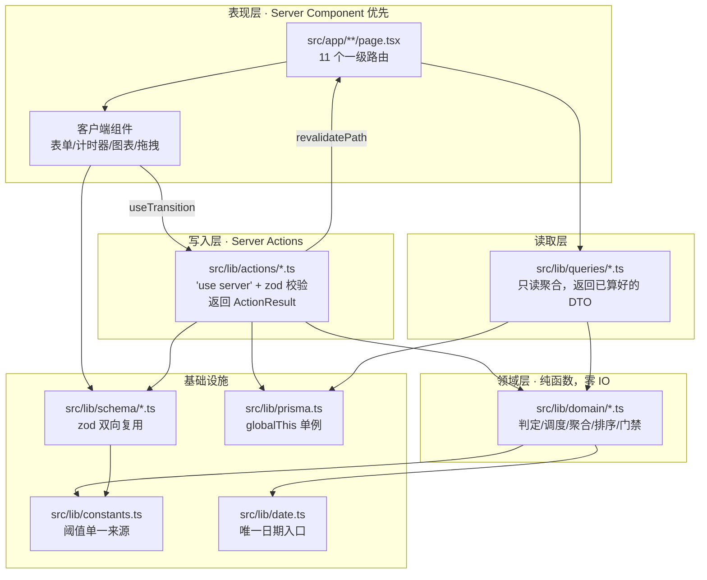
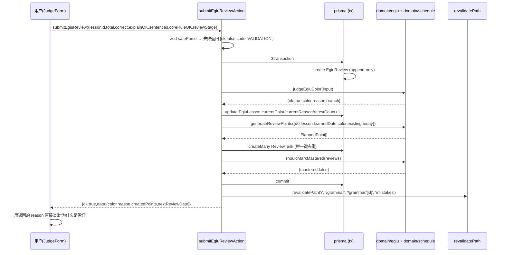

# IELTS Learning OS 技术架构与任务分解

> 版本 v1.0 ｜ 架构师：高见远 ｜ 输入：`docs/00-sop-source.md`、`docs/01-prd.md`
> 本文档是工程师的唯一实现依据。所有阈值来自 PRD §6，不在代码中重新发明。

**阅读顺序建议**：`§0 决策摘要`（先看唯一一处依赖修正）→ `§7 任务列表`（照顺序做）→ 做到哪个任务再回看 `§2/§4/§5` 对应小节。
**关于篇幅**：全文 1074 行，其中 `§2` 的 Prisma schema 全文占 500 行（按要求"完整可编译、不许省略"，且与 `prisma/schema.prisma` 逐字一致，可直接跳过看文件）。**设计正文 574 行**，无重复内容。
关联设计产物：`prisma/schema.prisma`（可直接 `db push`）、`docs/arch-diagram.mermaid`、`docs/sequence-diagram.mermaid`、`docs/class-diagram.mermaid`。

## 0. 决策摘要（含一处对当前依赖树的修正）

| 项 | 决策 | 理由 |
|---|---|---|
| 框架 | Next.js 15 App Router + React 19 + TS | 单进程、Server Component 直连 DB，无 REST 层 |
| 样式 | Tailwind CSS **v3** | v4 的 CSS-first 配置与 PostCSS 插件不兼容既有工程 |
| ORM | Prisma**@6** + SQLite | ⚠️ 当前 `node_modules` 装的是 `@prisma/client@7.10.1`。v7 强制 driver adapter、generator 改为 `prisma-client` 且 `output` 必填、datasource url 迁到 `prisma.config.ts`、CLI 不再自动读 `.env`、`db push` 不再自动 generate、且需整库 ESM。对一个 6 周单人项目是纯负担。**必须降档到 6.x**，命令见 §8 |
| 数据访问 | Server Actions（写）+ `src/lib/queries/*`（只读聚合） | 一个 Route Handler 例外：`/api/export/[kind]` 用于文件下载 |
| 日期 | 业务日期一律 `String` `YYYY-MM-DD`；时刻一律 `DateTime` | SQLite 无 DATE 类型；用字符串彻底消灭时区漂移，且可直接字典序比较/索引 |
| 时区 | 固定 +08:00（`Asia/Singapore` 无 DST） | **不安装 date-fns-tz**，`src/lib/date.ts` 用 UTC 正午锚点做纯字符串运算 |
| 枚举 | 全部 `String` + `src/lib/constants.ts` 常量联合类型 | SQLite 不支持原生 enum；用 zod `z.enum(CONST)` 在边界兜住 |
| JSON 字段 | 全部 `String`（JSON 文本）+ `src/lib/json.ts` 解析 | SQLite/Prisma 不支持标量数组；统一入口避免到处 `JSON.parse` |
| 正确率等派生值 | **不落库**，一律在读模型计算 | 避免生成列与编辑后失效；保证"同一口径只有一处实现" |
| 单测 | vitest 只测 `src/lib/domain/*` 纯函数 | 纯函数不 import prisma，可在毫秒级跑全分支 |

---

## 1. 架构总览



**为什么业务规则必须是纯函数**：PRD §6 有 6 个算法、约 40 个分支，其中三色判定就有 9 组官方案例。若写进 Action（依赖 prisma/SQLite/时间），单测必须建库、跑 seed、mock 时间，成本高到不会有人写。因此：**`domain/` 只接受普通对象、只返回普通对象、不 import `prisma`、不调 `new Date()`（时间由入参传入）**。Action 层职责被压缩为「读库 → 交给 domain → 事务写回 → revalidate」，通常 20–40 行。

**分层职责与禁止事项**

| 层 | 允许 | 禁止 |
|---|---|---|
| `app/**/page.tsx` | 调 `queries/*`、渲染、传 searchParams | 直接 import `prisma`；任何 `new Date()` 业务日期运算；直接算正确率/完成率 |
| `components/*` | 展示、表单交互、`useTransition` 调 action | import `prisma`；`localStorage` 存学习数据；自己判断三色 |
| `lib/actions/*` | `'use server'`、zod `safeParse`、事务、`revalidatePath` | 内联业务阈值（必须从 constants 取）；返回裸 `throw` 给 UI |
| `lib/queries/*` | `prisma.*` 只读、调 domain 聚合、返回 DTO | 写操作；返回 Prisma 原始 model 给 Client Component（会带 `Decimal`/`Date` 序列化问题） |
| `lib/domain/*` | 纯计算 | `import prisma`、`new Date()`、`process.env`、抛异常（用返回值表达错误） |

### 关键调用时序（EGIU 提交复测 → 生成复习点 → 刷新看板）



---

## 2. 数据模型（`prisma/schema.prisma` 全文，可直接编译）

**设计口径**

| 问题 | 方案 |
|---|---|
| 历史不丢失 | `EgiuReview` / `StudySession` / `VocabQuiz(Item)` / `RecordRevision` / `StageTransitionLog` 为 **append-only**：Action 层只 `create`，无 `update`/`delete` 入口。主表（`EgiuLesson.currentColor`、`Mistake.nextReviewAt`、`PlanTask.actualMinutes`）只存**当前态快照**，可在同一事务中由历史重算，故可安全重建 |
| 硬删除 vs 软删除 | 定义型子表（验收项、复测、会话、修订）用 `onDelete: Cascade`：父记录删了它们无独立意义。用户资产（`Resource`/`StudyRecord`/`EgiuLesson`/`Mistake`/`VocabWord`/`SentenceAnalysis`）只做软删除 `archivedAt`；UI 的"删除"= 写 `archivedAt`。`Stage` 对业务数据用 `Restrict`：阶段不可删，只要有数据就阻断 |
| 多态引用 | `ReviewTask.targetType/targetId` 无法建 FK（SQLite 不支持多态 FK），用 `targetLabel` 冗余展示名 + `@@unique([targetType,targetId,intervalCode,dueDate])` 保证调度幂等；完整性由 `scripts/check-integrity.ts`（P2）巡检 |
| 单一 ACTIVE 阶段 | SQLite 无部分唯一索引，在 `transitionStageAction` 事务内先 `updateMany({status:'ACTIVE'} → COMPLETED/SKIPPED)` 再置新阶段 |

```prisma
generator client {
  provider = "prisma-client-js"
}

datasource db {
  provider = "sqlite"
  url      = env("DATABASE_URL")
}

// ── E1 单用户配置（固定 1 行，id 恒为 1）
model UserProfile {
  id                 Int      @id @default(1)
  targetBandOverall  Float    @default(6.5)
  targetBandListen   Float?
  targetBandRead     Float?
  targetBandWrite    Float?
  targetBandSpeak    Float?
  dailyMinutes       Int      @default(240)
  timezone           String   @default("Asia/Singapore")
  examDate           String?
  weeklyReviewDow    Int      @default(0)
  aiEnabled          Boolean  @default(false)
  lastExportedAt     DateTime?
  createdAt          DateTime @default(now())
  updatedAt          DateTime @updatedAt
}

// ── E2 阶段（4 行，seed 写入）
model Stage {
  id          String   @id @default(cuid())
  code        String   @unique // S0_PREP|S1_A0_A2|S2_A2_B1|S3_B1_IELTS
  nameZh      String
  estDaysMin  Int
  estDaysMax  Int?     // null = 「或更久」
  status      String   @default("NOT_STARTED") // NOT_STARTED|ACTIVE|COMPLETED|SKIPPED
  startedAt   String?
  completedAt String?
  sortOrder   Int      @default(0)
  createdAt   DateTime @default(now())
  updatedAt   DateTime @updatedAt

  acceptanceItems StageAcceptanceItem[]
  planTasks       PlanTask[]
  studyRecords    StudyRecord[]
  egiuLessons     EgiuLesson[]
  mistakes        Mistake[]
  sentenceItems   SentenceAnalysis[]

  @@index([status])
  @@index([sortOrder])
}

// ── E3 阶段验收项（每阶段 7 行，seed 写入）
model StageAcceptanceItem {
  id            String   @id @default(cuid())
  stageId       String
  dimension     String // LISTENING|READING|SPEAKING|WRITING|GRAMMAR|VOCAB|SENTENCE
  isRequired    Boolean  @default(true)
  criterionText String // SOP 原文，只读
  myResult      String?
  evidence      String?
  verdict       String   @default("PENDING") // PENDING|PASSED|FAILED
  judgedAt      String?
  sortOrder     Int      @default(0)
  updatedAt     DateTime @updatedAt

  stage Stage @relation(fields: [stageId], references: [id], onDelete: Cascade)

  @@unique([stageId, dimension])
  @@index([stageId])
}

// ── E4 计划任务（含实时计时状态）
model PlanTask {
  id             String  @id @default(cuid())
  stageId        String
  planDate       String // YYYY-MM-DD
  module         String // VOCAB_REVIEW|GRAMMAR|LISTENING|READING|SPEAKING|WRITING|SENTENCE|REVIEW_PLAN|EXTENSIVE|BASELINE_LISTEN|BASELINE_READ|BASELINE_OUTPUT
  skill          String // VOCAB|GRAMMAR|LISTENING|READING|SPEAKING|WRITING|SENTENCE|META|LISTENING_EXT|READING_EXT
  plannedMinutes Int
  actualMinutes  Int     @default(0) // 快照，真值来自 StudySession
  sortOrder      Int     @default(0)
  status         String  @default("TODO") // TODO|IN_PROGRESS|DONE|PARTIAL|MISSED
  statusChangedAt DateTime?
  movedFromDate  String?
  movedToDate    String?
  movedCount     Int     @default(0)
  resourceId     String?
  note           String?

  timerStatus             String    @default("IDLE") // IDLE|RUNNING|PAUSED|STOPPED
  timerStartedAt          DateTime?
  timerAccumulatedSeconds Int       @default(0)
  timerLastActiveAt       DateTime?
  timerVersion            Int       @default(0)

  createdAt DateTime @default(now())
  updatedAt DateTime @updatedAt

  stage    Stage        @relation(fields: [stageId], references: [id], onDelete: Restrict)
  resource Resource?    @relation(fields: [resourceId], references: [id], onDelete: SetNull)
  sessions StudySession[]
  records  StudyRecord[]

  @@index([planDate, sortOrder])
  @@index([stageId])
  @@index([status])
  @@index([timerStatus])
  @@index([resourceId])
}

// ── E5 计时段（append-only；跨零点拆分见下一张表）
model StudySession {
  id               String   @id @default(cuid())
  taskId           String
  startedAt        DateTime
  endedAt          DateTime
  activeMinutes    Int
  idleMinutes      Int      @default(0)
  countRatio       Float    @default(0)
  anomalyFlag      Boolean  @default(false)
  anomalyReason    String?
  terminatedReason String // COMPLETED|PAUSED|ABANDONED|MOVED|TIMEOUT
  sessionDate      String // 占比最大的自然日
  createdAt        DateTime @default(now())

  task      PlanTask              @relation(fields: [taskId], references: [id], onDelete: Cascade)
  daySplits StudySessionDaySplit[]

  @@index([taskId])
  @@index([sessionDate])
}

// 跨零点分钟占比拆分 → 保证「日净时长」不虚高
model StudySessionDaySplit {
  id        String @id @default(cuid())
  sessionId String
  date      String
  minutes   Int

  session StudySession @relation(fields: [sessionId], references: [id], onDelete: Cascade)

  @@unique([sessionId, date])
  @@index([date])
}

// ── E6 学习记录（核心）
model StudyRecord {
  id               String   @id @default(cuid())
  stageId          String
  taskId           String?
  recordDate       String
  skill            String
  resourceId       String?
  chapter          String?
  content          String
  plannedMinutes   Int      @default(0)
  actualMinutes    Int      @default(0)
  status           String   @default("DONE")
  totalQuestions   Int      @default(0)
  correctQuestions Int      @default(0)
  difficulty       String? // EASY|MEDIUM|HARD
  outputText       String?
  problemText      String?
  errorTypes       String? // JSON string[]
  nextReviewDate   String?
  ext              String? // JSON，分科扩展
  createdAt        DateTime @default(now())
  updatedAt        DateTime @updatedAt
  archivedAt       DateTime?

  stage         Stage              @relation(fields: [stageId], references: [id], onDelete: Restrict)
  task          PlanTask?          @relation(fields: [taskId], references: [id], onDelete: SetNull)
  resource      Resource?          @relation(fields: [resourceId], references: [id], onDelete: SetNull)
  mistakes      Mistake[]
  sentenceItems SentenceAnalysis[]
  revisions     RecordRevision[]

  @@index([recordDate])
  @@index([skill, recordDate])
  @@index([stageId])
  @@index([archivedAt])
  @@index([resourceId])
}

// ── P1-03 字段级修订历史（append-only）
model RecordRevision {
  id          String   @id @default(cuid())
  recordId    String
  field       String
  beforeValue String?
  afterValue  String?
  changedAt   DateTime @default(now())

  record StudyRecord @relation(fields: [recordId], references: [id], onDelete: Cascade)

  @@index([recordId, changedAt])
}

// ── E7 EGIU 单元（只存当前态）
model EgiuLesson {
  id               String    @id @default(cuid())
  stageId          String
  resourceId       String?
  book             String    @default("Essential Grammar in Use")
  version          String?
  unitNo           String
  knowledgePoint   String
  currentColor     String    @default("PENDING") // PENDING|GREEN|YELLOW|RED
  currentScore     Float?
  currentReason    String?
  learnedDate      String // D0，复习点起算日
  greenStreak      Int       @default(0)
  masteredAt       DateTime?
  inLowFreqPool    Boolean   @default(false)
  nextReviewDate   String?
  retestCount      Int       @default(0)
  archivedAt       DateTime?
  createdAt        DateTime  @default(now())
  updatedAt        DateTime  @updatedAt

  stage    Stage       @relation(fields: [stageId], references: [id], onDelete: Restrict)
  resource Resource?   @relation(fields: [resourceId], references: [id], onDelete: SetNull)
  reviews  EgiuReview[]

  @@index([stageId])
  @@index([currentColor])
  @@index([nextReviewDate])
  @@index([resourceId, unitNo])
}

// ── E8 复测记录（append-only，禁止覆盖）
model EgiuReview {
  id               String   @id @default(cuid())
  lessonId         String
  reviewDate       String
  reviewStage      String // D0|D1|D3|D7|D14|D21|D30|MANUAL
  totalQuestions   Int
  correctQuestions Int
  explainOk        Boolean
  sentencesCount   Int
  coreRuleOk       Boolean
  judgedColor      String
  judgeReason      String
  judgeBranch      String // ZERO|OVERRIDE|FULL|LOW_VOLUME|INVALID
  score            Float?
  errorBreakdown   String? // JSON {rule_unclear,memory_confusion,careless,vocab}
  reviewTaskId     String?
  createdAt        DateTime @default(now())

  lesson EgiuLesson @relation(fields: [lessonId], references: [id], onDelete: Cascade)

  @@index([lessonId, reviewDate])
  @@index([reviewDate])
}

// ── E9 错题
model Mistake {
  id                 String    @id @default(cuid())
  stageId            String
  sourceType         String // EGIU_REVIEW|STUDY_RECORD|MANUAL|VOCAB
  sourceId           String?
  studyRecordId      String?
  originalQuestion   String
  myAnswer           String?
  correctAnswer      String
  errorReason        String
  knowledgePoint     String
  errorCategory      String // RULE_NOT_UNDERSTOOD|MEMORY_CONFUSION|VOCAB_UNKNOWN|WORD_ORDER|CARELESS|OTHER
  ieltsErrorCategory String? // VOCAB|LOCATING|COMPREHENSION|ATTENTION|STRATEGY（仅 S3）
  reviewCount        Int       @default(0)
  lastReviewAt       String?
  nextReviewAt       String?
  isMastered         Boolean   @default(false)
  archivedAt         DateTime?
  createdAt          DateTime  @default(now())
  updatedAt          DateTime  @updatedAt

  stage       Stage        @relation(fields: [stageId], references: [id], onDelete: Restrict)
  studyRecord StudyRecord? @relation(fields: [studyRecordId], references: [id], onDelete: SetNull)

  @@index([stageId])
  @@index([knowledgePoint])
  @@index([errorCategory])
  @@index([isMastered])
  @@index([nextReviewAt])
}

// ── E10 统一复习调度（唯一入口，4 种 targetType 共用）
model ReviewTask {
  id             String    @id @default(cuid())
  targetType     String // EGIU_LESSON|MISTAKE|VOCAB_WORD|GRAMMAR_POINT
  targetId       String
  targetLabel    String // 冗余展示名，避免多态 join
  knowledgePoint String?
  intervalCode   String // D1|D3|D7|D14|D21|D30|MANUAL|LOW_FREQ_30
  dueDate        String
  status         String    @default("PENDING") // PENDING|DONE|SKIPPED|SUPERSEDED
  estMinutes     Int       @default(5)
  result         String? // PASS|FAIL（DONE 时必填）
  completedAt    DateTime?
  skippedReason  String?
  supersededById String?
  createdAt      DateTime  @default(now())
  updatedAt      DateTime  @updatedAt

  @@unique([targetType, targetId, intervalCode, dueDate])
  @@index([status, dueDate])
  @@index([targetType, targetId])
  @@index([dueDate])
}

// ── E11 词汇
model VocabWord {
  id              String    @id @default(cuid())
  word            String    @unique
  phonetic        String?
  partOfSpeech    String?
  meaningZh       String
  meaningEn       String?
  collocation     String?
  exampleSentence String?
  source          String    @default("MANUAL") // Oxford3000|MANUAL
  learnedDate     String
  mastery         String    @default("RECOGNIZE_ONLY") // RECOGNIZE_ONLY|COMPREHEND|ACTIVE_USE
  lastReviewAt    String?
  nextReviewAt    String?
  isNew           Boolean   @default(true)
  archivedAt      DateTime?
  createdAt       DateTime  @default(now())
  updatedAt       DateTime  @updatedAt

  quizItems VocabQuizItem[]

  @@index([learnedDate])
  @@index([mastery])
  @@index([archivedAt])
  @@index([nextReviewAt])
}

// 随机抽测会话
model VocabQuiz {
  id               String   @id @default(cuid())
  quizDate         String
  sampleSize       Int
  weightedAccuracy Float?
  recommendation   String?
  createdAt        DateTime @default(now())

  items VocabQuizItem[]

  @@index([quizDate])
}

model VocabQuizItem {
  id         String  @id @default(cuid())
  quizId     String
  wordId     String?
  word       String
  selfRating String // RECOGNIZE_ONLY|COMPREHEND|ACTIVE_USE
  weight     Float

  quiz    VocabQuiz  @relation(fields: [quizId], references: [id], onDelete: Cascade)
  wordRef VocabWord? @relation(fields: [wordId], references: [id], onDelete: SetNull)

  @@index([quizId])
}

// ── E12 句子成分
model SentenceAnalysis {
  id             String    @id @default(cuid())
  stageId        String
  sentenceEn     String
  sentenceZh     String?
  tokens         String // JSON [{text,component,pos}]
  isCorrect      Boolean   @default(true)
  errorReason    String?
  patternTag     String? // FIVE_PATTERNS|RELATIVE_CLAUSE|ADVERBIAL_CLAUSE|NON_FINITE|PASSIVE
  sourceRecordId String?
  sentenceDate   String
  archivedAt     DateTime?
  createdAt      DateTime  @default(now())
  updatedAt      DateTime  @updatedAt

  stage        Stage        @relation(fields: [stageId], references: [id], onDelete: Restrict)
  sourceRecord StudyRecord? @relation(fields: [sourceRecordId], references: [id], onDelete: SetNull)

  @@index([stageId])
  @@index([sentenceDate])
}

// ── E13 周复盘
model WeeklyReview {
  id             String    @id @default(cuid())
  isoYear        Int
  isoWeek        Int
  weekStart      String
  weekEnd        String
  metrics        String // JSON：13 项 {auto, override, overriddenAt}
  isPartial      Boolean   @default(false)
  top3Weaknesses String // JSON 固定 3 项
  reviewNote     String?
  exportedAt     DateTime?
  createdAt      DateTime  @default(now())
  updatedAt      DateTime  @updatedAt

  @@unique([isoYear, isoWeek])
  @@index([weekStart])
}

// ── E14 资源库（8 类初始资源由 seed 写入，代码内无枚举）
model Resource {
  id               String    @id @default(cuid())
  name             String
  subject          String // GRAMMAR|VOCAB|PRONUNCIATION|LISTENING|READING|SPEAKING|WRITING|EXAM
  type             String // BOOK|WORDLIST|WEBSITE|AUDIO_SERIES|GRADED_READER|EXAM_PAPER
  applicableStages String    @default("[\"S1\"]") // JSON string[]
  version          String?
  totalUnits       Int?
  currentUnit      Int?
  startDate        String?
  finishDate       String?
  url              String?
  note             String?
  isPrimary        Boolean   @default(false) // SOP「每项能力固定一个主材料」
  archivedAt       DateTime?
  createdAt        DateTime  @default(now())
  updatedAt        DateTime  @updatedAt

  planTasks    PlanTask[]
  studyRecords StudyRecord[]
  egiuLessons  EgiuLesson[]

  @@index([subject])
  @@index([archivedAt])
}

// ── 辅助：阶段流转日志（append-only）
model StageTransitionLog {
  id               String   @id @default(cuid())
  fromStageCode    String?
  toStageCode      String
  decidedAt        DateTime @default(now())
  decidedBy        String // SYSTEM_SUGGESTED|USER
  reason           String
  evidenceSnapshot String? // JSON
}

// ── 辅助：当日总结
model DailySummary {
  id                     String   @id @default(cuid())
  summaryDate            String   @unique
  netMinutes             Int      @default(0)
  completionRateByTime   Float?
  completionRateByCount  Float?
  outputs                String? // JSON
  issues                 String? // JSON
  draftText              String?
  generatedAt            DateTime @default(now())
  updatedAt              DateTime @updatedAt
}

// ── P1-07 AI 建议（与学习成绩物理分区）
model AiSuggestion {
  id        String   @id @default(cuid())
  scope     String // WEEKLY|WEAKNESS|PLAN
  refKey    String?
  status    String   @default("unavailable") // available|unavailable
  title     String
  body      String
  basis     String? // 依据，UI 强制展示
  provider  String?
  createdAt DateTime @default(now())

  @@index([scope, createdAt])
}
```

**SQLite / Prisma 落地注意**

1. 所有 `snake_case` 概念在 Prisma 用 `camelCase` 字段名，仅在导出 CSV/JSON 时映射回 PRD 的 `snake_case`（`src/lib/export/mapping.ts`）。
2. `EgiuLesson` 的 `resourceId` 可空 → SQLite 视 NULL 互不相等，`(resourceId,unitNo)` 非唯一约束；同一教材内 `unitNo` 的唯一性由 `createLessonAction` 在事务内 `count` 校验。
3. 不用 `Decimal`：SQLite 的 Decimal 会返回 `Prisma.Decimal` 对象，传到 Client Component 无法序列化。金额无关，全部 `Float`/`Int` 足够。
4. `db push` 后必须 `prisma generate`（Prisma 6 会自动，但仍显式写进 `package.json` 的 `db:reset` 脚本，防止团队换成 v7 后行为差异踩坑）。

---

## 3. 目录结构与文件清单

```
ielts-learning-os/
├── .env                          DATABASE_URL="file:./dev.db"
├── package.json / tsconfig.json / next.config.ts / postcss.config.mjs / tailwind.config.ts
├── vitest.config.ts
├── prisma/{schema.prisma, seed.ts, dev.db}
├── docs/{00-sop-source.md, 01-prd.md, 02-architecture.md}
└── src/
    ├── app/                      11 个一级路由（见下表）
    ├── components/               layout / ui / charts / dashboard / plan / records / grammar / reviews / mistakes / vocab / sentences / stages / weekly
    └── lib/                      constants / types / date / json / format / prisma / schema / domain / queries / actions / export / backup
```

| 文件 | 职责 | 预估行 |
|---|---|---|
| `src/app/layout.tsx` | 根布局：字体、globals.css、Sidebar+TopBar+MobileNav 外壳、读 UserProfile | 60 |
| `src/app/globals.css` | Tailwind 三指令 + CSS 变量（三色、语义色）、focus 可见、打印样式 | 110 |
| `src/app/page.tsx` `/` | Dashboard：装配 12 区块（P0-13） | 90 |
| `src/app/plan/page.tsx` `/plan` | 计划页：`?view=list\|calendar`，今日任务+计时器+当日总结 | 140 |
| `src/app/records/page.tsx` `/records` | 记录列表 + 筛选 + 新建入口 | 110 |
| `src/app/records/[id]/page.tsx` | 记录详情/编辑 + 修订历史（P1-03） | 120 |
| `src/app/grammar/page.tsx` `/grammar` | EGIU 三色看板 + 新建单元 | 100 |
| `src/app/grammar/[id]/page.tsx` | 单元详情：判定→命中规则→复习计划→复测时间线→掌握度曲线 | 160 |
| `src/app/mistakes/page.tsx` `/mistakes` | `?tab=bank\|queue`：错题库 / 复习队列（今日·逾期·未来7天） | 130 |
| `src/app/vocabulary/page.tsx` `/vocabulary` | 今日新词/复习词进度 + 词表 + 随机抽测 | 130 |
| `src/app/sentences/page.tsx` `/sentences` | 句子列表 + 编辑器（S/V/O/C/Adverbial × 词性） | 120 |
| `src/app/resources/page.tsx` `/resources` | 资源库 CRUD + 进度（P1-01；主入口仍在设置） | 110 |
| `src/app/weekly/page.tsx` `/weekly` | `?tab=review\|history\|analytics`：13 项指标 / 历史周报 / 数据分析 10 图 | 150 |
| `src/app/stages/page.tsx` `/stages` | 时间线 + 7 维度验收清单 + 升级判定区 | 150 |
| `src/app/settings/page.tsx` `/settings` | 目标/时长/资源库/导出备份/AI 预留/免责声明 | 150 |
| `src/app/api/export/[kind]/route.ts` | 唯一 Route Handler：JSON/CSV/周报 Markdown 下载（`Content-Disposition`） | 70 |
| `src/app/{error,not-found,loading}.tsx` | 全局错误态（可重试）/ 404 / 骨架屏 | 40×3 |
| `src/lib/constants.ts` | 全部阈值、模块表、枚举联合类型（§6） | 220 |
| `src/lib/types.ts` | 跨层 DTO、`ActionResult`、领域函数输入输出类型 | 180 |
| `src/lib/date.ts` | 唯一日期入口：`todayStr/addDays/diffDays/startOfWeek/isoWeek/listDateRange/formatMinutes` | 150 |
| `src/lib/json.ts` | `parseJson<T>(s, fallback)` / `stringify(value)` 安全封装 | 40 |
| `src/lib/format.ts` | `formatMinutes('3h 25m')`、`formatPercent(null→'—')`、`formatBand` | 70 |
| `src/lib/prisma.ts` | `globalThis` 单例 + `log:['warn','error']` | 25 |
| `src/lib/schema/*.ts`（8 个） | zod：`plan.ts` `record.ts` `egiu.ts` `reviewTask.ts` `mistake.ts` `vocab.ts` `sentence.ts` `stage.ts` | 60×8 |
| `src/lib/domain/egiu.ts` | 三色判定纯函数（§6.1） | 90 |
| `src/lib/domain/schedule.ts` | 复习点生成/追加/掌握判定/低频池（§6.3） | 170 |
| `src/lib/domain/aggregate.ts` | 加权正确率/完成率/净时长/四项投入/三色分布（§6.6） | 160 |
| `src/lib/domain/session.ts` | 计时净额、异常标记、跨零点拆分 | 110 |
| `src/lib/domain/plan.ts` | 9 模块生成、S0 三任务、增量分配（§6.2） | 170 |
| `src/lib/domain/vocab.ts` | 抽测权重正确率、下周新词量建议 | 70 |
| `src/lib/domain/weakness.ts` | 薄弱点 Top3 排序（§6.5） | 120 |
| `src/lib/domain/stageGate.ts` | H1–H5 硬条件判定（§6.4） | 130 |
| `src/lib/domain/weekly.ts` | 13 项周指标装配（§5.9） | 150 |
| `src/lib/domain/__tests__/*.test.ts`（8 个） | 覆盖 §6 全部分支 + PRD 9 组三色用例 | 80×8 |
| `src/lib/queries/{dashboard,plan,records,egiu,reviews,vocab,sentences,stages,weekly,analytics}.ts` | 只读聚合，返回已算好的 DTO（10 个） | 90×10 |
| `src/lib/actions/{plan,timer,task,records,recordRevision,egiuLesson,egiuReview,reviewTasks,mistakes,vocab,sentences,stages,weekly,settings,resources,export}.ts` | Server Actions（16 个） | 80×16 |
| `src/lib/services/reviewScheduler.ts` | 调度编排：把 domain 结果 + ReviewTask 读写拼在一个事务里（唯一允许 review_task 写入的地方） | 140 |
| `src/lib/export/{json,csv,mapping}.ts` | 全量导出（含 `schema_version`/`exported_at`/校验和）、按表 CSV | 90×3 |
| `src/lib/backup.ts` | 每日备份到 `backups/`，保留 7 份 | 70 |
| `src/components/layout/{Sidebar,TopBar,MobileNav}.tsx` | 导航（桌面左栏常驻 / 移动端底部 5 项 + 抽屉） | 90×3 |
| `src/components/ui/{Card,StatTile,EmptyState,Skeleton,StatusBadge,ColorBadge,ConfirmDialog,Toast,FormField}.tsx` | 原子组件；`ColorBadge` 必须带文字/图标（色盲可达） | 40×9 |
| `src/components/charts/{ChartFrame,LineTrend,BarSimple,PieSplit,ChartDataTable}.tsx` | Recharts 封装；`ChartFrame` 负责 `dynamic(ssr:false)`、空态、`aria-label`、数据表替代 | 70×5 |
| `src/components/dashboard/{StatusStrip,QuantityGrid,TodayCard,WeekCard,SkillInvestment,GrammarVocabCard,ReviewDebtCard,TrendCard,WeaknessCard,GateRing}.tsx` | Dashboard 12 区块（10 个组件，共 12 块） | 60×10 |
| `src/components/plan/{PlanToolbar,TaskList,TaskRow,TimerPanel,TaskStatusMenu,CalendarGrid,DailySummaryCard}.tsx` | 计划页交互（拖拽、就地改时长、状态流转、计时） | 80×7 |
| `src/components/records/{RecordForm,SkillExtFields,RecordTable,RecordFilters,RevisionList}.tsx` | 记录表单（17 通用 + 4 科扩展条件渲染） | 90×5 |
| `src/components/grammar/{LessonBoard,LessonForm,JudgeForm,RuleExplain,RetestTimeline,MasteryCurve}.tsx` | EGIU 看板/判定/解释/曲线 | 80×6 |
| `src/components/reviews/{ReviewQueue,ReviewRow,BatchBar}.tsx` | 复习队列三 Tab + 批量完成/顺延（含二次确认） | 90×3 |
| `src/components/mistakes/{MistakeTable,MistakeForm}.tsx` | 错题库 | 90×2 |
| `src/components/vocab/{TodayPanel,WordTable,QuizRunner,QuizResult}.tsx` | 词汇 | 90×4 |
| `src/components/sentences/{SentenceEditor,TokenTable}.tsx` | 成分标注（两个独立下拉） | 90×2 |
| `src/components/stages/{StageTimeline,AcceptanceTable,GatePanel,TransitionDialog}.tsx` | 阶段验收与升级 | 90×4 |
| `src/components/weekly/{WeeklyMetricsTable,Top3Picker,WeeklyExportBar,AnalyticsBoard,FilterBar,DrillDownPanel}.tsx` | 周复盘 / 数据分析 | 90×6 |

---

## 4. 领域服务接口（`src/lib/domain/`，全部纯函数）

```ts
// ─────────── src/lib/types.ts 公共类型 ───────────
export type EgiuColor = 'PENDING' | 'GREEN' | 'YELLOW' | 'RED';
export type ReviewStatus = 'PENDING' | 'DONE' | 'SKIPPED' | 'SUPERSEDED';
export type IntervalCode = 'D1'|'D3'|'D7'|'D14'|'D21'|'D30'|'MANUAL'|'LOW_FREQ_30';
export type TargetType = 'EGIU_LESSON'|'MISTAKE'|'VOCAB_WORD'|'GRAMMAR_POINT';
export type ModuleId = 'VOCAB_REVIEW'|'GRAMMAR'|'LISTENING'|'READING'|'SPEAKING'
                     |'WRITING'|'SENTENCE'|'REVIEW_PLAN'|'EXTENSIVE'
                     |'BASELINE_LISTEN'|'BASELINE_READ'|'BASELINE_OUTPUT';
export type SkillId = 'VOCAB'|'GRAMMAR'|'LISTENING'|'READING'|'SPEAKING'|'WRITING'
                    |'SENTENCE'|'META'|'LISTENING_EXT'|'READING_EXT';
export type ActionResult<T> =
  | { ok: true; data: T }
  | { ok: false; code: 'VALIDATION'|'NOT_FOUND'|'CONFLICT'|'PRECONDITION'|'INTERNAL';
      error: string; fieldErrors?: Record<string, string> };
```

```ts
// ─────────── domain/egiu.ts（§6.1 逐条对齐）───────────
export interface EgiuJudgeInput {
  total: number; correct: number; explainOK: boolean;
  sentences: number; coreRuleOK: boolean;
}
export interface EgiuJudgment {
  color: EgiuColor; reason: string;
  branch: 'ZERO'|'OVERRIDE'|'FULL'|'LOW_VOLUME';
  score?: number; // 仅 LOW_VOLUME 分支返回 S
}
/** total=0 → PENDING；correct>total → {invalid:true}；分支顺序不可调换 */
export function judgeEgiuColor(input: EgiuJudgeInput):
  | { ok: true; judgment: EgiuJudgment }
  | { ok: false; code: 'CORRECT_GT_TOTAL'|'NEGATIVE_INPUT' };
```
边界：分支顺序 **PENDING → 输入校验 → 硬否决 RED → `total>=5` 正确率档 → `total 1..4` 降权档**。降权档 `S = acc*0.30 + (explainOK?0.40:0) + (sentences>=2?0.30:sentences===1?0.15:0)`；仅当 `explainOK && sentences>=2 && S>=0.85` 才 GREEN。

```ts
// ─────────── domain/schedule.ts（§6.3）───────────
export interface PlannedPoint { intervalCode: IntervalCode; dueDate: string; estMinutes: number; }
export interface ExistingPoint { intervalCode: IntervalCode; dueDate: string; status: ReviewStatus; }

export interface GenerateReviewInput {
  d0: string;                 // 首测日 learnedDate，不是今天
  today: string;              // 由调用方传入，函数内不得 new Date()
  color: EgiuColor;
  totalQuestions: number;     // <5 且判 YELLOW → 追加 MANUAL +2 天补测
  existing: ExistingPoint[];
  estMinutesByInterval?: Partial<Record<IntervalCode, number>>;
}
export function generateReviewPoints(i: GenerateReviewInput): PlannedPoint[];

export interface AppendAfterRetestInput {
  d0: string; today: string;
  retestInterval: IntervalCode;          // 本次做的是哪个点
  result: EgiuColor;                     // 本次复测结果
  existing: ExistingPoint[];
}
export function appendAfterRetest(i: AppendAfterRetestInput): PlannedPoint[];

export interface MasteryInput { reviews: { reviewDate: string; color: EgiuColor }[]; }
/** 连续 2 次 GREEN 且两次间隔 ≥7 天 → mastered */
export function shouldMarkMastered(i: MasteryInput):
  { mastered: boolean; greenStreak: number; anchorGapDays?: number };
export function nextLowFreqDate(lastDate: string): string; // +30 天
```
硬规则：GREEN → `[]`（进 D7 抽测池）；YELLOW → `D1,D3,D7`；RED → `D1,D3,D7,D14`；PENDING → `[]`。**去重**：`existing` 中同 `intervalCode` 且状态为 `PENDING` 的跳过；累计未完成未来点 >4 → 只保留最近的 4 个（其余标 `SUPERSEDED` 由 Action 处理）。**新点落过去**：`dueDate = max(d0+n, today)`（仅对新建点；已存在的逾期点绝不改期）。

```ts
// ─────────── domain/aggregate.ts（§6.6）───────────
export interface AccSample { total: number | null; correct: number | null; recordId?: string; }
/** 加权 Σcorrect/Σtotal；total 为 0/null 的样本剔除；全部剔除 → null（不是 0） */
export function weightedAccuracy(samples: AccSample[]): number | null;

export interface CompletionItem {
  plannedMinutes: number; actualMinutes: number;
  status: 'TODO'|'IN_PROGRESS'|'DONE'|'PARTIAL'|'MISSED';
  movedToDate?: string | null; movedFromDate?: string | null;
}
/** 权重：DONE=1；IN_PROGRESS/PARTIAL=clamp(actual/planned,0,1)；TODO/MISSED=0 */
export function taskWeight(t: CompletionItem): number;
export function completionRate(items: CompletionItem[]): { byTime: number | null; byCount: number | null };
/** byTime = Σ(w×planned)/Σ(planned)；分母 0 → null。周完成率必须先合并分子分母再相除 */

export interface SessionLike {
  activeMinutes: number; plannedMinutes: number;
  startedAt: string; endedAt: string; idleMinutes: number;
}
/** net = active；active > planned×1.5 → 截断并标 anomaly；active < max(3, planned×0.2) → 0 且标 anomaly */
export function sessionNet(s: SessionLike): { netMinutes: number; anomaly: boolean; reason?: string };

export type SkillBucket = 'LISTENING'|'READING'|'SPEAKING'|'WRITING'|'EXTENSIVE'|'VOCAB'|'GRAMMAR'|'SENTENCE';
export function skillMinutes(rows: { skill: SkillId; minutes: number }[]): Record<SkillBucket, number>;
/** EXTENSIVE 独立成桶：LISTENING_EXT/READING_EXT 只进 EXTENSIVE，不并入精练 */

export function colorDistribution(latest: { color: EgiuColor }[]): Record<EgiuColor, number>;
/** 每个 Lesson 只取最新一次判定，故入参必须是"已按 lesson 去重后的最新值" */
export function effectiveOutputRatio(records: { totalQuestions: number; outputText?: string|null;
  recordingUrl?: string|null; mistakeCount?: number; summaryEn?: string|null }[]): number;
```

```ts
// ─────────── domain/session.ts（计时 + 跨零点）───────────
export const IDLE_GAP_MINUTES = 30;
export interface RawSegment { startedAt: string; endedAt: string; }
/** 从计时段推出 active/idle：相邻段间隔 >30min 计入 idle，不计 active */
export function deriveActiveMinutes(segments: RawSegment[], plannedMinutes: number):
  { activeMinutes: number; idleMinutes: number; anomaly: boolean; terminatedReason: 'COMPLETED'|'PAUSED'|'TIMEOUT' };
/** 跨零点拆分：按分钟占比落到两个自然日，Σminutes === activeMinutes */
export function splitAcrossMidnight(startedAt: string, minutes: number):
  { date: string; minutes: number }[];
export function clampCountRatio(activeMinutes: number, plannedMinutes: number): number; // 0..1.5
```

```ts
// ─────────── domain/plan.ts（§6.2）───────────
export interface DailyPlanItem { module: ModuleId; skill: SkillId; minutes: number; sortOrder: number; }
export interface WeakModuleHint { module: ModuleId; weight: number; } // 已把子项映射到父模块
/** 240/270/300 合法；S0 走 3 基线任务（30/30/30=90min）；S1 语法 ≤20% 硬约束 */
export function generateDailyPlan(i: {
  dailyMinutes: number; stageCode: 'S0_PREP'|'S1_A0_A2'|'S2_A2_B1'|'S3_B1_IELTS';
  weakTop3?: WeakModuleHint[];
}): { ok: true; items: DailyPlanItem[]; totalMinutes: number; warnings: string[] }
   | { ok: false; code: 'MINUTES_OUT_OF_RANGE' };
/** 纯增量分配，便于单测：SPEAKING/LISTENING/READING 单科 ≤20，其余 ≤15，REVIEW_PLAN 恒 10 */
export function allocateExtra(extra: number, base: Record<ModuleId, number>,
  weak: WeakModuleHint[], stageCode: string): Record<ModuleId, number>;
```
不变量（必须断言）：`Σminutes === dailyMinutes`；`S1` 时 `GRAMMAR <= dailyMinutes*0.2`；`REVIEW_PLAN === 10`；`sortOrder` 严格等于 SOP 主线下标。

```ts
// ─────────── domain/vocab.ts ───────────
export const MASTERY_WEIGHT = { ACTIVE_USE: 1.0, COMPREHEND: 0.7, RECOGNIZE_ONLY: 0.3 } as const;
export function quizAccuracy(ratings: (keyof typeof MASTERY_WEIGHT)[]): number | null;
export function suggestNewWordCount(lastWeekQuizAccuracy: number | null, current: number):
  { next: number; reason: string }; // <80%→12；≥90%→min(22,current+4)；上限 25
```

```ts
// ─────────── domain/weakness.ts（§6.5）───────────
export interface WeaknessCandidate {
  key: string; name: string; scope: 'SKILL'|'KNOWLEDGE';
  totalQuestions: number; wrongQuestions: number;
  subjectAcc: number | null; dimAcc: number | null;
  plannedMinutes: number; actualMinutes: number;
  reviewTotal: number; reviewOverdue: number;
  unitTotal: number; unitRed: number;
  mainErrorCategory?: string; trendDelta?: number;
}
export interface WeaknessResult {
  key: string; name: string; score: number; evidence: string; actionHint: string;
}
/** 同 key 多来源先去重（各分项取 max，不累加），再按 minQuestions 过滤 */
export function rankWeaknesses(cands: WeaknessCandidate[], opts?: { minQuestions?: number; limit?: number }):
  { ranked: WeaknessResult[]; insufficient: WeaknessResult[] };
```
权重固定 `0.35/0.25/0.15/0.15/0.10`；`investGap = clamp((planned-actual)/planned,0,1)`，`planned=0` 时取 0。样本 `totalQuestions < 10` 进 `insufficient`，不参与排序。

```ts
// ─────────── domain/stageGate.ts（§6.4）───────────
export interface GateInput {
  stageStart: string | null; stageEnd: string | null; today: string;
  acceptance: { dimension: string; isRequired: boolean; verdict: 'PENDING'|'PASSED'|'FAILED';
    myResult: string|null; evidence: string|null; judgedAt: string|null }[];
  reviewTasks: { intervalCode: IntervalCode; status: ReviewStatus; dueDate: string; result: 'PASS'|'FAIL'|null }[];
  days: { date: string; hasPlan: boolean; netMinutes: number }[]; // 近 30 天
  lessons: { currentColor: EgiuColor }[];
}
export interface GateResult {
  suggested: boolean;
  unmet: { code: 'H1'|'H2'|'H3'|'H4'|'H5'; label: string; current: string; target: string }[];
  metrics: { requiredPassed: number; requiredTotal: number; h3Rate: number|null;
             h4Rate: number|null; redLessons: number };
}
export function evaluateStageGate(i: GateInput): GateResult;
```
H1 必验项 = `LISTENING/READING/SPEAKING/WRITING/GRAMMAR` 各 ≥1 项 `PASSED`；H2 每个 `PASSED` 必须有 `myResult` + `evidence` 非空且 `judgedAt` 落在阶段内；H3 = 近 14 天 `D7|D14` 的 `DONE / (DONE+SKIPPED+PENDING)` ≥ 0.8（分母 0 → 视为未满足）；H4 = 近 30 天**有计划的日期**中 `netMinutes>=240` 占比 ≥0.8；H5 = `lessons` 中 `RED` 数量 = 0。**永不自动切换**，函数只返回建议。

```ts
// ─────────── domain/weekly.ts（§5.9 13 项）───────────
export interface WeeklyInput {
  weekStart: string; weekEnd: string; isPartial: boolean;
  dailyNet: { date: string; minutes: number|null }[];
  completion: { plannedMinutes: number; actualMinutes: number; status: string }[];
  listening: { count: number; avgGistScore: number|null };
  reading:   { count: number; avgComprehension: number|null };
  speaking:  { recordingCount: number; recordingMinutes: number };
  writing:   { pieces: number; totalWords: number };
  grammar:   { testedUnits: number; greens: number; yellows: number; reds: number;
               prevGreens: number; prevYellows: number; prevReds: number };
  mistakes:  { created: number; retestPassed: number; topCategory: string|null };
  vocab:     { totalWords: number; newWords: number; quizAccuracy: number|null };
  prevWeek:  { netMinutes: number; accuracy: number|null };
}
export interface WeeklyMetrics { netMinutes: number|null; dailyDistribution: unknown;
  completionRate: unknown; listening: unknown; reading: unknown; speaking: unknown;
  writing: unknown; grammar: unknown; colorDelta: unknown; mistakes: unknown;
  vocab: unknown; topErrorCategory: string|null; weekOverWeek: unknown }
export function buildWeeklyMetrics(i: WeeklyInput): WeeklyMetrics;
```

---

## 5. Server Actions 契约

统一返回 `ActionResult<T>`（§4）。失败一律**返回**而非 throw（Next 15 的 `throw` 会被 error boundary 吞成 500，UI 拿不到可读信息）。每个 action 头部三行固定套路：

```ts
'use server';
export async function xAction(raw: unknown): Promise<ActionResult<DTO>> {
  const parsed = XSchema.safeParse(raw);
  if (!parsed.success) return { ok: false, code: 'VALIDATION', error: '输入不合法',
    fieldErrors: parsed.error.flatten().fieldErrors as Record<string,string> };
  // …读库 → domain → 事务写 → revalidatePath
}
```

| Action | 入参要点（zod） | 返回 | revalidate |
|---|---|---|---|
| `generatePlanAction` | `stageId, planDate: /^\d{4}-\d{2}-\d{2}$/, dailyMinutes: 240\|270\|300` | `{ tasks, totalMinutes }`；当日已有任务 → `CONFLICT` | `/`, `/plan` |
| `createPlanTaskAction` / `updatePlanTaskAction` | `module, skill, plannedMinutes 1..180, sortOrder, resourceId?, note?` | `{ taskId }` | `/plan` |
| `reorderPlanTasksAction` | `planDate, orderedIds: string[]min(1)` | `{ ok: true }`（事务内按数组序重写 `sortOrder`） | `/plan` |
| `startTimerAction` | `taskId, expectedVersion: number` | `{ timerStatus:'RUNNING', timerStartedAt, timerAccumulatedSeconds, timerVersion }` | `/plan` |
| `touchTimerAction` | `taskId, expectedVersion` | `{ timerVersion }`（只刷 `timerLastActiveAt`，不增版本） | — |
| `pauseTimerAction` | `taskId, expectedVersion` | `{ session: {id, activeMinutes, endedAt}, timerStatus:'PAUSED' }` | `/plan`, `/` |
| `finishTaskAction` | `taskId, outcome: DONE\|PARTIAL\|MISSED, actualMinutes?, missReason?` | `{ taskId, status, actualMinutes }` | `/plan`, `/`, `/records` |
| `moveTaskToDateAction` | `taskId, targetDate`；服务端校验 `movedCount<2` | `{ movedToDate }` | `/plan` |
| `patchTaskStatusAction` | `taskId, to: 'TODO'\|'IN_PROGRESS'\|'DONE'\|'PARTIAL'\|'MISSED'`；非法流转 → `PRECONDITION` | `{ status, statusChangedAt }` | `/plan`, `/` |
| `upsertDailySummaryAction` | `summaryDate, draftText?` | `{ summary }` | `/plan` |
| `createStudyRecordAction` | 17 通用 + `ext` 按 skill 判别联合；`.refine(v=>!!v.outputText?.trim() || !!v.problemText?.trim())`（G2） | `{ recordId }` | `/records`, `/`, `/weekly` |
| `updateStudyRecordAction` | `id` + 同上；事务内写 `RecordRevision`（每字段一行 diff） | `{ recordId }` | `/records`, `/records/[id]` |
| `archiveStudyRecordAction` | `id` | `{ ok: true }`（软删，写 `archivedAt`） | `/records` |
| `createEgiuLessonAction` | `stageId 仅 S1/S2, unitNo, knowledgePoint, learnedDate, resourceId?` | `{ lessonId }` | `/grammar` |
| `submitEgiuReviewAction` | `lessonId, reviewDate, reviewStage, total>=0, correct>=0, explainOK, sentences 0..20, coreRuleOK`；服务端再校 `correct<=total` | `{ color, reason, branch, createdPoints, nextReviewDate }` | `/`, `/grammar`, `/grammar/[id]`, `/mistakes` |
| `completeReviewTaskAction` | `taskId, result: PASS\|FAIL` | `{ task, appendedPoints }` | `/`, `/mistakes`, `/grammar/[id]` |
| `skipReviewTaskAction` / `postponeReviewTaskAction` | `taskId, reason min 2` / `taskId, toDate` | `{ taskId, status }` / `{ taskId, dueDate }` | `/`, `/mistakes` |
| `batchReviewTasksAction` | `ids min 1 max 200, op: 'COMPLETE_PASS'\|'POSTPONE', toDate?` | `{ affected }` | `/`, `/mistakes` |
| `createMistakeAction` | `sourceType, sourceId?, originalQuestion, correctAnswer, errorCategory, knowledgePoint, errorReason` | `{ mistakeId, firstReviewDate }`（同步插 D1） | `/mistakes`, `/` |
| `masterMistakeAction` | `mistakeId, isMastered` | `{ mistakeId }`（置 true 同时 `SUPERSEDED` 未来 PENDING 点） | `/mistakes` |
| `upsertVocabWordAction` | `word, meaningZh, mastery, learnedDate, source` | `{ wordId, firstReviewDate }` | `/vocabulary` |
| `submitVocabQuizAction` | `quizDate, items: {wordId, word, selfRating}[] min 1 max 120` | `{ quizId, weightedAccuracy, recommendation }` | `/vocabulary`, `/weekly` |
| `upsertSentenceAction` | `sentenceEn, tokens [{text,component,pos}] min 1`，`.refine` 校验 component ∈ {S,V,O,C,ADVERBIAL} 且 pos 不与之重叠 | `{ sentenceId }` | `/sentences` |
| `updateAcceptanceItemAction` | `itemId, myResult?, evidence?, verdict, judgedAt?`；`verdict!=='PENDING'` 时 myResult+evidence 必填（H2 前置） | `{ item }` | `/stages` |
| `evaluateGateAction` | `stageId` | `GateResult`（只读，不改库） | `/stages`, `/` |
| `transitionStageAction` | `toStageId, reason min 10`（PRD 硬要求） | `{ logId }`；先 `updateMany` 清 ACTIVE 再置新 | `/`, `/stages` |
| `saveWeeklyReviewAction` | `isoYear, isoWeek, top3: 恰好 3 项, overrides?` | `{ reviewId }` | `/weekly` |
| `updateProfileAction` | `dailyMinutes 240..300, targetBand* 0.5 步进, weeklyReviewDow 0..6, examDate?` | `{ profile }` | `/`, `/settings`, `/plan` |
| `upsertResourceAction` / `archiveResourceAction` | 资源字段 / `id` | `{ resourceId }` | `/settings`, `/resources`, `/records`, `/plan` |

**幂等与并发（计时器）**：`startTimerAction` 首行 `if (task.timerStatus === 'RUNNING' && task.timerVersion === expectedVersion) return { ok:true, ...当前状态 }`——**同一请求重放返回同一结果，不新建 session**；若版本不匹配返回 `CONFLICT` 并携权威状态，客户端以服务端状态覆盖本地（多标签页自动收敛）。`pauseTimerAction` 在事务内以 `updateMany({ where: { id, timerVersion: expectedVersion } })` 做 CAS，`count===0` 即 `CONFLICT`，**这是防双计时/双 session 的唯一正确写法**。

---

## 6. 共享常量（`src/lib/constants.ts` 键名清单）

| 分组 | 键 |
|---|---|
| 模块 | `MODULE_ORDER`（SOP 主线 9 项排序）、`MODULE_META: Record<ModuleId,{labelZh,skill,defaultMinutes,canExtend}>`、`S0_MODULES` |
| 科目 | `SKILL_IDS`、`SKILL_LABEL_ZH`、`SKILL_BUCKET: Record<SkillId,SkillBucket>` |
| 阶段 | `STAGE_CODES`、`STAGE_META`（`nameZh`/`estDaysMin`/`estDaysMax`/`allowedEgiu`） |
| 时长 | `DAILY_MINUTES_PRESETS=[240,270,300]`、`GRAMMAR_CAP_RATIO=0.2`、`EXTRA_CAP_SKILL=20`、`EXTRA_CAP_DEFAULT=15`、`REVIEW_PLAN_FIXED=10`、`REVIEW_LOAD_WARN_RATIO=0.25` |
| 三色 | `EGIU_COLORS`、`FULL_VOLUME_MIN_QUESTIONS=5`、`GREEN_ACC=0.9`、`YELLOW_ACC=0.7`、`LOW_VOLUME_W={ACC:0.3,EXPLAIN:0.4,SENTENCE:0.3}`、`LOW_VOLUME_PASS=0.85`、`LOW_VOLUME_MIN_SENTENCES=2` |
| 复习 | `REVIEW_INTERVAL_DAYS={D1:1,D3:3,D7:7,D14:14,D21:21,D30:30,LOW_FREQ_30:30}`、`COLOR_INTERVALS={GREEN:[],YELLOW:['D1','D3','D7'],RED:['D1','D3','D7','D14'],PENDING:[]}`、`LOW_VOLUME_RETEST_OFFSET=2`、`MAX_PENDING_POINTS=4`、`MASTERY_GREEN_STREAK=2`、`MASTERY_MIN_GAP_DAYS=7`、`LOW_FREQ_INTERVAL_DAYS=30`、`EST_MINUTES_BY_INTERVAL` |
| 聚合 | `NET_MAX_RATIO=1.5`、`NET_MIN_MINUTES=3`、`NET_MIN_RATIO=0.2`、`IDLE_GAP_MINUTES=30`、`NEXT_DAY_ABANDON_HOUR=24` |
| 薄弱点 | `WEAKNESS_WEIGHTS={ERR:0.35,ACC_GAP:0.25,INVEST_GAP:0.15,REVIEW_DEBT:0.15,RED_DENSITY:0.10}`、`WEAKNESS_WINDOW_DAYS=28`、`WEAKNESS_MIN_QUESTIONS=10`、`WEAKNESS_TOP_N=3` |
| 阶段门 | `GATE_H3_WINDOW_DAYS=14`、`GATE_H3_MIN_RATE=0.8`、`GATE_H4_WINDOW_DAYS=30`、`GATE_H4_MIN_MINUTES=240`、`GATE_H4_MIN_RATE=0.8`、`REQUIRED_DIMENSIONS` |
| 词汇 | `MASTERY_LEVELS`、`MASTERY_WEIGHT`、`VOCAB_NEW_DEFAULT=18`、`VOCAB_NEW_MIN=15`、`VOCAB_NEW_MAX=25`、`VOCAB_NEW_DOWN=12`、`VOCAB_NEW_UP=22`、`QUIZ_SIZE={MIN:50,MAX:100}`、`QUIZ_PASS=0.8` |
| 错题 | `ERROR_CATEGORIES`（6）、`IELTS_ERROR_CATEGORIES`（5）、`SENTENCE_COMPONENTS`（5）、`PARTS_OF_SPEECH`（7）、`PATTERN_TAGS` |
| 状态 | `TASK_STATUSES`、`TASK_STATUS_LABEL_ZH`、`TASK_TRANSITIONS`（合法流转白名单）、`REVIEW_STATUSES`、`TARGET_TYPES`、`VERDICTS`、`TRANSITION_DECIDED_BY` |
| 系统 | `TZ_OFFSET_MINUTES=480`、`TZ_NAME='Asia/Singapore'`、`SCHEMA_VERSION=1`、`BACKUP_KEEP=7`、`DISCLAIMER_CEFR`、`DISCLAIMER_BAND` |

**原则**：任何数字在 `domain/`、`actions/`、页面中都不得出现字面量；`grep -rn "[^0-9]\(240\|0\.9\|0\.7\|0\.35\)" src/lib src/app` 应为空（测试文件除外）。

---

## 7. 任务列表（35 条，四阶段，顺序即可运行）

> 每个任务结束时 `npm run dev` 必须能起、`npm test` 必须绿。带 🔒 的是"不可跳过"的地基任务。

### 阶段 A · 基础框架（T01–T11，11 条）

| ID | 任务 | 涉及文件 | 依赖 | 验收 |
|---|---|---|---|---|
| T01 | 脚手架与构建配置（含把 Prisma 降到 6） | `package.json` `next.config.ts` `tsconfig.json` `postcss.config.mjs` `tailwind.config.ts` | — | `npm run dev` 出默认页；`npx prisma -v` 显示 6.x |
| T02 | 🔒 全局样式与根布局外壳 | `src/app/globals.css` `src/app/layout.tsx` `src/app/error.tsx` `src/app/loading.tsx` | T01 | 三色 CSS 变量可见；任意页面报错显示可重试错误态 |
| T03 | 🔒 常量与类型中心 | `src/lib/constants.ts` `src/lib/types.ts` | T01 | `tsc --noEmit` 通过；常量表与 PRD §6 逐条对照无缺失 |
| T04 | 🔒 日期/JSON/格式化工具 | `src/lib/date.ts` `src/lib/json.ts` `src/lib/format.ts` | T03 | 单测：`addDays('2025-03-31',1)='2025-04-01'`；跨年 `isoWeek` 正确；`formatMinutes(205)='3h 25m'` |
| T05 | 🔒 数据模型与种子 | `prisma/schema.prisma` `src/lib/prisma.ts` `prisma/seed.ts` | T03 | `prisma db push` 成功；`npm run db:seed` 后有 4 阶段+28 验收项+8 资源+1 用户 |
| T06 | 🔒 三色判定 + 复习调度纯函数 | `src/lib/domain/egiu.ts` `src/lib/domain/schedule.ts` `__tests__/egiu.test.ts` `__tests__/schedule.test.ts` | T04,T05 | PRD §6.1 的 9 组用例全过；YELLOW 出 3 点、RED 出 4 点；`total<5` 出 MANUAL+2 |
| T07 | 🔒 聚合口径 + 计时纯函数 | `src/lib/domain/aggregate.ts` `src/lib/domain/session.ts` `__tests__/aggregate.test.ts` `__tests__/session.test.ts` | T04,T05 | `[{9,10},{0,0},{1,2}]`→`10/12`；`total=0` 全剔除→`null`；跨零点拆分 `Σ===active` |
| T08 | 计划生成 + 词汇权重纯函数 | `src/lib/domain/plan.ts` `src/lib/domain/vocab.ts` `__tests__/plan.test.ts` `__tests__/vocab.test.ts` | T06 | 240min 生成 9 项合计 240；300min 合计 300 且 S1 语法 ≤60；S0 只 3 项共 90 |
| T09 | 薄弱点/阶段门/周复盘纯函数 | `src/lib/domain/weakness.ts` `src/lib/domain/stageGate.ts` `src/lib/domain/weekly.ts` `__tests__/gate.test.ts` | T07 | H1–H5 各造 1 个不满足用例；`total<10` 进 `insufficient`；13 项 key 齐全 |
| T10 | UI 基础原子 | `src/components/ui/{Card,StatTile,EmptyState,Skeleton}.tsx` | T02,T03 | 四组件可渲染；`EmptyState` 支持「说明依赖 + 直达创建」双 CTA |
| T11 | 状态徽章/确认框/轻提示 | `src/components/ui/{StatusBadge,ColorBadge,ConfirmDialog,Toast,FormField}.tsx` | T10 | `ColorBadge` 带文字+图标（色盲可达）；删除类操作必经 `ConfirmDialog` |

### 阶段 B · 核心业务闭环（T12–T20，9 条）

| ID | 任务 | 涉及文件 | 依赖 | 验收 |
|---|---|---|---|---|
| T12 | 应用外壳与导航 | `src/components/layout/{Sidebar,TopBar,MobileNav}.tsx` + `layout.tsx` 接入 | T11 | 11 项一级导航可用；<600px 底部 5 项 + 抽屉 |
| T13 | 🔒 计划查询层与生成 Action | `src/lib/queries/plan.ts` `src/lib/schema/plan.ts` `src/lib/actions/plan.ts` | T08 | 生成当日计划落库 9 行；重复生成返回 `CONFLICT` 不产生重复 |
| T14 | 计划页列表视图 + 调序 + 改时长 | `src/app/plan/page.tsx` `components/plan/{PlanToolbar,TaskList,TaskRow}.tsx` | T13 | 拖拽后刷新顺序不变；改时长即时落库；语法超 20% 有提示 |
| T15 | 🔒 计时器（服务端权威 + CAS） | `src/lib/actions/timer.ts` `src/components/plan/{TimerPanel,TimerBadge}.tsx` | T14,T07 | 刷新/双标签页不重复计时；暂停生成 1 条 `StudySession`+`DaySplit`；中断 >30min 提示三选一 |
| T16 | 任务状态流转/顺延/当日总结 | `src/lib/actions/task.ts` `src/components/plan/{TaskStatusMenu,DailySummaryCard}.tsx` | T15 | `DONE→TODO` 被拒（`PRECONDITION`）；顺延 2 次后提示；24:00 后未结束置 `MISSED` |
| T17 | 🔒 记录表单与四科扩展 | `src/lib/schema/record.ts` `src/lib/actions/records.ts` `src/components/records/{RecordForm,SkillExtFields}.tsx` | T12 | 4 科各建 1 条，`ext` 按科目渲染并落库；产出/问题都空时保存被拒（G2）；正确率实时算且 `total=0` 显示「无题量数据」 |
| T18 | 记录列表/详情/修订历史 | `src/app/records/page.tsx` `src/app/records/[id]/page.tsx` `src/components/records/{RecordTable,RecordFilters,RevisionList}.tsx` `src/lib/actions/recordRevision.ts` | T17 | 编辑后 `created_at` 不变、可查最近 10 次字段前后值 |
| T19 | 资源库 CRUD 与进度 | `src/app/resources/page.tsx` `src/lib/actions/resources.ts` `src/components/resources/{ResourceTable,ResourceForm}.tsx` | T12 | 新增资源不重启即出现在记录表单下拉；代码中 grep 不到资源名字面量 |
| T20 | 系统设置 + 导出下载 | `src/app/settings/page.tsx` `src/lib/actions/settings.ts` `src/lib/export/{json,csv,mapping}.ts` `src/app/api/export/[kind]/route.ts` | T18,T19 | JSON 含 `schema_version`/`exported_at`/条数；CSV 按表下载；时区字段只读 |

### 阶段 C · 学习诊断（T21–T28，8 条）

| ID | 任务 | 涉及文件 | 依赖 | 验收 |
|---|---|---|---|---|
| T21 | EGIU 看板与单元创建 | `src/app/grammar/page.tsx` `src/lib/actions/egiuLesson.ts` `src/components/grammar/{LessonBoard,LessonForm}.tsx` | T13 | 四列（GREEN/YELLOW/RED/PENDING）计数 = 最新判定去重 |
| T22 | 🔒 三色判定提交 + 复习点落库 | `src/lib/actions/egiuReview.ts` `src/lib/services/reviewScheduler.ts` `src/components/grammar/{JudgeForm,RuleExplain}.tsx` | T21,T06 | 提交后 UI 显示服务端返回的 `reason`（不前端重算）；黄灯生成 D1/D3/D7 三条 `ReviewTask`；重复提交同输入不产生重复点（唯一键） |
| T23 | 单元详情 + 复测时间线 + 掌握度曲线 | `src/app/grammar/[id]/page.tsx` `src/lib/queries/egiu.ts` `src/components/grammar/{RetestTimeline,MasteryCurve}.tsx` | T22 | 历史复测不被覆盖；曲线用 `EgiuReview` 全量；曲线为空时显示空态 |
| T24 | 错题库 | `src/app/mistakes/page.tsx` `src/lib/actions/mistakes.ts` `src/components/mistakes/{MistakeTable,MistakeForm}.tsx` | T17 | 从记录/EGIU 一键生成错题；自动排 D1；7 类错误筛选；`is_mastered` 置真后不再排程 |
| T25 | 复习队列三 Tab + 批量操作 | `src/lib/queries/reviews.ts` `src/lib/actions/reviewTasks.ts` `src/components/reviews/{ReviewQueue,ReviewRow,BatchBar}.tsx` | T22,T24 | 逾期点显示 `overdue_days` 且不消失；未通过按 §6.3 追加；批量有二次确认 |
| T26 | 词汇管理 + 随机抽测 | `src/app/vocabulary/page.tsx` `src/lib/actions/vocab.ts` `src/components/vocab/{TodayPanel,WordTable,QuizRunner}.tsx` | T12 | 三档不可跳过、分列统计；抽测 50–100 词输出加权正确率；<80% 给出下调建议 |
| T27 | 句子成分分析 | `src/app/sentences/page.tsx` `src/lib/actions/sentences.ts` `src/components/sentences/{SentenceEditor,TokenTable}.tsx` | T12 | 成分/词性两个独立下拉、取值不重叠；按阶段过滤重点标签；错误原因在 `isCorrect=false` 时必填 |
| T28 | 阶段验收与升级判定 | `src/app/stages/page.tsx` `src/lib/actions/stages.ts` `src/components/stages/{StageTimeline,AcceptanceTable,GatePanel}.tsx` | T09,T17 | 不受条件满足时按钮禁用并列出未满足项（H1–H5）；手动升级原因 <10 字被拒；阶段名带「训练区间」且含免责声明 |

### 阶段 D · 学习分析（T29–T35，7 条）

| ID | 任务 | 涉及文件 | 依赖 | 验收 |
|---|---|---|---|---|
| T29 | 🔒 图表基础设施（SSR 安全） | `src/components/charts/{ChartFrame,LineTrend,BarSimple,PieSplit,ChartDataTable}.tsx` | T11 | `ChartFrame` 用 `dynamic(ssr:false)`；`aria-label`+数据表替代；空态不出零值折线 |
| T30 | 聚合查询层与 Dashboard 装配 | `src/lib/queries/{dashboard,analytics}.ts` `src/lib/domain/dashboardMap.ts` | T07,T09,T28 | 单次装配 ≤500ms；每块数据可下钻到 `recordId` |
| T31 | Dashboard 前 5 块 | `src/app/page.tsx` `src/components/dashboard/{StatusStrip,QuantityGrid,TodayCard}.tsx` | T30,T15 | 12 区块齐；四类量分区不混排；今日完成率=按时长加权且副指标为任务数 |
| T32 | Dashboard 后 7 块 | `src/components/dashboard/{WeekCard,SkillInvestment,GrammarVocabCard,ReviewDebtCard,TrendCard,WeaknessCard,GateRing}.tsx` | T31 | 7 天趋势空缺日断点不补 0；Top3 必带「错 X/Y·类别·趋势」；无数据显示「需 ≥2 天」 |
| T33 | 每周复盘 13 项 + Top3 选定 | `src/app/weekly/page.tsx` `src/lib/actions/weekly.ts` `src/components/weekly/{WeeklyMetricsTable,Top3Picker,WeeklyExportBar}.tsx` | T30,T09 | 13 项自动填充可覆盖且留痕；Top3 必须选满 3；空周可导出并标「本周无有效记录」 |
| T34 | 数据分析 10 图 + 筛选 + 下钻 | `src/components/weekly/{AnalyticsBoard,FilterBar,DrillDownPanel}.tsx` + `weekly/page.tsx` 接入 | T29,T33 | 10 图齐全；改筛选全量重算；`total=0` 显示「暂无数据」 |
| T35 | 打磨：空/错/加载态 · 响应式 · 备份 · 冒烟 | `src/lib/backup.ts` `src/app/not-found.tsx` `components/ui/ErrorState.tsx` `docs/smoke-checklist.md` | T32,T34 | 3 断点无横向溢出；每日备份保留 7 份；11 页空态均有直达创建入口；S1–S6 场景手工走查通过 |

**并行提示**：T19/T26/T27 三者互不依赖，可并行；T29 完成后 T34 才能做；T30 是全站聚合枢纽，不要与其他任务同时改。

---

## 8. 依赖包清单与安装命令

```bash
# 0) 关键修正：把 Prisma 降档到 6.x（当前 node_modules 是 7.10.1）
npm i @prisma/client@6
npm i -D prisma@6

# 1) 开发依赖
npm i -D typescript @types/node @types/react @types/react-dom \
         tailwindcss@3 postcss autoprefixer \
         tsx vitest eslint eslint-config-next

# 2) 运行时依赖（拖拽调序，纯 JS，无原生编译）
npm i @dnd-kit/core @dnd-kit/sortable

# 3) 脚本
npm pkg set scripts.dev="next dev" scripts.build="next build" scripts.start="next start" \
  scripts.test="vitest run" scripts.test:watch="vitest" \
  scripts.db:push="prisma db push" scripts.db:generate="prisma generate" \
  scripts.db:seed="tsx prisma/seed.ts" \
  scripts.db:reset="rm -f prisma/dev.db && prisma db push && prisma generate && tsx prisma/seed.ts"

# 4) 建库与种子
printf 'DATABASE_URL="file:./dev.db"\n' > .env
npm run db:push && npm run db:seed
```

**不需要**：`date-fns-tz`（固定 +8 用 `src/lib/date.ts` 自建）、`zod` 已装、`recharts` 已装、`clsx` 已装、`lucide-react` 已装。
⚠️ 当前 `lucide-react` 解析到 `^1.70.0`，与上游命名可能不一致；若 `import { Play } from 'lucide-react'` 报错，改为 `import Play from 'lucide-react/dist/esm/icons/play'` 或临时内联 SVG——不影响任何业务逻辑。

---

## 9. 风险与对策

| 风险 | 对策（一句） |
|---|---|
| SQLite 并发写 `SQLITE_BUSY` | 单进程单用户，Prisma 默认单连接；所有多表写必须进 `prisma.$transaction`，事务体内**禁止** `await fetch`/耗时计算（先算完再开事务） |
| Next 15 hot reload 连接泄漏 | `src/lib/prisma.ts` 用 `const g = globalThis as { prisma?: PrismaClient }; export const prisma = g.prisma ?? new PrismaClient(); if (process.env.NODE_ENV !== 'production') g.prisma = prisma;` |
| Client/Server 边界 | `domain/` 与 `queries/` 只被 Server 引用；需在客户端复用的只有 `constants.ts`（纯常量）与 `schema/*.ts`（zod，无 Node API）；Prisma model 一律不出 Server（queries 返回手写 DTO） |
| 时区漂移 | 日期只用 `YYYY-MM-DD` 字符串 + `src/lib/date.ts`；`toUtcInstant` 固定 `+08:00`；禁止在组件/action 中 `new Date().getDate()` |
| 跨零点计时 | 只由 `splitAcrossMidnight` 产出 `StudySessionDaySplit`，日净时长一律从 split 表求和，绝不从 `sessionDate` 单值推算 |
| Recharts SSR 报错 | 所有图表经 `ChartFrame`，内部 `dynamic(() => import('./LineTrend'), { ssr: false })`，并给 `Suspense` 骨架 |
| Prisma 7 误升级 | `package.json` 锁 `"prisma": "^6.16.0"` / `"@prisma/client": "^6.16.0"`，并在 README 写明「不要 `npm update prisma`」 |
| 派生值落库后失效 | 正确率/完成率/净时长**不落库**；`PlanTask.actualMinutes`、`EgiuLesson.currentColor` 只是快照，必须与历史同事务写入，且可由历史全量重算（`scripts/rebuild-snapshots.ts`，P2） |
| 算法退化成"谁练得少就补谁" | `investGap` 权重锁死 0.15 且 `planned=0` 取 0；代码评审时检查权重未被调高 |
| 空库出零值曲线 | 所有图表入参为空数组时走 `EmptyState`；`weightedAccuracy` 返回 `null` 而非 0，UI 显示 `—` |

---

## 10. 待明确事项（问题 + 已定方案，不留空）

| # | 问题 | 已定方案 |
|---|---|---|
| 1 | PRD 有「数据分析」一级页，但导航固定 11 项且已占满 | 数据分析作为 `/weekly?tab=analytics` 的 Tab，`weekly/page.tsx` 按 `searchParams.tab` 分派（服务端渲染，无客户端路由状态） |
| 2 | 「资源库」在 PRD 是设置二级页，但仍是独立能力 | 保留 `/resources` 一级路由做全量 CRUD；`/settings` 内嵌同一 `ResourceTable` 组件复用，两处不重复实现 |
| 3 | `ReviewTask` 多态无法建外键 | 用 `targetLabel` 冗余展示名 + 唯一键 `(targetType,targetId,intervalCode,dueDate)`；P2 加 `scripts/check-integrity.ts` 巡检孤儿 |
| 4 | 「同一知识点最多 4 个未完成未来点」如何执行 | `reviewScheduler.ts` 内统一处理：排序后超出部分置 `SUPERSEDED` 并写 `supersededById`，不删除 |
| 5 | 新建复习点的 `dueDate` 落在过去怎么办 | `dueDate = max(d0+n, today)`；**已存在**的逾期点绝不改期（PRD §6.3 边界 2） |
| 6 | `@dbgenerated` 生成列（PRD 提到 `accuracy`/`overdue_days` 为生成列） | SQLite + Prisma 不稳定支持，改为读模型计算：`accuracy` 由 `weightedAccuracy` 出，`overdueDays` 由 `diffDays(dueDate, today)` 出 |
| 7 | 24:00 自动置 `MISSED` 谁来触发 | 不引入 cron：`queries/plan.ts` 在每次读取当日/历史计划前先执行 `sweepStaleTasks()`（幂等 `updateMany`，把 `planDate < today` 且 `status ∈ {TODO,IN_PROGRESS}` 置 `MISSED`），单用户场景足够 |
| 8 | 每日备份如何触发 | Layout 挂载时读 `UserProfile.lastExportedAt`；备份动作在 `dailySummary` 生成后调用 `backup.ts`（幂等：当日文件已存在则跳过），不依赖外部调度 |
| 9 | Prisma 版本 | 锁 6.x（理由见 §0）。若未来必须升 7，需同步改：`prisma.config.ts`、`provider="prisma-client"`+`output`、`@prisma/adapter-better-sqlite3`、`"type":"module"`，共 4 处 |
| 10 | 阶段 `S0` 是否用 EGIU 判定 | 不用。`createEgiuLessonAction` 仅接受 `stageCode ∈ {S1_A0_A2, S2_A2_B1}`，S0/S3 传入返回 `PRECONDITION` |
