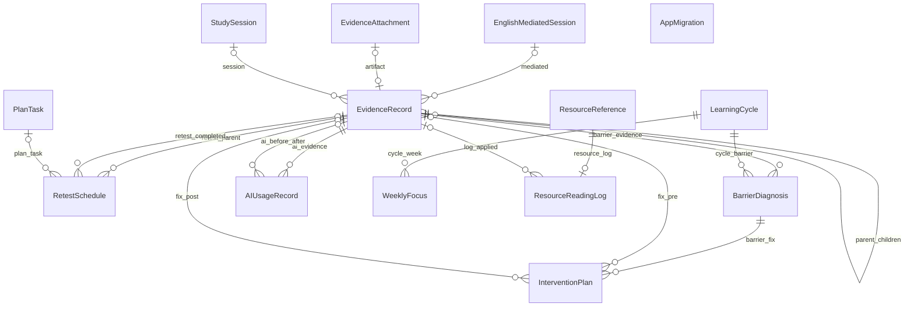

# v2.2 证据驱动学习域 ER 图

图型：ER 图（实体关系）。范围：v2.2 新增的 11 张表，以及与 v2.1 既有表的连接点（`PlanTask`、`EnglishMediatedSession`、`StudySession`）。

一句话说明：证据是原始样本，复测是按时间排出的独立验证，障碍与修复挂在证据上，周期只做阶段门禁；所有「能力判断」都必须能沿箭头追回具体 `EvidenceRecord`。

关键假设：

- `EvidenceRecord.parentEvidenceId` 表示版本链的上一版；`chainRootId` 是冗余的链根，便于整链查询。
- `RetestSchedule` 与 `ReviewTask`（知识型复习）是两套独立队列，本图不画 `ReviewTask`。
- 一个 90 天周期内同一时间只允许一个「当前聚焦」障碍（`selectedFocus`），由应用层约束，数据库不建唯一索引。
- `AIUsageRecord` 记录的是「哪次辅助」，A4（代写/代答）永远不计独立产出，这一口径在纯函数里判定，不落库。
- `AppMigration` 只由版本化迁移脚本写入，业务代码只读。

## 读图要点

1. **证据链**：`BASELINE → ASSISTED（可选）→ IMMEDIATE_RETEST → DELAYED_RETEST → APPLIED_TASK → TRANSFER`，父指针逐级衔接；`chainRootId` 让整链一次查出。
2. **复测与计划**：`RetestSchedule.planTaskId` 表示这条复测已经被某天的计划占过时间，避免重复计入预算；重排时若该任务被 DEFER，应用层会在同一事务内解除关联并重新排入。
3. **画像**：`SkillProfile` 只存方向与置信度，证据依据是可点击的 `EvidenceRecord` ID 列表，不存「平均分」。
4. **障碍与修复**：修复完成（`DONE`）必须挂 `postEvidenceId`；没有后测样本就不能宣称障碍已解决。
5. **AI 边界**：`AIUsageRecord.assistanceLevel` 为 `A4` 时永远不计独立产出，统计只用于提醒依赖比例。
6. **迁移**：`AppMigration` 是版本闸门，重复执行同一版本必须 checksum 一致，否则拒绝运行。

## 字段速查（约束来自 schema.prisma）

| 表 | 关键字段 | 约束 / 取值 |
| --- | --- | --- |
| `EvidenceRecord` | `skill`、`evidenceType`、`level`、`parentEvidenceId`、`chainRootId`、`conditionJson`、`outputText`、`score`、`assistanceLevel`、`confidence`、`privacyLevel` | `score` 为 0–2，只有 `assistanceLevel = A0` 允许 2；`evidenceType` 六种：`BASELINE / ASSISTED / IMMEDIATE_RETEST / DELAYED_RETEST / APPLIED_TASK / TRANSFER` |
| `EvidenceAttachment` | `fileUri`、`mimeType`、`sizeBytes`、`checksum`、`privacyLevel`、`consentStatus` | 只存文件元数据，不存二进制；`privacyLevel` 默认 `PRIVATE`，`consentStatus` 默认 `NOT_REQUIRED` |
| `RetestSchedule` | `parentEvidenceId`、`retestType`、`dueDate`、`status`、`estMinutes`、`completedEvidenceId`、`planTaskId`、`idempotencyKey` | 幂等键 = `父证据ID:类型:到期日`，全表唯一；`status`：`PENDING / DONE / SKIPPED / SUPERSEDED` |
| `SkillProfile` | `skill`（唯一）、`direction`、`confidence`、`evidenceBasis`、`lastAssessedAt`、`reviewDueAt`、`doNotInfer` | 每项技能一行；`evidenceBasis` 是 JSON 字符串数组，元素为 `EvidenceRecord.id` |
| `BarrierDiagnosis` | `skill`、`barrierType`、`evidenceId`、`evidenceAnchor`、`impact`、`selectedFocus`、`status`、`cycleId` | `barrierType` 受 `BARRIER_TYPES_BY_SKILL` 约束；同一周期最多一个 `selectedFocus = true`（应用层保证） |
| `InterventionPlan` | `barrierId`、`action`、`successCriteria`、`scaffoldLevel`、`estimatedMinutes`、`status`、`preEvidenceId`、`postEvidenceId` | `scaffoldLevel` 仅 `A0–A3`；`status = DONE` 前 `postEvidenceId` 必须非空 |
| `LearningCycle` | `title`、`goal`、`deliverable`、`startDate`、`endDate`、`status`、`baselineRefs`、`recoveryNote` | 90 天周期：第 1–14 天校准、第 15–56 天积累、第 57–90 天交付 |
| `WeeklyFocus` | `cycleId`、`weekIndex`、`weekStart`、`focusQuestion`、`inputText`、`outputText`、`feedbackText`、`transferEvidenceId`、`nextDecision` | `(cycleId, weekIndex)` 唯一；每周只保留一个主问题 |
| `AIUsageRecord` | `evidenceId`、`beforeEvidenceId`、`afterEvidenceId`、`toolName`、`assistanceLevel`、`actionType`、`adoptedOrRejected` | `A4` 永远不计独立产出；`actionType` 八种，见上文注释 |
| `ResourceReference` | `title`、`creator`、`url`（唯一）、`resourceType`、`priority`、`licenseNote`、`status`、`category`、`summary` | 只存元数据、链接与用户自己的摘要，不复制原文 |
| `ResourceReadingLog` | `resourceId`（唯一）、`status`、`personalSummary`、`plannedAction`、`appliedEvidenceId`、`lastReadAt` | 每资源最多一行；`APPLIED` / `DONE` 需写明实际做法 |
| `AppMigration` | `version`（唯一）、`checksum`、`appliedAt`、`note` | 同一版本重复执行时 checksum 必须一致，否则脚本拒绝执行 |
