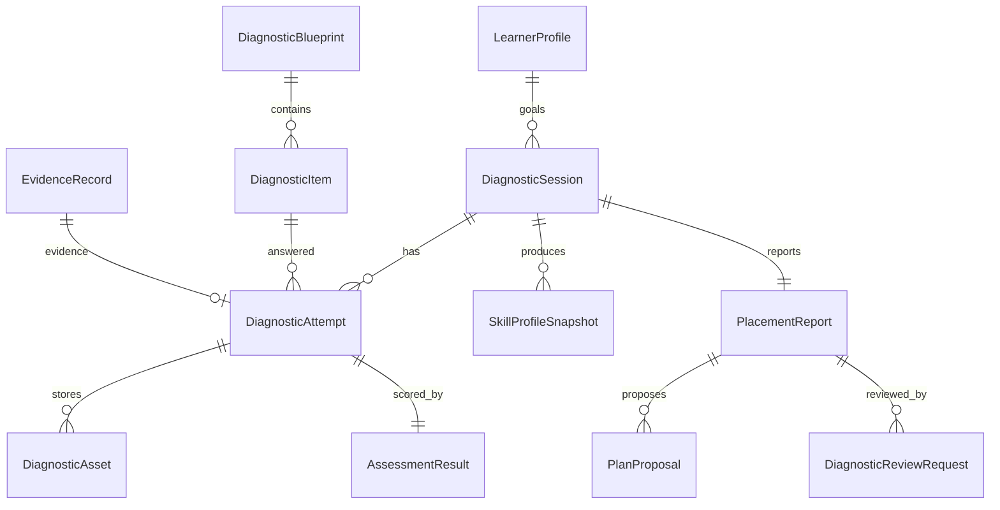

# v2.4.1 设计与实施计划：AI Diagnostic & Intelligent Placement

本文件承接 `CURRENT_STATE_AUDIT.md`，描述 v2.4.1 的数据模型、路由、评分、接口、页面、测试与回滚。所有名称以最终代码为准。

## 1. 设计原则

1. 纯加法：新增 `Diagnostic*` 域，不重建 AI Engine、不覆盖 v2.2 证据、不改 v2.1 预算、不动 v2.3 词汇主数据。
2. 原始与评估分离：`DiagnosticAttempt` 只存原始响应与条件；`AssessmentResult` 只存评分；AI 不得覆盖原始作答。
3. 确定性优先：客观题由题库答案与纯函数评分；只有开放题使用版本化 rubric + AI Evaluator。
4. 低置信度不强行定级：输出等级范围、`needs_follow_up` 与补测建议。
5. 用户确认：计划草案默认 DRAFT，必须显式激活。
6. 报告追加式：新报告不覆盖旧报告，旧报告标记 `SUPERSEDED`。

## 2. 数据模型（ERD）

| 表 | 关键字段 | 说明 |
| --- | --- | --- |
| `LearnerProfile` | `id=default`、`goalsJson`、`backgroundJson`、`recordingConsent`、`externalAiConsent`、`selfReportedWeaknessJson` | 背景只用于排期与对照，不参与定级 |
| `DiagnosticBlueprint` | `code@unique`、`version`、`title`、`active` | 蓝图版本 |
| `DiagnosticItem` | `itemCode@unique`、`skill`、`subskill`、`targetLevelMin/Max`、`difficulty`、`taskType`、`sourceType`、`prompt/transcript/passage`、`optionsJson`、`correctAnswer`、`answerExplanation`、`rubricJson`、`rubricVersion`、`validationStatus`、`exposureCount` | `VERIFIED` 可定位；`RUBRIC` 开放题；`AI_PRACTICE` 仅练习 |
| `DiagnosticSession` | `status`、`goalSnapshotJson`、`planJson`、`currentItemId`、`startedAt/lastActivityAt/completedAt` | 支持 PAUSED / RESUMED / COMPLETED |
| `DiagnosticAttempt` | `status`、`responseText`、`responseJson`、`timeSpentSec`、`technicalStatusJson`、`score/maxScore`、`evaluatorType`、`confidence`、`evidenceId` | `INVALID` 不计分、不写证据 |
| `DiagnosticAsset` | `kind`、`storagePath`、`mimeType`、`sizeBytes`、`sha256`、`durationSec` | 音频以 data URL 存在本机；可删除 |
| `AssessmentResult` | `dimensionJson`、`estimatedLevel`、`levelRangeJson`、`confidence`、`rubricVersion`、`evidenceRefsJson`、`limitationsJson`、`needsFollowUp` | 与 attempt 一对一 |
| `SkillProfileSnapshot` | `skill`、`estimatedLevel`、`levelRangeJson`、`confidence`、`coverageJson`、`evidenceCount`、`limitationsJson`、`needsFollowUp` | 每会话每技能一行 |
| `PlacementReport` | `version`、`status`、`summary`、`strengthsJson`、`gapsJson`、`coverageJson`、`suggestionsJson`、`confidence`、`supersededById` | 追加式 |
| `PlanProposal` | `horizonDays`、`tasksJson`、`rationaleJson`、`budgetJson`、`status`、`activatedAt` | DRAFT / ACTIVE / ARCHIVED |
| `DiagnosticReviewRequest` | `reason`、`status`、`resolutionNote` | 复核/异议记录 |

## 3. 技能与证据映射

| 诊断技能 | EvidenceRecord.skill | 说明 |
| --- | --- | --- |
| LISTENING | LISTENING | 客观题 |
| READING | READING | 客观题 |
| WRITING | WRITING | rubric 开放题 |
| SPEAKING_PRODUCTION / SPEAKING_INTERACTION | SPEAKING | rubric 开放题；音频可选 |
| GRAMMAR | GRAMMAR | 辅助维度 |
| VOCABULARY_RECEPTIVE / PRODUCTIVE | VOCABULARY | 辅助维度 |
| SENTENCE_STRUCTURE | GRAMMAR | 辅助维度，`dimensionsJson.subskill=SENTENCE_STRUCTURE` |
| EMLR | MEDIATED | 可选内部指标，不是 CEFR 等级 |

每条计分 attempt 写入一条 `EvidenceRecord(evidenceType=BASELINE, level=QUICK, assessorType=SELF|AI, score 0–2)`；`conditionJson` 记录诊断会话、题目、技术状态。无效 attempt 不写证据。

## 4. 评分与路由

### 4.1 客观题（确定性）

- 单选：答案索引比较；多选：集合相等。
- `score = 2` 正确 / `0` 错误；`maxScore = 2`。
- 记录用时；用时异常不直接扣分，仅写入条件与局限。

### 4.2 开放题（AI Evaluator）

- 输入：题目、rubric、原始作答、音频技术状态（不含整段音频内容）。
- 输出 Schema：`dimensions[]`、`strengths[]`、`issues[]`、`evidence_quotes[]`、`estimated_level`、`level_range`、`confidence`、`limitations[]`、`needs_follow_up`。
- `is_official_score` 恒为 false；不保存 chain-of-thought。
- AI 不可用 / 非法 JSON：attempt 保持 `PENDING_EVAL`，报告标 provisional；不影响客观题。

### 4.3 难度路由（纯函数）

- 初测从 `A1–A2` 基础题开始，每技能先取 1 道覆盖广的题。
- 正确 → 下一题 `difficulty + 1`；错误 → `difficulty - 1`；同难度已有曝光则选未曝光平行题。
- 每技能至少 2 个有效样本；不足则 `confidence=LOW` + 补测建议。
- 路由结果写回 `session.planJson`，可解释（记录原因码）。

### 4.4 置信度聚合

| 条件 | 置信度 |
| --- | --- |
| 无有效样本 | LOW + 「暂不能判断」 |
| 1 个有效样本 或 结果冲突 | LOW |
| ≥2 个一致有效样本，技术正常 | MEDIUM |
| ≥3 个一致样本 + 至少 1 个开放题 rubric 证据 | HIGH |

`estimating_level` 取样本等级中位数；LOW 时只输出 `level_range`，不输出确定单点。

## 5. 页面与交互

| 路由 | 内容 |
| --- | --- |
| `/diagnostics` | 欢迎、隐私说明、背景表单、历史诊断列表、补测入口 |
| `/diagnostics/[id]` | 进度、当前任务（听力播放/阅读/客观题/开放题/录音）、提交、标记技术故障、暂停/继续、完成诊断 |
| `/diagnostics/report/[id]` | 四项画像、辅助维度、证据覆盖、优势/缺口、局限、原始样本入口、复核/补测、计划草案生成与激活 |
| Dashboard `/` | 「尚未建立初始基线」提示卡 + 预计耗时 + 开始诊断 |

## 6. 服务接口（Server Action 等价）

| 接口 | 实现 |
| --- | --- |
| `POST /diagnostics/sessions` | `startDiagnosticAction` |
| `GET /diagnostics/sessions/{id}` | `getDiagnosticSessionView` |
| `POST /diagnostics/sessions/{id}/attempts` | `submitDiagnosticAttemptAction` |
| `POST /diagnostics/sessions/{id}/pause` / `resume` | `pauseDiagnosticAction` / `resumeDiagnosticAction` |
| `POST /diagnostics/sessions/{id}/finalize` | `finalizeDiagnosticAction` |
| `GET /diagnostics/reports/{id}` | `getPlacementReportView` |
| `POST /diagnostics/reports/{id}/request-review` | `requestReportReviewAction` |
| `POST /diagnostics/reports/{id}/retest` | `startDiagnosticRetestAction` |
| `POST /plans/proposals` | `generatePlanProposalAction` |
| `POST /plans/proposals/{id}/activate` | `activatePlanProposalAction` |
| 资产删除 | `deleteDiagnosticAttemptMediaAction` |

## 7. Prompt 规划（追加到 Registry）

| Kind | promptKey | 用途 |
| --- | --- | --- |
| `diag_speaking` | `ai.diag.speaking.v1` | 口语 rubric 评估（文本 + 音频技术状态） |
| `diag_writing` | `ai.diag.writing.v1` | 写作 rubric 评估 |
| `diag_summary` | `ai.diag.summary.v1` | 画像摘要、优势与 3–5 个缺口 |
| `diag_plan` | `ai.diag.plan.v1` | 7/30/90 天计划草案 |

所有 prompt 有 input/output schema、测试样本、版本与 checksum；评分 prompt 与教学 prompt 分离。

## 8. 测试计划

| 层级 | 内容 |
| --- | --- |
| 单元 | 客观题评分、难度路由、置信度聚合、报告缺口、计划预算分配、无效项排除、去重与曝光 |
| 集成 | 数据库副本：建会话 → 答题 → 暂停恢复 → 无效音频 → 客观评分 → 开放评分 → 结束 → 报告 → 草案 → 激活 → 删除媒体 → 历史保留 |
| E2E | `scripts/e2e-v24-1.mts`：两次会话完成、invalid 音频、provisional 补测、报告追加、计划确认 |
| 失败路径 | AI 超时、非法 JSON、预算超限、音频过大/损坏、用户中断、重复提交 |
| 数据 | 迁移前后核心表行数、foreign_key_check、旧证据/计划/词汇不变 |

## 9. 迁移与回滚

- `scripts/migrations/v2.4.1.mjs`：`CREATE TABLE/INDEX IF NOT EXISTS`，单事务，幂等，登记 `AppMigration(version='v2.4.1')`；迁移前后 integrity / foreign_key / 核心行数对比。
- 回滚：`bash scripts/restore.sh backups/<迁移前备份>` + `npm run db:generate`。不提供反向 DDL。
- 迁移不修改既有列；只新增诊断表；`EvidenceRecord` 不新增列。

## 10. 与 v2.5 的接口

- `SkillProfileSnapshot` 与 `PlacementReport` 作为 v2.5 自适应学习计划的输入契约。
- `AssessmentResult.dimensionJson` 提供子维度缺口，供 v2.5 生成定向任务。
- `PlanProposal` 保留 7/30/90 天结构，v2.5 可在激活后展开为正式 `PlanTask`。
- `DiagnosticReviewRequest` 提供人工复核队列，v2.5 可接入更完整的人工校准。