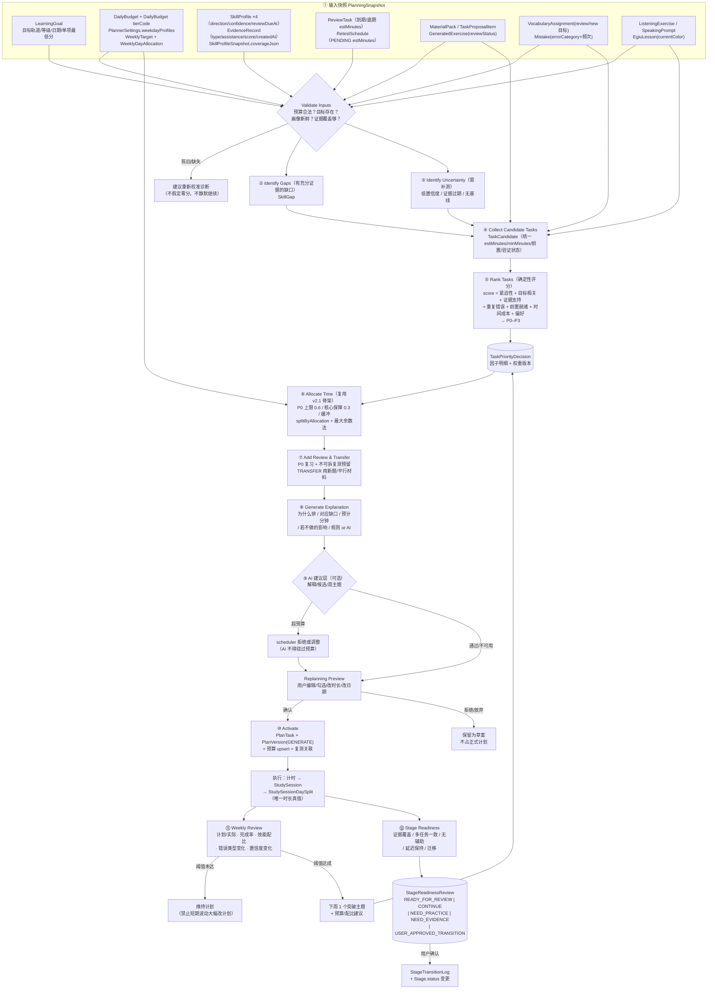

# v2.7 CURRENT_STATE_AUDIT — Adaptive Learning & Curriculum Planner

> 版本：v2.7 · 类型：代码与风险审计（只读）· 角色：架构师 高见远
> **说明：需求文档要求的 `v2.7_CURRENT_STATE_AUDIT.md` 即本文件（编号沿用项目 `docs/` 序列）。**
> 审计基线：`main` = `81ce8aa`（tag `v2.6`），93+17 = **110 张表**，已迁移到 v2.6。
> 审计方式：**逐文件读取源码**，所有结论带 `文件:行号`。不含推测。
> 上游输入：`00_跨版本通用架构与开发约束.md`、`v2.7_完整升级需求.md`、`v2.7_Agent开发提示词.md`

---

## 0. 结论摘要：v2.7 不是「从零建规划器」

v2.1 已经交付了一个**成熟的确定性日计划引擎**（590 行纯函数 + 316 行重排 + 451 行配比 + 305 行输入装配），v2.7 的真实工作量集中在**三个缺口**：

| # | 结论 | 证据 |
|---|---|---|
| 1 | **排程骨架已完整**：预算约束、P0 复习优先 + 上限、核心保障、休息日短路、15 分钟应急、短时预算单技能、跨日拆分、重排保留已发生时长、版本审计、幂等键 —— 全部已实现且有测试 | `adaptivePlan.ts:206`、`replan.ts:123`、`PlanVersion` 表 |
| 2 | **计划引擎完全不读 SkillProfile / EvidenceRecord**。弱项判定只看 `StudyRecord` 正确率（28 天窗口、≥10 题阈值） | `planning.ts:209-240`；`adaptivePlan` 的 `weakSkills` 只用于选 `priority='P2'`（`:531-546`） |
| 3 | **没有任何「优先级评分函数」**。`P0/P1/P2/P3` 由角色硬编码：复习→P0、基础模块→P1、弱项→P2、泛练→P3 | `adaptivePlan.ts:288/330/410/424/439/481/539/571` |
| 4 | **没有 SkillGap / Uncertainty / TaskCandidate / PlanningSnapshot 的存储**。候选任务是「模块级」的（LISTENING/READING…），不是「内容级」的（哪篇材料、哪组题） | 无对应表；`adaptivePlan` 输出 `AdaptivePlanItem { module, skill, minutes, … }` |
| 5 | **两条写计划的路径并存且口径不一致**：`generateAdaptivePlanAction` 写全字段（priority/sourceKind/planVersion/originalScheduledDate）；材料包确认走 `createPlanTaskAction`，只传 `{stageId, planDate, module, skill, plannedMinutes, note}` 6 个字段，其余决策字段全落默认值（priority=`P1`、sourceKind=`CORE`、planVersion=`1`、splittable=`false`） | `actions/plan.ts:301-322` vs `:119-134`；`materialPack.ts:534` |
| 6 | **净时长口径是单一口径，已防重复计时**：日净时长只从 `StudySessionDaySplit` 求和；`EnglishMediatedSession.durationMinutes` 明文「绝不参与任何总量求和」 | `duration.ts:171-180`、`queries/plan.ts:54-60`、schema 注释 |
| 7 | **无「任务缓冲时间」概念**；`remaining` 只是「不强行填满 + 打 warning」 | `adaptivePlan.ts:191-194` |
| 8 | **阶段 readiness 的 H4 门槛与动态预算冲突**：H4 要求「近 30 天有计划的日子中，净时长 ≥ **240 分钟** 的占比 ≥80%」，60 分钟/天的用户永远无法满足 | `stageGate.ts:96-102`、`constants.ts:735` |

**一句话**：v2.7 = 在既有确定性调度骨架上补「证据驱动的缺口/不确定性建模 + 可解释评分 + 内容级候选 + 快照复现 + 周/30 天/90 天层级」，**不要重写 scheduler**。

---

## 1. 现有计划 / 任务 / 预算 / 周目标模型

### 1.1 表清单与关键约束

| 表 | 关键字段 | 唯一约束 / 索引 | 说明 |
|---|---|---|---|
| `Stage` | `code`(S0_PREP/S1_A0_A2/S2_A2_B1/S3_B1_IELTS), `profileCode`(PREPARATION/A0_A2/A2_B1/B1_B2), `status`, `startedAt/completedAt`, `sortOrder` | `code @unique`; `@@index([status])`, `@@index([sortOrder])` | 阶段是 `PlanTask.stageId` 的必填父级（`onDelete: Restrict`） |
| `StageAcceptanceItem` | `dimension`(7 值), `isRequired`, `criterionText`(SOP 原文只读), `myResult`, `evidence`, `verdict`(PENDING/PASSED/FAILED), `judgedAt` | `@@unique([stageId, dimension])` | 每阶段 7 行，seed 写入 |
| `PlanTask` | 见 §1.2 | `@@index([planDate, sortOrder])`, `@@index([planDate, priority])`, `@@index([status])`, `@@index([timerStatus])`, `@@index([planVersion])`, `@@index([track])`, `@@index([primarySkill])`, `@@index([stageId])`, `@@index([resourceId])` | **无 unique** —— 同日同模块允许多条（分段/重排后的历史行） |
| `DailyBudget` | `date`, `plannedAvailableMinutes`, `budgetType`(PRESET/CUSTOM/REST_DAY), `tierCode`(10 档), `isRestDay`, `isInitialSuggestion`, `source`(USER/WEEKDAY_TEMPLATE/DEFAULT_SUGGESTION/MIGRATION) | `date @unique`; `@@index([date])`, `@@index([isRestDay])` | **预算唯一真值来源**；`isInitialSuggestion=true` 表示「系统建议，不是用户真实可用时间」 |
| `WeeklyTarget` | `weekStart`(ISO 周一), `targetMinutes`, `status`(ACTIVE/ADJUSTED), `source`(USER/SUGGESTION_ACCEPTED) | `weekStart @unique` | 系统建议不得自动写入（`source` 语义） |
| `WeeklyDayAllocation` | `weeklyTargetId`, `date`, `availableMinutes`, `isRestDay` | `@@unique([weeklyTargetId, date])`; `@@index([date])` | 支持工作日/周末差异，不要求平均 |
| `PlannerSettings` | `id=1`, `defaultDailyMinutes`, `weekdayProfiles`(JSON 7 值), `minTaskMinutes`, `weeklyTargetMinutes`, `priorityPolicy`(JSON `{p0CapRatio,coreMinRatio}`), `isUserConfirmed` | 单行 `id @default(1)` | **`priorityPolicy` 是 v2.7 权重配置化的现成挂载点** |
| `PlanVersion` | `planDate`, `version`, `changeSource`(GENERATE/REPLAN/MANUAL_ADJUST), `reason`, `budgetMinutes`, `actualMinutesAtChange`, `beforeSnapshot`/`afterSnapshot`(JSON), `idempotencyKey` | `@@unique([planDate, version])`; `idempotencyKey @unique`; `@@index([planDate])` | **append-only 审计**；`actualMinutesAtChange` 用于证明「事实不被改写」 |
| `PlanProposal`（v2.4.1 诊断域） | `reportId`, `status`(DRAFT/ACTIVE/ARCHIVED), `horizonDays`, `tasksJson`, `rationaleJson`, `budgetJson`, `activatedAt` | `@@index([status])` | 诊断后的计划草案，**与 `PlanTask` 无外键**，`tasksJson` 是 JSON 而不是任务行 |

### 1.2 `PlanTask` 字段全清单（v2.7 最重要的表）

```
决策字段：priority(P0–P3) / sourceKind(REVIEW|CORE|WEAKNESS|EXTENDED|MANUAL|LEGACY) / splittable / minChunkMinutes
归属字段：stageId / planDate / module(14 值) / skill(10 值) / track(3 值) / primarySkill(5 值) / resourceId?
时长字段：plannedMinutes / actualMinutes(快照，真值 = Σ DaySplit)
状态字段：status / statusChangedAt
延期字段：movedFromDate / movedToDate / movedCount / rescheduleReason / deferReason / originalScheduledDate
版本字段：planVersion （重排递增，历史行保留）
计时字段：timerStatus(IDLE|RUNNING|PAUSED|STOPPED) / timerStartedAt / timerAccumulatedSeconds / timerLastActiveAt / timerVersion
其他：sortOrder / note / createdAt / updatedAt
```

**状态机取值（`status`，7 态）与语义**：

| 状态 | 语义 | 谁写 | 计入完成率分母 |
|---|---|---|---|
| `TODO` | 未开始 | 生成 / 重排新建 | ✅ |
| `IN_PROGRESS` | 计时中或已开始 | 计时器 | ✅ |
| `DONE` | 完成 | 用户 | ✅ |
| `PARTIAL` | 部分完成（时长不足） | 用户 | ✅ |
| `MISSED` | 过期未做（**自动**，非用户决定） | `sweepStaleTasks` 读时清扫 | ✅ **计入**（作为未完成；`TASK_STATUSES_EXCLUDED_FROM_RATE` 只排除 `CANCELLED`/`DEFERRED`，`constants.ts:912`） |
| `DEFERRED` | 用户主动延期（**必须填 `deferReason`**） | `finishTaskAction` / 重排 | ❌ 排除 |
| `CANCELLED` | 用户取消 | 用户 | ❌ 排除 |

**延期策略（关键）**：

- **自动清扫不滚存**：`planDate < today` 且仍是 `TODO/IN_PROGRESS` → 一律置 `MISSED`（`queries/plan.ts:45-52`，读时幂等清扫，无 cron）。这条已经满足 v2.7「未完成任务不无限滚存」的**下限**：过去的日子不会把任务带到今天。
- **手动顺延有硬上限**：`MAX_MOVE_COUNT = 2`（`constants.ts:931`），超过拒绝并提示「建议下调该模块计划时长」（`actions/task.ts:125-131`）。
- **重排用 `DEFERRED` 而非删除**：`replan.ts:215-224` 明确「不删除，保护 `StudySession` 级联」（`StudySession.taskId` 是 `onDelete: Cascade`，删任务会抹掉计时历史）。
- ⚠️ **缺口**：没有任何「按重要性 / 时效重新排入」的自动化。需求 §5.1「未完成任务按重要性、时效和用户选择处理」只实现了「清扫 + 手动上限」，**没有 `MISSED` → 新日期的候选回流**。

---

## 2. `SkillProfile` / `EvidenceRecord` 可用字段（字段级清单）

### 2.1 三张画像相关表

| 表 | 字段 | 粒度 | 边界 |
|---|---|---|---|
| `SkillProfile` | `skill @unique`、`direction`(Pre-A1…C1, null=待评估)、`confidence`(LOW/MEDIUM/HIGH)、`evidenceBasis`(JSON string[] = EvidenceRecord.id)、`lastAssessedAt`、`reviewDueAt`、`doNotInfer`、`note` | **只有 4 行**（LISTENING/READING/SPEAKING/WRITING），**无子维度** | 源码注释：「不做四项平均，也不换算 CEFR 官方等级」 |
| `SkillProfileSnapshot` | `sessionId+skill @unique`、`estimatedLevel`、`levelRangeJson`、`confidence`、`coverageJson`、`evidenceCount`、`limitationsJson`、`needsFollowUp` | 每诊断会话 × 技能一行 | **只在诊断域**；`coverageJson` 实际只存 `{ratio: number}`（`queries/diagnostics.ts:327`） |
| `EvidenceRecord` | `skill`(6 值)、`evidenceType`(BASELINE/ASSISTED/IMMEDIATE_RETEST/DELAYED_RETEST/APPLIED_TASK/TRANSFER)、`level`(QUICK/STANDARD/FULL)、`parentEvidenceId`/`chainRootId`、`assistanceLevel`(**A0–A4**)、`assessorType`(SELF/TEACHER/PEER/AI/EXAM)、`confidence`、`score`(0–2)、`dimensionsJson`、`conditionJson`、`evidenceAnchor`、`outputText`、`privacyLevel`、`createdAt`、`taskId`/`sessionId`/`mediatedId`/`aiSessionId` | 事件级（append-only 链） | `assistanceLevel` 是能力判断的硬门（`evidence.ts:62-71`） |

### 2.2 v2.7 需要的四件事 → 现状对照

| v2.7 需要 | 能否表达 | 依据 | 缺口 |
|---|---|---|---|
| **置信度** | ✅ 完全可表达 | `SkillProfile.confidence` 三档；派生规则 `suggestProfileConfidence()`（`profile.ts:38-88`）：无 A0 基线→LOW；有基线+独立复测→MEDIUM；有独立延迟复测+独立应用/迁移→HIGH。**并且返回 `reasons[]` + `gaps[]`**，可直接喂给「为什么这么排」 | 无 |
| **证据新鲜度** | 🟡 可推导，无字段 | `lastAssessedAt` + `reviewDueAt`（`profileReviewDueDate()`，`profile.ts:91-97`，按置信度给复评间隔，常量 `PROFILE_REVIEW_DAYS`）；`EvidenceRecord.createdAt` 可算「最近 N 天证据数」 | **没有「新鲜度分数」字段**。每次都要现算；且 `SkillProfile.lastAssessedAt` 需要人工保存，可能与实际证据时间漂移 |
| **样本数量** | ✅ 可实时聚合 | `listSkillProfileRows()` 已算 `evidenceCount` / `independentCount`（`queries/skillProfile.ts:31-36, 68-69`） | 无缓存列 → 每次页面/计划生成都全表扫 `EvidenceRecord`（数据量小可接受，但**每次生成计划都扫**是性能隐患） |
| **子维度覆盖** | ❌ **不可表达** | `SkillProfile` 唯一键是 `skill`（4 行），没有 `subskill`。子维度只存在于 `DiagnosticItem.subskill`（题目定义侧）与 `SkillProfileSnapshot.coverageJson`（诊断快照侧，且只有 `ratio`） | **v2.7 的 `SkillGap` 若要 subskill 粒度，现有表撑不住**。`GRADER_GAP`：无法回答「READING 的 gist_understanding 覆盖够不够」 |
| **错误类型重复频率** | 🟡 靠 `Mistake` 而非 `EvidenceRecord` | `Mistake.errorCategory`(6 值) + `knowledgePoint`(聚合键) + `reviewCount` + `ieltsErrorCategory`；`rankWeaknesses()`（`weakness.ts:326`）已按「多来源证据总量 ≥10」筛 + 打分 | `EvidenceRecord` **没有 errorCategory 字段** → 错误类型无法与证据链关联（只能靠 `Mistake.studyRecordId` 间接） |
| **「低置信度优先补测」** | ❌ 未接入排程 | `suggestProfileConfidence().gaps` 只用于 `/profile` 页展示；`adaptivePlan` 输入里**没有 uncertainty 通道** | 需求 §4「不要因为置信度低就判最弱项，低置信度应先补证据」目前**无实现路径** |

> **结论**：置信度 ✅、样本数 ✅（现算）、新鲜度 🟡（可推导无字段）、**子维度覆盖 ❌**、**错误类型与证据关联 🟡**、**不确定性→排程 ❌**。

---

## 3. 各类候选任务来源（含「预计分钟 / 最小分钟 / 前置条件」字段现状）

| 来源 | 表 / 模块 | 预计分钟 | 最小分钟 | 前置条件 | 验证状态 | 备注 |
|---|---|---|---|---|---|---|
| **每日模块骨架** | `adaptivePlan.ts` 输出 `AdaptivePlanItem` | ✅ `minutes` | ✅ `minChunkMinutes` | ❌ | — | 模块级候选，**不含内容**（无「做哪篇」） |
| **知识型复习** | `ReviewTask` | ✅ `estMinutes`(默认 5) | ❌ | ✅ 隐式（`targetType+targetId` 指向具体单元） | — | 唯一键 `(targetType,targetId,intervalCode,dueDate)` |
| **技能型复测** | `RetestSchedule` | ✅ `estMinutes`(默认 10) | ❌ | ✅ `parentEvidenceId` 必填 | — | 唯一键 `(parentEvidenceId,retestType,dueDate)` + `idempotencyKey` |
| **词汇** | `VocabularyAssignment` + `VocabularyAssignmentItem` | ✅ `budgetMinutes` / `estimatedMinutes` | ✅ `budgetMinutes`（与 PlanTask 同事务） | 🟡 词条级 `priority`+`kind`(REVIEW/NEW/WEAKNESS) | — | `@@unique([assignmentDate])` 每日一份；`planTaskId` 一对一 |
| **材料包** | `MaterialPack`/`TaskProposalItem` | ✅ `suggestedMinutes`/`finalMinutes` + `granularity`(15/30/60) | ✅ `granularity` | 🟡 `exerciseIdsJson` | ✅ `GeneratedExercise.reviewStatus`（`approved` 才可挂证据） | **唯一已有「跨日拆分 + 预算校验」的候选源**（`taskProposal.ts:131/313`） |
| **SOP 教材（EGIU）** | `EgiuLesson` | ❌ 无单次时长（靠 `EST_MINUTES_BY_INTERVAL` 反推复习分钟） | ❌ | ✅ `unitNo` 顺序 + `currentColor` | — | `nextReviewDate` + `inRetestCount` |
| **题库（诊断）** | `DiagnosticItem` | ❌ **无 `estMinutes`** | ❌ | ✅ `targetLevelMin/Max` + `difficulty` | ✅ `validationStatus`(VERIFIED/RUBRIC/AI_PRACTICE) + `active` + `exposureCount` | 字段很全，**唯独缺时长** |
| **听力 Lab** | `ListeningExercise` | ❌ **无任何时长字段** | ❌ | ✅ `audioAssetId` + `mode`(9 种) | ❌ | `promptJson` 里可能有隐含信息，不可依赖 |
| **口语 Lab** | `SpeakingPrompt` | ❌ **无任何时长字段** | ❌ | ✅ `taskType`(9 种) | ❌ | 同上 |
| **句子成分** | `SentenceAnalysis` | ❌ | ❌ | 🟡 `patternTag` | — | 是记录表，不是候选源 |
| **资源库** | `Resource` | ❌ | ❌ | ✅ `currentUnit`/`totalUnits` | — | SOP 书单，无时间粒度 |

**结论**：v2.7 的「候选任务必须带预计耗时 + 最低可执行时间 + 前置条件」（需求 §3.4）**只有材料包与词汇两条链满足**。题库/听说 Lab/EGIU **缺 `estMinutes`/`minMinutes`** —— 这是 `TaskCandidate` 表必须存在（而不是靠各表加列）的根本原因：**跨 7 个来源无法各自加列**。

**另一个更要紧的发现**：现有引擎的候选粒度是**模块级**（「听力 15 分钟」），v2.7 需要的是**内容级**（「听这篇 TED 的 3 分钟片段」）。`AdaptivePlanItem` 只有 `{module, skill, minutes, priority, sourceKind, splittable, minChunkMinutes, rationale}` —— **没有 `contentRef`**。材料包那条链是唯一能说清「做什么」的，但它绕过了引擎（见 §5.4）。

---

## 4. 复习 / 延迟测试机制：两套队列的分工

| 项 | `ReviewTask`（知识型） | `RetestSchedule`（技能型） |
|---|---|---|
| 定位 | 知识点的间隔复习 | 能力的延迟复测 / 迁移验证 |
| `targetType`/`retestType` | `EGIU_LESSON` / `MISTAKE` / `VOCAB_WORD` / `GRAMMAR_POINT` | `IMMEDIATE` / `DELAYED` / `APPLIED` / `TRANSFER` |
| **幂等键** | `@@unique([targetType, targetId, intervalCode, dueDate])` | `@@unique([parentEvidenceId, retestType, dueDate])` **+ `idempotencyKey @unique`** |
| 调度阶梯 | `REVIEW_INTERVAL_DAYS`：D1=1、D3=3、D7=7、D14=14、D21=21、D30=30、MANUAL=2、LOW_FREQ_30=30（`constants.ts:605-614`）；由 `generateReviewPoints()`（`review.ts:74`）与 `appendAfterRetest()`（`review.ts:119`）推进 | 由 `buildRetestPlan()`（`evidence.ts:134`）按证据类型生成；`retestEvidenceType()`/`retestEvidenceLevel()`（`retest.ts:34/39`）映射目标类型 |
| 状态 | `PENDING/DONE/SKIPPED/SUPERSEDED` + `supersededById` | 同上 + `completedEvidenceId` + `planTaskId` |
| 预估分钟 | `estMinutes` 默认 5；`EST_MINUTES_BY_INTERVAL`（D1=5 … D30=12） | `estMinutes` 默认 10 |
| 是否进日计划 | ✅ 经 `getDueReviewLoad()` 汇总为 `dueReviews.estMinutes` → P0 切片 | ✅ 经 `getDueRetestLoad()` 汇总为 `dueRetests.items[]` → **先于 P0 预留**，且**不可拆分**（`adaptivePlan.ts:271-311`） |
| 已占预算防重 | — | `planTaskId = null` 过滤，避免同一批复测被两天各排一次（`planning.ts:119-144`）；重排时用 `includePlanTaskIds` 把「即将 DEFER 的任务上的复测」算回来（`:115-118` 注释） |

**分工是清晰的、且源码有明确约束**：「知识型复习仍用 `ReviewTask`，两套状态互不复用」（schema 注释）。

**缺口**：

1. **无「复习负载过重」的自动降载**。`isReviewLoadHeavy(estMinutes, dailyMinutes)` 存在（`duration.ts:188-191`，阈值 `REVIEW_LOAD_WARN_RATIO=0.25`）但只用于提示；实际 `p0CapRatio=0.6` 会把 60% 预算给复习，剩下 40% 再被 `coreMinRatio=0.3` 挤压 → 技能训练可能只剩 10%。
2. **`TRANSFER` 复测的「新题/平行材料」选择没有约束机制**。`checkTransferContext()`（`retest.ts:88`）能校验，但**没有任何数据字段记录「这次复测用的是哪道题/哪份材料」**（`RetestSchedule` 只有 `note`）→ 需求 §7 测试项 13「延迟复测使用新题/平行材料」**不可断言**。
3. **`SUPERSEDED` 无自动收敛**。「旧复测被新复测取代」需要人工/代码显式写，没有「新证据产生时自动 supersede 同技能更早复测」的规则。

---

## 5. 当前计划生成方式（真实算法 + 行号）

### 5.1 主引擎：`generateAdaptivePlan()`（`adaptivePlan.ts:206`）

执行顺序（源码注释声明「不可调换」）：

| 步 | 动作 | 行号 | 规则 |
|---|---|---|---|
| ① | 预算校验 | `:211-214` | 非有限/负数 → `INVALID_BUDGET` |
| ② | **休息日短路** | `:229-251` | `isRestDay` 或 `budget===0` → 不生成任务，到期复习/复测进 `backlog`，warning「本次不计为学习失败」 |
| ③ | 取预算模板 | `:257` → `templateFor()` `:155-164` | 有 `tierCode` 用 `BUDGET_TEMPLATES`（8 档：EMERGENCY/MINIMUM/LIGHT/LIGHT_STANDARD/STANDARD/FOCUSED/DEEP/EXTENDED），否则按 `foundation 25% / review 5% / 其余技能池` 切 |
| ③.5 | **复测预留（先于 P0）** | `:271-311` | 单项放不下就**整项顺延**（`continue`），不拆半截；不进入四技能分母；不受 `p0CapRatio` 约束 |
| ④ | **P0 切片** | `:313-337` | `p0Available = min(dueMinutes, floor(budget×0.6), budget − coreReserve − retestMinutes)`，再 `floorTo(granularity)`；超出部分进 `backlog`（`:338-345`） |
| ⑤ | S0 特例 | `:351-384` | 只排 `S0_MODULES` 基线诊断，**不可拆分**，放不下整项顺延 |
| ⑤' | 基础支持模块 | `:389-429` | `foundation` 预算内先切语法（S1 受 `GRAMMAR_CAP_RATIO` 20% 约束），余下给词汇 |
| ⑥ | 复盘占位 | `:432-446` | 在技能池**之前**占位，避免被技能池吃掉 |
| ⑦ | **技能池装箱** | `:451-559` | ① 短时预算（`budget ≤ 45`）→ 整块给单一主技能，选择序：本周缺口最大 → 配比最高 → 有证据弱项（`:464-503`）；② 否则 `splitByAllocation()`（`allocation.ts:223`）按阶段配比切，每项**向下取整到粒度**，余数用**最大余数法**补块（`:506-522`）；③ 不足粒度的份额**不生成碎片**，写入 `weeklyRotation`（`:525-529`） |
| ⑧ | P3 拓展 | `:562-576` | 仅 `budget ≥ 120` 且剩余 ≥ 2×粒度 |
| ⑨ | 收尾复核 | `:173-196` | 总量再校验 + 15 分钟应急 warning + 剩余不强行填满 warning |

**硬约束（源码注释保证）**：`Σminutes ≤ budget`（`:183-187` 防御分支）、`minutes ≥ 粒度`、P0 上限 **且** 核心保障下限、短时预算不铺四技能。

### 5.2 中途重排：`replanDailyTasks()`（`replan.ts:123`）

六步，**顺序不可调换**：

| 步 | 动作 | 行号 | 关键点 |
|---|---|---|---|
| ① | 算已发生净分钟，推剩余预算 | `:136-144` | **剩余 = 新预算 − 当日已发生**（不是「新预算 − 保留任务计划分钟」，后者会把已学时间算两次）；优先用调用方传的 `actualMinutesToday`（含不挂任务的学习段，如英语媒介学习） |
| ② | `DONE/PARTIAL` → `KEEP` | `:147-150` | 已结束不回滚，不占剩余预算（已在 ① 抵扣） |
| ③ | 进行中 | `:154-210` | `timerRunning` → **冻结**（改 `plannedMinutes` 会让计划在计时中漂移），但尾巴仍扣预算（`:170`）；`!splittable` → 整体保留，放不下也保留 + 警告（事实优先于计划）；可拆分 → `SHRINK` 到 `done + allocate`，损耗进 `backlog(PARTIAL_TAIL)` |
| ④ | 未开始 `TODO` → `DEFER` | `:215-224` | **不删除**（保护 `StudySession` 级联）；`CANCELLED/MISSED/DEFERRED` 不产生指令（已做的决定不覆盖） |
| ⑤ | 超预算说明 | `:227-232` | 已发生 > 新预算 → 保留全部记录，`remaining=0` |
| ⑥ | 剩余预算交引擎 | `:248-280` | 传 `skipModules = 已保留模块`，避免重复排；新任务 `planVersion = nextVersion` |

### 5.3 输入装配：`loadPlanEngineContext()`（`planning.ts:246-296`）

一次性并发取 6 项：`activeAllocationFor(profileCode)`、`getDueReviewLoad()`、`getDueRetestLoad()`、`getWeakSkills()`、`plannerSettings`（含 `priorityPolicy` JSON 解析，损坏则回落常量）、S0 的已完成基线（用于 `skipModules`）；再算 `getWeeklySkillGap()`。

- **阶段配比**：`SkillAllocationProfile`（`profileCode + isActive + effectiveFrom` 取最新），合计 ≠100 时**不配平**（`checkAllocation` 校验，`planning.ts:57-73`）。
- **本周缺口**：`getWeeklySkillGap()`（`:158-201`）= `四技能合计 × 配比 − 已投入`；已投入 = 本周 DaySplit 实际 + 本周**其他日期已排未做**的计划分钟（`:170-176`，为了「一次生成多天不每天选同一项」）；四项之和恒为 0；分母用四技能合计而非周目标（`:152-154` 注释）。
- **弱项**：`getWeakSkills()`（`:209-240`）= 近 28 天（`WEAKNESS_WINDOW_DAYS`）× 题量 ≥10（`WEAKNESS_MIN_QUESTIONS`）× 正确率 < 四技能合并正确率 → 最多 3 项。**只读 `StudyRecord`**。

### 5.4 写库路径（两条，口径不一致 —— 必须统一）

| 路径 | 文件:行 | 写入字段 | 版本 |
|---|---|---|---|
| 引擎生成 | `actions/plan.ts:301-322` | `stageId/planDate/module/skill/plannedMinutes/sortOrder/track/primarySkill/priority/sourceKind/splittable/minChunkMinutes/planVersion/originalScheduledDate/resourceId/note(rationale)` | ✅ 写 `planVersion` + `PlanVersion` 审计 + 预算 upsert + 复测关联 + 词汇分配（全在一个事务，`:285-368`） |
| 材料包确认 | `actions/materialPack.ts:534` → `createPlanTaskAction`（`actions/plan.ts:107-138`） | `stageId/planDate/module/skill/plannedMinutes/sortOrder/resourceId(默认 null)/note/track/primarySkill` | ❌ **priority 落 `P1` 默认、sourceKind 落 `CORE` 默认、planVersion 落 `1` 默认、`splittable=false`、`originalScheduledDate=null`** |

**后果（v2.7 风险 R-2）**：材料来源的任务在 `PlanVersion` 里查不到（`planVersion=1` 可能与 v2.0 旧行混淆），`priority` 谎报为 P1 核心，`splittable=false` 导致重排时**不能缩短**（`replan.ts:174-183` 对 `!splittable` 整体保留）→ 材料 90 分钟任务在 30 分钟的日子里只能整项顺延。

### 5.5 优先级是怎么来的？（关键：**没有评分函数**）

| priority | 谁得到它 | 行号 |
|---|---|---|
| `P0` | 复测预留（`:288`）+ P0 复习切片（`:330`） | 硬编码 |
| `P1` | S0 基线（`:371`）、词汇（`:410`）、语法（`:424`）、复盘（`:439`）、非弱项技能（`:539`）、短时预算非弱项（`:481`） | 硬编码 |
| `P2` | 弱项技能（`:539`/`:481`，`isWeak ? 'P2' : 'P1'`） | 硬编码 |
| `P3` | 拓展（`:571`） | 硬编码 |

需求 §4 要求「紧迫性、目标相关度、证据支持程度、重复错误、前置关系、时间成本、用户偏好」可配置评分 —— **一个都没有**。`PlannerSettings.priorityPolicy` 只有两个数字（`p0CapRatio`/`coreMinRatio`），是**预算切分参数**，不是任务评分权重。

---

## 6. 重复计时风险（v2.7 最容易踩的坑）

### 6.1 现有口径（已做对的）

| 口径 | 实现 | 证据 |
|---|---|---|
| **唯一时长真值** | 日净时长**只**从 `StudySessionDaySplit` 求和 | `duration.ts:171-180`、`queries/plan.ts:54-60` |
| **跨零点拆分** | `splitAcrossMidnight()`，`@@unique([sessionId, date])`，`Σsplit === activeMinutes` | `duration.ts:10`、`date.ts` |
| **挂机/误触截断** | `sessionNet()`：`min(active, planned×1.5)`，`planned=0` 时用绝对上限 180 分钟，`< max(3, planned×0.2)` 记误触为 0 | `duration.ts:107-142` |
| **不挂任务的记录不丢** | `StudySession.taskId` **可空**（v2.0 关键改动），英语媒介学习直接落 `StudySession` + `mediatedId`，**不另建带 duration 的表** | schema 注释（`:368-378`） |
| **媒介学习时长不另行求和** | `EnglishMediatedSession.durationMinutes` 注释：「只是这条记录声称的时长，与 session 交叉校验，**绝不参与任何总量求和**」 | schema `:931` 区块注释 |
| **`PlanTask.actualMinutes` 是快照** | 注释「真值 = Σ StudySessionDaySplit」；重排时用 `actualMinutesToday` 参数化，不按任务行求和 | schema、`replan.ts:88/140-143` |
| **单主技能** | `StudySession.skill` / `PlanTask.primarySkill` 单值；`skillMinutes()` 按 `SKILL_BUCKET` 归桶，泛听泛读只进 `EXTENSIVE`，复盘只进 `META` | `duration.ts:150-169` |
| **媒体时长 ≠ 净学习** | schema 无任何「媒体时长计入净分钟」的路径；`ListeningAttempt.replayCount` 只是计数 | — |

### 6.2 现存/潜在的风险点（按严重度）

| # | 风险 | 状态 | 说明 |
|---|---|---|---|
| **T-1** | **`WeeklyTarget.targetMinutes` 与 `DailyBudget.plannedAvailableMinutes` 双写** | 🔴 存在 | `WeeklyDayAllocation.availableMinutes` 是第三份分钟数。三者没有一致性校验/触发器；`getEffectiveBudget()` 优先 `DailyBudget` → `PlannerSettings.weekdayProfiles` → `defaultDailyMinutes`（`budget.ts:60-134`），**完全不看 `WeeklyTarget`** → `WeeklyTarget` 实际是「展示性目标」，若 v2.7 用它做「按周预算分配」会与日预算互相矛盾 |
| **T-2** | **`PlanTask.actualMinutes` 与 DaySplit 可能漂移** | 🟠 存在 | 快照字段，只要有人按它求和就重复计。`replan.ts` 已经用参数规避，但 v2.7 新增的周复盘/readiness 若直接 `sum(actualMinutes)` 就会错 |
| **T-3** | **「一个 session 多能力标签」无字段** | 🟠 设计缺口 | 需求 §5.2：「同一段学习时间只能有一个主时间记录，**可有多个能力标签**，不得重复计时」。现有 `StudySession.skill` 单值 → 目前**只能二选一**，v2.7 若加「多标签」必须加 `tagsJson`（新列，不是新表），且**汇总仍只能按主技能** |
| **T-4** | 若为 `TaskCandidate`/`PlanTaskAllocation` 存「候选分钟」并按候选求和 | 🔴 需预防 | 候选分钟是**计划侧**，绝不能进净时长汇总。必须明文约束：`TaskCandidate.suggestedMinutes` 只用于排程，统计只读 DaySplit |
| **T-5** | `PlanProposal.tasksJson`（v2.4.1）与 `PlanTask` 无外键 | 🟡 存在 | 诊断计划草案激活时若把 `tasksJson` 也当账本求和，会与 `PlanTask` 双计 |
| **T-6** | `materialPack` 的 `TaskProposalItem.suggestedMinutes` 与 `PlanTask.plannedMinutes` | 🟡 已控制 | 确认后只通过 `createPlanTaskAction` 写 `plannedMinutes`，草案行不参与统计 ✅ |

**结论**：核心口径（净时长）是**干净的单一口径**，没有发现真实双计。真正的风险在于 **v2.7 新增层如果不遵守三条铁律就会破坏它**：
1. 净学习分钟**只能** `SUM(StudySessionDaySplit.minutes)`；
2. 计划分钟**只能** `SUM(PlanTask.plannedMinutes WHERE status NOT IN (DEFERRED,CANCELLED,MISSED))`；
3. 候选/草案分钟**永不参与任何统计**。

---

## 7. 需要复用 / 改造 / 新增的服务清单

### 7.1 直接复用（**不要改**，共 10 项）

| # | 服务 | 位置 | 理由 |
|---|---|---|---|
| 1 | `generateAdaptivePlan()` | `adaptivePlan.ts:206` | 排程骨架已验证；v2.7 通过**新增可选输入**扩展，不动核心 |
| 2 | `replanDailyTasks()` | `replan.ts:123` | 重排口径（剩余预算 = 新预算 − 已发生）是正确解，逐字复用 |
| 3 | `splitByAllocation()` / `rebalanceFourSkills()` | `allocation.ts:223/353` | 最大余数法 + 四技能内部搬运，已处理不变量 |
| 4 | `getEffectiveBudget()` / `getBudgetRange()` | `budget.ts:60/137` | **唯一预算真值**；含 `isInitialSuggestion`/`isUserConfirmed` 语义 |
| 5 | `loadPlanEngineContext()` | `planning.ts:246` | 唯一输入装配；v2.7 在此**追加** evidence/gap 输入 |
| 6 | `sessionNet()` / `netMinutesByDate()` | `duration.ts:107/171` | 唯一净时长口径 |
| 7 | `suggestProfileConfidence()` / `profileReviewDueDate()` | `profile.ts:38/91` | 置信度三档 + gaps，直接产出 `SkillGap`/`Uncertainty` |
| 8 | `rankWeaknesses()`（含 `insufficient` 分桶） | `weakness.ts:326` | **已实现「证据不足 ≠ 弱项」**，正是需求 §4 的关键语义 |
| 9 | `splitProposalAcrossDays()` / `validateProposalAgainstBudget()` | `taskProposal.ts:131/313` | 唯一「跨日拆分 + 预算闸门」；粒度 15/30/60 已对齐需求 §5.1 |
| 10 | `PlanVersion`（表）+ `nextPlanVersion()` | schema / `planning.ts:299` | append-only 审计 + 幂等键，需求 §11「保存输入快照/规则版本/变更原因」的现成载体 |

### 7.2 需要改造（**扩展现有，6 项**）

| # | 改造对象 | 改造范围 | 理由 |
|---|---|---|---|
| M-1 | `AdaptivePlanInput` | **追加可选字段**：`skillGaps?`、`uncertainties?`、`candidates?`、`bufferRatio?`、`weeklyTargetMinutes?`。老字段语义与默认值不变 | 保持 v2.1 行为向后兼容（未传 = 现状），同时让证据/候选/缓冲进入引擎 |
| M-2 | 优先级生成 | 抽出 `scoreCandidate()` 纯函数（`domain/taskPriority.ts`），`priorityOf(score)` 按阈值映射 P0–P3；权重从 `PlannerSettings.priorityPolicy` 读，**默认值等价于现状** | 需求 §4「可解释、可配置、可测试」；现状是硬编码角色映射 |
| M-3 | `getWeakSkills()` | 改为 `getSkillGaps()`：证据优先（`SkillProfile.confidence` + `EvidenceRecord` 新鲜度 + `StudyRecord` 正确率三源），保留 `StudyRecord` 路径作为 fallback | 需求 §3.2/§4「不能把低置信度单次结果当精确弱项」；现状完全不读画像 |
| M-4 | `PlanTask` | **加 2 个可空列**：`candidateId String?`（指向 `TaskCandidate`）、`decisionJson String?`（本条任务的评分明细与依据）。**不动既有列** | 需求 §12「每项推荐任务要显示推荐原因/对应缺口/若不做的影响」 |
| M-5 | `createPlanTaskAction` | 补 `priority/sourceKind/splittable/minChunkMinutes/planVersion/originalScheduledDate` 可传；材料包确认路径改走 `appendTaskFromCandidate()` | 修复 §5.4 的口径分裂（风险 R-2） |
| M-6 | `stageGate.evaluateStageGate()` | **H4 从「净时长 ≥240 分钟占比」改为「证据覆盖 + 无辅助完成 + 延迟保持 + 迁移」**（或把时长降为软提示）；追加输入 `skillProfiles`/`retestResults` | 需求 §9「学习时长不能单独触发晋级」+ 与 v2.1 动态预算冲突（60 分钟/天用户永远不满足 240） |

### 7.3 必须新增（**≤6 项**，详见 §10）

| # | 新增 | 必要性 |
|---|---|---|
| N-1 | `PlanningSnapshot` | 需求 §7.1「Validate Inputs + 保存快照保证可复现」；`PlanVersion.before/afterSnapshot` 只存**任务列表**，不含输入（预算/画像/复习负荷/候选池），无法复现「为什么这样排」 |
| N-2 | `SkillGap` | 置信度 + 覆盖 + 新鲜度 + 证据来源的**结构化载体**；现有 `SkillProfile` 只有 4 行且无子维度 |
| N-3 | `TaskCandidate` | 跨 7 个候选来源的**统一视图**；各源表无法各自加 `estMinutes/minMinutes/prerequisites` |
| N-4 | `TaskPriorityDecision` | 需求 §4「算法必须可解释」；记录每个候选的 6 项评分因子 + 权重版本 + 最终 P 级 |
| N-5 | `StageReadinessReview` | 需求 §9 的 5 种结果 + 证据清单；`stageGate` 目前是**纯函数无持久化**，刷新即丢 |

> `Cycle90` / `ReplanningEvent` / `PlanTaskAllocation` / `WeeklyTarget` / `PlanVersion` / `LearningGoal` **不要新建**（见 §10.2）。

---

## 8. 数据流



---

## 9. 调度规则与冲突处理：已实现 vs 缺失

| # | 规则（需求条款） | 现状 | 证据 | 缺口 |
|---|---|---|---|---|
| 1 | **P0 到期复习优先**（§5.1、AC-7） | ✅ **已实现，且比需求更严** | `adaptivePlan.ts:313-345`：`min(到期量, budget×0.6, budget−coreReserve−复测)` 三重约束；超出部分进 backlog 并按逾期风险说明 | 无 |
| 2 | **复测不可拆、先于 P0** | ✅ | `:271-311`，单项放不下整项顺延 | 无 |
| 3 | **15 分钟应急维护**（§5.1） | ✅ | `BUDGET_MAINTENANCE_MAX=15` → `:188-190` 明确 warning「只维持记忆连续性，不视为完整学习日」；`EMERGENCY` 模板 `foundation 5/skill 8/review 2` | 无 |
| 4 | **短时预算不铺四技能** | ✅ | `SHORT_PLAN_MAX_MINUTES=45` → `:464-503` 整块给单一主技能，其余进周轮换 | 无 |
| 5 | **休息日不产生失败** | ✅ | `:229-251` 零任务 + 「本次不计为学习失败」；`DailyBudget.isRestDay` + `plannedAvailableMinutes=0` → 无任务行 → 完成率分母为 0 | 无 |
| 6 | **临时缩短预算保留完成项、重排剩余** | ✅ **完整实现（含幂等 + 审计）** | `actions/replan.ts:44-311`：`PlanVersion.idempotencyKey` 幂等重放（`:61-77`）、`actualMinutesAtChange` 快照、`DEFER` 不删行、`SHRINK` 不低于已发生 | 无 |
| 7 | **未完成任务不无限滚存** | 🟡 **下限有、上限缺** | 有：`sweepStaleTasks()` 把过期未完成置 `MISSED`（`queries/plan.ts:45-52`）；`MAX_MOVE_COUNT=2` 限制手动顺延（`constants.ts:931`）。缺：**没有「按重要性/时效自动重新排入」**，`MISSED` 任务直接消失，无回流候选 | 需 `TaskCandidate` 从 `MISSED` 生成新候选（带 `deferReason`/`movedCount` 权重） |
| 8 | **工作日/周末差异**（§5） | ✅ | `PlannerSettings.weekdayProfiles`（7 值 JSON）+ `WeeklyDayAllocation`（`@@unique([weeklyTargetId,date])`）+ `getEffectiveBudget()` 优先级链 | `WeeklyTarget` 未参与实际预算（见 T-1） |
| 9 | **每周技能权重可配置**（§5.2） | ✅ **部分** | `SkillAllocationProfile`（`profileCode + isActive + effectiveFrom`）+ `activeAllocationFor()`；改动插新行 + 旧行 `isActive=false`，有 `changeReason` 留痕；未配置时**不配平**（不硬编码 25/25/25/25，`planning.ts:57-73`） | 只在 `profileCode` 粒度（4 档），**不支持「本周临时微调」**；需求 §5.2 要求「结合诊断证据动态微调并展示调整原因」→ 缺 weekly-level override |
| 10 | **保留任务缓冲时间**（§5.1） | ❌ **完全缺失** | `:191-194` 只是「剩余不强行填满」，不是预算预留 | 需 `bufferRatio`（建议默认 10%），且缓冲不得挤占 P0 |
| 11 | **低置信度优先补测**（§3.2/§4/AC-6） | ❌ **完全缺失** | `adaptivePlan` 输入无 `uncertainties`；`suggestProfileConfidence().gaps` 只用于画像页展示；`getWeakSkills()` 不看 confidence | 需 `SkillGap`/`Uncertainty` → `TaskCandidate(kind='PROBE')` 链路 |
| 12 | **AI 不可用仍可生成基础计划**（AC-17） | ✅ **事实上已满足** | 计划生成**完全不含 AI 调用**（`actions/plan.ts` 无 AI import）；纯确定性 | v2.7 加 AI 层时**必须保持**「AI 失败 → 规则计划照常」 |
| 13 | **AI 输出超预算被 scheduler 拒绝**（§7 测试 9） | ⚠️ 无 AI 层，规则待定 | 现有 `validateProposalAgainstBudget()`（`taskProposal.ts:313`）是同类闸门的现成范式 | 需在 plan 层复用同一函数做 AI 建议的准入校验 |
| 14 | **计划分级（7天/30天/90天）** | 🟡 **90 天有骨架，7/30 天无** | `LearningCycle`（`status`: CALIBRATION/BUILD/DELIVER/COMPLETED/PAUSED + `baselineRefs` + `recoveryNote`）+ `WeeklyFocus`（周主问题） | ❌ 无 7 天启动计划实体；❌ 无 30 天阶段计划（周里程碑/验收指标/调整条件）；❌ `LearningCycle` 的阶段推进无审计、无「中途校准」事件 |
| 15 | **阶段 readiness 不靠时长**（§9/AC-14） | ❌ **冲突** | `stageGate.ts` H4：「近 30 天有计划的日子中净时长 ≥ **240 分钟** 的占比 ≥80%」（`constants.ts:735`）—— 与 v2.1 动态预算（15–600，默认 60）直接冲突，**60 分钟/天用户永远无法晋级**；且 H1/H2 基于人工填写的 `StageAcceptanceItem`，不看 `SkillProfile.confidence`/覆盖/迁移 | 需改造 H4（见 M-6）+ 追加 `skillProfiles`/`retestResults` 输入 |
| 16 | **历史计划可版本比较与恢复** | 🟡 **只写不读** | `PlanVersion` 有 `beforeSnapshot`/`afterSnapshot`（JSON）；`getPlanVersionsAction`（`actions/replan.ts:313`）能列 | ❌ 无「恢复到某个版本」的动作；❌ 无版本 diff 视图；❌ 材料路径的任务不进版本（§5.4） |
| 17 | **不因短期波动大幅改计划**（§8） | 🟡 阈值只在弱项判定 | `WEAKNESS_MIN_QUESTIONS=10` + `WEAKNESS_WINDOW_DAYS=28`（`planning.ts:236`） | 周复盘→下周计划的「变更阈值」未定义（如「连续 2 周同向趋势才改配比」） |

---

## 10. Migration 与测试计划

### 10.1 需求 §11 的 11 个建议模型 → 对照结论

| 需求建议 | 结论 | 落地方式 |
|---|---|---|
| `LearningGoal` | ✅ **复用现有** | 表已存在：`goalType @unique`(3 轨道)、`targetValue`、`min{L,R,W,S}`、`targetDate`、`status`；子表 `GoalMilestone`(`@@unique([goalId,milestoneCode])`)。**零改动** |
| `PlanningSnapshot` | 🆕 **必须新建** | 见 §10.2 N-1 |
| `SkillGap` | 🆕 **必须新建** | 见 N-2 |
| `TaskCandidate` | 🆕 **必须新建** | 见 N-3 |
| `TaskPriorityDecision` | 🆕 **新建（可与 TaskCandidate 合并，见下）** | 见 N-4 |
| `PlanVersion` | ✅ **复用现有** | `@@unique([planDate,version])` + `changeSource` + `before/afterSnapshot` + `idempotencyKey`。**只加 1 个可空列** `snapshotId String?` 指向 `PlanningSnapshot` |
| `PlanTaskAllocation` | ❌ **不要新建** | `PlanTask` 本身就是 allocation（`planDate+module+plannedMinutes+sortOrder+priority+splittable+minChunkMinutes`）。为「分配」再建表会与 `PlanTask` 双写分钟数（触发 R-T4） |
| `WeeklyTarget` | ✅ **复用现有** | `weekStart @unique` + `WeeklyDayAllocation`。**注意**：需在 v2.7 明确它是否参与实际预算（现状不参与，见 T-1） |
| `Cycle90` | ⚠️ **复用 `LearningCycle`，只加可空列** | 已有 `status`(CALIBRATION/BUILD/DELIVER)、`startDate/endDate`、`baselineRefs`、`recoveryNote`。补 3 列：`primaryTheme String?`（1 个突破主题）、`secondaryThemesJson String?`（≤2 个）、`phaseChangedAt DateTime?`（中途校准留痕） |
| `ReplanningEvent` | ❌ **不要新建** | `PlanVersion(changeSource='REPLAN')` + `reason` + `budgetMinutes` + `actualMinutesAtChange` + `before/afterSnapshot` **已完整覆盖**。缺的只是「重排触发原因枚举」→ 复用 `reason`（zod 约束取值），不建表 |
| `StageReadinessReview` | 🆕 **必须新建** | 见 N-5 |

**最终新增 = 5 张表 + 4 处「可空列」改造。**

### 10.2 建议新增表（5 张，字段级别）

```prisma
// ── V27-1 计划输入快照（每次生成/重排各一行；保证可复现「为什么这样排」）──
model PlanningSnapshot {
  id                   String   @id @default(cuid())
  /** GENERATE | REPLAN | WEEKLY | CYCLE_CALIBRATION */
  purpose              String
  /** 业务日期（快照针对哪一天/哪一周） */
  asOfDate             String
  /** 空闲/缓存键：同输入同规则 → 同 hash，可用于断言确定性 */
  inputHash            String
  /** 规则版本（scheduler 语义版本，规则改动必须递增） */
  ruleVersion          String   @default("v2.7.0")
  /** JSON：预算快照 { budgetMinutes, tierCode, isRestDay, source, isInitialSuggestion } */
  budgetJson           String
  /** JSON：画像/证据摘要 { skills:[{skill,direction,confidence,evidenceCount,independentCount,lastAssessedAt,freshDays}], gaps:[...] } */
  profileJson          String?
  /** JSON：到期负荷 { dueReviewMinutes, dueReviewCount, maxOverdueDays, dueRetestItems:[{id,minutes,overdueDays}] } */
  workloadJson         String?
  /** JSON：候选池摘要 [{candidateId, module, skill, estMinutes, minMinutes, priorityHint}] */
  candidatesJson       String?
  /** JSON：配置快照 { minTaskMinutes, p0CapRatio, coreMinRatio, bufferRatio, allocation, weights } */
  configJson           String
  /** JSON：输入校验结果 { ok, stale:[], missingBaseline:[], lowConfidence:[] } */
  validationJson       String?
  createdAt            DateTime @default(now())

  gaps        SkillGap[]
  candidates  TaskCandidate[]
  reviews     StageReadinessReview[]

  @@unique([purpose, asOfDate, inputHash])
  @@index([asOfDate])
}
```

```prisma
// ── V27-2 技能缺口（有充分证据的缺口；子维度粒度）──
model SkillGap {
  id                String   @id @default(cuid())
  snapshotId        String
  /** LISTENING | READING | SPEAKING | WRITING（**官方四项**；辅助维度不得进这张表） */
  skill             String
  /** 子维度，如 gist_understanding / detail_scanning / coherence；空串 = 技能级缺口 */
  subskill          String   @default("")
  /** GAP（已证实）| UNCERTAINTY（证据不足，需补测）| UNKNOWN（无基线） */
  kind              String
  /** LOW | MEDIUM | HIGH —— 与 SkillProfile.confidence 同源 */
  confidence        String   @default("LOW")
  /** 证据样本数（实时聚合，非快照冗余） */
  evidenceCount     Int      @default(0)
  /** A0 无辅助样本数 —— 独立性门槛 */
  independentCount  Int      @default(0)
  /** 证据新鲜度（最近证据距 asOfDate 的天数；null = 无证据） */
  freshnessDays     Int?
  /** 覆盖比例 0..1（coverage 分母由 blueprint 决定；null = 未知） */
  coverageRatio     Float?
  /** 0..1，缺口严重度（证据支持下的偏离幅度；UNCERTAINTY 恒 0） */
  severity          Float    @default(0)
  /** 一句话依据（人话，直接进解释面板） */
  reason            String
  /** JSON string[]：支撑本缺口的 EvidenceRecord.id（可追溯，AC-8） */
  evidenceIdsJson   String?
  /** JSON string[]：suggestProfileConfidence().gaps 原文 */
  missingEvidenceJson String?
  /** PENDING | ADDRESSED | SUPERSEDED */
  status            String   @default("PENDING")
  createdAt         DateTime @default(now())

  snapshot    PlanningSnapshot @relation(fields: [snapshotId], references: [id], onDelete: Cascade)
  candidates  TaskCandidate[]
  decisions   TaskPriorityDecision[]

  @@unique([snapshotId, skill, subskill, kind])
  @@index([skill, kind, status])
}
```

```prisma
// ── V27-3 候选任务（跨 7 个来源的统一视图；**不参与任何时长统计**）──
model TaskCandidate {
  id                 String   @id @default(cuid())
  snapshotId         String
  /** REVIEW | RETEST | VOCAB | MATERIAL | EGUI | QUESTION | LISTENING | SPEAKING | PROBE | EXTENSIVE */
  sourceKind         String
  /** 源表弱引用（普通 String?，不建跨域外键，避免触碰既有 110 表） */
  sourceRef          String?
  /** 稳定去重键：sourceKind:sourceRef:module:dateKey（幂等复用同一候选） */
  candidateKey       String
  /** PlanTask.module 取值（14 值） */
  module             String
  /** 四技能子集 + FOUNDATION */
  targetSkill        String
  skillGapId         String?
  title              String
  /** 预计分钟 */
  estMinutes         Int
  /** 最小可执行单元（不生成低于它的碎片） */
  minMinutes         Int      @default(5)
  /** 建议粒度上限（材料包用 15/30/60） */
  maxBlockMinutes    Int?
  /** JSON string[]：前置条件（如 ['stage:S2_A2_B1','retest:D7_done','material:approved_exercise']） */
  prerequisitesJson  String?
  /** VERIFIED | RUBRIC | AI_PRACTICE | UNVERIFIED —— 未验证不得进正式估分 */
  validationStatus   String   @default("UNVERIFIED")
  /** 0..1 难度归一（A0..C1 → 0..1），用于难度匹配 */
  difficultyScore    Float?
  /** true = AI 建议生成（必须在 UI 标注） */
  isAiSuggested      Boolean  @default(false)
  /** 关联 AI 调用日志（复用 v2.4 账本；普通 String?） */
  aiCallLogId        String?
  /** PROPOSED | SELECTED | REJECTED | EXPIRED */
  status             String   @default("PROPOSED")
  createdAt          DateTime @default(now())

  snapshot PlanningSnapshot @relation(fields: [snapshotId], references: [id], onDelete: Cascade)
  gap      SkillGap?        @relation(fields: [skillGapId], references: [id], onDelete: SetNull)
  decision TaskPriorityDecision?

  @@unique([snapshotId, candidateKey])
  @@index([snapshotId, sourceKind])
  @@index([targetSkill, status])
}
```

```prisma
// ── V27-4 优先级决策（可解释性核心；1:1 候选）──
model TaskPriorityDecision {
  id                 String   @id @default(cuid())
  candidateId        String   @unique
  snapshotId         String
  skillGapId         String?
  /** 权重版本（PlannerSettings.priorityPolicy.weightsVersion；改权重必须递增，否则历史不可复算） */
  weightsVersion     String   @default("v1")
  /** 各因子原始值 0..1（JSON：{urgency,goalRelevance,evidenceStrength,errorRecurrence,prerequisiteReady,timeCost,preferenceFit}） */
  factorsJson        String
  /** 加权总分 0..1 */
  score              Float
  /** P0 | P1 | P2 | P3（由 score 阈值映射，不是角色硬编码） */
  priority           String
  /** 一句话推荐原因（模板化生成，人话） */
  rationale          String
  /** 若不做的影响（可判则填；null = 无法判断，UI 不得编造） */
  consequenceIfSkipped String?
  /** ELIGIBLE | BLOCKED_PREREQUISITE | OVER_BUDGET | DUPLICATE */
  eligibility        String   @default("ELIGIBLE")
  blockedReason      String?
  createdAt          DateTime @default(now())

  candidate TaskCandidate @relation(fields: [candidateId], references: [id], onDelete: Cascade)
  gap       SkillGap?     @relation(fields: [skillGapId], references: [id], onDelete: SetNull)

  @@index([snapshotId, priority])
}
```

```prisma
// ── V27-5 阶段 readiness 评审（append-only；stageGate 纯函数结果的持久化）──
model StageReadinessReview {
  id                String   @id @default(cuid())
  snapshotId        String
  stageId           String
  /** ruleVersion 记录当时用的门禁规则版本（H1–H5 口径变更必须递增） */
  ruleVersion       String   @default("v2.7.0")
  /** READY_FOR_REVIEW | CONTINUE_CURRENT | NEED_TARGETED_PRACTICE | NEED_MORE_EVIDENCE | USER_APPROVED_TRANSITION */
  outcome           String
  /** JSON：H1–H5 逐条 { code, label, current, target, passed } */
  criteriaJson      String
  /** JSON string[]：依据的 evidenceIds / retestScheduleIds */
  evidenceRefsJson  String?
  /** JSON string[]：未满足项的人话说明 */
  unmetJson         String?
  /** 用户确认信息（系统只建议，不自动切换） */
  userConfirmed     Boolean  @default(false)
  confirmedAt       DateTime?
  confirmedBy       String?
  note              String?
  createdAt         DateTime @default(now())

  snapshot PlanningSnapshot @relation(fields: [snapshotId], references: [id], onDelete: Cascade)

  @@index([stageId, createdAt])
  @@index([outcome])
}
```

### 10.3 既有表的可空列改造（4 处，全部纯加法）

| 表 | 新列 | 理由 |
|---|---|---|
| `PlanTask` | `candidateId String?`、`decisionJson String?` | 任务 → 候选/评分的溯源（需求 §12）；`+ @@index([candidateId])` |
| `PlanVersion` | `snapshotId String?` | 版本 → 输入快照（需求 §11「保存输入快照」）；`+ @@index([snapshotId])` |
| `PlanningSnapshot` 反向 | — | 无 |
| `LearningCycle` | `primaryTheme String?`、`secondaryThemesJson String?`、`phaseChangedAt DateTime?` | 90 天周期「1 主 + ≤2 次主题」+ 中途校准留痕（需求 §6.3） |
| `PlannerSettings.priorityPolicy` | **不改列**，只扩 JSON 契约 | 从 `{p0CapRatio,coreMinRatio}` 扩为 `{p0CapRatio,coreMinRatio,bufferRatio,weights:{...},weightsVersion,priorityThresholds:{...}}`；解析处（`planning.ts:270-282`）已有「损坏回落默认」逻辑，天然向后兼容 |
| `StudySession` | `tagsJson String?`（**可选，P2**） | 需求 §5.2「可有多能力标签」；但**汇总仍只按 `skill`**，`tagsJson` 仅供标签展示，严禁参与求和（防 T-3/T-4） |

### 10.4 迁移脚本设计（沿用 v2.2–v2.6 范式）

| 项 | 设计 |
|---|---|
| 路径 / 版本 | `scripts/migrations/v2.7.mjs`，`VERSION='v2.7'` |
| 性质 | **纯加法**：5 `CREATE TABLE IF NOT EXISTS` + 6 条 `ALTER TABLE ... ADD COLUMN`（`PlanTask×2`、`PlanVersion×1`、`LearningCycle×3`）+ `CREATE INDEX IF NOT EXISTS`（约 8 条） |
| 幂等 | `ALTER` 前 `PRAGMA table_info("<表>")` 取列名集合，缺失才加（SQLite 无 `ADD COLUMN IF NOT EXISTS`） |
| checksum | `sha256(DDL.join('\n--\n') + '===\n' + ALTERS.join('\n') + '===\n' + INDEXES.join('\n')).slice(0,16)`；与 `AppMigration.checksum` 不一致则拒绝 |
| 事务 | `BEGIN IMMEDIATE` → 全部 DDL → `AppMigration` 登记 → 后置校验；失败 `ROLLBACK` |
| 受保护表 | 沿用 v2.6 列表；**新增 `PlanTask`/`PlanVersion`/`LearningCycle` 只允许「行数不变」，列变更由 `PRAGMA table_info` 显式断言** |
| dry-run | `--dry-run` 打印版本/checksum/将建的表/将加的列/完整 SQL |
| 备份 | 非 dry-run 且无 `--allow-no-backup` → 要求 `backups/` 有当日 `.db` |
| 后置校验 | `integrity_check=ok`；`foreign_key_check` 空；5 表存在；6 列存在；受保护表行数无漂移 |
| 报告 | `backups/migrations/v2.7-<iso>.json` |
| 回滚 | `bash scripts/restore.sh <backup>`；文档注明「纯加法，回滚 = 恢复备份」 |
| seed 配套 | `PlannerSettings.priorityPolicy` **不主动改写**（保持 `{p0CapRatio,coreMinRatio}`，解析层回落新默认值）；`VocabularySource`/`PromptTemplate` 不动 |

### 10.5 测试计划（分层）

#### 单元（Vitest，纯函数，无 DB）

| 模块 | 用例要点 |
|---|---|
| `scoreCandidate()`（新） | 7 因子各自单调；权重和为 1；阈值映射 P0–P3 边界；**同输入同输出（确定性）**；权重版本变化必须改变结果（可复算） |
| `buildSkillGaps()`（新） | 低置信度 → `kind='UNCERTAINTY'` 且 `severity=0`（**不得判弱项**，需求 §4 核心）；无 A0 基线 → `kind='UNKNOWN'`；`evidenceCount < WEAKNESS_MIN_QUESTIONS` → 不进 GAP；`freshnessDays > PROFILE_REVIEW_DAYS[confidence]` → 标记陈旧 |
| `assignPrerequisites()`（新） | S2 前置未满足的候选 → `eligibility='BLOCKED_PREREQUISITE'`；未审核材料题 → 不可进正式练习 |
| `generateAdaptivePlan()` 扩展 | **向后兼容**：不传新字段 → 输出与 v2.1 逐字相同（golden test）；传 `bufferRatio` → 总分钟 ≤ budget×(1−buffer)；传 `uncertainties` → 生成 PROBE 任务且不吃 P0 份额 |
| `splitProposalAcrossDays()` 已有 | 保留既有用例（跨日/粒度/休息日/确定性）作为回归 |
| `evaluateStageGate()` 改造 | H4 新口径：240 分钟门槛不再是否决项；证据覆盖不足 → `NEED_MORE_EVIDENCE`；仅时长充足而证据缺失 → **不得** `READY_FOR_REVIEW` |
| `sessionNet()` / `netMinutesByDate()` 已有 | 保留；**新增**「多标签场景下主技能唯一」用例 |
| `weekly.ts` 指标 | 变化阈值：单周波动 < 阈值 → 不改配比；连续 2 周同向 → 才建议调整 |

#### 集成（真实 Prisma + mock provider）

| 场景 | 断言 |
|---|---|
| 生成 → 快照 → 版本 | 一次 `GENERATE` 产生 1 条 `PlanningSnapshot` + N 条 `TaskCandidate` + N 条 `TaskPriorityDecision` + 1 条 `PlanVersion(snapshotId)`；`inputHash` 相同则复用快照（幂等） |
| 重排 → 版本链 | `REPLAN` 后 `PlanVersion(changeSource='REPLAN', actualMinutesAtChange=已发生净分钟)`；已 `DONE` 行 `plannedMinutes` 不变；未开始行 `status='DEFERRED'` 且 `StudySession` 未被删 |
| 材料 → 计划（修复 R-2） | 确认草案后 `PlanTask.priority/sourceKind/planVersion/candidateId` **全部非默认**；该行出现在 `PlanVersion` diff 中 |
| 7 天批量生成 | 逐日 `budget` 遵守；本周技能配比在 7 天合计层面对齐 ±1 粒度；**不把整份材料排在同一天** |
| 周复盘 → 下周 | 生成 `WeeklyReview` 后 `buildSkillGaps()` 的 `freshnessDays` 变化；阈值未达 → 新计划配比与上周相同 |
| 90 天周期校准 | 中途 `purpose='CYCLE_CALIBRATION'` 快照 + `LearningCycle.phaseChangedAt` 更新；`primaryTheme` 只有 1 个（≤2 次要） |

#### 故障测试

| 用例 | 期望 |
|---|---|
| AI 不可用（provider 抛错/未配置） | 规则计划照常产出（AC-17）；`TaskCandidate.isAiSuggested=false` 全量覆盖 |
| AI 建议超预算 | scheduler 拒绝并返回可读原因（复用 `validateProposalAgainstBudget`） |
| 输入陈旧（`lastAssessedAt` 超期） | `validationJson.stale` 非空 → 计划标「建议重新校准」，**不静默用旧画像** |
| 无基线技能 | 生成 PROBE 候选，**不假定零分**（不写 `direction='Pre-A1'`） |
| 预算仅 15 分钟 | 只产生应急任务（P0 + 最小维护），不产生技能训练 |
| 全休息日 | 零任务 + 不计失败 + backlog 说明 |
| `PlannerSettings.priorityPolicy` JSON 损坏 | 回落常量（现有逻辑），警告可见 |

#### 数据测试

| 用例 | 断言 |
|---|---|
| 重复计时（T-1..T-6） | `SUM(DaySplit) === 日净分钟`；`WeeklyTarget/WeeklyDayAllocation/DailyBudget` 三方矛盾时 `getEffectiveBudget` 行为一致；`TaskCandidate.estMinutes` 求和 ≠ 任何统计口径 |
| 历史不丢 | 迁移后 `PlanTask`/`PlanVersion`/`EvidenceRecord`/`LearningCycle` 行数与列值不变（新增列全为 `null`） |
| 版本可恢复 | 从 `PlanVersion.beforeSnapshot` 恢复后任务集合与快照一致；`StudySession` 不受影响 |
| 幂等 | 同 `idempotencyKey` 重放不产生新任务/新版本；同 `inputHash` 不重复建快照 |
| 删除级联 | 删 `PlanningSnapshot` → `SkillGap`/`TaskCandidate`/`TaskPriorityDecision`/`StageReadinessReview` 全删；`PlanTask.candidateId` 保留（弱引用，不级联） |

---

## 11. 风险清单（供 v2.7 设计与实现阶段盯住）

| # | 风险 | 严重度 | 依据 |
|---|---|---|---|
| **R-1** | **重复计时被 v2.7 新层破坏** | 🔴 | 三条铁律（§6.2）若被 `TaskCandidate`/`PlanTaskAllocation`/`WeeklyTarget` 求和打破，历史统计全部失真且**不可回滚**（数据已混） |
| **R-2** | **两条写计划路径口径分裂** | 🔴 | `generateAdaptivePlanAction` 写全字段；`createPlanTaskAction`（材料路径）只写 4 个字段 → priority 谎报 P1、planVersion=1、`splittable=false` 导致重排无法缩短 |
| **R-3** | **`stageGate` H4 与动态预算冲突** | 🟠 | 240 分钟门槛（`constants.ts:735`）让 60 分钟/天用户永不能晋级；且 H1/H2 依赖人工填写，与「证据优先」原则相悖 |
| **R-4** | **置信度低被误当弱项** | 🟠 | `getWeakSkills()` 只看正确率不看 `confidence`；`suggestProfileConfidence().gaps` 未接入排程。需求 §4 明令禁止 |
| **R-5** | **AI 层引入后破坏「AI 不可用仍可生成」** | 🟠 | 现状计划生成零 AI 依赖（这是优点）；若 AI 建议变成必需路径，AC-17 失效 |
| **R-6** | **`WeeklyTarget` 是「僵尸表」** | 🟡 | 有表有唯一约束有 `WeeklyDayAllocation`，但 `getEffectiveBudget` 完全不读它 → v2.7 若把它当周预算真值，会与日预算打架 |

---

## 12. 附：本次审计读过的文件（可复查）

```
src/lib/domain/  adaptivePlan.ts(590) replan.ts(316) plan.ts(409) planFusion.ts(25) allocation.ts(451)
                 weekly.ts(331) taskProposal.ts(355) evidence.ts(256) retest.ts(220) review.ts(247)
                 profile.ts(97) stageGate.ts(179) barrier.ts(127) weakness.ts(362) duration.ts(191)
                 completion.ts(135)
src/lib/queries/ planning.ts(305) plan.ts(237) budget.ts(242) weekly.ts(474) evidence.ts skillProfile.ts
src/lib/actions/ plan.ts(378) replan.ts(329) task.ts materialPack.ts(704)
prisma/schema.prisma   Stage / StageAcceptanceItem / PlanTask / DailyBudget / WeeklyTarget /
                       WeeklyDayAllocation / PlannerSettings / PlanVersion / StudySession /
                       StudySessionDaySplit / EvidenceRecord / SkillProfile / SkillProfileSnapshot /
                       RetestSchedule / ReviewTask / Mistake / WeeklyReview / LearningCycle /
                       WeeklyFocus / LearningGoal / GoalMilestone / SkillAllocationProfile /
                       PlanProposal / EnglishMediatedSession / VocabularyAssignment /
                       DiagnosticItem / ListeningExercise / SpeakingPrompt / EgiuLesson
src/lib/constants.ts   BUDGET_TEMPLATES REVIEW_INTERVAL_DAYS EST_MINUTES_BY_INTERVAL
                       P0_CAP_RATIO CORE_MIN_RATIO SHORT_PLAN_MAX_MINUTES BUDGET_MAINTENANCE_MAX
                       MIN_TASK_MINUTES MAX_MOVE_COUNT WEAKNESS_* GATE_H3_* GATE_H4_* PROFILE_REVIEW_DAYS
```
