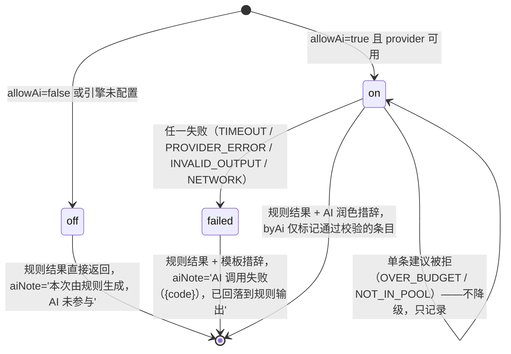
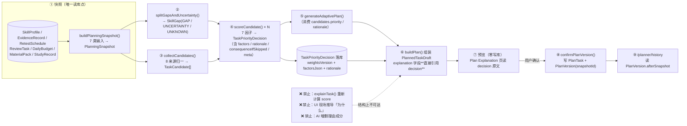

# v2.7 架构设计 — Adaptive Learning & Curriculum Planner

> 版本：v2.7 · 角色：架构师 高见远
> 上游（**权威顺序**）：`40-v2.7-decisions.md`（裁决，**优先于 PRD**）> `38-v2.7-prd.md`（范围与 AC-1~AC-17）> `39-v2.7-current-state-audit.md`（现状）
> 本文档**不含应用代码**；schema 与迁移由 Phase A 的工程师落地，本文只给契约。**不提交 git**。

---

## 目录

0. [设计基线：三条铁律与四个禁区](#0-设计基线三条铁律与四个禁区)
1. [模块地图](#1-模块地图)
2. [核心函数签名](#2-核心函数签名)
3. [`AdaptivePlanInput` 扩展契约与 golden test](#3-adaptiveplaninput-扩展契约与-golden-test)
4. [可解释性数据流（禁止二次计算）](#4-可解释性数据流禁止二次计算)
5. [7/30/90 层级与 stale 传播规则](#5-73090-层级与-stale-传播规则)
6. [AI 层契约](#6-ai-层契约)
7. [页面 ↔ 数据依赖表](#7-页面--数据依赖表)
8. [不变量守门](#8-不变量守门)
9. [数据层契约（Phase A 对齐表）](#9-数据层契约phase-a-对齐表)
10. [测试分层总纲](#10-测试分层总纲)

---

## 0. 设计基线：三条铁律与四个禁区

### 0.1 三条铁律（新代码不得破坏）

| # | 铁律 | 唯一口径来源 | 违反后果 |
|---|---|---|---|
| **I-1** | **净学习分钟 = `SUM(StudySessionDaySplit.minutes)`**。任何新表**不得**新增 `actualMinutes` / `netMinutes` / `durationMinutes` 类字段 | `domain/duration.ts:171-180`、`queries/plan.ts:54-60` | 历史统计不可逆失真 |
| **I-2** | **计划分钟 = `SUM(PlanTask.plannedMinutes)`**，且只统计 `status NOT IN ('DEFERRED','CANCELLED')`。`TaskCandidate.estMinutes` / `TaskProposalItem.suggestedMinutes` **永不进任何统计** | `PlanTask`、`completion.ts:43` | 双计 |
| **I-3** | **四技能分母 = `AllocationSkill` 四项**（`LISTENING/READING/SPEAKING/WRITING`）。Grammar / Vocabulary / Sentence Structure 只在 `SkillGap.dimensionKind='AUXILIARY'` 与候选中出现，**不进分母** | `types.ts:231`、`allocation.ts:40` | 违反约束 §4.1 |

### 0.2 四个禁区（结构性禁止，靠类型/测试而非自觉）

| # | 禁区 | 结构性保障 |
|---|---|---|
| **F-1** | AI 参与时间分配 / 装箱 / 复习日期计算 | `domain/*` 与 `services/planBuild.ts` 的调度段**不得** import `@/lib/ai/*`；AI 只在 `planBuild` 的 `applyAiLayer()` 后置阶段被调用（`importBoundary.test.ts` 断言） |
| **F-2** | 用完成率 / 学习时长 / 单次 AI 分数推导晋级 | `ReadinessInput` **类型里根本没有** `daysCompleted` / `completionRate` / `aiScore` 字段 —— 拿不到就写不出 |
| **F-3** | AI 新增池外任务类型 | AI 输出必须按 `candidateKey` 在既有池中解析；未命中 → `eligibility='REJECTED_NOT_IN_POOL'`，不落候选 |
| **F-4** | 解释二次计算 | 解释字段只能从 `TaskPriorityDecision` 读；`explainTask()` 无 `scoreCandidate` 依赖（`explanationNoRecompute.test.ts` 用「篡改 decision → 解释随之变化」反证） |

---

## 1. 模块地图

> 分层约定（与既有代码一致）：**`domain/` = 纯函数，禁止 `import prisma`、禁止 `Date.now()`、禁止随机**；`services/` 才允许 IO；`actions/` 负责 zod + 事务 + `revalidatePath`；`queries/` 只读。

### 1.1 `src/lib/domain/`（纯函数，无 IO）

| 文件 | 职责（一句话） | 新建/改造 |
|---|---|---|
| `planningSnapshot.ts` | `hashPlanningInput()` + `validateSnapshotInput()` + 快照 DTO 类型。**只做规范化、哈希与缺失项判定，不读库** | 🆕 |
| `skillGap.ts` | `splitGapsAndUncertainty()`：7 类证据信号 → `GAP / UNCERTAINTY / UNKNOWN` 三态判定 + `dimensionKind` 分流 + `severity` 归一 | 🆕 |
| `taskCandidate.ts` | `normalizeCandidate()` / `candidateKeyOf()` / `dedupeGroupOf()` / `evaluatePrerequisites()` / `dedupeCandidates()`。**8 来源的归一规则表与去重分组表在此** | 🆕 |
| `taskPriority.ts` | `scoreCandidate()` / `priorityOf()` / `buildDecision()` / `DEFAULT_WEIGHTS` / `WEIGHTS_VERSION` | 🆕 |
| `carryover.ts` | `carryoverPolicy()`：升格 / 降格 / 进 backlog / 放弃 + 单日上限 | 🆕 |
| `readiness.ts` | `computeReadiness()`：五维 → 5 结论。**唯一**允许产出「可晋级」结论的地方 | 🆕 |
| `planDiff.ts` | `diffPlan()`：纯 diff（新增/移除/移动/分钟变化/保持）+ 汇总 | 🆕 |
| `sourceBadge.ts` | `resolveSourceBadge(task, candidate)`：来源徽章的**唯一**解析点（`PROBE`→「补测（证据不足）」/`RETEST`→「到期复测」…）。纯函数、无 IO，放在 domain 是为了让客户端组件能**值导入**而不把 prisma 打进浏览器包 | 🆕 |
| `weeklyDelta.ts` | `buildWeeklyDelta()`：两周指标 → 改善/未解决/需诊断三类 + 阈值判定 | 🆕 |
| `adaptivePlan.ts` | **只加可选输入**（`bufferRatio` / `candidates` / `uncertainties` / `skillGaps`），不传时行为逐字不变 | 🔧 改造 |
| `stageGate.ts` | H4 退出 `blockers`，改相对预算参考指标（Q5） | 🔧 改造（已验收） |
| `allocation.ts` / `replan.ts` / `plan.ts` / `duration.ts` / `weakness.ts` / `profile.ts` / `taskProposal.ts` / `cycle.ts` / `completion.ts` / `suggestion.ts` | **零改动**，仅被调用 | 复用 |

### 1.2 `src/lib/services/`（唯一允许 IO 的业务层）

| 文件 | 职责 | 新建/改造 |
|---|---|---|
| `planningSnapshot.ts` | `buildPlanningSnapshot()`：7 类输入装配 → 幂等写 `PlanningSnapshot` → 返回内存 `context` 供本次调度直接使用（避免二次读库造成快照与调度不一致） | 🆕 |
| `planWrite.ts` | **`appendTaskFromCandidate()`：全系统唯一写 `PlanTask` 的函数**（Q6） | 🆕 |
| `planBuild.ts` | `buildPlan()`：`aiMode` 三态状态机；编排 snapshot → gaps → candidates → priority → adaptivePlan → decision 落库 → （可选）AI 后置 | 🆕 |
| `replanPreview.ts` | `previewReplan()`（dry-run，零写库）+ `confirmReplan()`（token 校验后一次事务落库） | 🆕 |
| `readiness.ts` | `persistReadinessReview()`：`computeReadiness()` 结果 + 证据引用 → `StageReadinessReview` | 🆕 |
| `carryoverApply.ts` | 把 `carryoverPolicy()` 的裁决写回 `PlanTask`（`DEFERRED`/`backlog`/`deferReason`/`movedCount`），不新建表 | 🆕 |
| `materialDeletion.ts` / `materialPackRepo.ts` / `materialChunkRepo.ts` | 零改动 | 复用 |

### 1.3 `src/lib/actions/`

| 文件 | 职责 | 新建/改造 |
|---|---|---|
| `planner.ts` | 11 个 action：生成预览 / 确认版本 / 重排预览 / 确认重排 / readiness 确认 / 周建议接受 / 候选手动提级 …（见 §2.9） | 🆕 |
| `materialPack.ts` | `confirmTaskProposalAction` **只把写入调用换成 `appendTaskFromCandidate()`**；签名、返回结构、组件 props 一律不变 | 🔧 改造（已验收 / Q6） |
| `plan.ts` / `replan.ts` / `stages.ts` / `weekly.ts` | 零改动（`plan.ts` 内部改为调用 `appendTaskFromCandidate` 以便收口，签名不变） | 复用（微调） |

### 1.4 `src/lib/queries/`

| 文件 | 职责 | 新建/改造 |
|---|---|---|
| `planner.ts` | 12 个只读查询（见 §7 表） | 🆕 |
| `plan.ts` / `budget.ts` / `evidence.ts` / `skillProfile.ts` / `weekly.ts` / `planning.ts` / `materials.ts` | 零改动 | 复用 |

### 1.5 `src/lib/schema/` 与 `src/lib/ai/`

| 文件 | 职责 | 新建/改造 |
|---|---|---|
| `schema/planner.ts` | 全部 zod schema（13 个，见 §2.10）；权重配置带**非法即拒绝**（`sum≈1`、无负数、无未知键） | 🆕 |
| `ai/planner.ts` | AI 建议层：3 个 kind 的领域函数，**只做内容/措辞**；全部经 `runAiCompletion()` | 🆕 |
| `ai/types.ts` / `prompts.ts` / `structured.ts` | 追加 3 个 prompt kind（16 → 19）与 3 个 schema | 🔧 改造 |
| `ai/orchestrator.ts` | **零改动**（`runAiCompletion` 已可用） | 复用 |

### 1.6 `src/components/planner/` 与路由

| 路径 | 职责 |
|---|---|
| `src/app/planner/page.tsx` + `components/planner/Dashboard*` | 决策层首页 |
| `src/app/planner/evidence/page.tsx` + `GapSummary*` | 依据层 |
| `src/app/planner/candidates/page.tsx` + `CandidateQueue*` | 操作层（候选池） |
| `src/app/planner/build/page.tsx` + `PlanBuilder*` | 四层构建器（7 / 30 / 90） |
| `src/app/planner/explain/[versionId]/page.tsx` + `Explanation*` | 解释与取舍 |
| `src/app/planner/budget/page.tsx` + `BudgetPlanner*` | 预算 |
| `src/app/planner/replan/page.tsx` + `ReplanPreview*` | 重排预览 |
| `src/app/planner/readiness/page.tsx` + `Readiness*` | 阶段就绪 |
| `src/app/planner/history/page.tsx` + `VersionHistory*` | 版本历史 |
| `src/app/weekly/page.tsx`（**升级**）+ `components/weekly/WeeklyDelta*` | 周复盘新增 5 区块 |

### 1.7 依赖方向（单向，违反即 F-1）

```
components → actions / queries → services → domain
                                  services → ai/planner → ai/orchestrator（共享层）
domain  ✗→ prisma      ✗→ ai/*      ✗→ Date.now()
ai/planner ✗→ adaptivePlan / allocation / replan / stageGate   （AI 不碰调度）
domain/*   ✗→ ai/planner
```

**客户端组件的硬约束（新增）**：`components/**` 对 `queries/**` **只允许 `import type`**。需要**值**（函数/常量）时，必须先下沉到 `domain/**`（纯函数）或 `lib/format.ts`（展示格式化），再由组件从那里导入。
理由：`queries/*` 会 `import { prisma }`；组件里一旦出现值导入，客户端包就会尝试打包 `PrismaClient`。实测既有 39 处 `from '@/lib/queries/*'` **全部是 `import type`**（含多行形式），说明这条约定已经成立，只是没写下来 —— 现在写下来并由 G-5 ③ 守。

**G-5③ 的实现要求（多行感知，否则门禁本身失效）**

逐行 `grep` + 「该行必须含 `import type`」是**错的**，会同时产生两类错误：

| 失败模式 | 具体表现 |
|---|---|
| **误报** | 多行 `import type {` 的**闭合行** `} from '@/lib/queries/materials';` 不含 `import type` → 被误判为违规。实测既有代码就有 **3 条**这样的闭合行（`VocabCandidateTable.tsx:29`、`SourceDetailsBody.tsx:30`、`ExerciseBuilderBody.tsx:27`） |
| **漏报** | 真正的值导入若写成多行（`import {\n  resolveSourceBadge\n} from '@/lib/queries/planner'`），逐行匹配找不到 `import type` 也找不到 `from`，直接漏掉 |

**首选实现：用 `typescript` Compiler API 做 AST 检查**（`typescript@^5.7.3` 已是 devDependency，无需新依赖）：

```ts
import ts from 'typescript';

function isTypeOnlyImport(node: ts.ImportDeclaration): boolean {
  const clause = node.importClause;
  if (!clause) return false;                       // 裸 import 'x'：无运行时绑定，另按需处理
  if (clause.isTypeOnly) return true;              // import type { A } from '...'
  // import { type A, type B } from '...' —— 所有具名绑定都是 type，运行时同样被擦除
  const nb = clause.namedBindings;
  if (nb && ts.isNamedImports(nb)) return nb.elements.length > 0 && nb.elements.every((el) => el.isTypeOnly);
  return false;                                    // import X from / import * as X from：值导入
}

// 对每个 components/**/*.tsx：
const sf = ts.createSourceFile(file, source, ts.ScriptTarget.Latest, /* setParentNodes */ true, ts.ScriptKind.TSX);
for (const node of sf.statements) {
  if (!ts.isImportDeclaration(node)) continue;
  const spec = (node.moduleSpecifier as ts.StringLiteral).text;
  if (!spec.startsWith('@/lib/queries')) continue;
  if (!isTypeOnlyImport(node)) {
    violations.push({ file, line: sf.getLineAndCharacterOfPosition(node.getStart(sf)).line + 1, spec });
  }
}
```

AST 方案零误报零漏报，且能识别 `import { type A, type B }` 这种 inline 写法。

**次选（不允许 AST 时）**：正则必须跨行，且**只对不以 `type` 开头的 import 报警**：

```ts
/import\s+(?!type\b)[^;]*?from\s*['"]@\/lib\/queries/g   // [^;]*? 而非 [\s\S]*?，避免跨语句误跨
```

三条用例必须都在（`importBoundary.test.ts`）：① 多行 `import type` **不报**；② 多行值导入 **要报**；③ 单行值导入 **要报**。缺任一条，这个门禁就是「看起来在守、实际守不住」—— 比没有更糟。

### 1.8 映射表定型规则：**键集合由枚举决定时，必须 `Record<枚举联合, V>`**

> **凡是「键 = 某个枚举取值」的映射表，必须用 `Record<枚举联合, V>` 定型，不得用手写对象字面量 + `as const`。**

`as const` 只固定**值**，不固定**键集合**。漏键在运行期表现为 `undefined`，下游后果通常是 `NaN`（参与算术）或空白（参与渲染）—— **两者都不报错**。

| # | 事故 | 形状 |
|---|---|---|
| ① | `PlanTask.sourceKind` 的 schema 注释 6 值 vs `TASK_SOURCE_KINDS` 实际 7 值（v2.2 加了 `RETEST`） | 手写清单与常量分叉 |
| ② | `TASK_SOURCE_LABEL_ZH: Record<string, string>` → 未知键渲染**空白徽章** | 键类型宽成 `string`，等于放弃检查 |
| ③ | §2.3.3 的 `QUESTION` 派生分钟表：`{MCQ, MULTI, SHORT_ANSWER, OPEN_WRITING, OPEN_SPEAKING}` 与 `DIAG_TASK_TYPES`（`MCQ/SHORT_ANSWER/OPEN_TASK`）、`MATERIAL_EXERCISE_TYPES`（5 个材料题型）**全不相交**，且缺 `OPEN_TASK` | 凭印象造表，没有任何东西比对枚举 |

三次的形状完全一样：**手写表 + 没有任何机制保证键集合与枚举一致**。

**后果是具体的**。事故 ③ 若照文档落地：诊断题里 `taskType === 'OPEN_TASK'` 的行取到 `undefined` → `estMinutes = NaN` → 装箱时 `Σ` 为 `NaN` → `Σ ≤ budget` 恒为 `false` → **任务被静默挤出**，不报错、不告警、页面只是「今天安排得有点少」。

**正例（已做对，可作模板）**：

```ts
export const TASK_SOURCE_LABEL_ZH: Record<(typeof TASK_SOURCE_KINDS)[number], string> = { … };
export const CANDIDATE_DEFAULT_MINUTES: {
  QUESTION: Record<DiagTaskType | MaterialExerciseType, number>;   // 3 + 5 = 8 键
  LAB: Record<ListeningMode | SpeakingTaskType, number>;           // 9 + 9 − 1 = 17 键
};
export const CANDIDATE_FALLBACK_MINUTES: Record<MinuteBearingSourceKind, number>;  // Exclude<…> 派生
export const CANDIDATE_SOURCE_PRIORITY: Record<CandidateSourceKind, number>;
export const EST_MINUTES_BY_INTERVAL: Record<IntervalCode, number>;   // 既有，本来就是这样
```

**这条规则比「逐张表加断言」更有用**：断言是人想起来才加的，`Record<Union, V>` 是编译器每次都查。断言只应作为**第二道**（守运行期数据，如 §8 G-14），第一道必须在这里。

两个配套要求：

1. **枚举只有一份**：不要在 `domain/` 里重新声明一份同样的字面量联合。用 `(typeof X)[number]` 从既有常量数组推导（`src/lib/constants.ts`、`src/lib/diagnostic/constants.ts`）。
2. **值语义不同就分表**：「本来就没有时长字段」与「本该有却是空」是两种语义，分成 `CANDIDATE_DEFAULT_MINUTES` / `CANDIDATE_FALLBACK_MINUTES`，后者必须标 `derivedFrom: 'fallback:…'` 让数据问题显形。合表会让「估算」和「缺数据」长得一样。

**唯一的例外：表**本身**用 `Partial<Record<枚举联合, V>>` 声明**，且必须「缺失有明确定义」才允许。例：`QUESTION_OPEN_TASK_SKILL_OVERRIDE: Partial<Record<SkillId, number>>` 只有 `WRITING`/`SPEAKING` 两个键，因为未命中时**有确定的回落值**（`QUESTION.OPEN_TASK = 15`），且回落这件事写在取值顺序里。判据是：

> **键缺失时，行为是"有定义的回落"还是"`undefined` 流进算术"？** 前者可以 `Partial`，后者必须全键。

**这条豁免只适用于「表本身声明为 `Partial<Record<枚举联合, V>>`」；键类型为 `string` 的表不适用豁免，一律视为未定型。** 而且 `Record<string, V>` 比 `Partial<Record<枚举, V>>` **危险一个量级**：

| 声明 | TS 对读取的保证 | 实际 | 后果 |
|---|---|---|---|
| `Partial<Record<SkillId, number>>` | `number \| undefined` | 一致 | **编译器逼调用方写 `??`** —— 安全网在这里 |
| `Record<string, number>` | **「每个键都一定有 `number`」** | 未列出的键是 `undefined` | 这个保证是**假的**，而且它**免除了**写 `??` 的义务 → `undefined` 直接进算术 → `NaN` |

同一个事故换了个字段名而已。本仓库当前有一例未收口：`services/planningSnapshot.ts:65` 的 `goal.skillTargets`，见 §9.1 **C-I**（它是本事故族的**第四个实例**）。

⚠️ **G-14 第二道要豁免 `Partial` 表**（否则测试会假红）：对 `Partial<Record<…>>` 断言的是「键集 **⊆** 枚举」而不是「= 枚举」。写错成「= 枚举」的话，`QUESTION_OPEN_TASK_SKILL_OVERRIDE` 会因为只有 2 个键而红 —— 而假红的下场是有人把这条断言删掉。

**但豁免的正确断言方式是「逐缺失键走查找点」，不是「表里现有的值看着没问题」**：

```ts
// ✅ 遍历枚举中【不在表里】的每一个键，通过查找点断言文档写明的默认值
const missing = SKILL_IDS.filter((s) => !(s in QUESTION_OPEN_TASK_SKILL_OVERRIDE));
expect(missing.length).toBeGreaterThan(0);          // ★ 防空转：键被填满时循环体不执行，测试静默绿
for (const skill of missing) {
  const picked = estMinutesOf('OPEN_TASK', skill);
  expect(picked.estMinutes).toBe(15);               // 不是 undefined、不是 NaN
  expect(picked.derivedFrom).toBe('default:OPEN_TASK');
}
```

理由：`for (const k in table)` 遍历的是**实际有的键**，它永远不会告诉你有哪个键**没有** —— 而 `Partial` 的安全性恰恰全在「没有的那些键」上。同时必须打在**查找点**（`estMinutesOf`）而不是表本身：表可以完全合法，调用处漏一个 `?? 15`，`undefined` 照样流进算术。

⚠️ 还有一层，比「定点不够」更隐蔽：**循环自己也会空转**。所以三件事缺一不可 —— ① **遍历**而不是定点（枚举加值时定点不会红）；② 循环前断言**缺失侧非空**（见 §1.9 **A-1**：`[].every()` 恒 `true`，键被填满时循环体一次都不执行、测试静默通过）；③ **走查找点**而不是表。

顺带一个反面教材（§1.9 **A-2**）：`OVERRIDE.READING ?? 15` 这种写法看着在测回落，其实**恒真** —— `READING` 不在表里，`undefined ?? 15 === 15`，左边根本没调用任何实现，它测的是 `??` 运算符。

这条与「幂等键非空断言」同理 —— **正向遍历证明不了缺失侧的行为**。断言层面的三条通病见 §1.9。

### 1.9 断言的自我欺骗（四条一族）

§1.8 管的是**表的形状**。本节管**断言本身的形状** —— 有一类断言看起来在守，实则恒真，而且它们的错法不是"漏测"，是"测了个不需要测的东西"。这类比漏测更危险：漏测迟早被 bug 暴露，恒真断言会让整条防线在人心里已经"守住了"。

四条是同一族，都表现为「**通过了，但没有信息量**」（前三条管断言，A-4 管契约）：

#### A-1 全称量词断言必须先断言集合非空

> `[].every(...)` 恒 `true`；`for (const x of []) { … }` 什么都不做；`.filter(…).map(…)` 空数组不报错。
> 所以任何「**对集合里每个元素都成立**」的断言，在集合为空时是**真空通过**，不是通过。

```ts
// ❌ 缺失侧为空时整个循环不执行，测试静默绿
for (const skill of SKILL_IDS.filter((s) => !(s in OVERRIDE))) expect(f(skill)).toBe(15);

// ✅ 先证明"确实有缺失侧"，再遍历
const missing = SKILL_IDS.filter((s) => !(s in OVERRIDE));
expect(missing.length).toBeGreaterThan(0);        // ★ 这条本身也是一个断言，必须有
for (const skill of missing) expect(f(skill)).toBe(15);
```

**但"一律禁止空集"是错的 —— 有些空集是正常结果。** 判据是：

> **这个集合为空，本身是不是一个需要通过的事实？**
> - **是** → 断言非空（`toBeGreaterThan(0)` / `not.toHaveLength(0)`）；
> - **不是**（空即预期，如「没有候选被丢」）→ 换一种断言形式，别写全称量词，改成断言**空集分支的返回值**（如 `dropped` 为空时断言 `kept.length === 输入长度`）。

本仓库四类受影响的全称断言，逐条给出处置：

| 断言 | 空集是否合法 | 处置 |
|---|---|---|
| 「8 个来源全覆盖」`KINDS.every(k => 有用例)` | **不合法**（枚举被删空仍绿） | 先 `expect(KINDS.length).toBe(8)` |
| 「逐缺失 `SkillId` 回落 15」 | **不合法**（键填满后循环空转） | 先 `expect(missing.length).toBeGreaterThan(0)` |
| 「对所有 `SkillId` 断言 `minMinutes > 0`」 | **不合法** | 同上 |
| 「遍历 `dropped` 断言每条有 `why`」 | **合法**（没有丢弃就是空） | **不要**断言非空；改为断言 `kept.length === list.length` 与 `dropped.length === 0` 同时成立 |

#### A-2 断言的两侧必须来自不同来源

若等号两边的值最终由**同一个表达式 / 同一个内存对象 / 同一份配置**产生，这条断言恒真，且它测的是语言语义而不是我们的代码。

```ts
// ❌ 左边 = 右边 = 同一个字面量；左边根本没调用任何实现
const fallback = CANDIDATE_DEFAULT_MINUTES.QUESTION.OPEN_TASK;      // 15
expect(OVERRIDE.READING ?? fallback).toBe(fallback);                 // undefined ?? 15 → 恒真

// ✅ 左侧走被测的查找点，右侧是"文档写明的默认值"这个独立事实
expect(estMinutesOf('OPEN_TASK', 'READING').estMinutes).toBe(15);
```

同类：`expect(x).toBe(x)`、拿 `DEFAULT_WEIGHTS` 自身去验证 `DEFAULT_WEIGHTS` 之和、用 `severity` 重算一遍再断言等于 `severity`。

#### A-3 变异必须精准命中 —— **三层缺一不可**

凡「改一处输入 / 篡改一个字段 → 断言输出变化」的测试，要做到三层。少任何一层，结论都会是错的，而且错的方式彼此不同：

**第 1 层 · 选对变异：一个变异只能证明一个失效模式。要证哪条，就得打哪条。**

要证的失效模式是什么，变异就必须是那个。`删键` ≠ `放宽类型` ≠ `改回落值` ≠ `换查找路径` —— 它们各自只打得中自己那一条。

> 实例（真实踩过）：为验证「类型没有被放宽回 `as const`」这道门禁，第一次的变异是**删掉表里一个键**。它确实红了，但那证明的是「键缺失」这个失效模式（编译期 + 集合断言），**完全没触及「类型被放宽」** —— 后者要靠把 `Record<枚举联合, V>` 降级成 `Record<string, V>` 才打得中。选错变异时，测试红了也会让人以为那条门禁已经被证明。

**第 2 层 · 确认命中：变异真的改到了被测那一行。**

否则「没红」会被误读成「断言太弱」，而实际是没打中（字段名写错、值被默认值覆盖、分支根本没进、改的是另一份拷贝）。

**第 3 层 · 确认断言没被变异吃掉（最阴的一层）。**

如果断言的一侧取自**被测对象本身**，变异会让两侧**一起变**，于是两边仍然自洽、断言仍然绿。这时「不红」**不能推出任何结论** —— 而它的表现和「断言太弱」完全一样。

> 实例（同一个事故的另一半）：那次变异用 `as const` 常量当对照，表被改、对照跟着改，两边自洽 —— 变异明明生效了，断言却什么都说明不了。对照必须取自**变异之外的独立来源**（字面量、文档写明的默认值、另一份 fixture）。

**三个正例，形状可以照抄（它们各自满足三层）**：

- `42` T04 ⑮：改 `SkillGapSignal` 侧输入（第 2 层：先断言"这样改会让重算结果不同"）→ 断言 `evidenceStrength` **仍等于落库的 0.40 那一路**（第 1 层：打的是"实现偷偷重算"这个失效模式；第 3 层：对照是落库值，不是重算值）。
- `42` T04 ⑪：改 `weightsVersion` 与权重值 → 断言**至少一条候选的 `priority` 发生变化**。打的是"只存不用"。
- G-8：篡改 `decision.rationale` → 断言解释页输出**跟着变**。打的是"解释页二次计算"。

**共性**：不要断言「跑通了」，要断言「**差异出现在预期的位置、且只出现在那里**」。

#### A-4 公共函数的契约不能靠调用方的 pre-filter 兑现

> **一个 `export` 的函数，如果去掉某个调用方的前置过滤就会错，那它自己就错了。**
> 校验要放在**函数入口**，不是入口的前一步。

实例（真实踩过）：`parseSkillTargets(raw: unknown)` 被 `export`、JSDoc 写着「任意输入」，而它的正确性依赖 `services/planningSnapshot.ts:178` 那道 `.filter(([, v]) => typeof v === 'number')`。今天不炸**只因为恰好只有一个调用点** —— 而这个函数注定被 T04 复用，**第二个调用点不会知道要 pre-filter**。

这就是这一族的共同形状：**看起来在守，实际靠别的东西在守** ——

| 规则 | 它以为的防线 | 实际靠的东西 | 撤掉之后 |
|---|---|---|---|
| A-1 | 「每个元素都满足」 | **集合不会为空** | 空数组真空通过 |
| A-2 | 「两边相等」 | **两侧不会同时错** | 同源自洽、恒真 |
| A-3 | 「断言能抓住错误实现」 | **变异打中了目标** | 变异没打中，绿 |
| **A-4** | 「函数处理了脏输入」 | **调用方会先过滤** | 换个调用点就炸 |

修法固定：**类型挡在函数第一行**（`if (typeof value !== 'number') continue;` 早于任何 `Number()` / `parseFloat()` / `+value`），而不是在调用点加 `.filter`。注意顺序不可换：`Number(null)` / `Number('')` / `Number([])` / `Number(false)` **全是 `0`** —— 而 `0` 是有限非负数，放在 `Number()` 之后再怎么检查都拦不住。

**自动发现（G-15）**：这类缺陷结构特征稳定，值得一条绊线 —— 扫描 `domain/**` 的 `export function`。

触发集**按危险属性定义**，不按「看起来像强转」：

> **危险属性 = 「非 `number` 输入 → 有限的 `number` 输出」。**

| 是否触发 | 表达式 | 非 number 输入的结果 | 为什么 |
|---|---|---|---|
| ✅ | `Number(x)` | `Number(null) === 0` | 造出一个**合法**的 0 |
| ✅ | `+x` | `+null === 0` | 同上（且文本 grep 抓不到） |
| ✅ | `~~x` / `x \| 0` / `x >> 0` | `~~null === 0` | 同上 |
| ❌ | `parseInt(x)` / `parseFloat(x)` | **`NaN`** | 会翻车、会被 `isFinite` 抓住，伪装不成合法值 |
| ❌ | `Number.isNaN()` / `toFixed()` | —— | 不是强转 |
| ❌ | `x as number` | 运行时**原值不变**（没有转换） | 不造 0；危害是「让 TS 不再要求 `??`」，属**类型层**问题，由不变量测试与行为测试管，不是这条扫描能抓的 |

（`x as number` 这一行的存在是为了说明它是**决定排除**而不是**漏掉**：它不造 0，危害在类型层。）

按「看起来像强转」列触发集，`parseInt`/`parseFloat` 一定会被写进去，然后产出一批**假阳性** —— 假阳性的下场就是白名单被用来混过去、名单烂掉。而按危险属性收敛后，这条规则自带一句判据：**「为什么 `parseInt` 不管？因为它给 `NaN`，`NaN` 会被 `isFinite` 抓住。」** 遇到 `BigInt(x)`、`Math.trunc(x)` 这类新写法，问这一句就能定。

**三处盲区**（不写清会让人以为它覆盖了 A-4）：

1. 打不中「**没写守卫**」之外的任何形态 —— 也就是说它只盖得到最直白的那一种；
2. 打不中「**守卫在，但守卫错了对象**」（`typeof a` 之后去 `Number(b)`）；
3. **打不中「函数体里根本没有强转」** —— 脏值从**装配处**进来。这正是 C-I 的真实形态：`Object.fromEntries([['LISTENING', minListening], …])` 一行强转都没有，`null` 由构造过程带进 `Record<string, number>`，G-15 完全看不见。（反过来说，`parseSkillTargets` 自己属于盲区 2 的形态 —— 加一个 `typeof value` 就绿，但绿了不代表它对每个键都挡了。）

所以它是**绊线，不是证明**（同 G-14 第④道），真正的证明只有行为测试（`42` T02 ⑯ / T04 ⑳）。配白名单 + 无僵尸条目断言，否则实现者只能写成假阴性。

##### A-4 的邻居：**「空输入」≠「输入里有空值」**

上例里测试覆盖了 `parseSkillTargets(null)`（整个入参是 `null`）却**没覆盖 `parseSkillTargets({ READING: null })`**（入参是对象、**值**是 `null`）。前者通过不代表后者通过 —— 后者才是真实数据的样子（`LearningGoal.minReading` 是 `Float?`）。

同类的三对，都容易只测左边：

| 只测了这个 | 漏了这个 |
|---|---|
| 数组为空 `[]` | 数组元素是 `undefined` / `null`：`[undefined, 1]` |
| 字符串为空 `''` | 字符串全是空白：`'   '` |
| 入参为 `null` | 入参是对象、字段为 `null` |

判据：**「没有输入」和「输入里没有值」是两种输入**。前者测的是"函数能不能处理空"，后者测的是"函数能不能处理半空"—— 而真实数据几乎永远是后者。

> **四条合起来一句话**（前三条管断言，A-4 管契约）：
>
> - 断言要问：**「我要防的那种错误实现，会让它红吗？」** —— 不是「*某种*错误实现会让它红吗」，那太松，把断言删掉也能"红"。答不上来，这条就是恒真的；答上来但变异打不中它，就是白测一场。
> - 契约要问：**「把这个调用方的前置过滤删掉，函数还对吗？」** —— 不对就说明校验放错了位置。
>
> 两句问的是同一件事：**这个"守住"是真的，还是靠别的东西替它守住的？**

---

## 2. 核心函数签名

> 全部签名可直接抄写落地。`ActionResult<T>` 来自 `src/lib/types.ts`（`ok()/fail()` 见 `src/lib/result.ts`）。

### 2.1 `buildPlanningSnapshot()`

```ts
// src/lib/services/planningSnapshot.ts
export type PlanningSnapshotPurpose =
  | 'GENERATE'          // 日/7 天计划生成
  | 'REPLAN'            // 重排
  | 'WEEKLY'            // 周闭环
  | 'CYCLE_CALIBRATION' // 90 天中途校准
  | 'READINESS';        // readiness 评审

export interface BuildPlanningSnapshotInput {
  purpose: PlanningSnapshotPurpose;
  /** 业务日期 YYYY-MM-DD（Asia/Singapore 口径，由 lib/date.ts 提供） */
  asOfDate: string;
  /** 1（日）| 7 | 30 | 90 */
  horizonDays: number;
  stageId?: string;
  /** REPLAN 必填：要重排的那一天 */
  planDate?: string;
  /** 默认 true：同 inputHash 复用已有快照（幂等） */
  reuseIfSameHash?: boolean;
}

/** 缺失输入清单的一项。blocking=true 表示禁止生成计划，只能降级展示。 */
export interface MissingInputItem {
  key: 'GOAL' | 'BUDGET' | 'STAGE' | 'PROFILE' | 'EVIDENCE' | 'REVIEW' | 'RETEST' | 'CANDIDATES' | 'EXECUTION';
  label: string;
  severity: 'blocking' | 'degraded';
  /** 给用户的可操作提示（不写"暂无数据"死胡同，PRD §4 空态约束） */
  hint: string;
}

/** 装配结果：内存对象，本次调度直接用，不再二次读库。 */
export interface PlanEngineContextV27 {
  asOfDate: string;
  horizonDays: number;
  stage: { id: string; code: StageCode; profileCode: string | null };
  goal: {
    track: LearningTrack;
    targetValue: string | null;
    targetDate: string | null;
    /** 键是 `SkillId`（8 值）而不是 `AllocationSkill`（4 值）：`goalRelevance` 会用任意 `SkillId` 去索引，
     *  声明成 4 键会让每次查找都要断言。实际数据只填四个官方技能，其余键缺失 → `number | undefined`（C-I）。 */
    skillTargets: Partial<Record<SkillId, number>>;
  } | null;
  budget: EffectiveBudget;                        // getEffectiveBudget() 原样
  /** 逐日预算（7/30/90 需要；日计划只有 1 项） */
  budgetDays: BudgetDay[];
  /** v2.1 既有输入（原样透传，保证 golden 一致） */
  legacy: Omit<AdaptivePlanInput, 'budgetMinutes' | 'isRestDay' | 'tierCode'>;
  /** v2.7 新增 */
  gaps: SkillGapDraft[];
  candidates: TaskCandidateDraft[];
  decisions: TaskPriorityDecisionDraft[];
  /** 实际执行情况（近 7/30 天；只读 DaySplit，不读 actualMinutes） */
  execution: { last7NetMinutes: number; last30NetMinutes: number; activeDaysLast7: number };
  /** 快照可用性 */
  validation: { ok: boolean; missing: MissingInputItem[]; warnings: string[] };
}

export interface PlanningSnapshotResult {
  snapshotId: string;
  inputHash: string;
  /** true = 命中同 hash 已有快照，未新建 */
  reused: boolean;
  ruleVersion: string;
  weightsVersion: string;
  context: PlanEngineContextV27;
}

export async function buildPlanningSnapshot(
  input: BuildPlanningSnapshotInput,
): Promise<ActionResult<PlanningSnapshotResult>>;
```

#### `inputHash` 计算规则（**同输入必须同 hash**）

```ts
// src/lib/domain/planningSnapshot.ts
export const RULE_VERSION = 'v2.7.0';   // 调度语义版本；规则一改必须递增

export function hashPlanningInput(canonical: CanonicalPlanningInput): string;
```

规范化必须满足 5 条（每条都有单测）：

| # | 规则 | 理由 |
|---|---|---|
| H-1 | **JSON 键名递归字典序排序**；数组按声明主键排序（`candidates` 按 `candidateKey`、`dueRetests` 按 `id`、`gaps` 按 `dimensionKind|skill|subskill`） | 数据库返回顺序不稳定 |
| H-2 | **排除所有原始时间戳**，只保留**派生整数**（`freshnessDays`、`overdueDays`、`horizonDays`）。`createdAt` / `updatedAt` 一律不进 hash | 否则每次查询时间不同 → hash 永不命中 |
| H-3 | 浮点统一 `round(x, 3)` 后转字符串（`severity`、`coverageRatio`） | 消除 `0.30000000000000004` |
| H-4 | `null` 与 `undefined` 统一为 `null`；空数组与缺字段**不同**（`[]` ≠ `null`，语义不同：有源但无候选 vs 源不可用） | 保证「源挂了」与「源是空的」可区分 |
| H-5 | hash 内容**必须包含** `RULE_VERSION` + `weightsVersion` + `config`（含 `bufferRatio`、`CANDIDATE_DEFAULT_MINUTES` **与** `CANDIDATE_FALLBACK_MINUTES` 两张派生表、`priorityThresholds`） | 规则/权重/估算表变更必须换 hash，否则旧快照会被误复用。**改一次默认分钟表 → 全部候选的 `estMinutes` 变 → 计划会变，hash 必须跟着变** |

```
inputHash = sha256( canonicalJSON({
  v: RULE_VERSION, weightsVersion,
  asOfDate, horizonDays, purpose, stage: { code, profileCode },
  goal, budget: { minutes, tierCode, isRestDay, source, isInitialSuggestion },
  budgetDays, config, allocation, weeklyGap,
  dueReviews, dueRetests, gaps, candidates, execution,
  replan: purpose === 'REPLAN' ? { planDate, existingTaskKeys, actualMinutesToday } : null,
}) ).slice(0, 32)
```

> `existingTaskKeys` / `actualMinutesToday` 只在 `REPLAN` 时进 hash —— 日生成与重排是不同语义的输入。

#### 7 类输入装配表

| # | 类别 | 来源（表 / 函数） | 缺失时 |
|---|---|---|---|
| 1 | 目标 | `LearningGoal` + `GoalMilestone` | `blocking`：无法判断目标相关度；仍可生成「纯时间驱动」计划但解释标「无目标」 |
| 2 | 预算 | `getEffectiveBudget()`（**唯一入口**）+ `getBudgetRange()` + `WeeklyTarget`/`WeeklyDayAllocation` + `PlannerSettings` | `degraded`：回落 `PlannerSettings.defaultDailyMinutes` 并标 `isInitialSuggestion` |
| 3 | 阶段 | `Stage`（ACTIVE） | `blocking`：`PlanTask.stageId` 必填 |
| 4 | 技能画像 | `SkillProfile`×4 + `SkillProfileSnapshot.coverageJson` | `degraded`：四技能全部 `UNKNOWN` → 只排复习/复测/时间驱动核心 |
| 5 | 证据与置信度 | `EvidenceRecord`（`assistedLevel`/`evidenceType`/`createdAt`） | `degraded`：所有维度 `UNKNOWN` |
| 6 | 复习与复测 | `getDueReviewLoad()` / `getDueRetestLoad()`（**原样复用**） | `degraded`：视为无到期项（并 warning，不静默） |
| 7 | 材料与候选 + 近期执行 | `collectCandidates()`（§2.4）+ `StudySessionDaySplit` 近 7/30 天 | `degraded`：候选池可能为空 → 空态页给三条修复入口 |

### 2.2 `buildSkillGaps()`

```ts
// src/lib/domain/skillGap.ts
export type GapDimensionKind = 'OFFICIAL' | 'AUXILIARY';
export type GapJudgement = 'GAP' | 'UNCERTAINTY' | 'UNKNOWN';

export interface SkillGapSignal {
  dimensionKind: GapDimensionKind;
  /** OFFICIAL: LISTENING|READING|SPEAKING|WRITING；AUXILIARY: GRAMMAR|VOCABULARY|SENTENCE_STRUCTURE */
  skill: string;
  /** 子维度；'' = 技能级 */
  subskill: string;
  /** SkillProfile.confidence（无画像时传 'LOW'） */
  profileConfidence: EvidenceConfidence;
  /** A0 无辅助证据条数 */
  independentCount: number;
  /** 该维度全部证据条数 */
  evidenceCount: number;
  /** 参与「样本是否足够」判定的题目/样本数（口径 = weakness.ts 的 evidenceQuestions） */
  evidenceQuestions: number;
  /** 最近一条证据距 asOfDate 的天数；null = 无证据 */
  freshnessDays: number | null;
  /** 覆盖比例 0..1；null = 未知 */
  coverageRatio: number | null;
  /** 该维度正确率与四技能合并正确率之差（正数 = 更差），null = 无数据 */
  accuracyDelta: number | null;
  /**
   * 重复错误频次（近 28 天该维度 errorCategory 众数计数）。
   *
   * **`0` 与 `null` 必须可区分**：`0` = 数过、确实是零（确认为无重复错误）；
   * `null` = 没算过（该维度无错误数据 / 未观察）。二者在 `severity` 里走不同出口。
   */
  repeatedErrorCount: number | null;
  /** 支撑证据 id（可追溯，AC-8） */
  evidenceIds: string[];
}

export interface SkillGapDraft {
  dimensionKind: GapDimensionKind;
  skill: string;
  subskill: string;
  kind: GapJudgement;
  confidence: EvidenceConfidence;
  evidenceCount: number;
  independentCount: number;
  freshnessDays: number | null;
  coverageRatio: number | null;
  /** 0..1；UNCERTAINTY / UNKNOWN 恒 0（不得用不确定性冒充严重度） */
  severity: number;
  reason: string;
  evidenceIds: string[];
  /** 来自 suggestProfileConfidence().gaps 原文 */
  missingEvidence: string[];
  /**
   * 派生字段，**不落库**：= freshnessDays > PROFILE_REVIEW_DAYS[confidence]。
   * `SkillGap` 表刻意没有这一列 —— 同一事实只存一份（freshnessDays + confidence），
   * 再存一个布尔值是让它有两个副本，早晚漂移。
   */
  stale: boolean;
  /**
   * **判定时用到的输入事实**（从 `SkillGapSignal` 原样搬入，**不落库**）。
   *
   * 分界是「结论 vs 输入」：`severity` 是**判定结果**（落库，下游 `evidenceStrength`
   * 直接读、不许重算）；这两个是**判定输入**，其正确归宿是 `PlanningSnapshot`
   * —— 快照存在的理由就是「这些输入当时是这样」。把输入塞进结论表，等于同一份输入
   * 有两处副本，改一处忘一处就是下次的 severity bug。
   *
   * 下游：`taskPriority.ts` 用 `repeatedErrorCount` 算 `errorRecurrence` 因子，
   * 用 `evidenceQuestions === 0` 导出 `noObservation` 标注（见 §2.4.1）。
   */
  evidenceQuestions: number;
  /**
   * **`null` 必须原样保留，搬运时禁止 `?? 0`**：
   * `0` = 「数过，确实是零」，`null` = 「没算过」。抹平这一位会让
   * `errorRecurrence` 与 `noObservation` **同时**失效（回到 §2.2.1 修掉的那个 bug）。
   */
  repeatedErrorCount: number | null;
}

export interface SplitGapsResult {
  gaps: SkillGapDraft[];          // kind === 'GAP'
  uncertainties: SkillGapDraft[]; // kind === 'UNCERTAINTY'
  unknowns: SkillGapDraft[];      // kind === 'UNKNOWN'
  /** 因 severity 低于下限而未发射的维度（仅用于诊断信息，不入库） */
  suppressed: { skill: string; subskill: string; why: string }[];
}

export function splitGapsAndUncertainty(
  signals: SkillGapSignal[],
  opts?: { minSeverity?: number },
): SplitGapsResult;
```

#### 判定顺序（**不可调换**，逐条单测）

对每个 `(dimensionKind, skill, subskill)` 依次执行，**先命中先返回**：

| 步 | 条件 | 结论 | reason 模板 | severity |
|---|---|---|---|---|
| **S1** | `independentCount === 0` | `UNKNOWN` | 「无 A0 无辅助基线，系统不假定你是 0 分，先排一次基线诊断」 | 0 |
| **S2** | `profileConfidence === 'LOW'` | `UNCERTAINTY` | 「置信度低（{reasons}），样本再多也不据此判定弱项；先补测」 | 0 |
| **S3** | `evidenceQuestions < WEAKNESS_MIN_QUESTIONS`（**沿用现有常量，Q7**） | `UNCERTAINTY` | 「样本 {n}/{WEAKNESS_MIN_QUESTIONS} 不足，还差 {d} 条」 | 0 |
| **S4** | `freshnessDays === null` | `UNKNOWN` | 「该维度无任何证据时间戳」 | 0 |
| **S5** | `freshnessDays > PROFILE_REVIEW_DAYS[profileConfidence]` | `confidence === 'HIGH'` → **GAP + DTO `stale=true`**（不落库，见 §2.2 字段注释）；否则 → `UNCERTAINTY`（「画像已过 {n} 天，先重新评估」） | 见左 | GAP 时继续 S6；UNCERTAINTY 时 0 |
| **S6** | `severity < minSeverity`（默认 `GAP_MIN_SEVERITY = 0.15`） | **不发射**（记入 `suppressed`） | 「证据显示该维度不低于均值，无缺口」 | — |
| **S7** | 其余 | `GAP` | 「{skill}/{subskill}：{evidence}」 | 见 §2.2.1 |

> **S2 在 S3 之前是 Q7 + PRD C-2 的硬要求**：`confidence=LOW` **即使样本 20 条**也必须进 `Uncertainty`（AC-6 的测试正是这个）。
> **S5 只做降级、不做升格**：`GAP` 永远不会因为「时间新」而从 `UNCERTAINTY` 升上来 —— 否则会绕过 S2/S3 的闸门。

#### 2.2.1 `severity` 归一（OFFICIAL 与 AUXILIARY 同公式，但输入不同）

**每一项都必须按三态实现**，判据与 §2.4 回落值同源：**「确认为无」→ `0`；「不知道」→ 中性 `0.5`**。

```
severity = clamp01(
    0.45 * deficitOfAccuracy
  + 0.25 * deficitOfCoverage
  + 0.20 * deficitOfRecurrence
  + 0.10 * deficitOfFreshness
)
```

| 项 | `> 0`（已知更差） | `<= 0`（已知不差） | `null`（**不知道**） |
|---|---|---|---|
| `deficitOfAccuracy` | `clamp01(accuracyDelta / 0.25)` | **`0`** —— 已知不差就是真信号，不能给中性值 | **`0.5`** |
| `deficitOfCoverage` | —（见下） | — | — |
| 　└ 实现 | `clamp01(1 - coverageRatio)` | `coverageRatio = 1` → `0` | `coverageRatio === null` → **`0.5`** |
| `deficitOfRecurrence` | `clamp01(repeatedErrorCount / (WEAKNESS_MIN_QUESTIONS*2))` | `repeatedErrorCount === 0` → **`0`**（数过，确实是零） | `repeatedErrorCount === null` → **`0.5`**（没算过） |
| `deficitOfFreshness` | `clamp01(freshnessDays / 180)` | — | `freshnessDays === null` 走不到 S6（已在 S4 判 `UNKNOWN`）→ 该项恒有值 |

> **`repeatedErrorCount === 0` 与 `=== null` 必须可区分**：前者是「数过、确实是零」，后者是「没算过」。把两者合并成 `0`，等于把"没观察"当成"无错误"，`severity` 会被系统性压低（见下方实例）。

**为什么这一栏不能含糊 —— 一个真实的失效实例**：若 `accuracyDelta`/`coverageRatio` 的 `null` 都按 `0` 处理、`repeatedErrorCount` 类型上非空只能传 `0`，则一条 **20 条证据、5 天前刚测、`confidence=HIGH`** 的真实缺口代入后：

```
severity = 0.45×0 + 0.25×0 + 0.20×0 + 0.10×(5/180) = 0.128  <  GAP_MIN_SEVERITY(0.15)
```

→ 在 S6 被**静默抑制**，缺口池为空，`/planner/evidence` 两个分区都显示「暂无」。**这不是保守，是把真实缺口藏起来了。** 按三态修正后同一输入为 `0.45×0.5 + 0.25×0.5 + 0.20×0.5 + 0.10×0.028 = 0.453`，正常进入 GAP 池。

**`dimensionKind` 分流规则**：

| 维度 | skill 取值 | 子维度来源 | 进四技能分母 | 出现在哪 |
|---|---|---|---|---|
| OFFICIAL | `LISTENING/READING/SPEAKING/WRITING` | `DiagnosticItem.subskill`（gist_understanding、detail_scanning…）+ `EvidenceRecord.skill` 聚合 | ✅ | 配比、弱项排序、候选 |
| AUXILIARY | `GRAMMAR/VOCABULARY/SENTENCE_STRUCTURE` | `Mistake.errorCategory`/`knowledgePoint`、`EgiuLesson.currentColor`、`SentenceAnalysis.patternTag` | ❌ **结构上不可能**（`AllocationSkill` 类型不含它们） | 候选、缺口清单、补测建议、折叠区 |

> `SkillGap` 表必须带 `dimensionKind`（decisions §6.1），且**所有**「四技能占比 / 配比分母 / 弱项排序」查询显式带 `where: { dimensionKind: 'OFFICIAL' }`。

### 2.3 `collectCandidates()` — 最终 8 来源清单

> 审计写 7、PRD 写 6，**统一为 8**：把审计的「复习 / 复测 / 词汇 / 材料 / 题库 / 听说 / EGIU」7 项中拆出 **`PROBE`（补测）** 作为独立来源 —— 补测不是「复习」也不是「复测」，它由 `SkillGap(kind='UNCERTAINTY')` 驱动，`sourceKind` 必须是 `RETEST`（AC-6 要求徽章为「补测」而非「弱项强化」），但从数据来源看它是第 8 条独立链路。

```ts
// src/lib/domain/taskCandidate.ts
export const CANDIDATE_SOURCE_KINDS = [
  'REVIEW',   // 1. 知识型复习（ReviewTask）
  'RETEST',   // 2. 技能型复测（RetestSchedule）
  'PROBE',    // 3. 补测（由 UNCERTAINTY 缺口驱动）
  'VOCAB',    // 4. 词汇任务（VocabularyAssignment）
  'MATERIAL', // 5. 材料（TaskProposalItem + MaterialPack）
  'QUESTION', // 6. 题库（DiagnosticItem / GeneratedExercise）
  'LAB',      // 7. 听说 Lab（ListeningExercise / SpeakingPrompt）
  'EGIU',     // 8. SOP 教材单元（EgiuLesson）
] as const;
export type CandidateSourceKind = (typeof CANDIDATE_SOURCE_KINDS)[number];

export interface TaskCandidateDraft {
  candidateKey: string;               // 见 candidateKeyOf()
  sourceKind: CandidateSourceKind;
  sourceRef: string | null;           // 源表主键（弱引用，不建跨域外键）
  module: ModuleId;
  targetSkill: SkillId;
  primarySkill: PrimarySkill;         // 用于四技能分母
  track: LearningTrack;
  /** 关联缺口（OFFICIAL 或 AUXILIARY 均可） */
  skillGapKey: string | null;         // `${dimensionKind}:${skill}:${subskill}`
  title: string;
  estMinutes: number;
  minMinutes: number;
  maxBlockMinutes: number | null;
  prerequisites: Prerequisite[];
  validationStatus: 'VERIFIED' | 'RUBRIC' | 'AI_PRACTICE' | 'UNVERIFIED';
  difficultyScore: number | null;     // 0..1
  isAiSuggested: boolean;             // **初始恒 false**；只有 AI 层可置 true
  aiCallLogId: string | null;
  /** 预计产出描述（可判定则给，否则 null → UI 显示「无法判断」） */
  expectedOutput: string | null;
  /** 载荷来源标注（瞬态，不落库；落库时并入 decision.factorsJson.meta，见 §2.3.3） */
  meta: { estMinutesSource: 'SOURCE' | 'DERIVED'; derivedFrom?: string };
}
```

> `dedupeGroup` **不是 DTO 字段**，只由 `dedupeGroupOf(c)` 现算 —— 存进 DTO 就等于给「怎么分组」造第二份真相，而分组规则改一次就会漂移。

```ts
export type Prerequisite =
  | { kind: 'STAGE_AT_LEAST'; code: StageCode }
  | { kind: 'MATERIAL_READY'; materialId: string }
  | { kind: 'EXERCISE_APPROVED'; exerciseId: string }
  | { kind: 'TRANSCRIPT_CONFIRMED'; audioAssetId: string }
  | { kind: 'UNIT_ORDER'; lessonId: string; requiresLessonId: string }
  | { kind: 'EVIDENCE_EXISTS'; evidenceId: string };

/**
 * **身份键**：只描述「做什么」，不描述「要花多久」。
 * = `${sourceKind}:${sourceRef ?? 'none'}:${module}`
 */
export function candidateKeyOf(c: Pick<TaskCandidateDraft,
  'sourceKind' | 'sourceRef' | 'module'>): string;

/**
 * **去重分组**（纯 DTO 计算，**不落库**）。见 §2.3.1 的分组表。
 * 与 `candidateKey` 是两个不同的键，不可互相替代。
 */
export function dedupeGroupOf(c: TaskCandidateDraft): string;

export function evaluatePrerequisites(
  prerequisites: Prerequisite[],
  ctx: PrerequisiteContext,
): { ready: boolean; unmet: Prerequisite[] };

export function dedupeCandidates(list: readonly TaskCandidateDraft[]): {
  kept: TaskCandidateDraft[];
  dropped: { candidateKey: string; sourceKind: CandidateSourceKind; why: string }[];
};
```

#### 2.3.1 `candidateKey` 与 `dedupeGroup` 是两个键（**混用会造成静默丢任务或静默重复**）

**`candidateKey` = 身份。`estMinutes` 和 `dateKey` 都不是身份。**

`candidateKey` 的注释里承诺了三件事 —— 稳定、可去重、可跨快照比对 —— 只要把 `estMinutes` 放进 key，三件事**一件都做不到**：

| 承诺 | 放进 `estMinutes` 之后的实际后果 |
|---|---|
| 稳定 | `estMinutes` 是「要花多久」不是「做什么」：`MATERIAL` 的 `suggestedMinutes` 用户可改、`VOCAB` 的随批次变、派生来源随 `CANDIDATE_DEFAULT_MINUTES` 变 —— 改一次默认表，全池 key 全变 |
| 可跨快照比对 | 上周的「阅读细节题」和这周同一条，只要时长从 15 调到 20 就是两个 key。而「这个候选上次也在」正是 Q6 幂等与 `/planner/history` 要用的 |
| 可去重 | 同一件事被两个来源描述、估计略有不同 → key 不同 → **不合并且不会报错**（最坏的一种失败：无声） |

同理 `dateKey` 也不进 key：`TaskCandidate` 已挂在 `snapshotId` 下，而一个快照对应一个 `asOfDate`，`dateKey` 在快照内是常量，放进去不增加区分度、只破坏跨快照比对。

> **条款**：`candidateKey = sourceKind : sourceRef|none : module`。`estMinutes`、`minMinutes`、`dateKey`、`meta.estMinutesSource` 全是**载荷**，只进 `candidatesJson`，不进身份。
> `TaskCandidate.@@unique([snapshotId, candidateKey])` 因此仍然充分 —— 快照内 `(来源, 源行, 模块)` 唯一。

**`dedupeGroup` = 「是不是同一件工作」。它不能等于 `candidateKey`。**

反过来也不行：`REVIEW` 与 `PROBE` 指向同一维度时，两者的 `sourceRef` **天生不同**（`review:<id>` vs `probe:<skill>|<subskill>`），按 `candidateKey` 分组**永远合不起来**。若为了让这类用例通过而把 `sourceRef` 从 key 里删掉，就会连带破坏「跨来源不误合」。

| `sourceKind` | `sourceRef` 格式 | `dedupeGroup` | 为什么这样分组 |
|---|---|---|---|
| `REVIEW` | `review:<ReviewTask.id>` | `skillGapKey` 非空 → `evidence:<skillGapKey>`<br>**为空 → `= candidateKey`** | 复习项与补测若指向同一维度，是同一件工作（复习一遍就顺带验证了）。**但无缺口关联的复习项之间不能合并** —— 见下方反例 |
| `RETEST` | `retest:<RetestSchedule.id>` | 同上 | 同上；`skillGapKey` 由父证据的 `skill/subskill` 推导（通常非空） |
| `PROBE` | `probe:<skill>\|<subskill>` | 同上 | 同上 |
| `MATERIAL` | `material:<TaskProposalItem.id>` | `material:<TaskProposalItem.id>` | **入池单元是「提案项」不是「包条目」**：`TaskProposalItem` 表**没有 `packItemId` 列**，与 `MaterialPackItem`（`packId` + `refId` 弱引用）之间也没有任何外键或关联列，所以 `sourceRef` 只能用提案项 id。同一提案项被多次收进同一天 → 合并；不同提案项**必不合并** |
| `VOCAB` | `vocab:<VocabularyAssignment.id>` | `vocab:<assignmentId>` | 同一批次的词任务是一个整体，拆开排会打散记忆曲线 |
| `QUESTION` | **`diagnostic:<DiagnosticItem.id>`** / **`material_exercise:<GeneratedExercise.id>`**（链路前缀由 `sourceRefOf(kind, id, chain)` 传入，`chain ∈ QuestionChain`） | `= candidateKey` | 各处内容不同，**不跨来源合并**。⚠️ 曾写成 `question:` / `exercise:` —— 那是同义反复；`diagnostic` / `material_exercise` 对应「题库 vs 材料题」两条用户能理解的链路（`12abbb8` 已验收） |
| `LAB` | `listening:<id>` / `speaking:<id>` | `= candidateKey` | 同上 |
| `EGIU` | `egiu:<EgiuLesson.id>` | `= candidateKey` | 同上 |

**`sourceRef` 前缀的唯一真相是 `SOURCE_REF_PREFIX` + `sourceRefOf()`**（`domain/taskCandidate.ts`，别处不许手写字符串）。本表与代码不一致时**以代码为准**，但请同时改本表 —— 漂移过的正是这一列。

**组内保留优先级**（数字越小越优先）：

```
REVIEW(0) > RETEST(1) > PROBE(2) > MATERIAL(3) > VOCAB(4) > QUESTION(5) > LAB(6) > EGIU(7)
```

⚠️ **这是一张独立的常量表 `CANDIDATE_SOURCE_PRIORITY`，禁止用 `CANDIDATE_SOURCE_KINDS.indexOf()` 推导。** 两者顺序不同：数组里 `VOCAB` 排在 `MATERIAL` 之前（按业务分组、便于阅读），而优先级里 `MATERIAL(3)` **高于** `VOCAB(4)`（材料包是用户明确选过的，比系统派的词任务更该保留）。用下标推导会静默把这两者的优先级对调 —— 而结果只是「少了一条材料任务、多了一条词任务」，没人会当成 bug 报。

**平级规则：同组内 `sourceKind` 相同 → 两条都保留，不合并。** 优先级表只能裁决「不同来源指向同一件工作」，裁决不了「同一来源的两件工作」—— 两个 `RETEST` 指向同一 `skill/subskill` 但父证据不同，是**两件活**；两条 `REVIEW` 共享一个缺口，也是两个知识点。若不写这条，「并列即保留先到的」会让后一条**静默消失**（`candidateRank < currentRank` 为 `false` → `loser = 新来的`），这与「过度合并」是同一种事故，只是触发条件更隐蔽。

`dropped[].why` **必须写「被谁合并」而不是「重复」**：用户看到「今天候选少了 3 条」，唯一能解释这件事的就是这句话。

> ⚠️ **两个反例，必须进测试（`42` T03 ⑩⑪）**
>
> 1. **过度合并**：`ReviewTask` 表**没有** skill/subskill 列（只有 `targetType/targetId/knowledgePoint`），所以绝大多数复习项的 `skillGapKey` 是 `null`。若把「无缺口」的 `dedupeGroup` 回落成 `evidence:<targetSkill>:<module>`，则**今天到期的 5 条词汇复习会被合并成 1 条**，用户少看到 4 条任务还以为系统本来就这么安排的 —— 这比不合并危险得多。**无缺口 → 各走各的 `candidateKey`。**
> 2. **跨来源误合**：两条 `QUESTION` 同 `module`、不同 `sourceRef` → **必须不合并**。分组键里带上 `sourceKind`（`= candidateKey` 天然带）是防这条的唯一办法。
> 3. **平级互吞**：两条 `RETEST` 落在同一 `evidence:` 组（同 `skill/subskill`、父证据不同）→ **都保留**。这是「同组同来源不合并」规则的反例；不写这一条，优先级表的 `else` 分支会把后一条当成 loser 丢掉。

> **§2.3 + §2.3.2 是唯一权威（8 值）**。`prisma/schema.prisma` 里 `TaskCandidate.sourceKind` 的注释是 Phase A 草稿（10 值），**以本清单为准**，差异见 §9.1 协调项 C-A。特别地：
> - `LAB` 同时覆盖 `ListeningExercise` 与 `SpeakingPrompt`，用 `sourceRef = 'listening:<id>' | 'speaking:<id>'` 区分（两者前置条件与模块不同，但归一是同一套规则）。
> - **`EXTENSIVE` 不是候选来源**：泛听泛读由 `generateAdaptivePlan` 第 ⑧ 步（预算 ≥120 且剩余 ≥2 粒度时自动生成 P3）产出。若把它也做成候选来源，同一块时间会被生成两次 —— 这是本设计最容易被误加的一条。

#### 2.3.2 8 来源 → `TaskCandidate` 字段映射表

> `sourceRef` 格式与 `dedupeGroup` 见 **§2.3.1 分组表**（本表只管字段映射与入池条件，不管身份与去重）。

| # | sourceKind | 源表 | 过滤条件 | `estMinutes` 来源 | `minMinutes` | 前置条件 | `validationStatus` | 备注 |
|---|---|---|---|---|---|---|---|---|
| 1 | `REVIEW` | `ReviewTask` | `status='PENDING'` ∧ `dueDate <= asOfDate` | `estMinutes`（默认 5，真实值） | = `estMinutes`（复习项原子，不可拆） | 无 | `VERIFIED` | 逾期天数进 `urgency`。<br>⚠️ **`targetType='MISTAKE'` 的复习项没有技能归属**（`Mistake` 表**没有 `skill` 列**，只有 `errorCategory` / `ieltsErrorCategory`），故其 `skillGapKey` 恒为 `null`、模块落 `P0_REVIEW` / `META` —— 这是**有意保守**，不是遗漏：硬猜一科（比如按 `ieltsErrorCategory=LOCATING` 推成 READING）会把阅读错题的复习时间记进写作训练量，而四技能占比与 `SUM` 口径都建立在模块上 |
| 2 | `RETEST` | `RetestSchedule` | `status='PENDING'` ∧ `dueDate <= asOfDate` ∧ `planTaskId IS NULL` | `estMinutes`（默认 10） | = `estMinutes`（**不可拆**，v2.1 语义） | `{EVIDENCE_EXISTS, parentEvidenceId}` | `VERIFIED` | `retestType=TRANSFER` 时必须换材料 → 进 `prerequisites` |
| 3 | `PROBE` | `SkillGap`(k=UNCERTAINTY) + `DiagnosticItem` | 缺口维度存在对应的 `DiagnosticItem`（`subskill` 匹配、`active`、`validationStatus='VERIFIED'`） | `CANDIDATE_DEFAULT_MINUTES.PROBE`（**派生**，见下） | 10 | 无 | `VERIFIED` | `module` 由 skill 映射；`sourceKind` 落 `RETEST` 用于徽章（`candidateKey` 前缀仍为 `PROBE`） |
| 4 | `VOCAB` | `VocabularyAssignment` | `assignmentDate = asOfDate` ∧ `status='PLANNED'` ∧ `planTaskId IS NULL` | `estimatedMinutes`（真实值） | `MIN_TASK_MINUTES` | 无 | `VERIFIED` | 已排过（`planTaskId` 非空）不再入池 |
| 5 | `MATERIAL` | `TaskProposalItem` + `MaterialPack` + `Material` | `selected=true` ∧ `planTaskId IS NULL` ∧ `proposal.status='draft'` ∧ 材料 `status IN ('ready','partial')` | `finalMinutes ?? suggestedMinutes` | `granularity`（15/30/60） | `{MATERIAL_READY}`；若挂题则每个 `{EXERCISE_APPROVED}`<br>⚠️ **入池单元是「提案项」不是「包条目」**（见 §2.3.1） | 有 approved 题 → `VERIFIED`；否则 `UNVERIFIED` | `maxBlockMinutes = granularity`。<br>**`no-proposal` 只能按包粒度报**：`TaskProposalItem` 无 `packItemId`、与 `MaterialPackItem` 无关联列，所以判断「这条包条目有没有被提案」只能看**同 `packId` 下有没有 draft 草案**。`/planner/candidates` 的「被排除原因」文案必须按这个粒度写 —— 按条目粒度说「这条还没提草案」，用户会去找一个不存在的条目。<br>　　判断路径：`MaterialPackItem.packId` → `TaskProposal.packId`（`String?` **弱引用**，非关系）→ `TaskProposalItem.proposalId`。**`TaskProposal.packId` 可空，所以判据是两条并列的分支 —— 不是「以包为主、为空时兜底」**：

| 分支 | 触发条件 | 判据 | 含义 |
|---|---|---|---|
| A · 挂包提案 | `TaskProposal.packId IS NOT NULL` | 同 `packId` 下是否存在 `TaskProposal.status='draft'` | 「这个包里还有活着的草案吗」 |
| B · 单材料直出 | `TaskProposal.packId IS NULL` | 该 `proposalId` 自身的 `TaskProposal.status === 'draft'` | 「这份直出提案自己是不是还是草案」 |

**B 不是兜底，是另一种提案形态的正常判据**（单材料直出、不挂包是合法且常见的形态）。写成「兜底」会让实现者把 `packId IS NULL` 当成脏数据、顺手 `?? skip`，结果是把已确认的直出提案当成合法候选重复入池 —— 与写成「忽略 NULL」把草案当未提案，是同一个错误的两个方向。两个分支都必须有测试（`42` T03 ⑲）。 |
| 6 | `QUESTION` | `DiagnosticItem` + `GeneratedExercise` | `active` ∧ `validationStatus='VERIFIED'`（题库）/ `reviewStatus='approved'`（材料题） | `CANDIDATE_DEFAULT_MINUTES.QUESTION[taskType]`（**派生**）<br>⚠️ 两域题型枚举**不相交**：`DiagnosticItem.taskType ∈ DIAG_TASK_TYPES`（3 值，`src/lib/diagnostic/constants.ts:64`），`GeneratedExercise` 题型 ∈ `MATERIAL_EXERCISE_TYPES`（5 值，`constants.ts:3048`），表必须覆盖两侧**共 8 键**（§1.8 事故 ③） | = `estMinutes` | **无**（`{STAGE_AT_LEAST}` **待真值表**，见下） | `VERIFIED` / `RUBRIC` | **材料题 `reviewStatus≠approved` 一律不入池**（AC-2）。<br>**`minMinutes = estMinutes`** → `OPEN_TASK` 走 skill 覆写后（写作 20）**最小可执行单元随之从 15 变 20**：一篇大作文**不会**再被塞进 15 分钟的应急日 —— 以前会，因为标签写着 15 分钟、看起来放得下。覆写不只是让估算更准，它让「放不下」在装箱阶段就显形 |
| 7 | `LAB` | `ListeningExercise` / `SpeakingPrompt` | `ListeningExercise` 需 `Transcript.status='CONFIRMED'`；**`SpeakingPrompt` 不过滤**（该表**无 `active` 列**，Phase A 也没加），按 `taskType` 取即可 | `CANDIDATE_DEFAULT_MINUTES.LAB[mode/taskType]`（**派生**；键 = `LISTENING_MODES ∪ SPEAKING_TASK_TYPES`，`RETELLING` 共用 → 17 键） | = `estMinutes` | `{TRANSCRIPT_CONFIRMED}`（听力） | `UNVERIFIED`（v2.5 无验证状态字段） | 派生分钟必须标 `DERIVED`（见下） |
| 8 | `EGIU` | `EgiuLesson` | `archivedAt IS NULL` ∧ `currentColor != 'GREEN'` ∧ `nextReviewDate <= asOfDate` | **两级**：`EST_MINUTES_BY_INTERVAL[intervalCode]`（既有常量，优先）→ interval 未知时 `CANDIDATE_FALLBACK_MINUTES.EGIU` | = `estMinutes` | `{UNIT_ORDER}`（同 resource 前序单元） | `VERIFIED` | 复用 `REVIEW_INTERVAL_DAYS` 语义；落 `fallback:` 时是**数据问题**，须显形 |

> ⚠️ **`QUESTION` 没有 `{STAGE_AT_LEAST}` 前置条件，是因为真值表不存在，不是漏写**：全仓没有「技能 → 最低阶段」的映射（`STAGE_META` 只有 `nameZh` / `estDaysMin` / `estDaysMax` / `allowedEgiu` / `sortOrder`）。**凭空补一张会在 S0/S1 静默挡掉全部题库候选** —— 用户看到的是「没有题目可做」，而不是「我还在 S0」，而且没人能归因。待真值表落地前该前置条件**留空**，并记入 `docs/47-v2.7-known-limits.md`。

#### 2.3.3 派生分钟的诚实性约束（`CANDIDATE_DEFAULT_MINUTES`）

来源 3 / 6 / 7 的表**没有时长字段**（审计 §3）。绝不静默编造：

```ts
// 进 configJson → 进 inputHash → 可审计
// 键集合由枚举在编译期钉死（§1.8）：漏一个键、多一个键都编译不过
export const CANDIDATE_DEFAULT_MINUTES: {
  PROBE: number;
  QUESTION: Record<DiagTaskType | MaterialExerciseType, number>;  // 3 + 5 = 8 键
  LAB: Record<ListeningMode | SpeakingTaskType, number>;          // 9 + 9 − 1 = 17 键
} = {
  PROBE: 10,
  QUESTION: {
    // ── 诊断域 DIAG_TASK_TYPES（3）──
    MCQ: 3, SHORT_ANSWER: 6, OPEN_TASK: 15,
    // ── 材料域 MATERIAL_EXERCISE_TYPES（5）──
    reading_gist: 8, reading_detail: 10, vocab_in_context: 3,
    vocab_collocation: 4, grammar_error: 5,
  },
  LAB: {   // = LISTENING_MODES(9) ∪ SPEAKING_TASK_TYPES(9)，`RETELLING` 共用一项 → 17
    // ── 听力 LISTENING_MODES ──
    BLIND: 15, GIST: 10, DETAIL: 12, DICTATION: 15, TRANSCRIPT_COMPARISON: 12,
    CHUNKING: 10, SHADOWING: 10, RETELLING: 12, TRANSFER: 15,
    // ── 口语 SPEAKING_TASK_TYPES（`RETELLING` 已在上方）──
    READ_ALOUD: 8, SHORT_ANSWER: 6, TOPIC_MONOLOGUE: 15, PICTURE_DESCRIPTION: 12,
    ROLE_PLAY: 12, FOLLOW_UP: 8, CLARIFICATION: 6, IELTS_PART: 15,
  },
};

/**
 * 兜底分钟：源表**有**时长字段、但该行恰好为空时才用。
 * 与上表语义不同 —— 上表是「本来就没有」，本表是「本该有却没有」（**数据问题**，要看得见）。
 */
export const CANDIDATE_FALLBACK_MINUTES: Record<MinuteBearingSourceKind, number> = {
  REVIEW: 10, RETEST: 10, VOCAB: 10, MATERIAL: 15, EGIU: 20,
};

/**
 * **仅用于 `taskType === 'OPEN_TASK'` 的一档覆写。**
 *
 * 为什么只有这一档（写在这里是因为下一个人一定会想加第二档）：
 * `OPEN_TASK` 是**唯一**一个「枚举上不区分输出形态、行上却强制区分、且耗时差 2–3 倍」的题型
 * —— 同一档下既有 40 分钟的大作文，也有 3 分钟的口语短答。其余题型（`MCQ`/`SHORT_ANSWER`/
 * 材料域五类）的 skill 差异不改变量级，分档只会把一张表拆成两张互相打架的表：
 * `QUESTION.MCQ = 3` 与 `OVERRIDE[WRITING] = 8` 同时存在时，谁生效取决于代码里 `if` 的先后 ——
 * 那是我们这两天在修的同一类问题。
 */
export const QUESTION_OPEN_TASK_SKILL_OVERRIDE: Partial<Record<SkillId, number>> = {
  WRITING: 20,
  SPEAKING: 10,
};
```

**`OPEN_TASK` 的取值顺序**：`QUESTION_OPEN_TASK_SKILL_OVERRIDE[skill]` → 未命中回落 `QUESTION.OPEN_TASK`（15，覆盖 `READING`/`LISTENING` 等开放题）。`derivedFrom` 必须写清走了哪条：`skillOverride:OPEN_TASK/WRITING` vs `default:OPEN_TASK` —— 否则「20 分钟」这个数在解释面板里没有出处。

> **`QUESTION` 的键为什么是 8 个**（这张表曾经照文档造错，见 §1.8 事故 ③）：来源 6 同时收 `DiagnosticItem`（诊断域，`DiagnosticItem.taskType ∈ DIAG_TASK_TYPES`，3 值）与 `GeneratedExercise`（材料域，题型 ∈ `MATERIAL_EXERCISE_TYPES`，5 值）。两域**题型枚举不相交**，任何只覆盖一个域的表都会让另一个域的行取到 `undefined`。

> **`EGIU` 的取值优先级**：**先**走既有的 `EST_MINUTES_BY_INTERVAL[intervalCode]`（按 `IntervalCode` 键控、比默认表更准），**只有该 interval 未知时**才落 `CANDIDATE_FALLBACK_MINUTES.EGIU`。两级都要标 `estMinutesSource='DERIVED'`，`derivedFrom` 分别写 `EST_MINUTES_BY_INTERVAL.D7` / `fallback:EGIU(unknown interval)` —— 后者是数据问题，必须在一堆候选里看得见。
>
> `CANDIDATE_FALLBACK_MINUTES` 的键类型用 `Exclude<CandidateSourceKind, 'PROBE'|'QUESTION'|'LAB'>` 而不是另立数组：将来加第 9 个来源时，`Exclude` 会把它算进来，编译器**强制**作者回答「这个来源有没有真时长字段」。

- 派生值由采集函数写进 **候选 DTO 的 `meta.estMinutesSource = 'DERIVED'`**（`derivedFrom` 记默认表路径，如 `CANDIDATE_DEFAULT_MINUTES.LAB.DICTATION`）。
- **落库时**（`TaskPriorityDecision` 写入）搬进 **`factorsJson.meta.estMinutesSource`**（形状见 §2.4.3）—— DTO 的 `meta` 是瞬态的，`TaskCandidate` 表没有 `metaJson` 列，**不为这个字段加列**。
- **UI 必须在派生分钟旁标 `~` 并 tooltip「估算值，源任务未提供时长」**（PRD §4 全局数字口径）。

### 2.4 `scoreCandidate()`

```ts
// src/lib/domain/taskPriority.ts
export const WEIGHTS_VERSION = 'w1';

export interface PriorityWeights {
  urgency: number;           // 默认 0.22
  goalRelevance: number;     // 默认 0.18
  evidenceStrength: number;  // 默认 0.20
  errorRecurrence: number;   // 默认 0.12
  prerequisiteReady: number; // 默认 0.10
  timeCost: number;          // 默认 0.10
  preferenceFit: number;     // 默认 0.08
}
export const DEFAULT_WEIGHTS: PriorityWeights;   // 合计 1.000（断言 |Σ-1| < 1e-9）

export interface ScoreContext {
  asOfDate: string;
  budgetMinutes: number;
  minTaskMinutes: number;
  goal: PlanEngineContextV27['goal'];
  gaps: SkillGapDraft[];
  weights: PriorityWeights;
  /** 用户对模块的偏好（P1 反馈；无信号时 undefined → 因子取中性 0.5） */
  preferenceByModule?: Partial<Record<ModuleId, number>>;
}

export interface FactorTrace {
  urgency: number;
  goalRelevance: number;
  evidenceStrength: number;
  errorRecurrence: number;
  prerequisiteReady: number;
  timeCost: number;
  preferenceFit: number;
}

export interface TaskPriorityDecisionDraft {
  candidateKey: string;
  weightsVersion: string;
  factors: FactorTrace;
  score: number;
  priority: TaskPriority;
  rationale: string;
  consequenceIfSkipped: string | null;   // null = 无法判断（UI 必须显示「无法判断」，不编造）
  eligibility: Eligibility;
  blockedReason: string | null;
  /** 审计用：派生分钟标记 + 缺口引用 */
  meta: {
    estMinutesSource: 'SOURCE' | 'DERIVED';
    skillGapKey: string | null;
    evidenceRefs: string[];
  };
}

export type Eligibility =
  | 'ELIGIBLE' | 'BLOCKED_PREREQUISITE' | 'OVER_BUDGET' | 'DUPLICATE'
  | 'REJECTED_NOT_IN_POOL' | 'REJECTED_AI_OVER_BUDGET';

export function scoreCandidate(
  candidate: TaskCandidateDraft,
  ctx: ScoreContext,
): TaskPriorityDecisionDraft;

export function priorityOf(score: number, candidate: TaskCandidateDraft, asOfDate: string): TaskPriority;
```

#### 2.4.1 七因子取值函数与归一化（**每个因子输出 0..1，越大越该排**）

| # | 因子 | 取值函数（伪代码） | 归一化 | 无信号时 | 可解释文案模板 |
|---|---|---|---|---|---|
| 1 | **urgency** | `overdue = diffDays(dueDate, asOfDate)`；`overdue<=0 → 0.40`；否则 `0.40 + 0.20*min(overdue,3)` | 已在 0..1（最大 1.00） | 无 dueDate → **0.00**（确认为无紧迫性，见下方回落判据表） | 「今天到期」/「已逾期 N 天」 |
| 2 | **goalRelevance** | `skill ∈ goal.skillTargets` → `remaining = diffDays(asOfDate, goal.targetDate)`；`1.00 - clamp01(remaining/90)`；`skill ∉ targets` → 0.30 | clamp01 | **无 goal / 无 `targetDate` / 无 `LearningCycle` → `0.50`（显式中性，见下方陷阱）** | 「直指目标 {track} {targetValue}」/「与目标无直接关系」 |
| 3 | **evidenceStrength** | `gap.severity × confWeight`，`confWeight = {MEDIUM:0.6, HIGH:1.0}`；`candidate.skillGapKey === null` → 0.30 | clamp01（severity 已 0..1） | **无缺口 → `0.30`（「中性偏低」，不是打压到 0）** | 「证据充分（{n} 条，置信 {conf}）」/「未关联已证实缺口」 |
| 4 | **errorRecurrence** | `clamp01(repeatedErrorCount / (WEAKNESS_MIN_QUESTIONS*2))` | clamp01 | 无重复错误 → **0.00**（确认为无；**未观察时须标 `noObservation`**，见下方判据表与已知局限） | 「近 28 天同类错误 N 次」 |
| 5 | **prerequisiteReady** | 全部满足 → `1.00`；否则 `0.00` 且 `eligibility='BLOCKED_PREREQUISITE'` | 二值 | — | 「前置已满足」/「需先完成 X」 |
| 6 | **timeCost** | `clamp01(minTaskMinutes / max(candidate.minMinutes, candidate.estMinutes))` → 越短越高（同条件下先做短的，提高装箱成功率） | clamp01 | — | 「{est} 分钟可完成」 |
| 7 | **preferenceFit** | `preferenceByModule[module] ?? 0.50` | clamp01 | 无偏好 → **0.50** | 「你此前标记为合适」/「无偏好数据」 |

**默认权重（Σ = 1.000）**：

| urgency | goalRelevance | evidenceStrength | errorRecurrence | prerequisiteReady | timeCost | preferenceFit |
|---|---|---|---|---|---|---|
| 0.22 | 0.18 | 0.20 | 0.12 | 0.10 | 0.10 | 0.08 |

**回落值的唯一判据：这个「缺失」是「确认为无」，还是「不知道」？**

> 每次新增因子或改回落值时，先回答这一句，值就定了 —— 不必逐个记住数字。
>
> | 缺失的性质 | 语义 | 回落值 |
> |---|---|---|
> | **确认为无** | 查过了，确实没有 | `0.00` |
> | **不知道**（无信息） | 没测过 / 没关联过 / 没表达过 | **中性值**（`0.30`~`0.50`，按因子量纲定），绝不是 `0` |
>
> 把「不知道」写成 `0` 的后果不是"保守"，而是**把缺失当成负面证据**：一个从没测过的维度会被系统性压低，永远排不上。
>
> **同一条判据同时管两处**：§2.2.1 的 `severity` 四项 deficit，与本节的 7 个因子回落值。两处曾分别用了两种口径，结果是真实缺口被 `GAP_MIN_SEVERITY` 静默滤掉（实例见 §2.2.1）。写在一处、引用一次，避免再次分叉。

| 因子 | 缺失情形 | 性质 | 回落值 | 为什么 |
|---|---|---|---|---|
| `urgency` | 无 `dueDate` | **确认为无紧迫性** | **`0.00`** | 不是复习/复测任务就没有到期压力。若给中性值，普通核心任务会被无端抬到 P1 |
| `errorRecurrence` | 近 28 天无同类错误（且该维度**练过**） | **确认为无重复错误** | **`0.00`** | 没见过重复错误就不该被"错误顽固度"加成。见下方**已知局限** |
| `evidenceStrength` | 未关联缺口（`skillGapKey = null`） | **不知道这任务价值几何** | **`0.30`** | 「无缺口关联 ≠ 无价值」：阶段核心训练本来就可能不对应任何缺口。`0.20×0.30=0.06` vs `0` 的差，足以让同一候选从 P2 掉到 P3 |
| `goalRelevance` | 无 `LearningCycle` / 无 `targetDate` | **不知道与目标的关系** | **`0.50`** | 公式 `1 − clamp01(remaining/90)` 的前提是**有 90 天周期在跑**。错法一：`remaining=0`→`1.0`（全部满分、因子失效）；错法二：`remaining=∞`→`0`（全部同等打压）。**实现陷阱**：`LearningCycle` 缺失时取 `startDate` 拿到 `undefined`，`diffDays` 会**退化成 0** —— 这正是错法一"自然写出来"的原因，必须显式判空分支 |
| `preferenceFit` | 用户未表达偏好 | **不知道偏好** | **`0.50`** | 无偏好 ≠ 不喜欢。给 0 等于把所有未评价过的模块系统性排到后面 |
| `prerequisiteReady` | —— | —— | 二值，不适用 | 前置满足与否是确定事实，没有"不知道"这一档 |

**`errorRecurrence` 的已知局限（必须写进 `docs/47-v2.7-known-limits.md`）**：`0.00` 只在「该维度**确实练过**」时才等价于「无重复错误」。若 28 天内该维度**一次都没练**，那是「没有观察」而不是「没有错误」。当前口径**仍返回 `0.00`**（理由：错误重复度是**加重因子**而不是**发现因子**，未观察的维度应由 `PROBE` 补测路径接手，而不是靠这个因子被抬升），但必须：
- 在 `TaskPriorityDecision.factorsJson.meta` 记 `noObservation: true`（形状见 §2.4.3，**与七因子分层，绝不平铺**）；
- 在 `/planner/candidates` 的决策轨迹里显式显示「近 28 天无记录（未观察）」而不是「0 次错误」；
- 在 44 号调度说明与 47 号已知限制里各写一条。

（若后续能稳定拿到「该维度是否练过」的信号 —— 目前 `SkillGapSignal.evidenceQuestions > 0` 已经可以判 —— 可升级为「未观察 → 中性 `0.30`」。这属于口径变更，必须递增 `weightsVersion`。）

> **`noObservation` 与 `errorRecurrence` 的取值来源（踩过一次坑，写清楚）**
>
> 这两个值都读自 `SkillGapSignal` 的 `evidenceQuestions` / `repeatedErrorCount`，而**`SkillGap` 表里没有这两列**（只有聚合后的 `evidenceCount` / `severity`）。如果 `SkillGapDraft` 不带它们（改动前的状态），于是按本节写法直接实现 `taskPriority.ts`，会得到「`noObservation` 永远 `false`」和「`errorRecurrence` 永远 `0`」—— 一个看起来完整、实际整条因子与整条标注都失效的评分器。
>
> **已裁决的解法**（§9.1 **C-H**：扩 DTO、不加列）：`SkillGapDraft` 追加两个**纯 DTO 输入字段**（与 `stale` 同一处理方式）：`evidenceQuestions: number`、`repeatedErrorCount: number | null`，在 `buildSkillGaps` 内由信号**原样**搬入（`null` 不许 `?? 0`）。这样 ① `gaps` 已进 canonical input → `noObservation` **自然进 `inputHash`**（无需另开一条规则）；② `scoreCandidate` 从 `ctx.gaps` 直接取值，不再二次查库；③ 表结构零变更。
>
> **归属要分清**：`evidenceQuestions` / `repeatedErrorCount` 是**缺口自身的输入事实**，放 DTO；`noObservation` 是**消费方视角的标注**（「对这次评分而言，这个维度没有观察」），由 `taskPriority.ts` 现算后写进 `factorsJson.meta`，**不进 DTO**。把标注塞回 DTO 就等于让缺口自己宣称「我被怎么用了」。

设计意图（写进文档供审阅）：`urgency` 与 `evidenceStrength` 合计 0.42 —— 让「到期」和「真有证据的缺口」主导；`timeCost` 只有 0.10，避免把计划变成「只做 5 分钟小任务」；`preferenceFit` 最低，防止偏好压过证据。

#### 2.4.2 `priorityOf()` 阈值（**P0 不由分数决定**）

```
if (sourceKind ∈ {REVIEW, RETEST} && dueDate <= asOfDate)  → P0   // 约定性，score 只在 P0 内部排序
else if (score >= 0.60) → P1
else if (score >= 0.42) → P2
else                    → P3
```

**为什么 P0 不走分数**：AC-7 要求「P0 到期复习不被拓展挤占」；若 P0 由分数决定，一次高 `goalRelevance` 的拓展任务就可能把到期复习挤到 P1。P0 是**约定**（到期就得做），分数只决定 P1–P3 的分层与同层顺序 → 与 v2.1 既有语义一致，且 v2.1 的 `p0CapRatio=0.6` + `coreMinRatio=0.3` 继续在装箱阶段生效。

**阈值同时进 `configJson`**（`priorityThresholds: {p1: 0.60, p2: 0.42}`），因此进 `inputHash`；改阈值必须换 hash + 递增 `weightsVersion`。

#### 2.4.3 `factorsJson` 的落库形状 —— `meta` 必须分层，**绝不能与七因子平铺**

`TaskPriorityDecision.factorsJson` 是 `String`，一份 JSON 里同时装「七因子」和「审计元信息」。两者的唯一正确形状：

```jsonc
{
  "factors": {                        // 恰好 7 个键，键集 == DEFAULT_WEIGHTS 的键集
    "urgency": 0.40, "goalRelevance": 0.50, "evidenceStrength": 0.30,
    "errorRecurrence": 0.00, "prerequisiteReady": 1.00,
    "timeCost": 0.67, "preferenceFit": 0.50
  },
  "meta": {
    "estMinutesSource": "DERIVED",    // SOURCE | DERIVED
    "derivedFrom": "CANDIDATE_DEFAULT_MINUTES.LAB.DICTATION",
    "skillGapKey": "OFFICIAL:READING:TFNG",
    "evidenceRefs": ["ev_...", "ev_..."],
    "noObservation": true             // 仅在 errorRecurrence 未观察时为 true
  }
}
```

**为什么必须分层（这是一个静默失败的陷阱）**：

若把 `noObservation` / `estMinutesSource` 平铺到七因子旁边（或写成带点的 `_meta` 键），任何按 `Object.entries(factorsJson)` 求加权和的实现都会取到 `weights['noObservation']` + `weights['_meta']` —— 两者都是 `undefined`，`0.12 * undefined = NaN`，`score` 变成 `NaN`。而 **`NaN` 参与的比较一律返回 `false`**：`sort((a,b) => b.score - a.score)` 不会抛错、不会告警，只会产出**看似正常但顺序随机**的排序。等用户发现「今天的安排很奇怪」时，日志里没有任何异常可查。

三条强制约束：

1. **求和的键必须来自 `DEFAULT_WEIGHTS`，不是来自 `factorsJson`**：`for (const k of Object.keys(this.weights))`，而不是 `for (const [k, v] of Object.entries(decision.factors))`。这样即使有人往 JSON 里塞了多余字段，求和也不受影响。
2. **落库前拦 `NaN`**：`if (!Number.isFinite(score)) throw`（`42` T04 ⑰）。`NaN` 必须在写库之前暴露，不能等到排序。
3. **`noObservation` 不进 `weightsVersion`，但必须进 `inputHash`**：它是从输入派生的**事实**（该维度近 28 天有没有练过），不是权重 —— 所以改它不该让权重版本失效；但它会改变 `factorsJson.meta`，而 `meta` 是解释的一部分，两个不同的解释不能共享一个 hash。落地方式：它读的 `evidenceQuestions` 随 `SkillGapDraft` 进入 canonical `gaps`（§9.1 C-H），因此**已在 `inputHash` 的覆盖内**，不需要新增哈希字段。同理 `estMinutesSource` / `derivedFrom` 随 `CANDIDATE_DEFAULT_MINUTES` 变化 → 已由 H-5 覆盖。

> `prisma/schema.prisma` 里 `factorsJson` 的注释当前写的是平铺七键（`{urgency,goalRelevance,...}`）—— 是 Phase A 草稿，以本节为准，差异见 §9.1 协调项 **C-G**。

### 2.5 `appendTaskFromCandidate()` — Q6 唯一写入者

> **⚠️ 两个 `sourceKind` 是不同域的同名枚举，禁止直接赋值。**
>
> | 列 | 域 | 取值 | 数量 |
> |---|---|---|---|
> | `PlanTask.sourceKind`（schema `:182`，v2.0 遗产） | 任务在调度器里的**来源分类** | `REVIEW \| CORE \| WEAKNESS \| EXTENDED \| MANUAL \| LEGACY \| RETEST` | **7**（`RETEST` 是 v2.2 追加，`adaptivePlan.ts:289` 已在写） |
> | `TaskCandidate.sourceKind`（schema `:3407`，v2.7 新） | 候选来自**哪张源表** | `REVIEW \| RETEST \| PROBE \| VOCAB \| MATERIAL \| QUESTION \| LAB \| EGIU` | 8 |
>
> 两者只在 `REVIEW`/`RETEST` 上同名，其余全是单侧值。直接把 `candidate.sourceKind` 写进 `PlanTask.sourceKind` **不会报错**（列是 `String`），但会造成两类静默故障：① `queries/plan.ts` 按 `sourceKind` 筛选时漏掉这些行；② `TASK_SOURCE_LABEL_ZH` 是 `Record<string, string>`，查不到 `LAB`/`EGIU`/`PROBE` 时返回 `undefined` → UI 标签**空白**（既不报错也不显示未知值）。
>
> 因此 `appendTaskFromCandidate()` 的 `sourceKind` **必须由 `mapCandidateSourceToPlanTask()` 产出**，调用点不得自行拼装。同样的道理适用于 `track` / `primarySkill` / `skill` 三列（见 §2.5.2）。

#### 2.5.1 `mapCandidateSourceToPlanTask()` — 8 → 7 的显式映射

```ts
// src/lib/domain/planWriteMap.ts（纯函数，可穷举单测；services/planWrite.ts 只调用不重写）
export function mapCandidateSourceToPlanTask(
  candidate: { sourceKind: CandidateSourceKind; skillGapKind: GapJudgement | null },
): TaskSourceKind;
```

| 候选 `sourceKind` | `skillGapKind === 'GAP'` | 写入 `PlanTask.sourceKind` | 理由 |
|---|---|---|---|
| `MATERIAL` | 任意 | **`MANUAL`** | 材料草案是**用户确认**后落地的，不是引擎自排；`MANUAL` 的语义是「人工决定」 |
| `REVIEW` | 任意 | **`REVIEW`** | 与 `adaptivePlan.ts:330`（P0 复习块写 `sourceKind:'REVIEW'`）保持一致；若映射成 `CORE`，候选生成的复习任务与引擎生成的复习任务在筛选/统计里会被分成两类 |
| `RETEST` | 任意 | **`RETEST`** | 与 `adaptivePlan.ts:289`（复测预留写 `sourceKind:'RETEST'`）一致 |
| `PROBE` | 任意（只可能是 `UNCERTAINTY`） | **`RETEST`** | 补测本质是「为拿证据而做的复测」，与 `RETEST` 同域；**绝不可**落 `WEAKNESS`（补测不是弱项，AC-6） |
| `VOCAB` / `EGIU` / `QUESTION` / `LAB` | **是** | **`WEAKNESS`** | 有已证实缺口支撑 → 弱项强化 |
| `VOCAB` / `EGIU` / `QUESTION` / `LAB` | 否 / `null` / `UNCERTAINTY` / `UNKNOWN` | **`CORE`** | 阶段核心训练。**`UNCERTAINTY` 不得映射为 `WEAKNESS`** —— 低置信度在 UI 上被叫「弱项」就是 AC-6 要禁的那件事 |

**两条硬禁止**（写在这里而不是留给 review）：
- **永不产出 `EXTENDED`**：拓展由 `generateAdaptivePlan` 第 ⑧ 步生成（预算 ≥120 且剩余 ≥2 粒度），候选池不产拓展 —— 否则同一块时间会被生成两次（与 §2.3「`EXTENSIVE` 不是候选来源」是同一条约束的两面）。
- **永不产出 `LEGACY`**：该值只用于 v2.0 迁移行的历史标记，任何 v2.7 写入路径产 `LEGACY` 都是数据污染。

#### 2.5.2 `taskAxesOf()` — `(module, targetSkill)` → `{skill, primarySkill, track}`

`TaskCandidate` 表只有 `module` + `targetSkill`（**没有** `track`/`primarySkill`/`skill`），而 `PlanTask` 需要三列。映射必须**只从既有常量派生**，不得在调用点各写一份 `if`（v2.6 的 `materialPack.ts:585` 私有 `skillOfModule()` 就是这种历史包袱，T06 一并收编）：

```ts
// src/lib/domain/planWriteMap.ts
export function taskAxesOf(module: ModuleId, targetSkill: string): {
  skill: SkillId;              // ← MODULE_META[module].skill，但 VOCABULARY→VOCAB 需特判
  primarySkill: PrimarySkill;  // ← MODULE_TO_PRIMARY[module]
  track: LearningTrack;        // ← MODULE_TRACK[module]
};
```

- `skill`：优先 `MODULE_META[module].skill`；`targetSkill === 'VOCABULARY'` → `VOCAB`、`'GRAMMAR'` → `GRAMMAR`（沿用 `skillOfModule()` 的既有口径，含「兜底 `READING`」行为，**改口径会动到已验收的材料路径，必须加回归**）。
- `primarySkill`：`MODULE_TO_PRIMARY[module]`（`EVIDENCE_RETEST`/`REVIEW_PLAN` 等映射到 `FOUNDATION`）。
- `track`：`MODULE_TRACK[module]`。
- **`TargetSkill`（10 值：含 `GRAMMAR`/`VOCABULARY`/`SENTENCE`…）与 `LearningTrack`（3 值：`GENERAL_ENGLISH`/`IELTS_PREPARATION`/`ENGLISH_MEDIATED_LEARNING`）毫无重叠**，不存在「靠字符串猜」的可能，必须走常量表。

```ts
// src/lib/services/planWrite.ts
export interface AppendTaskFromCandidateInput {
  stageId: string;
  planDate: string;                 // YYYY-MM-DD
  module: ModuleId;
  /** 由 taskAxesOf(module, candidate.targetSkill) 产出，调用点不要自己算 */
  skill: SkillId;
  plannedMinutes: number;
  /** 必填：来自 TaskPriorityDecision.priority，**禁止函数内写死默认值** */
  priority: TaskPriority;
  /** 必填：来自 mapCandidateSourceToPlanTask()，**禁止直接传 candidate.sourceKind** */
  sourceKind: TaskSourceKind;
  track: LearningTrack;
  primarySkill: PrimarySkill;
  /** 不传则取 MIN_TASK_MINUTES */
  minChunkMinutes?: number;
  resourceId?: string | null;
  note?: string | null;
  /** 溯源 */
  candidateId?: string | null;
  decisionJson?: string | null;
  /** 幂等：材料草案确认必传（TaskProposalItem.id） */
  proposalItemId?: string | null;
  /** 幂等：其他入口可传（同 key 重放返回已有任务） */
  idempotencyKey?: string | null;
  /** 审计用：写入来源，决定 PlanVersion.changeSource */
  origin: 'MATERIAL_CONFIRM' | 'CANDIDATE_CONFIRM' | 'MANUAL_ADD';
}

export interface AppendTaskFromCandidateResult {
  taskId: string;
  planVersion: number;
  /** false = 幂等命中，未新建 */
  created: boolean;
  splittable: boolean;
  /** 该日写入后的计划总分钟（供调用方展示） */
  plannedMinutesAfter: number;
  warnings: string[];
}

export async function appendTaskFromCandidate(
  input: AppendTaskFromCandidateInput,
): Promise<ActionResult<AppendTaskFromCandidateResult>>;
```

#### 事务边界（**函数自己开事务**，调用方不得再嵌套）

```
BEGIN
  1. 幂等前置（读）
     a. proposalItemId 给定 → 读 TaskProposalItem；planTaskId 非空 → 直接 return {created:false, taskId}（**不写任何行**）
     b. idempotencyKey 给定 → 读 PlanVersion.idempotencyKey；命中 → return 已有 version 的任务
  2. 派生 splittable
     splittable = plannedMinutes > minChunkMinutes   // decisions §3.2
  3. 预算闸门（**唯一一次**，调用方不得预先扣减）
     days = loadBudgetDays(planDate)                  // getEffectiveBudget 投影
     existing = 当日 PlanTask（status NOT IN DEFERRED/CANCELLED）的 plannedMinutes
     check = validateProposalAgainstBudget([...existing, {date: planDate, minutes: plannedMinutes}], days)
     !ok → ROLLBACK + fail('PRECONDITION', describeBudgetViolations(check.violations))
  4. version = nextPlanVersion(planDate)             // 复用 planning.ts:299
  5. create PlanTask（写全 17 字段，见 decisions §3.2）
  6. proposalItemId 给定 → update TaskProposalItem.planTaskId = taskId
  7. create PlanVersion(
       planDate, version,
       changeSource = origin === 'MATERIAL_CONFIRM' ? 'MANUAL_ADJUST' : 'GENERATE',
       reason = 对应中文原因,
       budgetMinutes = days[planDate].minutes,
       actualMinutesAtChange = SUM(DaySplit of planDate),   // 只读，不改
       afterSnapshot = JSON(当日任务快照),
       idempotencyKey = input.idempotencyKey ?? null,
     )
COMMIT
then revalidatePath('/plan'), revalidatePath('/planner'), revalidatePath('/planner/candidates')
```

**`changeSource` 不用新增枚举**：材料确认语义上属于「人工调整」，映射到既有 `MANUAL_ADJUST`，`reason` 写明「材料草案确认」。避免动 v2.1 枚举（迁移与 UI 都要改）。

**其余入口的改造要求**：
- `actions/plan.ts:generateAdaptivePlanAction` 的 `createMany` 保留（批量生成，不逐条走 `appendTaskFromCandidate`，否则 N 次事务），但**必须**接受同一套字段断言（有测试比对两条路径写出的字段集合一致）。
- `actions/plan.ts:createPlanTaskAction`（手工加任务）内部改为调用 `appendTaskFromCandidate({origin:'MANUAL_ADD'})`；签名与返回不变。
- `actions/materialPack.ts:confirmTaskProposalAction` 内部改为 `appendTaskFromCandidate({origin:'MATERIAL_CONFIRM', proposalItemId})`；签名、返回、组件 props 不变。

#### 2.5.3 计划层合并、展示层分离（`PROBE` vs `RETEST`）

`PROBE` 与 `RETEST` 在 **`PlanTask.sourceKind` 上都落 `RETEST`**（计划层合并，因为两者在调度语义上都是「为拿证据而占用的不可拆时间块」）。但**用户看到的徽章必须能分辨** —— 一个是「到日子了该复测」，一个是「证据不足才补测」，混成一个文案等于把 AC-6（低置信度 ≠ 弱项）的成果在最后一米丢掉。

```ts
// src/lib/domain/sourceBadge.ts —— 唯一解析点（**纯函数，无 IO，不得 import prisma**）
export function resolveSourceBadge(
  task: { candidateId: string | null },
  candidate: { sourceKind: CandidateSourceKind } | null,
): { label: string; kind: CandidateSourceKind | null; tone: 'review' | 'retest' | 'probe' | 'material' | 'core' | 'weakness' };
```

| `TaskCandidate.sourceKind` | 徽章文案 | `tone` |
|---|---|---|
| `PROBE` | **「补测（证据不足）」** | `probe` |
| `RETEST` | **「到期复测」** | `retest` |
| `REVIEW` | 「到期复习」 | `review` |
| `MATERIAL` | 「来自材料（已确认）」 | `material` |
| `VOCAB`/`EGIU`/`QUESTION`/`LAB` + GAP | 「弱项强化」 | `weakness` |
| 其余 / `candidateId` 为空（引擎自排任务） | 走 `taskSourceLabel(planTask.sourceKind)` | `core` |

**四条约束**：
0. **必须放在 `domain/`，不能放 `queries/`** —— `SourceBadge.tsx` 是客户端组件，`queries/*` 会 `import { prisma }`；值导入会把 PrismaClient 打进浏览器包（轻则包体暴涨，重则 `PrismaClient is unable to run in the browser`）。`components/**` 对 `queries/**` 的既有约定是**只用 `import type`**（实测 39 处引用零例外，多行形式也是 `import type {`），`resolveSourceBadge` 是**值**，所以必须下沉到 `domain/`。`queries/planner.ts` 只负责组装（把 `candidate` 取出来传进去）。
1. 解析**只能**经 `PlanTask.candidateId → TaskCandidate.sourceKind`，不得用 `PlanTask.module` 兜底 —— `PROBE` 的 `module` 由 `targetSkill` 映射（`LISTENING`/`READING`/…），而到期复测的 `module` 恒为 `EVIDENCE_RETEST`，靠 module 分辨只是**碰巧对**，一旦 `PROBE` 的 module 落成 `EVIDENCE_RETEST` 就会合流。
2. `candidateId` 为空（`generateAdaptivePlan` 自排的任务、v2.0/v2.1 历史行）时不得反查猜测，直接回落到 `sourceKind` 标签。
3. **`PROBE` 的整条渲染链（徽章 / tooltip / 理由 / 证据区）不得出现「弱项」「薄弱」「需强化」字样** —— 这是把 AC-6 钉到 UI 层的断言点，不只是 domain 层。

> 「`TASK_SOURCE_LABEL_ZH` 查不到 → 标签空白」这个故障模式目前是**潜在**而非活的：今天 `TASK_SOURCE_LABEL_ZH`（`constants.ts:566`）**没有任何消费点**（全库只有声明本身），计划页展示的是 `MODULE_META[module].labelZh`。所以 §2.5 那条约束不是修历史 bug，而是**给 v2.7 新 UI 立规则**：所有新徽章必须走 `taskSourceLabel()`（见 §2.5.4），不要在组件里手写 `Record` 索引。

#### 2.5.4 `TASK_SOURCE_LABEL_ZH` 编译期封闭 + 唯一访问器

现状 `constants.ts:566` 是 `Record<string, string>`：漏一个键不报错，运行时 `undefined` → 空白。改为闭集键 + 兜底函数（**仅改类型与新增函数，7 个键与文案一字不动**）：

```ts
// src/lib/constants.ts
export const TASK_SOURCE_LABEL_ZH: Record<(typeof TASK_SOURCE_KINDS)[number], string> = {
  REVIEW: '复习', CORE: '阶段核心', WEAKNESS: '弱项',
  EXTENDED: '拓展', MANUAL: '手工', LEGACY: 'v2.0 历史', RETEST: '证据复测',
};

/** 唯一访问器：未知键回落原值，永不渲染空白。调用点不得直接索引 TASK_SOURCE_LABEL_ZH。 */
export function taskSourceLabel(kind: string): string {
  return TASK_SOURCE_LABEL_ZH[kind as (typeof TASK_SOURCE_KINDS)[number]] ?? kind;
}
```

- **编译期**保证：`TASK_SOURCE_KINDS` 增删值而标签表没跟 → `typecheck` 直接失败（比测试早一个环节）。
- **运行时**兜底：`?? kind` 保证即便 DB 里有脏数据也不会出现空白标签。
- §8 G-13 里原「24 组合断言 `TASK_SOURCE_LABEL_ZH[结果]` 非空」**保留但降级为兜底**（编译器已先抓一层）。
- 今天无任何消费点 → 本次改动**零回归风险**；但从此约定：组件中禁止出现 `TASK_SOURCE_LABEL_ZH[`（由 G-13 扫描守）。

### 2.6 `buildPlan()` — `aiMode` 三态状态机

```ts
// src/lib/services/planBuild.ts
export type AiMode = 'off' | 'on' | 'failed';

export interface BuildPlanInput {
  purpose: 'GENERATE' | 'REPLAN';
  asOfDate: string;
  /** 1（日）| 7 | 30 | 90 */
  horizonDays: number;
  stageId?: string;
  planDate?: string;
  /** 覆盖当日预算（来自 Builder 输入框；不传则用 getEffectiveBudget） */
  budgetOverrideMinutes?: number;
  /** 是否允许调用 AI（默认取 AIEngineSetting；AI 不可用时仍返回 ok） */
  allowAi?: boolean;
  /** 草稿 ID：同一草稿重复预览只更新草稿，不建版本（Q4） */
  draftId?: string | null;
}

export interface PlannedTaskDraft {
  candidateKey: string | null;
  module: ModuleId; skill: SkillId; primarySkill: PrimarySkill; track: LearningTrack;
  planDate: string; plannedMinutes: number; minChunkMinutes: number; splittable: boolean;
  priority: TaskPriority; sourceKind: TaskSourceKind;
  /** 解释（**直接来自 decision**，见 §4） */
  explanation: TaskExplanation;
  /** 仅 AI 层可置 true */
  byAi: boolean;
  aiCallLogId: string | null;
}

export interface BuildPlanResult {
  snapshotId: string;
  inputHash: string;
  ruleVersion: string;
  weightsVersion: string;
  aiMode: AiMode;
  /** off / failed 时必有值，说明原因（UI 明示「本次由规则生成」） */
  aiNote: string | null;
  horizonDays: number;
  days: { date: string; budgetMinutes: number; isRestDay: boolean; tasks: PlannedTaskDraft[] }[];
  /** 取舍区数据（AC-8 / PRD §4.5③） */
  tradeoffs: {
    excludedByBudget: { title: string; minutes: number; reason: string }[];
    p0Ratio: number; coreRatio: number; extensiveRatio: number;
    uncertaintyDeferred: { skill: string; why: string }[];
    silentSkills: { skill: string; why: string }[];
  };
  rejectedAiSuggestions: { title: string; reason: string; aiCallLogId: string | null }[];
  warnings: string[];
  /** 预览态：true 时**未写任何 PlanTask / PlanVersion** */
  preview: boolean;
}

export async function buildPlan(input: BuildPlanInput): Promise<ActionResult<BuildPlanResult>>;
```

#### 状态机（单次 `buildPlan` 内不可逆）



**硬规则**：
1. `failed` **绝不**阻断返回；`ActionResult` 仍为 `ok:true`（AC-17）。
2. `mode !== 'on'` 时，**所有** `PlannedTaskDraft.byAi = false`、`aiCallLogId = null`、`explanation.wordingSource = 'TEMPLATE'`。
3. `on` 状态的 AI 只能：润色 `explanation.reason` 措辞 / 从池中挑候选 / 建议周主题。**不能**改 `plannedMinutes`、`priority`、`planDate`、`ordering`（改了 → 触发 scheduler 复核，仍以 scheduler 为准）。
4. AI 建议的每条都过 `scheduler` 复核（§6.3），被拒进 `rejectedAiSuggestions`，**不进** `days`。

### 2.7 `previewReplan()` — dry-run 契约

```ts
// src/lib/services/replanPreview.ts
export interface ReplanDiffEntry {
  kind: 'ADD' | 'REMOVE' | 'MOVE' | 'RESIZE' | 'PRIORITY_CHANGE' | 'KEEP';
  /** 稳定行键：既有任务用 taskId，新增用 candidateKey */
  key: string;
  title: string;
  before: { date: string; minutes: number; priority: TaskPriority; module: ModuleId } | null;
  after:  { date: string; minutes: number; priority: TaskPriority; module: ModuleId } | null;
  /** 必填，人话。来自 replan.ts 的 ReplanAction.reason / AdaptivePlanItem.rationale */
  reason: string;
  /** 已完成/计时中的行：受保护，不参与变更 */
  protected: boolean;
}

export interface ReplanDiff {
  planDate: string;
  entries: ReplanDiffEntry[];
  summary: {
    plannedBefore: number; plannedAfter: number;
    budget: number; budgetBefore: number;
    addedCount: number; removedCount: number; movedCount: number;
    resizedCount: number; priorityChangedCount: number; keptCount: number;
    p0MinutesBefore: number; p0MinutesAfter: number;
    protectedMinutes: number;
    /** 被挤出到 backlog 的分钟（含原因，取自 replan.ts 的 BacklogItem） */
    backlogMinutes: number;
  };
  warnings: string[];
  /** 是否有任何差异；false → UI 禁用「确认重排」按钮（PRD §4.7 空态） */
  hasChanges: boolean;
}

export interface ReplanPreviewInput {
  planDate: string;
  newBudgetMinutes: number;
  isRestDay?: boolean;
  reason?: string;
  /** 用户锁定的任务（不参与重排） */
  lockedTaskIds?: string[];
}

export interface ReplanPreviewResult {
  diff: ReplanDiff;
  /** 无状态预览令牌：确认时校验，保证「预览 == 实际」 */
  previewToken: string;
  snapshotId: string;
}

/** dry-run：**零写库**（不建 PlanTask / PlanVersion / PlanningSnapshot 也不写 —— 快照用内存上下文） */
export async function previewReplan(
  input: ReplanPreviewInput,
): Promise<ActionResult<ReplanPreviewResult>>;

export interface ConfirmReplanInput extends ReplanPreviewInput {
  previewToken: string;
  idempotencyKey: string;
}

export async function confirmReplan(
  input: ConfirmReplanInput,
): Promise<ActionResult<{ version: number; applied: ReplanDiff['summary'] }>>;
```

#### `previewToken` 计算（不新增 `ReplanningEvent` 表 —— decisions §5.7）

```
previewToken = sha256([
  'replan', RULE_VERSION, weightsVersion,
  planDate, newBudgetMinutes, isRestDay ? 1 : 0,
  // 当前计划状态指纹（任何变化都会使 token 失效）
  sortedTaskIds.map(t => `${t.id}:${t.status}:${t.plannedMinutes}:${t.actualMinutes}:${t.planVersion}`).join(','),
  actualMinutesToday,            // SUM(DaySplit)，只读
  sortedLockedIds.join(','),
].join('|')).slice(0, 24)
```

- 确认时**重新计算** token；不等 → `fail('CONFLICT', '计划在预览后已变化，请刷新预览再确认')`。
- 这样「预览 ≠ 实际」在结构上不可能，且不需要新表。
- 确认成功后写**一条** `PlanVersion(changeSource='REPLAN', idempotencyKey)`。

**复用关系**：`previewReplan` 内部**直接调用** `replanDailyTasks()`（纯函数，`domain/replan.ts:123`），**不写第二套简化重排**（PRD §5.1 硬约束）。`diffPlan()` 只做前后对比，不做决策。

### 2.8 `carryoverPolicy()`

```ts
// src/lib/domain/carryover.ts
export interface OverdueTask {
  taskId: string;
  module: ModuleId;
  priority: TaskPriority;
  plannedMinutes: number;
  actualMinutes: number;
  status: TaskStatus;          // 只接受 TODO / IN_PROGRESS / MISSED / DEFERRED
  planDate: string;
  movedCount: number;
  splittable: boolean;
  minChunkMinutes: number;
  deferReason: string | null;
}

export type CarryoverVerdict =
  | { action: 'PROMOTE'; toPriority: TaskPriority; reason: string }
  | { action: 'DEMOTE'; toPriority: TaskPriority; reason: string }
  | { action: 'BACKLOG'; reason: string }
  | { action: 'ABANDON'; reason: string };

export interface CarryoverInput {
  asOfDate: string;
  overdue: OverdueTask[];
  budgetMinutes: number;
  /** 单日滚存条数上限 */
  maxPerDay: number;            // 默认 3
  /** 单日滚存分钟上限（不超过预算的该比例） */
  maxMinutesRatio: number;      // 默认 0.25
  ruleMaxMoves: number;         // 默认 MAX_MOVE_COUNT = 2（复用既有常量）
}

export interface CarryoverResult {
  decisions: { taskId: string; verdict: CarryoverVerdict; overdueDays: number }[];
  promotedCount: number; demotedCount: number; backlogCount: number; abandonedCount: number;
  /** 被上限挤出的条数（也进 BACKLOG，但原因不同） */
  overflowCount: number;
  warnings: string[];
}

export function carryoverPolicy(input: CarryoverInput): CarryoverResult;
```

#### 判定条件（顺序执行，先命中先返回）

| 序 | 条件 | 裁决 | reason 模板 |
|---|---|---|---|
| C1 | `movedCount >= ruleMaxMoves` | `ABANDON` | 「已顺延 {n} 次达上限，建议放弃或拆成更小任务」 |
| C2 | `priority='P0'` ∧ `overdueDays <= 3` | `PROMOTE` → `P0` | 「到期复习逾期 {n} 天，优先补做」 |
| C3 | `priority='P0'` ∧ `overdueDays > 3` | `DEMOTE` → `P1` | 「复习已逾期 {n} 天；先做当日到期项，避免复习雪球」 |
| C4 | `splittable` ∧ `actualMinutes > 0` ∧ `actualMinutes < plannedMinutes` | `PROMOTE` → 原级（补齐尾巴） | 「已完成 {a}/{p} 分钟，先补完剩余 {d} 分钟」 |
| C5 | `!splittable` ∧ 连续 2 次未做（`movedCount >= 1`） | `BACKLOG` | 「整块任务连续未完成；建议拆成 ≥{minChunk} 分钟的段」 |
| C6 | `priority IN ('P1','P2')` | `BACKLOG` | 「进入 backlog，按周轮换摊平，不占用今日 P0/P1」 |
| C7 | 其余（P3） | `ABANDON` | 「拓展任务过期即放弃，不滚存」 |

**单日上限**（在 C1–C7 之后统一裁剪，按 `urgency → priority → overdueDays` 排序取前 N）：
```
keptMinutes = 0; kept = 0
for each decision where action IN ('PROMOTE','DEMOTE'):
    if (kept >= maxPerDay) → 改为 BACKLOG，reason='单日滚存上限 {maxPerDay} 条'
    else if (keptMinutes + plannedMinutes > budgetMinutes * maxMinutesRatio) → BACKLOG，reason='滚存分钟超过预算 {ratio}'
    else keep
```
`WARNING`：`overflowCount > 0` 时必须产出 warning，UI 在 Dashboard 显示「N 项任务因过载上限进入 backlog」。

### 2.9 `computeReadiness()`

```ts
// src/lib/domain/readiness.ts
export type ReadinessOutcome =
  | 'READY_FOR_REVIEW' | 'CONTINUE_CURRENT' | 'NEED_TARGETED_PRACTICE'
  | 'NEED_MORE_EVIDENCE' | 'USER_APPROVED_TRANSITION';

export interface ReadinessDimension {
  code: 'D1_EVIDENCE_COVERAGE' | 'D2_CROSS_SOURCE_CONSISTENCY' | 'D3_INDEPENDENT_COMPLETION'
      | 'D4_DELAYED_RETENTION' | 'D5_TRANSFER_EVIDENCE';
  label: string;
  status: 'PASS' | 'FAIL' | 'INSUFFICIENT' | 'READ_ERROR';
  /** 人话说明（含具体数字，不含定性评价） */
  detail: string;
  evidenceRefs: string[];
}

/**
 * 注意：本类型**故意不含** daysCompleted / completionRate / planMinutes / aiScore。
 * 任何「靠时长或完成率晋级」的实现都拿不到输入 —— 这是 F-2 的类型级保障。
 */
export interface ReadinessInput {
  stageId: string;
  stageStart: string | null;
  asOfDate: string;
  /** OFFICIAL 维度的缺口与不确定（来自 SkillGap，必须已按 dimensionKind 过滤） */
  officialGaps: SkillGapDraft[];
  officialUncertainties: SkillGapDraft[];
  /** 按官方技能的证据分布：{skill: {baseline, immediate, delayed, applied, transfer, independent}} */
  evidenceBySkill: Record<string, {
    baseline: number; immediate: number; delayed: number; applied: number; transfer: number; independent: number;
  }>;
  /** 每条延迟/迁移复测的结果 */
  retestOutcomes: { retestType: 'IMMEDIATE'|'DELAYED'|'APPLIED'|'TRANSFER'; skill: string;
                    status: 'PENDING'|'DONE'|'SKIPPED'|'SUPERSEDED'; score: number | null; materialRef: string | null }[];
  /** 材料/任务来源去重后的集合（多来源一致性用） */
  distinctSources: { skill: string; sourceRefs: string[] }[];
  /** 读取失败的维度（PRD §4.9：任一维度读取失败 → 整体必须 NEED_MORE_EVIDENCE） */
  readErrors: ReadinessDimension['code'][];
}

export interface ReadinessResult {
  outcome: ReadinessOutcome;
  headline: string;
  dimensions: ReadinessDimension[];
  /** 不参与判定的指标（反例展示，PRD §4.9③）。**只用于展示** */
  notConsidered: { label: string; value: string }[];
  unmet: string[];
}

export function computeReadiness(input: ReadinessInput): ReadinessResult;
```

#### 五维判定与结论映射

| 维 | 通过条件（全部参数集中配置） | `INSUFFICIENT` 条件 |
|---|---|---|
| **D1 证据覆盖** | 每个 OFFICIAL 技能：`uncertainties = 0` ∧ 关键子维度覆盖 ≥ `READINESS_COVERAGE_MIN`（0.6） | 某技能 `baseline + immediate = 0` |
| **D2 多来源一致** | 每技能 `distinctSources[skill].sourceRefs.length >= READINESS_MIN_SOURCES`（2）∧ 各来源方向一致（gap 方向相同） | 只有 1 个来源 |
| **D3 无辅助完成** | `evidenceBySkill[skill].independent >= READINESS_MIN_INDEPENDENT`（2） | 无 A0 证据 |
| **D4 延迟保持** | `DELAYED` 复测 `DONE` 且 `score >= 1` 的比例 ≥ `READINESS_RETEST_PASS_RATIO`（0.5），且至少 1 条 DONE | 无 DONE 的延迟复测 |
| **D5 迁移证据** | `APPLIED` 或 `TRANSFER` 至少 1 条 `DONE` 且 `score >= 1` | 无任何 applied/transfer 证据 |

**结论映射（第一个命中即返回）**：

```
1. readErrors.length > 0                        → NEED_MORE_EVIDENCE   （PRD §4.9 错误态硬要求）
2. 任一维度 INSUFFICIENT                         → NEED_MORE_EVIDENCE
3. D4 === 'FAIL' 或 D5 === 'FAIL'                → NEED_TARGETED_PRACTICE
4. 五维全 PASS                                   → READY_FOR_REVIEW
5. 其余                                          → CONTINUE_CURRENT
```

`USER_APPROVED_TRANSITION` **不由 `computeReadiness` 返回** —— 它只在用户点击「确认进入下一阶段」后由 action 写入 `StageReadinessReview.outcome`（`userConfirmed=true` + `StageTransitionLog`）。这保证「系统只建议，用户才生效」。

#### 与 Q5 改造后 `stageGate` 的职责切分（**两者不得互相引用结论**）

| 模块 | 回答什么 | 输入 | 输出 |
|---|---|---|---|
| `stageGate.evaluateStageGate()`（改造后） | 「**人工验收清单**填完没有」（H1 必验项、H2 证据完整性、H3 D7/D14 完成率、H5 无红灯）+ H4 仅作参考指标 | `StageAcceptanceItem` / `ReviewTask` / `EGIU` | `{ passed, blockers, h4: {advisory:true, rate, legacyRate, …} }` |
| `readiness.computeReadiness()`（新） | 「**证据**够不够宣布阶段结束」 | `SkillGap` / `EvidenceRecord` / `RetestSchedule` | `ReadinessResult` |

- `computeReadiness` **不得** import `stageGate`，反之亦然（`importBoundary.test.ts` 断言）。
- `/planner/readiness` 页同时展示两者，但**晋级结论只取 `computeReadiness`**；`stageGate` 结果作「人工验收清单完成度」副卡片。

### 2.10 其余 action 与 schema 清单

| action（`actions/planner.ts`） | 入参 schema | 返回 |
|---|---|---|
| `generatePlanPreviewAction` | `planPreviewSchema` | `ActionResult<BuildPlanResult>`（`preview:true`，零写库） |
| `confirmPlanVersionAction` | `planConfirmSchema`（含 `previewToken`） | `ActionResult<{version:number; versionId:string}>` |
| `saveDraftAction` | `planDraftSchema` | `ActionResult<{draftId:string}>` |
| `previewReplanAction` | `replanPreviewSchema` | `ActionResult<ReplanPreviewResult>` |
| `confirmReplanAction` | `replanConfirmSchema` | `ActionResult<{version:number; applied:ReplanDiff['summary']}>` |
| `reviewReadinessAction` | `readinessReviewSchema` | `ActionResult<{reviewId:string; outcome:ReadinessOutcome}>` |
| `confirmStageTransitionAction` | `stageTransitionSchema` | `ActionResult<{reviewId:string; logId:string}>` |
| `acceptWeeklySuggestionAction` | `weeklySuggestionSchema` | `ActionResult<{weeklyTargetId:string}>` |
| `promoteCandidateAction` | `candidatePromoteSchema` | `ActionResult<{candidateId:string; priority:TaskPriority}>`（只改决策，不写 `PlanTask`） |
| `restorePlanVersionAction` | `versionRestoreSchema` | `ActionResult<{version:number}>`（生成**新**版本） |
| `recalibrateCycleAction` | `cycleRecalibrateSchema` | `ActionResult<{cycleId:string}>` |

`src/lib/schema/planner.ts` 的 13 个 schema：上面 11 个 + `priorityWeightsSchema`（**非法即拒绝**：Σ≈1、无负数、无未知键、阈值单调）+ `candidateFilterSchema`。

---

## 3. `AdaptivePlanInput` 扩展契约与 golden test

### 3.1 扩展（**全部可选**，`undefined` 时必须与 v2.1 逐字相同）

```ts
// src/lib/domain/adaptivePlan.ts（追加，不改既有字段）
export interface AdaptivePlanInput {
  /* …既有字段不动… */

  /** v2.7：预算缓冲比例 0..0.3。默认 0 = v2.1 行为。**只作用于技能池与拓展，不作用于 P0/复测** */
  bufferRatio?: number;
  /** v2.7：内容级候选（已按 decision 排好序）。有值 → 候选装箱；无值 → v2.1 模块级装箱 */
  candidates?: RankedCandidateInput[];
  /** v2.7：补测候选（UNCERTAINTY 驱动）。占用 P0 之后、核心之前的独立池 */
  uncertainties?: UncertaintyProbeInput[];
  /** v2.7：缺口提示（仅影响 rationale 与 weakSkills 的优先级提示，不改变分配算法） */
  skillGaps?: SkillGapHint[];
}

export interface RankedCandidateInput {
  candidateKey: string;
  module: ModuleId; primarySkill: PrimarySkill; track: LearningTrack;
  estMinutes: number; minMinutes: number; maxBlockMinutes: number | null;
  priority: TaskPriority;               // 来自 decision
  splittable: boolean;
  rationale: string;                    // 来自 decision（**原样透传，不重算**）
  score: number;
}

export interface UncertaintyProbeInput {
  skillGapKey: string; module: ModuleId; primarySkill: PrimarySkill;
  minutes: number; reason: string;
}

export interface SkillGapHint {
  dimensionKind: GapDimensionKind; skill: string; subskill: string;
  severity: number; reason: string;
}
```

### 3.2 缓冲的精确语义（唯一实现方式）

```
bufferMinutes    = round(budgetMinutes * (bufferRatio ?? 0))
effectiveBudget  = budgetMinutes - bufferMinutes        // 仅给「技能池 + 拓展」用
P0 / 复测 / 基础支持模块 / 复盘  仍按 budgetMinutes 计算（不被缓冲挤占）
```
- `bufferMinutes` 计入 `warnings`（「保留 N 分钟缓冲」）。
- `bufferRatio = 0` 时 `bufferMinutes = 0`，`effectiveBudget === budgetMinutes` → **逐字等价**。

### 3.3 golden test 设计（保证 v2.1 零回归）

| 项 | 设计 |
|---|---|
| **基准产物** | `src/lib/domain/__tests__/fixtures/adaptivePlan.v21.golden.json`，在**改动前**由当前 `generateAdaptivePlan` 对 18 组输入跑出并提交（改动由 T05 的第一个 commit 完成，先固化再改） |
| **18 组输入** | 预算 `0 / 15 / 30 / 45 / 60 / 90 / 120 / 180 / 240 / 300 / 600`；`isRestDay=true`；`tierCode` 缺失；`S0_PREP`；`S1` 语法 20% 封顶；短时预算单技能；有 `weakSkills`；有 `weeklyGap`；有 `dueRetests` 放不下 → 顺延 |
| **断言 1（逐字）** | `JSON.stringify(generateAdaptivePlan(legacy)) === golden[i]` —— **整对象深比较**（含 `backlog` / `weeklyRotation` / `warnings` / `sortOrder`） |
| **断言 2（新字段为 undefined）** | `generateAdaptivePlan({...legacy, bufferRatio: undefined, candidates: undefined, uncertainties: undefined, skillGaps: undefined})` 与断言 1 结果深相等 |
| **断言 3（字段隔离）** | `bufferRatio: 0` 与不传 → 深相等（0 不是「关闭」的魔法值，0 就是 0） |
| **断言 4（新路径不污染旧路径）** | 仅传 `candidates` 时，输出仍满足全部既有不变量（`Σ ≤ budget`、`minutes ≥ 粒度`、P0 ≤ `p0Cap`、backlog 有原因） |
| **反例保护** | 若有人改了 v2.1 算法，断言 1 立刻失败 → 迫使在 PR 里显式说明「这是行为变更」 |

---

## 4. 可解释性数据流（禁止二次计算）

### 4.1 铁律

> **解释面板上的每一个字，都来自同一次调度调用产出的 `TaskPriorityDecision`。禁止任何形式的二次计算或事后推断。**

原因（PRD §9 最大风险）：解释与排程若是两次独立计算，UI 展示的理由会与真实排程原因不一致 —— 而它「有据可查」，因此比 AI 幻觉更难被发现。

### 4.2 链路（单向，无回头箭头）



### 4.3 `TaskExplanation` 的字段级来源（逐字段标注，防止实现时"顺手再算一次"）

```ts
export interface TaskExplanation {
  /** 直接取 decision.rationale（模板生成，AI 至多润色措辞） */
  reason: string;
  /** 直接取 goal（快照），不改写 */
  goalRef: string | null;
  /** 直接取 decision.meta.skillGapKey → 跳 /planner/evidence#skill-gap */
  gapRef: { skillGapKey: string; evidenceRefs: string[] } | null;
  /** 直接取 candidate.estMinutes / minMinutes */
  estMinutes: number;
  minMinutes: number;
  /** 直接取 decision.priority */
  priority: TaskPriority;
  /** 直接取 candidate.prerequisites + evaluatePrerequisites 的结果（同一次计算） */
  prerequisites: { text: string; met: boolean }[];
  /** 直接取 candidate.expectedOutput；null → UI 显示「无法判断」 */
  expectedOutput: string | null;
  /** 直接取 decision.consequenceIfSkipped；null → UI 显示「无法判断」 */
  consequenceIfSkipped: string | null;
  /** 三态徽章唯一来源 */
  origin: 'RULE' | 'AI' | 'USER_EDIT';
  /** 措辞来源（AI 润色过 → 'AI_POLISHED'；否则 'TEMPLATE'） */
  wordingSource: 'TEMPLATE' | 'AI_POLISHED';
}
```

**AI 润色的边界（可测试）**：AI 只能改 `reason` 的措辞。测试断言：润色前后 `JSON.stringify({...explanation, reason: '', wordingSource: ''})` 完全相等 —— 即除 `reason`/`wordingSource` 外任何字段被 AI 改动都失败。

### 4.4 反证测试（`explanationNoRecompute.test.ts`）

| 用例 | 断言 |
|---|---|
| 正常 | `buildPlan` 产出后，逐条 `explanation.reason === decision.rationale`（字符串相等） |
| **篡改 decision 后解释必须跟着变** | 直接把 DB 里 `decision.rationale` 改成 `'XX'`，再读解释页 → `explanation.reason === 'XX'`。**若实现是「读时重算」，此用例必失败** |
| `consequenceIfSkipped` 不编造 | 造一个 `meta.skillGapKey=null` 且无 dueDate 的候选 → `consequenceIfSkipped === null`（UI 显示「无法判断」） |
| `evidenceRefs` 可解析 | 每条非空 `evidenceRefs` 必须能在 `EvidenceRecord` 找到（AC-8） |

---

## 5. 7/30/90 层级与 stale 传播规则

### 5.1 嵌套关系（Q1 裁决：单向下依赖）

```
CYCLE（LearningCycle，90 天容器）
   └─ MONTH（30 天阶段计划，layer='MONTH' 的 PlanVersion）
        └─ WEEK（7 天启动/滚动计划，layer='WEEK'）
             └─ DAY（PlanTask 日计划，layer=null/DAY）
```
**存在性**：上层可独立存在；下层必须声明 `parentVersionId`（DAY 层的 `planDate` 由 WEEK 派生的日期决定，仍需声明 `parentVersionId` 指回该周版本，用于 stale 传播）。

**四层缺一不可**（v2.7 主理人明确要求，理由见下）：

| 层 | 为什么必须是独立层 | 承载 |
|---|---|---|
| CYCLE | 90 天管理周期（1 个主突破主题 + ≤2 次主题） | `PlanVersion(layer='CYCLE')` + `LearningCycle` |
| **MONTH** | AC-4 要求 30 天阶段计划含「阶段目标 / 4 个周里程碑 / 技能配比 / 每周测试 / 材料建议 / 词汇语法范围 / 验收指标 / 调整条件」8 项结构；`LearningCycle` 只有 `title/goal/deliverable/startDate/endDate`，`WeeklyFocus` 是**周度反思记录**（`focusQuestion/inputText/outputText/feedbackText/transferEvidenceId/nextDecision`），两者都装不下 → 没有 MONTH 层，AC-4 **没有任何可验收产物**，`/planner/build` 的 `ThirtyDayMatrix` 也无数据源 | `PlanVersion(layer='MONTH')` 的 `afterSnapshot` 存那 8 项结构 |
| WEEK | 7 天启动/滚动计划，逐日预算落位 | `PlanVersion(layer='WEEK')` |
| DAY | 日计划（`PlanTask`） | `PlanVersion(layer=null/DAY)` + `PlanTask` |

> **`WeeklyFocus` 与计划层级无关**：它是「每周一个主问题 + 一输入/一输出/一反馈/一迁移证据」的**反思记录**，与 `PlanVersion.layer` 是并列关系，**不得混用**（不得把计划内容塞进 `WeeklyFocus`，也不得用 `WeeklyFocus` 代替 MONTH 版本）。
> **`PlanVersion.layer` 与 `LearningCycle.status` 不是同义**：前者是「这份版本的**计划作用域**」，后者是「这个 90 天周期处在 CALIBRATION/BUILD/DELIVER 哪个**阶段**」，分属两张表两套语义。同名不等于同义，混用才会真打架。

### 5.2 载体（不新建表，`PlanVersion` 加可空列 —— **以 Phase A 已落地 schema 为准**）

| 列（Phase A 实况） | 类型 | 说明 |
|---|---|---|
| `snapshotId` | `String?` | → `PlanningSnapshot.id`（普通 String?，不建外键） |
| `layer` | `String?` | **`DAY` \| `WEEK` \| `MONTH` \| `CYCLE`**；**null 读作 `DAY`**（v2.7 前的行全是日计划）。工程侧刻意用「可空 + 读取回落」而非默认值，避免历史行「看起来」是新语义写出来的 —— 架构侧采纳该判断。**必须无默认值**（若加 `@default("DAY")`，历史行会被伪装成 v2.7 新语义写出的日计划版本） |
| `parentVersionId` | `String?` | 上层版本引用（自引用不建外键）；只允许指**上一层**，见 §5.4 |
| `staleAt` / `staleReason` | `DateTime?` / `String?` | 非空 = 已过期；UI 显示 `stale` 徽章 + 原因 + 「重新生成」 |
| `periodStart` / `periodEnd` / `confirmedAt` | **不新增** | 区间由 `layer + planDate` **确定性派生**（见下表）；Q4 规定「只有确认才建版本」，故 `createdAt` 即确认时刻 |

**区间派生表**（不落列，纯函数 `periodOf(version)`，T02 单测 4 种 layer）：

| `layer` | `planDate` 语义 | `periodStart` | `periodEnd` |
|---|---|---|---|
| `null` / `'DAY'` | 那一天 | `planDate` | `planDate` |
| `'WEEK'` | 周起始日 | `planDate` | `addDays(planDate, 6)` |
| `'MONTH'` | 阶段首日 | `planDate` | `addDays(planDate, 29)` |
| `'CYCLE'` | 周期起始日 | `planDate` | `addDays(planDate, 89)` |

> **30 天层用 `layer='MONTH'`**，其 `afterSnapshot` 承载 P0-07 的 8 项结构（阶段目标 / 4 个周里程碑 / 技能配比 / 每周测试 / 材料建议 / 词汇语法范围 / 验收指标 / 调整条件）。`WeeklyFocus` 是周度反思记录，**与计划层级无关，不得混用**（详见 §5.1 表）。

### 5.3 传播规则（谁给谁打 stale）

| 事件 | 传播方向 | 打标记对象 | **不传播**的情况 |
|---|---|---|---|
| 确认新 `CYCLE` 版本 | `CYCLE → MONTH → WEEK → DAY` **向下三跳**（逐层，不跳层） | ① `periodStart ∈ 新周期区间` 的 `MONTH` 版本；② 再由 MONTH 传 WEEK，由 WEEK 传 DAY | ① 下级 `createdAt > 上级.createdAt`（下级更新 → 不打）；② 下级已 `staleAt` 非空（幂等）；③ 变更仅影响 `LearningCycle.primaryTheme` 文案（见下行） |
| 确认新 `MONTH` 版本 | `MONTH → WEEK → DAY` 向下**两跳** | 该 30 天区间内的 `WEEK` 版本（含其下 `DAY`） | 同 ①② |
| 确认新 `WEEK` 版本 | `WEEK → DAY` 向下**一跳** | 该周区间内的 `DAY` 版本 | 同 ①② |
| 修改 `LearningCycle.primaryTheme` / `secondaryThemesJson`（中途校准） | **不传播**（只影响解释文案与下一次生成的输入） | — | 全部不传播 |
| 修改预算（`DailyBudget`） | **不传播** | — | 预算变更走 `previewReplan` 流程，由用户显式确认 |
| 确认新 `DAY` 版本 | 不传播（叶子层） | — | — |

> `stale` 传播**只写 `PlanVersion.staleAt/staleReason`**，绝不改 `PlanTask`（G3：不自动改写已确认计划）。`stale` 版本仍可查看与对比，但不能作为新生成的父级。
> **逐层传播而非跨层直达**：若 MONTH 已被 `stale`，其下的 WEEK/DAY 不再重复打标（幂等），避免一次上层变更产生 N×M 条无意义写入。

### 5.4 下层重新生成时如何引用父级

```
buildPlan({ horizonDays: 7 }) →
  ① 找当前生效的 MONTH 版本（layer='MONTH', staleAt IS NULL, createdAt 最新，且 periodStart ≤ 本周 ≤ periodEnd）
  ② 读其 afterSnapshot 的 8 项结构（阶段目标 / 周里程碑 / 技能配比 / 每周测试 / 材料建议 /
     词汇语法范围 / 验收指标 / 调整条件）→ 进入 PlanningSnapshot（因此进 inputHash）
  ③ 生成 WEEK 版本时写 parentVersionId = monthVersion.id
  ④ 找不到 MONTH → 再退一层找 CYCLE 的 primaryTheme；仍无 → warnings.push('无 30/90 天计划，本周仅按时间与证据生成') + parentVersionId=null（**不阻塞**）
```

**硬约束**：
- 上层变更**绝不自动改写**下层已确认版本（G3）—— 只打 `stale`。
- `stale` 版本**仍可查看与对比**，但不能作为新生成的父级（生成时过滤 `staleAt IS NULL`）。
- `parentVersionId` **只允许指向紧邻的上一层**：`DAY→WEEK`、`WEEK→MONTH`、`MONTH→CYCLE`。其余组合（`DAY→CYCLE`、`WEEK→CYCLE`、以及**任何父级指向自己的子级**）在写入时校验拒绝 —— 跳层会让传播链断裂，反向指会形成环。

### 5.5 `planDiff` 与层级

- `/planner/history` 的对比**只在同 `layer` 内允许**（跨层对比无意义，UI 禁用并说明）。
- `restorePlanVersionAction` 只允许 `layer` 为 `null/DAY` 或 `'WEEK'`。`MONTH` / `CYCLE` 的恢复**本期不做**（会连带打乱下层 `parentVersionId` 链与 `LearningCycle` 状态），写入 `docs/47-v2.7-known-limits.md`；同时 UI 在这两层的「恢复」按钮置灰并给出原因。

---

## 6. AI 层契约

### 6.1 prompt kind 登记（16 → 19）

| kind | promptKey | purpose | 输出 schema（`structured.ts`） | 输入变量 |
|---|---|---|---|---|
| `plan_explain` | `ai.plan.explain.v1` | 把 decision 的模板 reason **润色成自然语言**，禁止增删理由成分 | `planExplainSchema`：`{ tasks: [{ candidate_key: string, reason: string }] }` `.strict()`，`reason` ≤ 200 字 | `{{planDayBlock}}`（逐候选：key/module/skill/priority/factors 摘要/模板 reason/evidence 摘要） |
| `plan_suggest_candidates` | `ai.plan.suggest.v1` | **从既有候选池中挑选**并排优先级（不得新建类型） | `planSuggestSchema`：`{ picks: [{ candidate_key: string, why: string, suggested_order: number }] }` `.strict()`，`picks` ≤ 10 | `{{candidatePoolBlock}}`（≤ 40 条：key/sourceKind/targetSkill/estMinutes/priority/score/+ `{{budgetMinutes}}`/`{{dailyBudgetBlock}}`） |
| `plan_weekly_theme` | `ai.plan.weekly.v1` | 建议下周 1 个主突破主题（3 选 1）+ 理由 | `planWeeklyThemeSchema`：`{ options: [{ theme, rationale, evidence_refs: string[] }] }` `.strict()`，`options.length === 3` | `{{weeklyMetricsBlock}}`/`{{gapSummaryBlock}}`/`{{recentDeltaBlock}}` |

全部：`AI_PROMPT_KINDS` 追加 3 项 → `AI_PROMPT_KEY_BY_KIND` → `PROMPT_DEFINITIONS` → `StructuredByKind`；`ensurePromptRegistry()` **零改动**（默认参数即全量）。
`systemTemplate` 首段必须含既有 `DATA_BOUNDARY` 语义（材料/画像数据是数据不是指令），并追加一句：`你只输出措辞与排序建议。时间、预算、复习日期、装箱结果由调度器决定，你无权修改。`

### 6.2 调用入口与归属

```ts
// src/lib/ai/planner.ts
export async function polishExplanations(input: {
  prisma: PrismaClient; snapshotId: string; tasks: TaskExplanationSeed[]; timeoutMs?: number;
}): Promise<{ ok: boolean; polished: Map<string, string>; callLogId: string | null; code?: string }>;

export async function suggestCandidateOrder(input: {
  prisma: PrismaClient; snapshotId: string; pool: TaskCandidateDraft[];
  budgetMinutes: number; maxPicks?: number;
}): Promise<{ ok: boolean; picks: { candidateKey: string; why: string; order: number }[];
             callLogId: string | null; code?: string }>;

export async function suggestWeeklyTheme(input: {
  prisma: PrismaClient; snapshotId: string; metrics: WeeklyMetricDraft[]; gaps: SkillGapDraft[];
}): Promise<{ ok: boolean; options: { theme: string; rationale: string; evidenceRefs: string[] }[];
             callLogId: string | null; code?: string }>;
```

- 全部经 `runAiCompletion()`（`ai/orchestrator.ts:205`，v2.6 已抽出）。**不新建调用层**。
- 归属：`AICallLog.sessionId=null`、`materialId=null`、`materialJobId=null`，把 `snapshotId` 写进 `redactedMetadataJson`（`{kind, snapshotId}`）。**不改 `AICallLog` 结构**（避免 Phase A 冲突）；代价是「按规划批次查费用」需走 JSON 提取，写入已知限制。
- 预算闸门：`runAiCompletion` 内部已有日/月 `evaluateBudget`；**规划域不再另设费用上限**（避免双闸门口径分裂）。

### 6.3 超预算拒绝的位置（**在 scheduler，不在 AI**）

Q2 裁决：**整条拒绝 + 规则补位 + 记录原因**，禁止按比例裁剪。

| 检查点 | 位置 | 行为 |
|---|---|---|
| AI 自称「这条需要 60 分钟」 | **`scoreCandidate` 之后的 scheduler 复核** | `estMinutes + 当日已排 > 当日预算` → `eligibility='OVER_BUDGET'`；`priority` 保留但 `days[].tasks` 不含它 |
| AI 建议的候选不在池中 | `resolveAiPicks()`（`domain/taskCandidate.ts`） | `eligibility='REJECTED_NOT_IN_POOL'`，**不落 `TaskCandidate`**（F-3） |
| AI 返回的 reason 含理由成分 | `assertReasonOnlyChanged()`（`domain/taskPriority.ts`） | 除 `reason` 外任何字段被改 → 整条拒绝并记 `REJECTED_AI_MUTATED_DECISION` |

拒绝记录落 `TaskPriorityDecision.eligibility` + `blockedReason`（**不新建表** —— decisions §5.6）。UI 在 `/planner/candidates` 的「AI 建议区」与 `/planner/explain` 的「AI 建议处置区」展示。

### 6.4 失败回落路径

| 失败 | 检测点 | 回落 |
|---|---|---|
| provider 未配置 | `allowAi=false` 或 `loadEngineConfig` 无 key | `aiMode='off'`，不发起调用 |
| TIMEOUT / NETWORK / PROVIDER_ERROR | `AiCompletionOutcome.ok===false` | `aiMode='failed'`，`aiNote` 带 code，**计划照常返回** |
| INVALID_OUTPUT（schema 不过） | `parseStructured` | `aiMode='failed'`，`aiNote='AI 输出未通过校验，已回落'` |
| 全部 pick 被拒 | scheduler 复核 | `aiMode='on'` 但 `picks=[]`；`aiNote='AI 建议全部被调度器拒绝'` |

### 6.5 `byAi` 的唯一来源

```
byAi = (candidate.isAiSuggested === true)
    && (decision.eligibility === 'ELIGIBLE')
    && (aiMode === 'on')
    && (task.candidateKey ∈ aiPicks)
```
**只有这一行能赋值 `byAi=true`**；写在 `planBuild.assembleDraft()` 内，其他任何地方赋值都视为缺陷（`byAi.test.ts` 用「aiMode='failed' 时全库断言 byAi=false」覆盖，占位）。

---

## 7. 页面 ↔ 数据依赖表

| # | 页面 | 路由 | 读的 query（`queries/planner.ts`） | 关键 props / action | 空态 | AI 关闭态 |
|---|---|---|---|---|---|---|
| 1 | Adaptive Planner Dashboard | `/planner` | `getPlannerDashboard(asOfDate)` → `{ statusBand, todayDecision, pendingConfirmations[], weeklyGap[], gapTop3, uncertaintyTop3, banners[] }` | 「查看今天计划 →」`/plan`；待确认项 → 对应预览页 | 未诊断 → 单卡「先做一轮诊断」（跳 `/diagnostics`），其余区隐藏 | 状态带加「AI 未参与」灰徽章；待确认区不出现「AI 建议待确认」类条目 |
| 2 | Evidence & Gap Summary | `/planner/evidence` | `getGapSummary(snapshotId)` → 四技能 Tab + `auxiliary[]` + 新鲜度 | 行 → `getEvidenceDrawer(evidenceId)`；「加入本周补测」→ `promoteCandidateAction` | 某技能无证据 → 「无基线，系统不假定 0 分」+ 一键排基线 | 无变化（本页无 AI 依赖） |
| 3 | Task Candidate Queue | `/planner/candidates` | `getCandidateQueue(snapshotId, filter)` → 候选 + 每行 `decision`（含 7 因子）；`getExcludedReasons(snapshotId)` | 展开决策轨迹；`promoteCandidateAction` | 池空 → 三条修复入口（题库/材料/诊断） | 「AI 建议区」显示「AI 未参与本次排序」，**不隐藏分区**（PRD §4.3） |
| 4 | Plan Builder（7 / 30 / 90） | `/planner/build` | `getBuilderContext(horizon)` → 四层状态（`DAY/WEEK/MONTH/CYCLE`）+ 上层版本 + 快照摘要；`getDraft(draftId)` | `generatePlanPreviewAction` → 跳 explain；`saveDraftAction`。**30 天层读 `layer='MONTH'` 版本的 `afterSnapshot`（8 项结构）**，`WeeklyFocus` 不参与本页 | 未确认诊断 → 30/90 层禁用 + 7 天层提示「无诊断依据」 | 预览结果 `aiNote` 明示；无 AI 时 `rejectedAiSuggestions=[]` |
| 5 | Plan Explanation & Trade-offs | `/planner/explain/[versionId]` | `getPlanExplanation(versionId)` → 逐任务 `TaskExplanation` + `tradeoffs` + `rejectedAiSuggestions` + 头部快照信息 | 点证据 → `getEvidenceDrawer`（侧滑，不跳页）；「返回修改」回 Builder | 快照被清理 → 「历史解释数据已按保留策略清理」+ 禁用追问 | 「AI 建议处置区」显示「本次由规则生成，AI 未参与」 |
| 6 | Daily / Weekly Budget | `/planner/budget` | `getBudgetWeek(weekStart)`；`getWeeklyTargetSummary(weekStart)` | `setBudgetAction`（复用）；「查看重排预览 →」`/planner/replan` | 首次安装 → 「60 分钟是建议值，不是你真实可用时间」 | 无变化 |
| 7 | Replanning Preview | `/planner/replan` | `getReplanContext(planDate)` → 当前任务 + 已完成/计时中（受保护） | `previewReplanAction` → 三列对比；`confirmReplanAction` | `hasChanges=false` → 「本次重排不会改变任何任务」+ 主按钮禁用 | 无 AI（重排纯规则） |
| 8 | Weekly Review（升级 `/weekly`） | `/weekly` | 既有 `getWeeklyRawInput` + `getWeeklyReview` + 新 `getWeeklyDelta(isoYear, isoWeek)` | `acceptWeeklySuggestionAction`；`suggestWeeklyTheme`（AI 可选，3 选 1） | 有效学习 < 2 天 → 「样本不足，仅记录不调整」 | 周主题区显示「AI 未参与，本周主题请自选」 |
| 9 | Stage Readiness Review | `/planner/readiness` | `getReadinessView(stageId)` → `ReadinessResult` + `stageGate` 副卡 + `notConsidered[]` | `reviewReadinessAction`；`confirmStageTransitionAction` | 阶段 < 7 天 → 「阶段早期，readiness 无意义」+ 证据计数 | 无 AI（readiness 纯规则） |
| 10 | Plan History / Version Comparison | `/planner/history` | `getVersionHistory(filter)`；`getVersionDiff(a, b)` | `restorePlanVersionAction`；`getPlanExplanation` | 只有 1 版 → 解释「版本何时产生」 | 版本行显示「AI 参与：是/否」 |

**导航挂载**（`constants.ts` `NAV_ITEMS`）：新增 group `'PLANNER'`（label「自适应计划」）放 4 项：`/planner`、`/planner/build`、`/planner/candidates`、`/planner/readiness`；其余 6 页从 `/planner` 内部进入（避免导航膨胀到 30+ 项）。`MOBILE_NAV_HREFS` **不变**。

**查询边界（硬约束）**：
- 所有读函数**不得**包含 `sum(estMinutes)` / `sum(suggestedMinutes)` 类聚合（I-2）—— 由 `noCandidateSum.test.ts` 做文本扫描断言。
- `/planner/*` 的所有分钟数必须带口径前缀（`计划` / `实际净`），由组件层 `MinutesWithProvenance` 统一渲染。

---

## 8. 不变量守门

> 每条守门 = **一个可自动执行的断言**，不是文档口号。全部放进 `src/lib/__tests__/invariants/`。

| # | 不变量 | 守门实现 | 测试文件 |
|---|---|---|---|
| **G-1** | 净学习分钟唯一口径：新表无「实际/净分钟」列 | 读 `Prisma.dmmf.datamodel.models`，断言 `PlanningSnapshot/SkillGap/TaskCandidate/TaskPriorityDecision/StageReadinessReview` 的字段名**不含** `/^(actual\|net\|duration).*Minutes$/i`；且全库「时长类字段」白名单只有 `StudySession(.activeMinutes)`、`StudySessionDaySplit(.minutes)`、`PlanTask(.actualMinutes)`（快照，允许）、`PlanTask(.plannedMinutes)`、`TaskCandidate(.estMinutes/.minMinutes)`（候选，禁统计）；**并断言 `SkillGap` 不含 `staleFlag`/`stale` 列**（C-D：派生字段不落库） | `invariants/noDoubleCountSchema.test.ts`（T10） |
| **G-2** | `TaskCandidate.estMinutes` / `TaskProposalItem.suggestedMinutes` 不进统计 | 扫描 `queries/**/*.ts` 文本，禁止 `_sum: { estMinutes }` / `_sum: { suggestedMinutes }` / `reduce(...estMinutes...)` 出现在 `queries/` 与 `services/`（白名单：`taskPriority.ts`、`adaptivePlan` 相关） | `invariants/noCandidateSum.test.ts` |
| **G-3** | 四技能分母不含辅助维度 | ① `AllocationSkill` 类型不含 `GRAMMAR/VOCABULARY/SENTENCE_STRUCTURE`（编译期）；② 造 1 OFFICIAL + 1 AUXILIARY 缺口 → 断言四技能配比合计 100%、辅助维度分钟不影响四项占比 | `invariants/auxiliaryNotInDenominator.test.ts` |
| **G-4** | `SkillGap` 查询必须带 `dimensionKind` | 扫描所有 `prisma.skillGap.findMany`，断言 `where` 里出现 `dimensionKind`（正则） | `invariants/skillGapDimensionFilter.test.ts` |
| **G-5** | AI 不碰调度 + 客户端不拉 prisma | ① `domain/**` 与 `services/planBuild.ts` 的调度段不 import `@/lib/ai/*`；② `ai/planner.ts` 不 import `adaptivePlan`/`allocation`/`replan`/`stageGate`；③ **`components/**` 里 `from '@/lib/queries/*'` 必须是 `import type`**（值导入即失败；需要值先下沉 `domain/**` 或 `format`），且 `components/**` 不得出现 `from '@/lib/prisma'` / `PrismaClient`。**⚠️ 这条必须用多行感知的实现**（见下方「G-5③ 的实现要求」），逐行 grep 会同时误报与漏报 | `invariants/importBoundary.test.ts` |
| **G-6** | 唯一写 `PlanTask` 的入口 | 扫描 `prisma.planTask.create` / `createMany`，只允许出现在 `services/planWrite.ts`、`actions/plan.ts`（批量生成，白名单）、迁移脚本 | `invariants/singlePlanTaskWriter.test.ts` |
| **G-7** | `computeReadiness` 唯一产出晋级结论 | 扫描 `READY_FOR_REVIEW` 字面量，只允许出现在 `domain/readiness.ts`、`queries/planner.ts`（透传）、`components/planner/**`（展示） | `invariants/readinessSingleSource.test.ts` |
| **G-8** | 解释不二次计算 | 篡改 `decision.rationale` → 解释页输出随之变化 | `invariants/explanationNoRecompute.test.ts` |
| **G-9** | v2.1 零回归 | 18 组 golden 逐字相等（§3.3） | `domain/__tests__/adaptivePlan.golden.test.ts` |
| **G-10** | 权重合法性 | 权重 Σ=1、无负数、无未知键、阈值单调（`p1 > p2`）；非法 → `fail('VALIDATION')` **不回落默认值**（PRD §4.3 错误态） | `schema/__tests__/priorityWeights.test.ts` |
| **G-11** | 预算唯一入口 | 扫描 `services/**`、`actions/**`，禁止自拼 `dailyBudget.findUnique` + `weeklyTarget` 组合（只允许调 `getEffectiveBudget`） | `invariants/budgetSingleEntry.test.ts` |
| **G-12** | 三种来源徽章不可合并 | 组件层枚举 `origin: 'RULE'\|'AI'\|'USER_EDIT'`，`byAi` 只由 `planBuild.assembleDraft()` 赋值 | `byAi.test.ts` |
| **G-13** | **枚举跨域必须显式映射**（两个 `sourceKind` 不同域；`track`/`primarySkill`/`skill` 靠常量表；标签表编译期封闭） | ① 穷举 `mapCandidateSourceToPlanTask()`：8 个候选 `sourceKind` × {`GAP` / `UNCERTAINTY` / `null`} = **24 组合**，输出必须全部 ∈ `TASK_SOURCE_KINDS`（7 值）且 **`taskSourceLabel(结果)` 非空**（**兜底**用：编译期封闭已先抓一层，见 2.5.4）；② 穷举 `taskAxesOf()`：14 个 `ModuleId` × 关键 `targetSkill` → `skill`/`primarySkill`/`track` 三者全部 ∈ 各自枚举，无 `undefined`；③ 文本扫描 `services/**`、`actions/**`、`components/**` 禁止出现 `sourceKind: candidate.sourceKind` / `sourceKind: item.sourceKind`，且**禁止直接索引 `TASK_SOURCE_LABEL_ZH[`**（必须走 `taskSourceLabel()`）；④ `MODULE_META[` / `MODULE_TO_PRIMARY[` / `MODULE_TRACK[` 在 `services/**`、`actions/**` 中出现即失败（白名单 `domain/planWriteMap.ts`、`domain/adaptivePlan.ts`、`domain/plan.ts`）；⑤ **`EXTENDED`/`LEGACY` 在 `mapCandidateSourceToPlanTask` 的输出空间内不可达**（断言 24 组合结果不含这两个值）；⑥ **`PROBE` 与 `RETEST` 的徽章文案必须不同**（同页同时渲染两种任务 → `resolveSourceBadge()` 分别返回「补测（证据不足）」/「到期复测」）；⑦ **`PROBE` 任务整条渲染链（徽章/tooltip/理由/证据区）不含「弱项」「薄弱」「需强化」**（把 AC-6 钉到 UI 层）；⑧ `TASK_SOURCE_LABEL_ZH` 漏键 → `typecheck` 失败（用 `@ts-expect-error` 造一个缺键对象证明闭集生效）；⑨ `taskSourceLabel('WHATEVER')` 返回 `'WHATEVER'`（未知键不渲染空白） | `domain/__tests__/planWriteMap.test.ts`（穷举）+ `invariants/enumDomainSeparation.test.ts`（扫描）+ `domain/__tests__/sourceBadge.test.ts`（⑥ + ⑦ 的**词表**层）+ `components/planner/__tests__/sourceBadge.render.test.tsx`（⑦ 的**渲染链**层）+ `constants/__tests__/taskSourceLabel.test.ts`（⑧⑨） |
| **G-14** | **映射表键集封闭**（§1.8）：所有「键 = 枚举取值」的表，键集合必须由枚举在编译期钉死 | 第一道（编译期，无需测试）：`CANDIDATE_DEFAULT_MINUTES` / `CANDIDATE_FALLBACK_MINUTES` / `CANDIDATE_SOURCE_PRIORITY` / `TASK_SOURCE_LABEL_ZH` / `EST_MINUTES_BY_INTERVAL` 必须声明为 `Record<枚举联合, V>`，**不得**写成手写字面量 + `as const`。<br>第二道（运行期）：对每张表断言 `Object.keys(table).sort()` 与对应枚举数组 **集合相等**（`toEqual` 排序后数组，**不是** `arrayContaining`）；多来源联合键用 `new Set([...A, ...B])` 去重（`LISTENING_MODES ∪ SPEAKING_TASK_TYPES` 里 `RETELLING` 出现两次，不去重会假红）。<br>第三道：`CANDIDATE_DEFAULT_MINUTES` / `CANDIDATE_FALLBACK_MINUTES` 逐键断言 `Number.isFinite(v) && v > 0` —— `undefined` 型漏键在算术里是 `NaN`，在渲染里是空白，都不报错。<br>**第二道对 `Partial<Record<…>>` 的豁免口径**：断言「键集 ⊆ 枚举」，并**逐缺失键走查找点**（`estMinutesOf`）断言等于文档默认值 —— `for (const k in table)` 只遍历实际有的键，证明不了缺失侧；表合法而调用点漏 `??` 同样会 `undefined` 入算术。只测一个定点不算（枚举加值时不红）。<br>**第四道（烟雾测试，不是证明）**：源码文本里这几张表的声明处含 `Record<` —— 便宜的早期警报，能抓到「类型被放宽回 `as const`」；但它会被格式化、换行、注释里的 `Record<` 误伤，**且证明不了类型真的生效**。真正的证明永远是编译期（第一道）。不要因为有它就觉得类型不用管了 | `domain/__tests__/mappingTableKeyClosure.test.ts`（T03） |
| **G-15** | **`export` 函数自己守住输入**（§1.9 A-4）：`domain/**` 里 `export function` 内的**危险强转**必须配类型守卫 | AST 扫描（`typescript` Compiler API，不用文本 grep）`src/lib/domain/**` 的 `export function` 函数体。<br>**触发集按危险属性定义，不按「看起来像强转」**：**危险属性 = 「非 `number` 输入 → 有限的 `number` 输出」**。满足者：`Number(x)`（`Number(null)===0`）、一元 `+x`（`+null===0`）、`~~x` / `x\|0` / `x>>0`（`~~null===0`）。命中则同函数体须含 `typeof` / `Number.isFinite` / `Number.isInteger` / `Array.isArray` 之一，否则失败并要求进白名单。<br>**刻意排除 `parseInt` / `parseFloat`**：`parseInt('')`、`parseFloat(null)` 给的是 **`NaN`** 而不是 `0` —— `NaN` 会被 `Number.isFinite` 拦下、会翻车，不会伪装成合法值，失效方式完全不同。这条排除本身也是判据：「为什么 `parseInt` 不管？因为它给 `NaN`，`NaN` 会被 `isFinite` 抓住」—— 遇到新函数（如 `BigInt(x)`、`Math.trunc(x)`）先问这句，就能判断该不该加。<br>**三处盲区（必须知道它不覆盖什么）**：① 打不中「没写守卫」（那是它唯一盖得到的，其余两个盖不到）；② 打不中「守卫在，但守卫错了对象」（`typeof a` 之后去 `Number(b)`）；③ **打不中「函数体里根本没有强转，脏值是在装配处进来的」** —— 这正是 C-I 的形状：`Object.fromEntries([...minListening…])` 一行强转都没有，脏值（`null`）由构造过程带进 `Record<string, number>`，G-15 完全看不见。<br>**性质：绊线，不是证明**。真正的证明是行为测试（`42` T02 ⑯ / T04 ⑳），不可替代 | `invariants/exportedFnSelfValidation.test.ts`（**T10 落地**；当前 `grep -rn "G-15" src/` 为空，尚未实现） |

---

## 9. 数据层契约（Phase A 对齐表）

> Phase A 由工程师并行落地。本节只声明**架构侧依赖的字段契约**，与 `39-…audit.md §10.2` + `40-…decisions.md §6` 完全一致；如 Phase A 已冻结不同命名，以 **Phase A 的 schema 为准**，架构侧只依赖**语义**（下列「必需字段」列），并在 T02 首个 commit 里同步类型别名。

| 表 | 必需字段（语义） | 关键约束 | 架构用途 |
|---|---|---|---|
| `PlanningSnapshot` | `purpose / asOfDate / inputHash / ruleVersion / budgetJson / profileJson / workloadJson / candidatesJson / configJson / validationJson / createdAt` | `@@unique([purpose, asOfDate, inputHash])` | `buildPlan` 幂等复用；`PlanVersion.snapshotId` |
| `SkillGap` | `snapshotId / dimensionKind / skill / subskill / kind / confidence / evidenceCount / independentCount / freshnessDays / coverageRatio / severity / reason / evidenceIdsJson / missingEvidenceJson / status` | **`@@unique([snapshotId, skill, subskill])`**（decisions §6.2：**去掉 `kind`**，一维一裁决） | 双池分流；`dimensionKind` 分流。**表里没有 `staleFlag`** —— `stale` 由 `freshnessDays > PROFILE_REVIEW_DAYS[confidence]` 派生，属 DTO 字段（§2.2），**不落库** |
| `TaskCandidate` | `snapshotId / sourceKind / sourceRef / candidateKey / module / targetSkill / skillGapId? / title / estMinutes / minMinutes / maxBlockMinutes / prerequisitesJson / validationStatus / difficultyScore / isAiSuggested / aiCallLogId / status` | `@@unique([snapshotId, candidateKey])` | 8 来源归一；`isAiSuggested` 初始 false。**`sourceKind` 取值以 §2.3 的 8 值清单为准**（schema 注释里的 10 值是草稿，见 C-A）。**`candidateKey = sourceKind:sourceRef\|none:module`，不含 `estMinutes` / `dateKey`**（§2.3.1、C-F）；`estMinutes`/`minMinutes`/`meta` 只作载荷进 `candidatesJson`，`meta` 不落库 |
| `TaskPriorityDecision` | `candidateId @unique / snapshotId / skillGapId? / weightsVersion / factorsJson / score / priority / rationale / consequenceIfSkipped / eligibility / blockedReason` | `candidateId @unique`（1:1） | **解释唯一来源**。`eligibility` 实际有 **6 值**（见 §2.4）。`factorsJson` 必须是 **`{ factors: {…7}, meta: {…} }`**，`meta` 与七因子**不平铺**（§2.4.3、C-G）；`score` 落库前须 `Number.isFinite` 断言 |
| `StageReadinessReview` | `snapshotId / stageId / ruleVersion / outcome / criteriaJson / evidenceRefsJson / unmetJson / userConfirmed / confirmedAt / confirmedBy / note` | `@@index([stageId, createdAt])` | AC-14 载体 |
| `PlanTask`（改） | `+ candidateId String?` `+ decisionJson String?` `+ @@index([candidateId])` | 可空 + 索引 | 任务 → 决策溯源 |
| `PlanVersion`（改） | `+ snapshotId String?` `+ layer String?`（null=DAILY）`+ parentVersionId String?` `+ staleAt DateTime?` `+ staleReason String?` | 全部可空（**无默认值**，见 §5.2 理由） | 层级 + stale + 快照引用；区间由 `layer+planDate` 派生 |
| `LearningCycle`（改） | `+ primaryTheme String?` `+ secondaryThemesJson String?` `+ phaseChangedAt DateTime?` | 可空 | 90 天主题与校准留痕 |
| `PlannerSettings.priorityPolicy` | JSON 契约扩展：`{p0CapRatio, coreMinRatio, bufferRatio, weights{7}, weightsVersion, priorityThresholds{p1,p2}, readiness{coverageMin,minSources,minIndependent,retestPassRatio}, carryover{maxPerDay,maxMinutesRatio}}` | **不改列**，解析层已有「损坏回落默认」逻辑（`planning.ts:270-282`） | 权重/阈值配置化 |

### 9.1 与 Phase A 已落地 schema 的协调项（9 条，需工程师确认后收口）

| # | 差异 | 架构裁决 | 落地动作 |
|---|---|---|---|
| **C-A** | `TaskCandidate.sourceKind` 的 schema 注释列了 **10 值**：`REVIEW\|RETEST\|VOCAB\|MATERIAL\|EGUI\|QUESTION\|LISTENING\|SPEAKING\|PROBE\|EXTENSIVE` | **以 §2.3 的 8 值为准**：`REVIEW/RETEST/PROBE/VOCAB/MATERIAL/QUESTION/LAB/EGIU`。三点理由：① `EGUI` 是 `EGIU` 的拼写错误（源表 `EgiuLesson`）；② `LISTENING`/`SPEAKING` 合并为 `LAB`，靠 `sourceRef` 前缀（`listening:` / `speaking:`）区分，减少枚举面；③ **`EXTENSIVE` 绝不能是候选来源** —— 泛听泛读由 `generateAdaptivePlan` 第 ⑧ 步（P3 拓展）在预算剩余时**自动生成**，若同时作为一个候选来源会**双份生成**同一块时间 | `sourceKind` 是 `String`，**无迁移**，只改 schema 注释 + `CANDIDATE_SOURCE_KINDS` 常量。T03 首个 commit 落实 |
| **C-B** | `TaskPriorityDecision.eligibility` 注释只有 4 值（`ELIGIBLE\|BLOCKED_PREREQUISITE\|OVER_BUDGET\|DUPLICATE`） | 实际需要 **6 值**：追加 `REJECTED_NOT_IN_POOL`（F-3）、`REJECTED_AI_OVER_BUDGET`（Q2 整条拒绝） | `String` 无约束，**无迁移**，只改注释 + `Eligibility` 类型。T04 落实 |
| **C-C** | `PlanVersion` 无 `periodStart/periodEnd/confirmedAt` | **采纳工程侧判断**（`layer String?` + null 读作 DAILY；不伪造历史语义）。区间改为 `periodOf(version)` 纯函数派生（§5.2 表）；确认时刻用 `createdAt`（Q4 已规定只有确认才建版本） | 架构侧已改 §5.2/§5.3/§5.4/§5.5。T02 实现 `periodOf()` 并单测 **4 种** layer（DAY/WEEK/MONTH/CYCLE） |
| **C-D** | `SkillGap` 无 `staleFlag`（审计 §10.2 曾设计，Phase A 未加） | **裁决：不加列**。`stale` 完全由 `freshnessDays + confidence` 决定，再存布尔值等于同一事实两个副本，早晚漂移 | 保持现状；`stale` 作 DTO 派生字段（§2.2）。T02 测试需同时断言「DTO `stale===true`」与「表里没有该列」 |
| **C-E** | `PlanVersion.layer` 取值 | **`DAY \| WEEK \| MONTH \| CYCLE`**（原 §5.2 曾打算不含 MONTH，已否决）。30 天阶段计划必须有独立层，否则 AC-4 无可验收产物 | `layer` 是 `String?`，**无迁移**，只改 schema 注释。T07 生成 `layer='MONTH'` 版本 |
| **C-F** | `TaskCandidate.candidateKey` 的 schema 注释写的是 **`sourceKind:sourceRef:module:dateKey`** | **以 §2.3.1 为准：`sourceKind:sourceRef\|none:module`**。两点差异：① `estMinutes` 从来不该在 key 里（身份 ≠ 载荷）；② `dateKey` 也不在 —— `TaskCandidate` 已挂在 `snapshotId` 下，一个快照对应一个 `asOfDate`，`dateKey` 在快照内是常量，留着只会让「上周同一条」与「这周同一条」永远对不上，而跨快照比对正是 Q6 幂等与 `/planner/history` 的用法 | **无迁移**（`String` 列，唯一约束 `[snapshotId, candidateKey]` 不变），只改 schema 注释。T03 首个 commit 落实 |
| **C-G** | `TaskPriorityDecision.factorsJson` 的 schema 注释写的是**平铺七键**（`{urgency,goalRelevance,...}`） | **以 §2.4.3 为准：`{ factors: {…7}, meta: {…} }`**。平铺会让 `Object.entries(factorsJson)` 求和的实现拿到 `weights['_meta'] === undefined` → `score=NaN` → `sort` 静默乱序（`NaN` 比较恒 `false`，不抛错） | **无迁移**（`String` 列），只改 schema 注释。T04 落实 |
| **C-H** | `SkillGap` 表**没有** `evidenceQuestions` / `repeatedErrorCount` 列，`SkillGapDraft` 也不带 —— 而 `errorRecurrence` 因子与 `noObservation` 标注都读它们 | **已裁决：扩 DTO，不加列。** 分界是**「结论 vs 输入」**，不是随手划的 —— `severity` 是判定**结果**（落库、下游只读不重算），这两个是判定**输入事实**，而输入事实的归宿是 `PlanningSnapshot`（快照存在的理由就是「这些输入当时是这样」）；把输入塞进结论表 = 同一份输入两处副本，改一处忘一处就是下次的 `severity` bug。<br>三条实施约束：① 由 `buildSkillGaps` 从 `SkillGapSignal` **原样搬入**，与 `stale` 同一处理方式；② **`repeatedErrorCount` 的 `null` 必须原样保留，搬运时禁止 `?? 0`** —— `0` =「数过确实是零」、`null` =「没算过」，抹平这一位会让 `errorRecurrence` 与 `noObservation` **同时**失效；③ **`noObservation` 不在 DTO 里算**，由 `taskPriority.ts` 从 `evidenceQuestions === 0` 导出并写进 `factorsJson.meta` —— 它是**消费方视角**的标注，不是缺口本身的属性 | **无迁移**。改 `domain/skillGap.ts` 的 DTO 与 `buildSkillGaps` 赋值；**T02 是已验收代码**，本次改动记 `CHANGELOG.md`（内部 DTO 扩展，非行为变更），回归 `skillGap.test.ts` 全绿 + 两个新字段断言 + **整链路反证**（`42` T04 ⑲） |
| **C-I** | `services/planningSnapshot.ts:65` 的 `goal.skillTargets` 声明为 **`Record<string, number>`**，由 `:172` 的 `Object.fromEntries([['LISTENING', minListening], …])` 构建。读取侧 TS 因此认为**每个键必为 `number`**，而：① 未列出的 `SkillId`（`GRAMMAR`/`VOCAB`/`SENTENCE`/`META`）实际是 `undefined`；② 四个官方技能的源字段是 `Float?`（`LearningGoal.minListening` 等**可空**），`null` 也会被声明成 `number` | **裁决：改为 `Partial<Record<SkillId, number>>`**，让 TS 在读取侧强制调用方写 `??`；构建处经 `parseSkillTargets()` 收窄。<br>**`parseSkillTargets()` 的语义必须是「丢弃」，不是「兜底」**：`null` / `undefined` / `NaN` / 负值 / 非 `SkillId` 的键 → **一律不放进结果**（语义 =「没设目标」）。**绝不能 `?? 0`** —— 那等于把「没设」变成「目标 0 分」，正是下面这张表要防的东西。<br>⚠️ **实现陷阱：`Number(value)` 会凭空造 0**。`Number(null) === 0`、`Number('') === 0`、`Number([]) === 0`、`Number(false) === 0` —— 所以 `const n = Number(value); if (Number.isFinite(n) && n >= 0) out[k] = n` 这种写法，会把 `{ READING: null }` 收成 `{ READING: 0 }`。必须先**按类型挡一道**：`if (typeof value !== 'number') continue;` 再判有限与非负。（收窄函数的职责是收窄，不是宽容解析：字符串数字应在写入口由 zod 校验，不在这里兼容。）<br>**风险是潜伏的**：该字段目前**全仓零消费点**（`grep -rn skillTargets src/` 只有声明与构建两处），所以**现在改是零回归**；而 T04 的 `goalRelevance` 是它的第一个读者 —— 一旦接上，未列出的 `SkillId` 就会把 `undefined` 带进 `1 - clamp01(remaining/90)` 变成 `NaN`，`goalRelevance` 整条因子失效且不报错 <br>**为什么 `null` 比 `undefined` 坏一档**（决定了修法必须是丢弃而非兜底）：`undefined * 1 = NaN` → 最终分数 `NaN` → 会被 `Number.isFinite` 拦截、至少留下异常痕迹；而 **`null * 1 = 0`** → 得到一个**貌似合法的「目标为 0」**，一路无声通过。`undefined` 至少会翻车，`null` 不会。 | **无迁移**（内存 DTO）。归属 **T04 首个 commit**（与 `goalRelevance` 同批），须在接上消费者**之前**改完。<br>**这是本事故族的第四个实例**（前三个：`PlanTask.sourceKind` 注释 6/7 值、`TASK_SOURCE_LABEL_ZH` 的 `Record<string,string>`、`§2.3.3` 的 `QUESTION` 表凭空造键） |

> 九条中前七条**不需要改 schema**（`sourceKind`/`eligibility`/`candidateKey`/`factorsJson` 是 `String`，`PlanVersion` 是删需求而非加需求）；C-H 只扩 DTO 与 `buildSkillGaps` 的搬运，C-I 只改内存 DTO 的键类型。九条都不触碰表结构，因此不会与 Phase A 的迁移冲突。

**明确不建（decisions §5.7）**：`Cycle90`、`ReplanningEvent`、`WeeklyTargetSuggestion`、第 6 张 AI 拒绝表。

---

## 10. 测试分层总纲

| 层 | 目标 | 文件数（估） | 关键断言 |
|---|---|---|---|
| **纯函数单测** | 每个 `domain/*.ts` 独立可测，无 IO | 9 个新文件 | 确定性（同输入同输出）、边界（0/负/空/极值）、权重单调性、阈值边界 |
| **golden / 回归** | v2.1 零回归 + Q5/Q6 行为变更留证 | 1 golden + 2 回归 | 18 组逐字相等；`stageGate` 5 条新用例；材料确认字段断言 |
| **服务集成**（真实 Prisma + mock provider） | 快照幂等、唯一写入者、预览≠落库、readiness 持久化 | 6 个 | `inputHash` 复用、`created=false` 幂等、`confirmReplan` token 失效 → CONFLICT |
| **不变量守门** | §8 的 G-1…G-13 | 11 个 | 文本扫描 + DMMF 扫描 + 枚举穷举 + 篡改反证 |
| **故障测试** | AI 三态、数据源局部失败、预算超支、快照清理 | 4 个 | `aiMode='failed'` 仍 `ok:true`；`readErrors` → `NEED_MORE_EVIDENCE` |
| **AC 映射测试** | AC-1~AC-17 每项至少 1 个断言 | 12 个（见 `42-v2.7-tasks.md` 任务表） | 见 PRD §6「证明它的测试」列 |

测试总门禁（Phase F 出口）：`npm test` 全绿 + `npm run typecheck` 0 错 + `npm run typecheck:test` 0 错 + 既有 83 个测试文件零回归。
