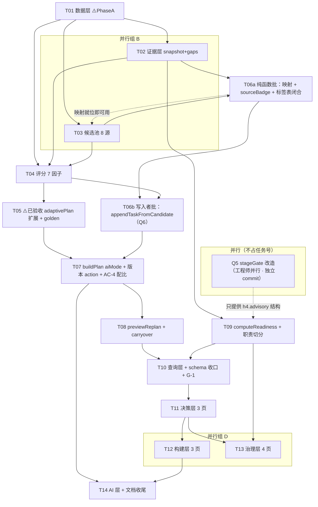

# v2.7 任务分解 — T01–T14

> 配套：`41-v2.7-architecture.md`（契约）、`40-v2.7-decisions.md`（裁决）、`38-v2.7-prd.md`（AC-1~AC-17）
> 每个任务给：**目标 / 改动文件（精确路径）/ 依赖 / 验收测试（文件名 + 断言）/ 风险**
> 标记说明：`🆕` 新建 · `🔧` 改造 · `⚠️已验收` = 改的是 v2.1/v2.2/v2.6 已验收代码，**必须单独列回归测试并写入 `VERSION_CHANGELOG.md` 行为变更**
> **每条验收断言都必须过 `41` §1.9 的四条**：A-1 全称量词先断言集合非空 / A-2 断言两侧来自不同来源 / A-3 变异必须精准命中（**分三层**：选对变异 · 确认命中 · 确认断言没被变异吃掉）/ **A-4 公共函数的契约不能靠调用方 pre-filter 兑现**（`export` 的函数去掉某个调用方的前置过滤就会错，那它自己就错了）。写完问两句：**「我要防的那种错误实现，会让它红吗？」**、**「把函数的守卫弄坏，这个调用点的过滤会不会把它掩盖过去？」** —— 会，就说明契约落在调用方手里了。（**不要**问「删掉 filter 还对吗」：函数正确时删掉也不会错，那是**空操作变异**，见 A-3 第 1 层的前置条件。）

---

## 0. 分期与总览

| Phase | 任务 | 出口条件 | 可并行 |
|---|---|---|---|
| **A 数据层** | T01 | 迁移可 dry-run / 幂等 / `integrity_check=ok`；既有表行数零漂移 | 工程师并行中 |
| **B 纯函数核心** | T02–T05 | 全部纯函数、无 IO；`generateAdaptivePlan` 不传新字段时与 v2.1 **逐字相同** | T02/T03/T04 可三路并行 |
| **C 服务与 action** | **T06a → T06b** → T07 → T08 → T09 → T10 | AC-3/6/7/9/10/11/14/17 可测；**两条写库路径合一（Q6）** | **T06a 先于 T06b**；T06b 先于 T07/T08 |
| **D 页面** | T11–T13 | 10 个页面均有可观察行为；空态与 AI 关闭态不崩 | 三批可并行（依赖 T10 查询层） |
| **E AI 层** | T14（前半） | 断开 provider 后全链路仍可用（AC-17） | — |
| **F 文档收尾** | T14（后半） | `npm test` 全绿 + typecheck 0 错 + 构建 exit 0 | — |

**改已验收代码的 4 处（必须单独列回归）**：
1. **T05** `domain/adaptivePlan.ts`（v2.1 排程引擎，590 行）—— 只加可选字段；回归 = `adaptivePlan.golden.test.ts` 18 组逐字相等
2. **T06b** `actions/materialPack.ts`（写库路径 Q6）+ 私有 `skillOfModule()` 收编（实现在 T06a 的 `domain/planWriteMap.ts`）—— 回归 = `materialPack.q6.test.ts`（含 ⑮「收编前后 `skill` 逐值相同」）
3. **T06a** `constants.ts` 的 `TASK_SOURCE_LABEL_ZH` 键类型由 `Record<string,string>` 收紧为闭合 `Record<(typeof TASK_SOURCE_KINDS)[number], string>` + 新增 `taskSourceLabel()` —— **纯类型改动、7 个键与文案一字不动、全库零消费点**（`grep TASK_SOURCE_LABEL_ZH src` 只有声明本身），回归 = `taskSourceLabel.test.ts`（⑱ 缺键则 typecheck 失败 / ⑲⑳ 兜底与全量一致性）
4. **Q5（工程师并行，不占任务号）** `domain/stageGate.ts` + `constants.ts` + `queries/stages.ts` —— 回归 = `stageGate.q5.test.ts`（见「并行/已完成」小节）

> 另：**T03** 复用既有常量 `WEAKNESS_MIN_QUESTIONS` / `WEAKNESS_WINDOW_DAYS`（间接依赖 `domain/weakness.ts` 的阈值语义），**不改该文件代码**，但列入回归范围以防有人顺手动它（动了会让 Uncertainty 判定与弱项排序口径分叉）。

> **粒度说明**：T14 覆盖「AI 层 + 9 件文档 + 收尾」，实际约 1.5 人日，超出「半天到一天」上限。**主理人已批准拆 T14a（AI 层 ~0.75d）/ T14b（文档收尾 ~0.75d）两次执行，编号仍按 T14 计。**

---

## Phase A — 数据层

### T01 迁移 + schema + 类型

| 项 | 内容 |
|---|---|
| **目标** | **5 张新表** + **3 张既有表共 10 个可空列** + 2 个新索引落地，迁移可 dry-run、幂等、可回滚；`src/lib/types.ts` 补齐 v2.7 类型别名 |
| **改动文件** | `prisma/schema.prisma`（🔧 +5 model，`PlanTask`/`PlanVersion`/`LearningCycle` 加可空列） `scripts/migrations/v2.7.mjs`（🆕） `prisma/seed.ts`（🔧 仅 `VocabularySource` 保持不动；`PlannerSettings.priorityPolicy` **不改写**） `src/lib/types.ts`（🔧 追加 `PlanningSnapshotPurpose`/`GapDimensionKind`/`GapJudgement`/`CandidateSourceKind`/`Eligibility`/`ReadinessOutcome`/`AiMode`/`PlanLayer` 等类型别名） `src/lib/constants.ts`（🔧 追加 `GAP_MIN_SEVERITY`/`CANDIDATE_DEFAULT_MINUTES`/`READINESS_*`/`CARRYOVER_*` —— **Q5 的 `GATE_H4_*` 改动由工程师独立实施，不在本任务**） |
| **依赖** | 无（工程师并行） |
| **验收测试** | `scripts/migrations/__tests__/v27.dryrun.test.ts`： ① `--dry-run` 输出 **5 张表 + 10 条 ALTER + 2 个索引**（`LearningCycle`×3、`PlanTask`×2、`PlanVersion`×5；索引 `PlanTask_candidateId_idx` / `PlanVersion_snapshotId_idx`），**不执行**； ② 连跑 2 次 → 第 2 次 `alreadyApplied:true`，行数不变； ③ `PRAGMA integrity_check === 'ok'` ∧ `PRAGMA foreign_key_check` 空； ④ `PROTECTED_TABLES` 行数零漂移（`PlanTask`/`PlanVersion`/`EvidenceRecord`/`VocabularyItem`/`AICallLog`）； ⑤ 新列全为 `null`，既有列值不变； ⑥ `PRAGMA table_info` 断言 10 个新列存在且 `notnull=0` |
| **风险** | ① `SkillGap` 唯一键必须是 `[snapshotId, skill, subskill]` —— **漏掉 decisions §6.2 就写成带 `kind`**，双池会双份计数（必须 review schema）；② **`PlanVersion.layer` 必须无默认值**，null 读作 `DAY`；若加 `@default("DAY")`，历史行会被**伪装成 v2.7 新语义写出来的日计划版本**（这也是 `§5.2` 采纳「可空 + 读取回落」的全部理由，两者不能一个写默认值一个写回落）；③ 若 Phase A 已冻结不同命名，T02 首个 commit 必须同步类型别名 |

---

## Phase B — 纯函数核心

### T02 证据层：`planningSnapshot` + `skillGap`

| 项 | 内容 |
|---|---|
| **目标** | ① `hashPlanningInput()` 确定性与 5 条规范化规则；② `splitGapsAndUncertainty()` 的 S1–S7 判定顺序与 `dimensionKind` 分流；③ 服务层 `buildPlanningSnapshot()` 装配 7 类输入并幂等落库 |
| **改动文件** | `src/lib/domain/planningSnapshot.ts`（🆕） `src/lib/domain/skillGap.ts`（🆕） `src/lib/services/planningSnapshot.ts`（🆕） `src/lib/domain/__tests__/planningSnapshot.test.ts`（🆕） `src/lib/domain/__tests__/skillGap.test.ts`（🆕） `src/lib/services/__tests__/planningSnapshot.integration.test.ts`（🆕） |
| **依赖** | T01 |
| **验收测试** | `planningSnapshot.test.ts`： ① 同输入两次 → 同 hash；键序打乱 → 同 hash；② `createdAt` 不同但 `freshnessDays` 相同 → **同 hash**（H-2）；③ `severity: 0.30000000000000004` 与 `0.3` → 同 hash（H-3）；④ `[]` 与 `null` → **不同** hash（H-4）；⑤ 只改 `weightsVersion` → hash 变（H-5）。 `skillGap.test.ts`： ⑥ `confidence=LOW` + `evidenceQuestions=20` → **`UNCERTAINTY` 且不在 `gaps`**（AC-6 核心）；⑦ `independentCount=0` 且 `confidence=HIGH` → `UNKNOWN`（S1 先于 S2）；⑧ `evidenceQuestions=9` → `UNCERTAINTY`（S3）；⑨ `confidence=HIGH` + `freshnessDays=200` → **返回 DTO 的 `stale === true` 且 `kind === 'GAP'`**（S5 只降级不升格），**并断言 `SkillGap` 表里不存在 `staleFlag`/`stale` 列**（`stale` 是派生 DTO 字段，不落库）；⑩ `confidence=MEDIUM` + `freshnessDays=200` → `UNCERTAINTY`；⑪ `dimensionKind=AUXILIARY` + `skill=GRAMMAR` → 能产出缺口，但 `severity` 计算使用 `Mistake.errorCategory` 口径；⑫ `periodOf()` 四种 layer（`null/DAY`、`WEEK`、`MONTH`、`CYCLE`）→ `periodEnd` 分别为 `planDate / +6 / +29 / +89`； 　　⑫b **`severity` 四项必须按三态实现**（`41` §2.2.1：`>0` 按比例 / `<=0` → `0` / `null` → `0.5`）。回归用例：20 条证据 + `freshnessDays=5` + `confidence=HIGH` + `accuracyDelta=null` + `coverageRatio=null` + `repeatedErrorCount=null` → **`severity ≥ GAP_MIN_SEVERITY(0.15)` 且 `kind='GAP'`**（旧口径算得 `0.128` 会被 S6 静默滤掉，缺口池变空）；并断言 `repeatedErrorCount === 0` 与 `=== null` 产出**不同的** `severity`（前者 `0`、后者 `0.5` 那一档）。 `planningSnapshot.integration.test.ts`： ⑬ 同 `inputHash` 二次调用 → `reused=true`，`PlanningSnapshot` 行数不变；⑭ 缺 `Stage` → `missing` 含 `{key:'STAGE', severity:'blocking'}` 且 `ActionResult` 为 `fail('PRECONDITION')` **⑮ C-H（`41` §9.1）· DTO 扩字段**：`SkillGapDraft` 新增 `evidenceQuestions: number`、`repeatedErrorCount: number \| null`，断言二者与输入 `SkillGapSignal` **逐字段相等**（`toBe`，不是 `toBeTruthy`）；**再单独断言 `repeatedErrorCount: null` 搬入后仍为 `null`**（`=== null`，不是 `0`、不是 `undefined`）—— 搬运时写 `?? 0` 会让 `errorRecurrence` 与 `noObservation` 同时失效，回到 §2.2.1 修掉的那个 bug； 　　⑮b `noObservation` **不在 DTO 里**：断言 `SkillGapDraft` 的键集**不含** `noObservation`（它是消费方标注，由 `taskPriority.ts` 导出，见 T04 ⑭）； 　　⑮c **T02 是已验收代码，本次改动的回归面**：`skillGap.test.ts` ⑥–⑭ 必须全绿（S1–S7 判定顺序、`stale` 派生、`severity` 三态不受影响），并在 `CHANGELOG.md` 记一条「内部 DTO 扩展，非行为变更」 **⑯ `parseSkillTargets` 的契约自证（A-4 + C-I）** —— 必须**直接调用函数**，不经过 `services/planningSnapshot.ts` 的 pre-filter：`parseSkillTargets({ READING: null })` → **`{}`**（`'READING' in r === false`），不是 `{ READING: 0 }`；`{ READING: '' }` / `{ READING: [] }` / `{ READING: false }` 一律 `{}`（`Number()` 对这四种都返回 `0`）；`{ READING: 0 }` → **保留** `{ READING: 0 }`（区分「没设目标」与「目标是 0 分」）；`{ READING: Number.NaN }` / `{ READING: -1 }` → `{}`；`{ NOT_A_SKILL: 9 }` → `{}`；**（A-4 的判别方法：把本函数的守卫退回 `Number(value)`，本条必须红；再确认调用点若仍有 `.filter` 会把这个红掩盖成绿 —— 掩盖得住就说明契约在调用方手里，filter 必须永久删除。）**字符串数字 `{ READING: '7' }` → `{}`（收窄不负责宽容解析，字符串应在写入口由 zod 挡）。 　　**并补一对「空输入 ≠ 输入里有空值」**：只测 `parseSkillTargets(null)` 通过**不代表** `parseSkillTargets({ READING: null })` 通过 —— 前者是「没有输入」，后者是「输入里没有值」，而真实数据（`LearningGoal.minReading: Float?`）几乎永远是后者 |
| **风险** | ① **hash 把时间戳并进哈希**是最易犯的错（导致快照永不复用、表爆炸）；② S2/S3 顺序颠倒 → AC-6 失败；③ `buildPlanningSnapshot` 返回的 `context` 若与落库 JSON 不一致，会造成「快照说 A、调度用 B」—— 必须**同一对象序列化两次**（先 hash 后落库）；④ **C-H 的 DTO 扩字段会顺手把 `repeatedErrorCount` 抹成 `0`**：`?? 0` 是 TypeScript 里最自然的"消 null"写法，而这里恰好不能消 —— `0` =「数过确实是零」、`null` =「没算过」，两者在 `severity` 三态与 `noObservation` 上含义相反。靠 ⑮ 的 `=== null` 断言守 |

### T03 候选池：`taskCandidate` 8 源归一

| 项 | 内容 |
|---|---|
| **目标** | 8 个来源 → 统一 `TaskCandidateDraft`；`candidateKey` 稳定（**身份 ≠ 载荷**）；前置条件判定；`dedupeGroup` 去重（**不靠 key 分组**）；派生分钟诚实标注 |
| **改动文件** | `src/lib/domain/taskCandidate.ts`（🆕） `src/lib/services/candidateSources.ts`（🆕，8 个采集函数，每个 ≤ 40 行） `src/lib/constants.ts`（改：`CANDIDATE_DEFAULT_MINUTES` / `CANDIDATE_FALLBACK_MINUTES` / `CANDIDATE_SOURCE_PRIORITY`，**必须 `Record<枚举联合, V>`**，见 `41` §1.8） `src/lib/domain/__tests__/taskCandidate.test.ts`（🆕） `src/lib/domain/__tests__/mappingTableKeyClosure.test.ts`（🆕，G-14） `src/lib/services/__tests__/candidateSources.test.ts`（🆕） |
| **依赖** | T01 |
| **验收测试** | `candidateSources.test.ts`（AC-2 主证据）： ① 每来源各造 1 条 → 归一后 `module/targetSkill/primarySkill/track/estMinutes/minMinutes/validationStatus` 全部非空； ② **`GeneratedExercise.reviewStatus='draft'` 的材料题不入池**；③ `ListeningExercise` 无 `CONFIRMED` transcript → 不入池；④ `VocabularyAssignment.planTaskId` 非空 → 不入池；⑤ `TaskProposalItem.planTaskId` 非空 → 不入池（Q6 入池过滤）。 `taskCandidate.test.ts`： ⑥ **`candidateKeyOf()` 不含时长**：同 `(sourceKind, sourceRef, module)` → 同 key；**把 `estMinutes` 从 15 改成 20 → key 必须不变**（旧写法断言"变 key"，与 `41` §2.3.1 相反）；再断言 key 里**不含** `dateKey`； ⑦ **`dedupeGroupOf()` 是去重分组的前置**：先断言分组值 —— `REVIEW`/`RETEST`/`PROBE` 带 `skillGapKey` → `evidence:<skillGapKey>`；`MATERIAL` → `material:<packItemId>`；`VOCAB` → `vocab:<assignmentId>`；`QUESTION`/`LAB`/`EGIU` → `= candidateKey`。**再**断言 `dedupeCandidates()` 同一复习项来自 `ReviewTask` 与 `PROBE` 两条 → 保留 `REVIEW`（优先级 `0` 最高）且 `dropped[0].why` 含"同一件事"与保留方的 `sourceKind`（不是只写"重复"）； ⑧ 8 来源全覆盖断言（`CANDIDATE_SOURCE_KINDS.length === 8` 且每个都有 ≥1 用例）； ⑨ QUESTION/LAB/PROBE 的 `estMinutes` 来自 `CANDIDATE_DEFAULT_MINUTES` 且候选 DTO 的 `meta.estMinutesSource==='DERIVED'`（`derivedFrom` 非空）、`REVIEW`/`VOCAB`/`MATERIAL` 为 `'SOURCE'`； **⑩ 反例一 · 不许过度合并（比不合并更危险）**：造 **5 条 `REVIEW`**、`skillGapKey` 全为 `null`、同 `targetSkill` 同 `module`、`sourceRef` 各异 → 断言 `kept.length === 5`。`ReviewTask` 表没有 skill/subskill 列，大多数复习项的 `skillGapKey` 天生为空；若把「无缺口」的 `dedupeGroup` 回落成 `evidence:<skill>:<module>`，今天到期的 5 条词汇复习会被合成 1 条 —— 用户少看到 4 条任务还以为系统本来就这么安排； **⑪ 反例二 · 跨来源不许误合**：造 2 条 `QUESTION`、同 `module`、不同 `sourceRef` → **不合并**（`kept.length === 2`）；再断言 2 条 `REVIEW` 各自关联**不同** `skillGapKey` → 也不合并； **⑫ 反例三 · 平级不许互吞**：造 2 条 `RETEST`、同 `skillGapKey`（同 `evidence:` 组）、父证据不同 → **两条都保留**（`kept.length === 2`）。优先级表只能裁决「不同来源指向同一件工作」；同来源并列必须各留，否则后一条会当作 loser 静默丢掉； **⑬ 优先级是独立常量，不能用数组下标推导**：断言 `CANDIDATE_SOURCE_PRIORITY.MATERIAL < CANDIDATE_SOURCE_PRIORITY.VOCAB`，**且** `CANDIDATE_SOURCE_KINDS.indexOf('VOCAB') < indexOf('MATERIAL')`（两者顺序相反）—— 用 `indexOf` 推导优先级的实现会在此失败； **⑭ 映射表键集封闭（G-14，`41` §1.8）**：`CANDIDATE_DEFAULT_MINUTES.QUESTION` 的键集必须**等于** `new Set([...DIAG_TASK_TYPES, ...MATERIAL_EXERCISE_TYPES])`（3 + 5 = 8，**集合相等**不是包含）；`.LAB` 等于 `new Set([...LISTENING_MODES, ...SPEAKING_TASK_TYPES])`（9 + 9 − 1 = **17**，不去重会假红）；`.QUESTION`/`.LAB` 逐键 `Number.isFinite(v) && v > 0`；`CANDIDATE_FALLBACK_MINUTES` 的键集等于 `MinuteBearingSourceKind` 的取值集。再补一条**烟雾断言**（刻意标成烟雾测试）：源码文本里这三张表**声明处含 `Record<`** —— 它能抓到「类型被放宽回 `as const`」（`as const` 版与 `Record<…>` 版在 TS 类型层面无法区分），但会被格式化/换行/注释里的 `Record<` 误伤，**且证明不了类型真的生效**；真正的证明是编译期。它只是便宜的早期警报，不许因为有了它就不看类型。**并且对 `Partial<Record<…>>` 的表（如 `QUESTION_OPEN_TASK_SKILL_OVERRIDE`）第二道要豁免**：断言「键集 **⊆** 枚举」而不是「= 枚举」，并**逐缺失键走查找点**断言等于文档默认值（见 ⑮）—— 不能只断言表里现有值看着没问题：表可以完全合法，而调用点漏了 `??` 照样 `undefined` 入算术。写成「= 枚举」会让只有 2 个键的覆写表假红，而假红的下场是这条断言被人删掉； **⑮ `OPEN_TASK` 的一档 skill 覆写（`41` §2.3.3）**：同 `taskType='OPEN_TASK'`、`skill` 分别为 `WRITING` / `SPEAKING` → `estMinutes` **20 / 10** 且 `derivedFrom` 为 `skillOverride:OPEN_TASK/WRITING` / `skillOverride:OPEN_TASK/SPEAKING`；**未命中的侧必须遍历而不是定点，且先断言缺失侧非空**（`41` §1.9 A-1：`[].every()` 恒 `true`）—— `const missing = SKILL_IDS.filter((x) => !(x in QUESTION_OPEN_TASK_SKILL_OVERRIDE)); expect(missing.length).toBeGreaterThan(0);` 然后 `for (const s of missing) expect(estMinutesOf('OPEN_TASK', s).estMinutes).toBe(15)`，即枚举里**每一个不在表里**的 `SkillId` 经**查找点**都得 15、不是 `undefined` 也不是 `NaN`，且 `derivedFrom === 'default:OPEN_TASK'`；**不许只测 `READING` 一个定点**（枚举加值时它不会红，而且 `for…in` 只遍历实际有的键、证明不了缺失侧）；再断言 `minMinutes === estMinutes` 在写作那条上是 **20**（覆写改变了最小可执行单元，使「放不下」在装箱阶段显形）；并加一条**反向**断言：`taskType='MCQ'` 时 `skill=WRITING` **不**触发覆写（仍 3 分钟）—— 否决「所有题型都能按 skill 覆写」的泛化；**并在 `docs/47-v2.7-known-limits.md` 留一条**：「`OPEN_TASK` 的写作 20 分钟是粗估，长作文（40 分钟级）仍会被低排」—— 覆写**改善但不解决**，别让人以为已经精确了（T14 文档门禁会查）； **⑯ `EGIU` 两级取值**：`intervalCode` 已知 → 取 `EST_MINUTES_BY_INTERVAL[code]` 且 `derivedFrom` 不是 `fallback:`；`intervalCode` 未知 → 落 `CANDIDATE_FALLBACK_MINUTES.EGIU` 且 `derivedFrom` 以 `fallback:` 开头（数据问题必须显形）； **⑰ `sourceRef` 前缀（`12abbb8` 已验收）**：`sourceRefOf('QUESTION', id, 'diagnostic')` → `diagnostic:<id>`、`sourceRefOf('QUESTION', id, 'material_exercise')` → `material_exercise:<id>`；`LAB` → `listening:<id>` / `speaking:<id>`；断言**前缀常量 `SOURCE_REF_PREFIX` 是唯一真相**（测试里不许手写前缀字面量，用 `expectedPrefix[kind]` 对表）； **⑱ 两处「不做不存在的过滤」**：① `SpeakingPrompt` **没有 `active` 列**（Phase A 未加）→ 每条 `taskType` 合法的 prompt 都应入池，测试要断言「`active` 字段不存在」而不是造一个；② `QUESTION` **不带 `{STAGE_AT_LEAST}`**（全仓无「技能→最低阶段」真值表）→ 造一个 `Stage=S0_PREP` 的库状态，断言题库候选**仍能入池**（若是空池，说明有人凭空补了真值表，会在 S0/S1 静默挡掉全部题目）； **⑲ `MATERIAL` 的粒度**：入池单元是 `TaskProposalItem`，`sourceRef` 是提案项 id（该表**没有 `packItemId`**）；断言 `no-proposal` 类排除**按包粒度**报 —— 造一个 `packId` 下无 draft 草案的包，其 `MaterialPackItem` 全部进「未提案」，**记录逐条、文案包粒度**：底层对**每一个** `MaterialPackItem` 各记一条排除原因（便于统计「有几个包没草案」），但**呈现时按包聚合成一句**（草案是整包生成的，界面上没有「条目」这个对象，逐条说「这条还没提草案」会让用户去找一个不存在的条目）。断言时两者都要：`dropped` 条数 = 包内条目数，而文案里出现的是包标识、不是条目 id；**再补一条 `packId IS NULL` 的用例**：`TaskProposal.packId` 是 `String?`，单材料直出的提案不挂包 → 「同 `packId` 下有无 draft」恒查不到，会把已有草案的条目全报成未提案；断言实现对 `packId IS NULL` 走**按 `proposalId` 查草案状态**的另一条判据 |
| **风险** | ① 8 源里 **5 源没有时长字段**（审计 §3），派生表若散落在各采集函数里就无法审计 —— 必须集中在 `constants.ts` 的 `CANDIDATE_DEFAULT_MINUTES`（进 `configJson` → 进 hash）；② `PROBE` 的 `candidateKey` 前缀与 `sourceKind='RETEST'` 不一致（徽章要「补测」），实现时容易把两者混成一个字段 —— 架构已定：`candidateKey` 前缀 `PROBE`、落库 `sourceKind='RETEST'`、`meta.skillGapKey` 指缺口；③ **`candidateKey` 里混入 `estMinutes`/`dateKey` 是最容易发生的回归**，而 `schema.prisma` 的 `candidateKey` 注释目前还写着 `...:module:dateKey`（见 `41` C-F）—— 照注释实现就会写错，本任务须同时改注释；④ **去重必须用 `dedupeGroupOf()` 分组，不能用 `candidateKey` 分组**：`REVIEW` 与 `PROBE` 的 `sourceRef` 天生不同，按 key 分组永远合不起来，为让用例变绿而删掉 key 里的 `sourceRef` 又会连带破坏「跨来源不误合」（⑪）；⑤ `dedupeGroup` 的 `null` 分支（无 `skillGapKey`）必须回落 `candidateKey` 而不是 `evidence:<skill>:<module>`，否则会静默吞掉同日多条复习（⑩）；⑥ **派生分钟表最容易「凭印象造键」**：`41 §2.3.3` 最初的 `QUESTION` 表写了 `MULTI/OPEN_WRITING/OPEN_SPEAKING` 三个**任何枚举里都不存在**的值，又漏了真实存在的 `OPEN_TASK`，材料域 5 个题型整块缺席 —— 落地后诊断开放题取到 `undefined` → `estMinutes=NaN` → `Σ ≤ budget` 恒 `false` → 任务被静默挤出。**修法不是补断言而是改类型**：三张表一律 `Record<枚举联合, V>`（`41` §1.8），漏键编译不过；断言（⑭）只作第二道；⑦ **`QUESTION_OPEN_TASK_SKILL_OVERRIDE` 只有一档，且必须停在那一档**：`OPEN_TASK` 是唯一「枚举上不区分、行上强制区分、差 2–3 倍」的题型。一旦给 `MCQ`/`SHORT_ANSWER`/材料域五类也加 skill 覆写，`QUESTION.MCQ=3` 与 `OVERRIDE[WRITING]=8` 会同时存在，谁生效取决于代码里 `if` 的先后 —— 那就是把一张表拆成两张互相打架的表。⑮ 的反向断言（`MCQ` + `WRITING` 仍 3 分钟）就是挡这条的；⑧ **文档曾写过四件代码做不到的事**（T03 收口时由工程侧发现、主理人核实）：`sourceRef` 前缀 `question:`/`exercise:`（实为 `diagnostic:`/`material_exercise:`）、`TaskProposalItem` 的 `packItemId`（该列不存在）、`QUESTION` 的 `{STAGE_AT_LEAST}`（真值表不存在）、`SpeakingPrompt.active`（该列不存在）。共同的教训：**文档里每一条「过滤条件」和「关联列」都必须在 `schema.prisma` 里点得出来** —— 点不出来的，要么改文档、要么改 schema，不能留着当成实现者的事 |

### T04 评分层：`taskPriority` 7 因子

| 项 | 内容 |
|---|---|
| **目标** | 7 因子取值/归一化、默认权重（Σ=1）、`priorityOf()` 阈值（P0 不由分数决定）、决策轨迹落库 DTO。**四条「容易做得看起来对」的陷阱必须先落成测试**：无周期时 `goalRelevance` 的回落值、P0 不被高分挤掉的反例、`evidenceStrength` 的 0.30 是中性而非打压、`weightsVersion` 变化必须真的改变 `priority`。**另加：`factorsJson` 的 `meta` 必须与七因子分层**（平铺 → `score=NaN` → `sort` 静默乱序，见 `41` §2.4.3） |
| **改动文件** | `src/lib/domain/taskPriority.ts`（🆕） `src/lib/domain/__tests__/taskPriority.test.ts`（🆕） `src/lib/schema/planner.ts`（🆕，先落 `priorityWeightsSchema`，其余 schema 在 T07/T08/T09 追加） `src/lib/services/__tests__/planningChain.integration.test.ts`（🆕，⑲ 整链路反证，唯一跨层测试） `src/lib/services/planningSnapshot.ts`（改：**C-I** —— `goal.skillTargets` 由 `Record<string, number>` 改 `Partial<Record<SkillId, number>>`，新增 `parseSkillTargets()` 过滤非 `SkillId` 键并丢掉 `null`） |
| **依赖** | T01、T02（C-H 扩 DTO 后才有 `evidenceQuestions`）、T03 |
| **验收测试** | `taskPriority.test.ts`（AC-7/AC-16）： ① 7 因子各自单调（造 5 档输入 → 输出单调不减）；② `DEFAULT_WEIGHTS` 之和 `Math.abs(Σ-1) < 1e-9`；③ **`REVIEW`/`RETEST` 且到期 → 恒 `P0`，即使 `score=0.10`**；④ 非到期 `score=0.60` → `P1`、`0.59` → `P2`、`0.42` → `P2`、`0.41` → `P3`（边界四连）；⑤ `evidenceStrength`：`confidence=LOW` 的缺口**不会出现在 `gaps` 里**（由 T02 保证）→ 该因子仅可能取 `MEDIUM/HIGH` 权重；⑥ `prerequisiteReady=0` → `eligibility='BLOCKED_PREREQUISITE'` 且 `blockedReason` 非空；⑦ `consequenceIfSkipped`：无 `dueDate` 且无缺口 → `null`（不编造）。 **四条抗「看起来对」的断言**（主理人指定，不是可选项）： ⑧ **`goalRelevance` 无周期时回落 0.5**：`goal=null` 与「有 goalType 但无 `LearningCycle`/无 `targetDate`」两种输入都必须得 `0.5`；**并显式断言不等于 `1.0` 也不等于 `0`** —— 前者是「剩余天数被当成 0」的错误实现（`1−0=1`，所有候选满分、该因子失效），后者是「剩余天数被当成 ∞」的错误实现（`clamp01→1`，得分 0，所有候选被同等打压）； ⑨ **P0 不被高分任务挤掉（AC-7 的反例）**：造 `score=0.99` 的 `EXTENSIVE` 型候选 + `score=0.10` 的到期 `REVIEW` → 断言分别落 **`P3`** 与 **`P0`**。只断言「到期 REVIEW 得到 P0」是不够的，那只能证明它被打上标记，证不了「不会被挤」； ⑩ **`evidenceStrength` 无缺口回落 0.30 是中性偏低、不是打压到 0**：`skillGapKey=null` → 因子 `0.30`（加权贡献 `0.20×0.30=0.06`，不是 `0`）；并断言该差异在阈值边界上可观察（同一候选其余因子固定时，`0.30` 落 P2、`0` 落 P3）—— 目的是把「无缺口关联 ≠ 无价值」钉住； ⑪ **`weightsVersion` 变化必须真的改变 `priority`（AC-16 的可复算性）**：同一批候选，只改 `weightsVersion` 与权重值（如把 `evidenceStrength` 从 0.20 抬到 0.40、`urgency` 从 0.22 降到 0.02）→ 至少一条候选的 `priority` 发生变化。否则无法排除「实际读的是默认权重、`weightsVersion` 只是被存下来」这种实现 —— 那会让整套「可复算」变成摆设。 `priorityWeights.test.ts`（G-10）：⑫ Σ≠1 / 含负数 / 含未知键 / `p1 <= p2` → `fail('VALIDATION')` **且不回落默认值**。 **回落判据的穷举**（判据见 `41` §2.4 表头：**「确认为无」→ `0.00`，「不知道」→ 中性值**）： ⑬ 五个回落值逐个断言：`urgency` 无 dueDate → `0.00`、`errorRecurrence` 无重复错误 → `0.00`、`evidenceStrength` 无缺口 → `0.30`、`goalRelevance` 无周期 → `0.50`、`preferenceFit` 无偏好 → `0.50`；**并断言前两个严格 `=== 0`、后三个严格 `> 0`** —— 防止有人「统一成中性值」或「统一成 0」，两种归并都会破坏判据； ⑭ `errorRecurrence` 未观察场景：`evidenceQuestions === 0`（该维度近 28 天没练过）→ 因子仍 `0.00`，但 `factorsJson.meta.noObservation === true`；`evidenceQuestions > 0` 且无错误 → `0.00` 且 `noObservation === false`（**把「确认为无」与「没有观察」分开**）； 　　⑭b **取值来源（措辞要够硬）**：`evidenceQuestions` / `repeatedErrorCount` 只能由**入参 `ctx.gaps`（即快照/DTO）**带进来 —— 断言 `taskPriority.ts` 的"入参 gaps **必须来自快照/DTO，不得查库补字段**"。只写「不直接查库」太弱：实现完全可以先查一次库把值补进 gaps，再"不直接查"地用；所以要同时断言 ① 模块内无 `prisma` 引用（AST 级，不是文本 grep），② `gaps` 的每一项在进入 `scoreCandidate` 之前就带有这两个字段（对入参做键集断言）； ⑮ **`evidenceStrength` 必须读落库的 `gap.severity`，不得在 `taskPriority.ts` 里重算**：造一条落库 `severity=0.40` 的缺口，断言 `evidenceStrength === 0.40 × confWeight`；再把 `SkillGapSignal` 侧的输入改成另一种算法会得出不同值的组合，断言结果**仍等于 0.40 那一路**（证明它读的是落库值而不是重算）。理由：`severity` 是落库字段，重算就等于第二套真相 —— 同一个缺口在 `/planner/evidence` 与 `/planner/candidates` 会显示两个严重度。 **`factorsJson` 形状的三条硬断言**（`41` §2.4.3；这三条挡的是**静默**失败，不是崩溃）： ⑯ **`meta` 不许与七因子平铺**：断言 `Object.keys(decision.factors).length === 7`，且其键集合与 `Object.keys(DEFAULT_WEIGHTS)` **完全相等**（用 `toEqual` 做集合相等，**不是** `toContain` / `arrayContaining`）—— 平铺实现会让键数变 8~10； ⑰ **`score` 必须是有限数**：`Number.isFinite(decision.score)` 为真、且 `score >= 0 && score <= 1`。`NaN` 参与的比较恒为 `false`，`sort` 不抛错只乱序 —— 必须在落库前拦住；再补一条：手工构造一个带多余键的 `factorsJson` 喂给「按 `DEFAULT_WEIGHTS` 求和」的实现，断言 `score` 仍为有限数（证明求和遍历的是权重表而不是 JSON 的键）； ⑱ **`noObservation` 进 `inputHash`、不进 `weightsVersion`**：同一批输入只改 `evidenceQuestions`（`0` ↔ `20`）→ 两次 `hashPlanningInput()` 结果**不同**（因为 `gaps` 进了 canonical input，C-H）；同时断言 `weightsVersion` **不变**（它是事实不是权重）。 **⑲ 整链路反证 —— C-H 真正的防点**（`services/__tests__/planningChain.integration.test.ts`，本任务唯一跨层测试）：造一个 `SkillGap` **表里确实没有** `evidenceQuestions`/`repeatedErrorCount` 列的库状态（现状即如此），从证据数据开始走**完整链路**（`buildSkillGaps` → `buildPlanningSnapshot` → `collectCandidates` → `scoreCandidate`）→ 断言 ① `errorRecurrence` 因子**非零**（fixture 里造 `repeatedErrorCount > 0`）；② `noObservation === (evidenceQuestions === 0)`。**为什么必须走整链路**：单测里手搓 `ctx.gaps` 永远绿，因为它自带字段；只有从库里长出来的数据才能证明"值是从快照/DTO 来、不是从表里补的"。这条红 = 实现改成从表里查（那时 `repeatedErrorCount` 取不到 → 恒 `0`）；这条绿才说明 C-H 的 DTO 通道真的接通了。**不写这条，下一次重构会"顺手从表里查更省事"，然后一切重新失效、其余测试全绿**； **⑳ `skillTargets` 的缺失侧（C-I）**：`goal.skillTargets` 只填四个官方技能，造 `skill='GRAMMAR'`（不在表内）→ `goalRelevance` 必须走「该技能与目标无直接关系」分支得 **0.30**，**且断言 `Number.isFinite`**（`NaN` 过不了 `toBe`，但要让它以"不等于 0.30"的形式失败而不是以异常形式失败）；**函数级契约自证不在这里**（在 T02 ⑯，直接调 `parseSkillTargets`）—— 本任务只测**调用链**：从一条真实的 `LearningGoal` 行出发，经 `services/planningSnapshot.ts` 装配 → `parseSkillTargets` → `ctx.goal.skillTargets` → `goalRelevance`，断言最终因子值；**且断言这条链上的服务实现不得依赖调用点的 `.filter(typeof === 'number')`** —— 做法照 `41` §1.9 A-4 + A-3 第 1 层：**把 `parseSkillTargets` 的守卫临时退回 `Number(value)`，断言调用链会红；再把 filter 装回去，断言同一个坏函数就绿了**（证明 filter 会掩盖函数缺陷）；**确认完之后 filter 永久删除，不装回去**； **㉑ 真实数据形状**：造一条 `minReading: null`、其余三项有值的 `LearningGoal` → `goalRelevance` 走「该技能不在目标内」分支得 **0.30**，**不是 `0`、不是 `NaN`**；并断言 `parseSkillTargets` 的结果里**没有** `READING` 这个键（区分「没设目标」与「目标是 0 分」）。这条比「未列出的 `SkillId`」更贴近真实数据 —— 用户建档时往往只填了自己关心的那两三项； **㉒ 目标行的选取必须确定（C-J）**：`seed.ts` 会建 **3 条** `status='ACTIVE'` 的 `LearningGoal`，而服务端 `findFirst` 原先**没有 `orderBy`** —— 断言 ① 服务端查询含确定性排序（或夹具里只留一条 ACTIVE），② 在**三条 ACTIVE 目标**的库状态下连续两次装配得到**同一个** `goal.targetDate` / `goal.skillTargets`。理由：`goalRelevance` 的两个输入都来自这一行，取错即算错且无报错；换台机器插入顺序不同结果就变； **㉓ 排序键（`41` §2.4.2，同分必须确定）**：排序 = `priority` 升序 → `score` 降序 → `candidateKey` 升序。两条断言：① **稳定性**：构造两条 `score` 完全相同、`priority` 相同、`candidateKey` 不同的候选 → **打乱输入顺序跑两次，输出顺序必须相同**（证明末位键生效，而不是靠数组/DB 顺序）；② **反向**：`score=0.99` 的 P3 拓展 与 `score=0.10` 的 P0 到期复习 → **P0 在前**（若写成 `score desc → priority`，这条必红）。 　　另断言 **`adaptivePlan` 不二次排序**：把已排序列表以**逆序**喂给 `adaptivePlan`，其内部消费顺序须与输入一致（否则顺序有两处决定，可复算失效） |
| **风险** | ① 有人把 P0 也做成「分数 ≥ 0.72」→ AC-7 失效；② `timeCost` 用 `estMinutes/budget` 会随每日预算变化，导致同一候选两天得分不同、决策轨迹不可复算 —— 架构已定用 `minTaskMinutes/est`（预算无关）；③ `preferenceFit` 默认 0.5 必须写进文档与 tooltip，否则被当成真偏好；④ 无周期场景最容易被写成「`remainingDays = 0`」，因为 `LearningCycle` 缺失时取 `startDate` 会拿到 `undefined` → `diffDays` 退化成 0 —— 必须是**显式分支**返回 `0.5`，不能靠公式自然得出；⑤ `weightsVersion` 只存不用是这类「版本化」实现的通病（存了一个字段、读的还是常量），必须靠 ⑪ 的正向断言暴露；⑥ **`factorsJson` 平铺是最隐蔽的一条**：`NaN` 不抛错、`sort` 不告警，页面只是"安排得有点怪" —— `schema.prisma` 里 `factorsJson` 的注释现在正是平铺写法（`41` C-G），照注释实现就会踩，本任务须同时改注释；⑦ **`errorRecurrence` 与 `noObservation` 可能"永远取不到值"**：`SkillGap` 表没有 `evidenceQuestions` / `repeatedErrorCount` 列，`SkillGapDraft` 也不带 → 若不做 `41` C-H 的 DTO 扩字段，这两个东西会静默恒为 `0` / `false`，测试若只断言 `0.00` 还会全绿。**这是唯一会改动已验收 T02 代码的点，须单独回归** |

### T05 ⚠️已验收 `adaptivePlan` 可选扩展 + golden test

| 项 | 内容 |
|---|---|
| **目标** | `AdaptivePlanInput` 追加 4 个可选字段（`bufferRatio`/`candidates`/`uncertainties`/`skillGaps`），**不传时与 v2.1 逐字相同** |
| **改动文件** | `src/lib/domain/adaptivePlan.ts`（🔧 **仅追加**，不改既有 9 步顺序与任何既有字段） `src/lib/domain/__tests__/fixtures/adaptivePlan.v21.golden.json`（🆕 **先固化后改代码**） `src/lib/domain/__tests__/adaptivePlan.golden.test.ts`（🆕） `src/lib/domain/__tests__/adaptivePlan.v27.test.ts`（🆕） `VERSION_CHANGELOG.md`（🔧 行为变更条目） |
| **依赖** | T04（`RankedCandidateInput` 类型）、T01 |
| **验收测试** | `adaptivePlan.golden.test.ts`（**G-9，最重要**）： ① 18 组 legacy 输入 → `JSON.stringify` **逐字相等**（含 `backlog`/`weeklyRotation`/`warnings`/`sortOrder`）；② 追加 4 字段全 `undefined` → 与 ① 深相等；③ `bufferRatio: 0` → 与不传深相等。 `adaptivePlan.v27.test.ts`： ④ `bufferRatio: 0.1` + 预算 100 → 技能池+拓展 ≤ 90，**P0/复测仍按 100 计算**；⑤ 传 `candidates` → 消费候选的 `priority`/`rationale`（**不重算**）；⑥ 传 `uncertainties` → 生成 PROBE 任务且**不吃 P0 份额**；⑦ 传 `candidates` 后仍满足全部既有不变量（`Σ ≤ budget`、`minutes ≥ 粒度`、P0 ≤ cap、backlog 有原因）  **㉓③（从 T04 顺延，不可丢）· `adaptivePlan` 不得二次排序**：T04 的 `rankDecisions()` 是**唯一**排序点（`priority` 升序 → `score` 降序 → `candidateKey` 升序）；本任务要断言「把已排序列表以**逆序**喂给 `adaptivePlan`，其内部消费的候选顺序与输入**逐项一致**」。只要 `adaptivePlan` 内部按 `priority` 或 `score` 再排一次，末位键 `candidateKey` 就白定义了，而现象是「同分任务的先后又变回看数据库顺序」—— 页面上完全正常，只能靠这条断言抓。T04 阶段断言不了（`adaptivePlan` 还不消费候选），**必须在本任务补上**。|
| **风险** | ① **必须在改代码前提交 golden fixture**（同一 commit 顺序：先加 fixture 测试并跑绿 → 再改 `adaptivePlan.ts`），否则「逐字相同」无从证明；② `bufferRatio` 若作用到 P0 会违反 AC-7；③ `candidates` 路径若漏了「低于粒度不发碎片 / 转周轮换」逻辑，`weeklyRotation` 语义会与 v2.1 分叉 |

---

## Phase C — 服务与 action

### T06 ⚠️已验收 Q6 唯一写入者 —— **分两批执行（T06a / T06b，编号仍算 T06）**

> **状态：Q5 已由工程师独立实施中**（`constants.ts` / `stageGate.ts` / `queries/stages.ts` + `stageGate.q5.test.ts`，独立 commit、独立回归）。**T06 不含 Q5**。
> **拆批理由**：纯函数批可以穷举单测、不碰 DB；写入者批的失效方式（双重预算闸门、双写）与纯函数批（枚举错值、徽章空白）毫无重叠，混在一起的回归定位成本是两倍。
> **执行顺序**：**T06a 先做完**——T03 那边立刻能用上 `sourceKind` 映射；T06b 再动事务。
> 本任务改的是 v2.6 已验收代码，必须在 `VERSION_CHANGELOG.md` 记**行为变更**并附回归证据。

---

#### T06a 纯函数批（无 DB、无事务）

| 项 | 内容 |
|---|---|
| **目标** | ① 建立两套跨域枚举的显式映射（两个 `sourceKind` 不同域；`(module,targetSkill) → {skill,primarySkill,track}`），并收编 v2.6 私有 `skillOfModule()`；② 计划层合并、展示层分离的**纯函数**解析点 `resolveSourceBadge()`；③ 把 `TASK_SOURCE_LABEL_ZH` 改成编译期闭合表 + 唯一访问器；④ 修掉 `schema.prisma:181` 那句漏 `RETEST` 的过时注释 |
| **改动文件** | `src/lib/domain/planWriteMap.ts`（🆕 `mapCandidateSourceToPlanTask()` + `taskAxesOf()`，含收编后的 `skillOfModule` 逻辑） `src/lib/domain/sourceBadge.ts`（🆕 `resolveSourceBadge()`，**纯函数、无 IO、不得 import prisma**；放 domain 才能被客户端组件值导入而不把 PrismaClient 打进浏览器包） `src/lib/constants.ts`（🔧 **仅两类**：`TASK_SOURCE_LABEL_ZH` 键类型收紧为闭合 `Record<(typeof TASK_SOURCE_KINDS)[number], string>`（7 键文案一字不动）；新增 `taskSourceLabel(kind)`） `prisma/schema.prisma`（🔧 **仅 `:181` 注释**补 `RETEST`；无 DDL、迁移 checksum 不受影响） `src/lib/domain/__tests__/planWriteMap.test.ts`（🆕） `src/lib/domain/__tests__/sourceBadge.test.ts`（🆕 **纯单测，不需要渲染环境**） `src/lib/__tests__/regression/taskSourceLabel.test.ts`（🆕） `src/lib/__tests__/invariants/enumDomainSeparation.test.ts`（🆕，G-13 扫描） |
| **依赖** | T01（`types.ts` 别名）、T02（`GapJudgement` 类型）、T03（`CandidateSourceKind` 类型）。**不依赖 T04/T05** —— 本批是纯映射，T04 还没跑完就能先做，这正是拆批的目的 |
| **验收测试** | `planWriteMap.test.ts`： ① `mapCandidateSourceToPlanTask()`：8 个候选 `sourceKind` × {`skillGapKind='GAP'` / `'UNCERTAINTY'` / `null`} = **24 组合**（比「8×有/无 GAP=16」多出的 `UNCERTAINTY` 分支必需：它必须与 `GAP` 走不同出口），结果全部 ∈ `TASK_SOURCE_KINDS`，且 `taskSourceLabel(结果)` 非空（**兜底**断言，编译期闭合表已先抓一层）； 　　⚠️ **`TASK_SOURCE_KINDS` 实际是 7 值不是 6**：`constants.ts:556` 为 `REVIEW/CORE/WEAKNESS/EXTENDED/MANUAL/LEGACY/RETEST`（`RETEST` 是 v2.2 追加，`types.ts:111-121` 有注释，`adaptivePlan.ts:289` 已在写它、`:330` 已在写 `REVIEW`）。按 6 值实现会让候选池产的复习/复测任务标成 `CORE`，与引擎自排的同类任务在筛选/统计里分成两类；② 定点断言：`MATERIAL→MANUAL`、`REVIEW→REVIEW`、`RETEST→RETEST`、`PROBE→RETEST`（**永不为 `WEAKNESS`**）、`EGIU+UNCERTAINTY→CORE`（**不得因不确定性判弱项**）、`QUESTION+GAP→WEAKNESS`；③ **输出空间不可达 `EXTENDED`/`LEGACY`**（24 组合全量断言）；④ `taskAxesOf()`：14 个 `ModuleId` × 关键 `targetSkill` → `skill`/`primarySkill`/`track` 全部 ∈ 各自枚举、无 `undefined`；⑤ `taskAxesOf('VOCAB_REVIEW','VOCABULARY').skill === 'VOCAB'` 且 `taskAxesOf('READING','VOCABULARY').skill === 'VOCAB'`（沿用 `skillOfModule()` 既有口径含兜底 `READING`；**口径变更须显式说明**）。 `enumDomainSeparation.test.ts`（G-13 扫描）： ⑥ `services/**`、`actions/**` 不得出现 `sourceKind: candidate.sourceKind` / `sourceKind: item.sourceKind`； ⑦ `MODULE_META[` / `MODULE_TO_PRIMARY[` / `MODULE_TRACK[` 不得出现在 `services/**`、`actions/**`（白名单 `domain/planWriteMap.ts`、`domain/adaptivePlan.ts`、`domain/plan.ts`）； 　　⑦b `components/**` 不得直接索引 `TASK_SOURCE_LABEL_ZH[`（必须走 `taskSourceLabel()`）。 `taskSourceLabel.test.ts`： ⑱ 用 `@ts-expect-error` 造一个**缺 `RETEST` 键**的对象 → `typecheck` 必须失败（证明闭合表真的生效）；⑲ `taskSourceLabel('WHATEVER') === 'WHATEVER'`、`taskSourceLabel('') === ''`；⑳ `TASK_SOURCE_KINDS` 7 值逐个非空且与常量表一致。 `sourceBadge.test.ts`（**纯单测**）： ㉑ `resolveSourceBadge({candidateId:'c1'},{sourceKind:'PROBE'})` 与 `…{sourceKind:'RETEST'}` 的 `label` **不相等**（「补测（证据不足）」vs「到期复测」），且 `tone` 分别为 `probe`/`retest`； ㉒ `PROBE` 的 `label` 与 tooltip 文本**不含**「弱项」「薄弱」「需强化」； ㉓ `resolveSourceBadge({candidateId:null}, null)` → 回落 `taskSourceLabel('RETEST')`＝「证据复测」，不抛异常； ㉔ `candidate` 传入 `null`（候选已被清理）但 `candidateId` 非空 → 同样回落 `taskSourceLabel()`，不抛异常。 |
| **风险** | ① **两个 `sourceKind` 同名不同域**：直赋不报错但会让 `queries/plan.ts` 来源筛选静默漏行、徽章标签空白 —— 必须经映射；② **`PROBE`/`RETEST` 用 `PlanTask.module` 分辨会「碰巧对」**：到期复测 module 恒为 `EVIDENCE_RETEST`，`PROBE` 的 module 由 `targetSkill` 映射，撞上就静默合流 —— 只能经 `candidateId` 反查；③ 收编 `skillOfModule()` 时若顺手「修正」兜底 `READING`，会悄悄改变已验收的材料路径行为 —— 只搬迁、不改口径；④ 闭合标签表类型后任何用 `string` 索引它的旧代码会编译失败 —— 实测今天**全库零消费点**（`grep TASK_SOURCE_LABEL_ZH src` 只有声明本身），零回归风险，但从此禁止直接索引；⑤ `schema.prisma:181` 那句注释本身就是错的（漏 `RETEST`），已列入本批 ——「注释不能当契约，常量数组才是」必须落成一次修正，否则下一个人还会按注释实现出 6 值映射 |

---

#### T06b 写入者批（有事务）

| 项 | 内容 |
|---|---|
| **目标** | ① 建立全系统唯一写 `PlanTask` 的函数 `appendTaskFromCandidate()`；② 材料草案确认改走它（UX / action 签名 / 返回结构 / 组件 props **一律不变**） |
| **改动文件** | `src/lib/services/planWrite.ts`（🆕 唯一写入者；**只调用 T06a 的映射，不重写映射**） `src/lib/actions/materialPack.ts`（🔧 `confirmTaskProposalAction` 内换写入函数、**删掉原有预算预检**；私有 `skillOfModule()` 删除改 import） `src/lib/actions/plan.ts`（🔧 `createPlanTaskAction` 内改调 `appendTaskFromCandidate`；`generateAdaptivePlanAction` 保持 `createMany` 但补字段集合一致性断言） `src/lib/services/__tests__/planWrite.integration.test.ts`（🆕） `src/lib/__tests__/regression/materialPack.q6.test.ts`（🆕 **独立回归**） `src/lib/__tests__/invariants/noDoubleWrite.test.ts`（🆕） `VERSION_CHANGELOG.md`（🔧 一条行为变更：Q6） |
| **依赖** | **T06a**（映射函数与 `taskSourceLabel` 必须先就位）、T04（`TaskPriorityDecision.priority`） |
| **验收测试** | `planWrite.integration.test.ts`： ⑧ 写入后 17 字段全部非默认（`priority`/`sourceKind` 来自**映射结果**、`planVersion = nextPlanVersion()`、`originalScheduledDate = planDate`、`splittable = plannedMinutes > minChunkMinutes`）；⑨ 预算超支 → `fail('PRECONDITION')` **且零写入**；⑩ `proposalItemId` 重复调用 → 第二次 `created:false`、`PlanTask` 行数不变；⑪ 同事务写 `PlanVersion(changeSource='MANUAL_ADJUST', reason 含「材料草案确认」)`。 `materialPack.q6.test.ts`（**回归**）： ⑫ 确认后该 `PlanTask.planVersion !== 1`（原缺陷）、`candidateId` 非空、`splittable` 与分钟匹配；⑬ `confirmTaskProposalAction` 的**签名/返回结构/组件 props 不变**（类型断言 + 快照）；⑭ **预算闸门只跑一次**（spy `validateProposalAgainstBudget` 调用次数 === 1）；⑮ `skillOfModule()` 收编后 `VOCAB_REVIEW`/`SENTENCE`/`GRAMMAR` 三类模块的 `skill` 与收编前**逐值相同**（行为不变回归）。 `noDoubleWrite.test.ts`： ⑯ 同一草案连续确认两次 → 只有一条 `PlanTask`；⑰ 材料页确认后该条目在候选池查询中**不出现**（`planTaskId IS NULL` 过滤生效）。 |
| **风险** | ① **Q6 最易出错**：`appendTaskFromCandidate` 内部跑预算闸门，若 `confirmTaskProposalAction` 仍保留原来的 `validateProposalAgainstBudget` 预检（v2.6 的 `materialPack.ts:500-511`）→ 双重扣减/双重拒绝，`splittable` 与 `planVersion` 也可能不一致；② `createPlanTaskAction` 改道后，`generateAdaptivePlanAction` 的 `createMany` 批量路径必须与单条路径写出的**字段集合一致**（加一致性断言，否则两条路径又会漂移）；③ 删预检时别把「草案状态校验/已落地校验」一起删了 —— 只删预算预检；④ 写入者里**再写一份映射**是本批最大诱惑（"就地拼一下更快"）—— 一旦如此，T06a 的 24 组合穷举就白做了，由 G-13 ③④ 扫描守 |

---

### T07 `buildPlan`（`aiMode` 三态）+ 确认/版本 action + AC-4 配比可配置

| 项 | 内容 |
|---|---|
| **目标** | 编排 snapshot → gaps → candidates → priority → adaptivePlan → 组装草稿；`aiMode` 三态状态机（AI 留空桩，T14 接真）；预览零写库、确认才建版本（Q4）；**生成 `layer='MONTH'` 版本的 8 项结构**（AC-4 的产物）；**证明四技能配比可配置且真的影响计划** |
| **改动文件** | `src/lib/services/planBuild.ts`（🆕） `src/lib/actions/planner.ts`（🆕，先落 5 个：`generatePlanPreviewAction`/`confirmPlanVersionAction`/`saveDraftAction`/`promoteCandidateAction`/`restorePlanVersionAction`） `src/lib/schema/planner.ts`（🔧 追加 5 个 schema） `src/lib/services/__tests__/planBuild.integration.test.ts`（🆕） `src/lib/__tests__/ac/planConfirm.test.ts`（🆕） `src/lib/__tests__/ac/aiFallback.test.ts`（🆕，AI 桩阶段先断言 `aiMode='off'` 路径） `src/lib/__tests__/ac/weeklyConfig.test.ts`（🆕，**AC-4 主证据**） |
| **依赖** | T02、T03、T04、T05、**T06b**（`appendTaskFromCandidate` 就位） |
| **验收测试** | `planBuild.integration.test.ts`： ① 预览 → `PlanTask` 行数不变、`PlanVersion` 行数不变（Q4：预览不落库）；② 确认 → 新增 1 条 `PlanVersion(snapshotId 非空, createdAt 即确认时刻)`；③ 同 `previewToken` 重复确认 → 第二次 `fail('CONFLICT')`（token 失效）；④ `tradeoffs.p0Ratio/coreRatio/extensiveRatio` 之和 ≈ 1；⑤ `horizonDays=30` → 生成 `layer='MONTH'` 版本，`afterSnapshot` 含 8 项结构（阶段目标/周里程碑×4/技能配比/每周测试/材料建议/词汇语法范围/验收指标/调整条件），且 `parentVersionId` 指向 CYCLE 版本（无 CYCLE 时为 null 且有 warning）。 `planConfirm.test.ts`（AC-9）： ⑥ 未确认草稿零 `PlanTask`；⑦ 确认后 `changeSource ∈ {'GENERATE','MANUAL_ADJUST'}`；⑧ `PlanVersion.beforeSnapshot/afterSnapshot` 均可 JSON 解析。 `weeklyConfig.test.ts`（**AC-4 主证据**）： ⑨ 切 `Stage.profileCode`（`A0_A2` 30/30/25/15 → `B1_B2` 25/25/25/25）后重新生成 7 天计划 → 四技能分钟**按新配比变化**且**每个技能分钟都是粒度整数倍**；⑩ 改 `WeeklyTarget.targetMinutes` 总量 → 7 天**合计**计划分钟随之变化，但**单日计划分钟仍以 `DailyBudget` 为准**（断言：某日 `DailyBudget=30` 时该日计划 ≤ 30，即使周目标调高）；⑪ 配比四项之和 ≠ 100 → `fail('VALIDATION')` 且**不做任何配平**（不是回落 25/25/25/25）。 `aiFallback.test.ts`（AC-17 第一段）： ⑫ `allowAi=false` → `ok:true`、`aiMode='off'`、**所有** `byAi=false`、`aiNote` 非空 |
| **风险** | ① 预览与确认若各自重新装配一遍快照，两者 `inputHash` 可能不同 → 预览看到的与确认落库的不是同一份计划；**必须复用同一个 `snapshotId`**；② `tradeoffs` 里「因 P0 超额被挤出」必须来自 `adaptivePlan` 的 `backlog`，不能 UI 现场推；③ **MONTH/CYCLE 层只产结构、不排明细任务**（PRD P2-05），明细只到 WEEK/DAY；④ `weeklyConfig` 测试里最易写错的是第 ⑩ 条 —— 若实现让 `WeeklyTarget` 参与日预算，就是在造**第二条预算链**（审计 T-1 已警告过） |

### T08 `previewReplan`（dry-run + token）+ `carryoverPolicy`

| 项 | 内容 |
|---|---|
| **目标** | ① 重排预览零写库 + 无状态 `previewToken` 保证「预览==实际」；② 过载保护四裁决 + 单日上限 |
| **改动文件** | `src/lib/domain/planDiff.ts`（🆕） `src/lib/domain/carryover.ts`（🆕） `src/lib/services/replanPreview.ts`（🆕） `src/lib/services/carryoverApply.ts`（🆕） `src/lib/actions/planner.ts`（🔧 追加 `previewReplanAction`/`confirmReplanAction`） `src/lib/schema/planner.ts`（🔧 追加 2 个） `src/lib/domain/__tests__/planDiff.test.ts`（🆕） `src/lib/domain/__tests__/carryover.test.ts`（🆕） `src/lib/__tests__/ac/replanPreview.test.ts`（🆕） `src/lib/__tests__/ac/carryover.test.ts`（🆕） |
| **依赖** | T07（`planner.ts` 骨架） |
| **验收测试** | `replanPreview.test.ts`（AC-10）： ① `previewReplan` 后 `PlanTask`/`PlanVersion` 行数**均不变**；② diff 正确识别 `ADD/REMOVE/MOVE/RESIZE/KEEP` 五类；③ 已完成/计时中任务 `protected=true` 且不参与变更；④ 预览后手动改一条任务 → `confirmReplan` 返回 `fail('CONFLICT')`（token 失效）；⑤ 确认后恰好 1 条 `PlanVersion(changeSource='REPLAN', idempotencyKey)`；⑥ `hasChanges=false` → action 返回 `fail('PRECONDITION')`（禁止空版本）。 `carryover.test.ts`（AC-11）： ⑦ 连续 5 天未完成同一批 → 触发降格/backlog（C1 `movedCount>=2` → ABANDON）；⑧ P0 逾期 2 天 → PROMOTE；P0 逾期 5 天 → DEMOTE 到 P1；⑨ 单日滚存 ≤ `maxPerDay`（3）且分钟 ≤ 预算 × 0.25 → 超出部分转 BACKLOG 并 warning；⑩ 每次移动必写 `rescheduleReason`/`deferReason`（非空断言） |
| **风险** | ① **`previewToken` 若漏了 `actualMinutes` 或 `status`**，会导致「计时中途确认」把已发生时长算错；② 若为预览另写一套简化重排 → 「预览≠实际」（PRD §5.1 明令禁止）；③ `carryover` 与 `replan` 同时 `DEFER` 同一任务会二次扣预算 —— 必须约定顺序：**先 carryover 决策，再 replan**，且 carryover 的产物作为 replan 的输入 |

### T09 `computeReadiness`（与 `stageGate` 职责切分）

> Q5（`stageGate` H4 改造）已由工程师独立实施，**本任务不重复改 `stageGate.ts`**；本任务只做 `computeReadiness` 与两者的**边界冻结**（互不引用结论 + import 边界测试）。
> 本任务本身不改已验收代码；但它产出的结论会与 `stageGate` 并列展示，属于「新结论源」，`VERSION_CHANGELOG.md` 需记录「晋级判定改由 `computeReadiness` 独家负责」。

| 项 | 内容 |
|---|---|
| **目标** | 五维 → 5 结论；持久化 `StageReadinessReview`；与 `stageGate` **互不引用结论**；用户确认才切阶段 |
| **改动文件** | `src/lib/domain/readiness.ts`（🆕） `src/lib/services/readiness.ts`（🆕） `src/lib/actions/planner.ts`（🔧 追加 `reviewReadinessAction`/`confirmStageTransitionAction`） `src/lib/schema/planner.ts`（🔧 追加 2 个） `src/lib/domain/__tests__/readiness.test.ts`（🆕） `src/lib/__tests__/ac/readiness.test.ts`（🆕） `src/lib/__tests__/invariants/importBoundary.test.ts`（🆕，含 G-5/G-7） |
| **依赖** | T02（缺口） Q5 的 H4 改造已完成（并行，非本任务产出）—— 依赖点只是「`stageGate` 的返回值结构已含 `h4.advisory`」，本任务直接消费即可 |
| **验收测试** | `readiness.test.ts`（AC-14 核心）： ① `ReadinessInput` **类型上无法传入** `daysCompleted`/`completionRate`/`aiScore`（`@ts-expect-error` 三连）；② `D4=INSUFFICIENT`（延迟复测 0 条 DONE）→ `NEED_MORE_EVIDENCE`，**即使 D1/D2/D3/D5 全 PASS**；③ `readErrors=['D5_TRANSFER_EVIDENCE']` → `NEED_MORE_EVIDENCE`（缺数据不许给 Ready）；④ 五维全 PASS → `READY_FOR_REVIEW`；⑤ D4 或 D5 `FAIL` → `NEED_TARGETED_PRACTICE`；⑥ **`USER_APPROVED_TRANSITION` 不由 `computeReadiness` 返回**（穷举断言）。 `readiness.test.ts`（AC，业务口径）： ⑦ 90 天 + 延迟复测 0 条 → `NEED_MORE_EVIDENCE`；⑧ 单次 AI 分数 9.0 存在 → 结论不变；⑨ `notConsidered` 必含「学习天数 / 完成率 / 单次 AI 分数」三项且**只用于展示**。 `importBoundary.test.ts`： ⑩ `readiness.ts` 不 import `stageGate`，`stageGate.ts` 不 import `readiness`；⑪ `READY_FOR_REVIEW` 字面量只出现在白名单文件（G-7）； ⑫ **G-5③ 必须多行感知**：`components/**` 里 `from '@/lib/queries/*'` 的值导入即失败、`import type` 通过。**用 `typescript` Compiler API 判 `importClause.isTypeOnly`（§1.7 首选实现），不要逐行 grep** —— 逐行版会同时误报（多行 `import type {` 的闭合行不含该关键字，实测既有 3 条：`VocabCandidateTable.tsx:29` / `SourceDetailsBody.tsx:30` / `ExerciseBuilderBody.tsx:27`）与漏报（多行值导入既无 `import type` 也无 `from`）。 　　三条用例缺一不可：⑬ 多行 `import type` **不报**；⑭ 多行值导入（`import {\n resolveSourceBadge\n} from '@/lib/queries/planner'`）**要报**；⑮ 单行值导入 **要报**。另断言 `components/**` 不含 `from '@/lib/prisma'` / `PrismaClient` |
| **风险** | ① 最易犯：`computeReadiness` 里顺手把「阶段天数 ≥ 30」当加分项 → 直接违反 AC-14；② `StageReadinessReview` 若不存 `criteriaJson`（五维明细），History 页无法回溯「当时凭什么说 Ready」；③ 与 `stageGate` 双份 readiness 文案会出现「清单说通过、证据说不够」—— UI 必须分区且结论只取 `computeReadiness` |

### T10 查询层 + zod schema 收口

| 项 | 内容 |
|---|---|
| **目标** | 10 个页面所需的 12 个只读查询 + 13 个 schema 全部就位；查询层不含任何候选分钟聚合；**承接 G-1 结构守门**（T01 未产出该测试） |
| **改动文件** | `src/lib/queries/planner.ts`（🆕，12 个查询） `src/lib/schema/planner.ts`（🔧 收口到 13 个） `src/lib/queries/__tests__/plannerQueries.test.ts`（🆕） `src/lib/__tests__/invariants/noDoubleCountSchema.test.ts`（🆕，**G-1**） `src/lib/__tests__/invariants/noCandidateSum.test.ts`（🆕，G-2） `src/lib/__tests__/invariants/skillGapDimensionFilter.test.ts`（🆕，G-4） `src/lib/__tests__/invariants/budgetSingleEntry.test.ts`（🆕，G-11） `src/lib/__tests__/helpers/testDb.ts`（🆕，`createTestDb(tables)` —— 集成测试统一夹具，见 ⑫） `src/lib/__tests__/helpers/__tests__/testDb.test.ts`（🆕，夹具自身的测试，见 ⑫b） `src/lib/__tests__/invariants/exportedFnSelfValidation.test.ts`（🆕，**G-15 / `41` §1.9 A-4**，AST 扫描 `domain/**` 的 `export function` 体内数值强转是否配了类型守卫；**绊线性质**，见该行验收） |
| **依赖** | T02–T09（数据结构） |
| **验收测试** | `plannerQueries.test.ts`： ① 12 个查询逐个有最小 fixture 断言（返回字段完整、`null` 安全）；② `getCandidateQueue` 的过滤（来源/技能/优先级/分钟）生效；③ `getExcludedReasons` 四类原因分组正确。 `noDoubleCountSchema.test.ts`（**G-1**）： ④ 读 `Prisma.dmmf.datamodel.models`，断言 `PlanningSnapshot`/`SkillGap`/`TaskCandidate`/`TaskPriorityDecision`/`StageReadinessReview` 的字段名**不含** `/^(actual\|net\|duration).*Minutes$/i`；⑤ 全库「时长类字段」白名单只有 `StudySession.activeMinutes`、`StudySessionDaySplit.minutes`、`PlanTask.actualMinutes`（快照）、`PlanTask.plannedMinutes`、`TaskCandidate.estMinutes`（候选，禁统计）—— 出现白名单外字段即失败；⑥ 断言 `SkillGap` **不含** `staleFlag`/`stale` 列（C-D 裁决）。 `noCandidateSum.test.ts`（G-2）： ⑦ 扫描 `queries/**`、`services/**`，禁止 `_sum:{estMinutes}`/`_sum:{suggestedMinutes}`/`reduce(...estMinutes)`（白名单 3 文件）。 `skillGapDimensionFilter.test.ts`（G-4）： ⑧ 所有 `prisma.skillGap.findMany` 的 `where` 必须含 `dimensionKind`。 `budgetSingleEntry.test.ts`（G-11）： ⑨ `services/**`、`actions/**` 不得同时出现 `dailyBudget` + `weeklyTarget` 查询组合。 `exportedFnSelfValidation.test.ts`（**G-15**，`41` §1.9 **A-4**）： ⑩ 用 `typescript` Compiler API（**不用文本 grep**：注释/字符串里的 `Number(` 会误报，且文本看不见一元加号）扫描 `src/lib/domain/**` 的 `export function` 函数体。**触发集按危险属性定义，不按「看起来像强转」**：**危险属性 = 「非 `number` 输入 → 有限的 `number` 输出」**。触发：`Number(x)`（`Number(null)===0`）、一元 `+x`（`+null===0`）、`~~x` / `x \| 0` / `x >> 0`（`~~null===0`）。命中则同函数体内必须同时出现 `typeof` 比较、`Number.isFinite`、`Number.isInteger` 或 `Array.isArray` 之一，否则失败并要求进白名单。 　　⑩a **刻意排除 `parseInt` / `parseFloat`**：它们给的是 **`NaN`** 不是 `0`（`parseInt('')`、`parseFloat(null)`），`NaN` 会被 `Number.isFinite` 拦下、会翻车，伪装不成合法值，失效方式完全不同。**这条排除本身就是判据**：「为什么 `parseInt` 不管？因为它给 `NaN`，`NaN` 会被 `isFinite` 抓住」—— 遇到 `BigInt(x)`、`Math.trunc(x)` 等新写法，问这一句就能定该不该加。按「看起来像强转」列触发集会把 `parseInt` 写进去，产出假阳性，而假阳性 ⇒ 白名单被用来混过去 ⇒ 名单烂掉。 　　⑩b **这是绊线，不是证明**（同 G-14 第④道）。**三处盲区必须写进测试文件注释**：① 只盖得住「没写守卫」这一种；② 盖不住「守卫在、但守卫错了对象」（`typeof a` 之后去 `Number(b)`）；③ **盖不住「函数体里根本没有强转、脏值从装配处进来」** —— 这正是 C-I 的形状（`Object.fromEntries([…minListening…])` 一行强转都没有，`null` 由构造过程带进 `Record<string, number>`，扫描完全看不见）。**真正的证明是行为测试**（T02 ⑯ / T04 ⑳），不可替代。 　　⑩c **必须配白名单**，且白名单是测试文件里的一个显式常量数组，每条含 `{ file, fn, reason }`：没有白名单 => 实现者只能写成假阴性（放宽正则 / 加 `eslint-disable`），那比没有这条守门更糟；另断言**白名单无僵尸条目**（每个 `{file, fn}` 必须仍存在于扫描结果中，否则红）—— 否则名单只增不减、慢慢变成「合法豁免区」。 　　⑩d **刻意不含非空断言 `!`**：`!` 的失效模式是「对 `null`/`undefined` 撒谎」，补救是显式空值判断而不是 `typeof`，塞进同一条规则会让「要求同体出现 `typeof`」这条补救对它毫无意义。`!` 另由 `strict` + review 管；不在这条守门范围内（写在这里是为了说明这是**取舍**，不是遗漏）； 　　⑪ **文档列名全限定收口（`41` §2.3.4）**：扫一遍 `41` 的 §2、§4、§5、§7，凡是出现**列名**的地方，必须写成 `表.列`，且能 `sed -n '/^model X {/,/^}/p' prisma/schema.prisma` 点得出来；**遇到「点不出来」先判断属于哪一类（`41` §2.3 开头表），三类修法不同**：① **名字错**（`Material` / `GeneratedExercise.taskType`）→ 改文档即可，typecheck 会替你确认；② **关联列或真值不存在**（`packItemId` / `active` / `STAGE_AT_LEAST`）→ 改文档 **并** 同时在 `docs/47-v2.7-known-limits.md` 记一条；③ **取值路径缺失**（`EgiuLesson.intervalCode`）→ **必须先找到真实路径再改文档，不能直接删功能** —— 这一类的最自然反应是「真值不存在，那这条逻辑删掉吧」，于是功能静默降级、没有任何报错。不许留着当实现者的事。§2.3.1–§2.3.3 已在 T03 收口时改完（`Material`→`LearningMaterial`、`GeneratedExercise.type`、`EGIU.intervalCode` 从 `ReviewTask` join 等），本任务是剩下的 §4/§5/§7 一遍过。 　　⑪b **表格结构机械校验**（`41` §1.9 族尾）：对本批改过的文档跑一遍「每行 `\|` 数（转义 `\|` 不计）与表头相等」，并把单元格内的字面 `\|` 统一转义成 `\|`（**即使在反引号内** —— GFM 的切格发生在代码段解析之前）。本轮实证两例：宽表里塞嵌套表把外层表截断、`/^(actual\|net\|duration)…/` 未转义把一行切成 4 格。两者都**不报错、渲染出来还能看**，只是结构与作者以为的不同。 　　⑫ **统一集成测试夹具（`41` §10.1）**：新建 `src/lib/__tests__/helpers/testDb.ts`，导出 `createTestDb(tables: readonly string[]): Promise<{ url: string; cleanup: () => void }>` —— ① `copyFileSync(prisma/dev.db → tmp)`；② 按 `tables` 逐个 `deleteMany`；③ **`tables.length === 0` 直接抛错**。最后一条是这个 helper 的全部意义：它把「我忘了清某张表」从**静默通过**变成**显式决定**（不写 `tables` 就起不来库）。没有它，helper 会退化成「又一个可以不用的约定」。此后**新写的**集成测试一律用它；旧文件不动、碰到再迁。 　　**⑫-Ⅰ `deleteMany` 必须包错误上下文**：`PlanTask.stageId` 是 `onDelete: Restrict`，调用方声明了 `['Stage']` 却没声明 `PlanTask` 时，SQLite 只会抛 `FOREIGN KEY constraint failed` —— **不带表名**，调用方完全不知道是谁挡住的。所以逐表 `try/catch` 并重抛可读错误：`try { await (prisma as any)[table].deleteMany({}); } catch (e) { throw new Error(`createTestDb: 清空 ${table} 失败（可能有子表未声明）：${(e as Error).message}`); }` —— 这比按依赖拓扑排序便宜，而且**把「我漏声明了子表」变成一条能读的错** —— 这正是这个 helper 存在的意义。 　　**⑫-Ⅱ 绝不自动补全成「清空所有表」**：有些测试**合法依赖** `db seed` 的种子数据。实测 `prisma/seed.ts` 会写 **`learningGoal`（3 条 ACTIVE，`min*` 全空）/ `goalMilestone` / `stage` / `stageAcceptanceItem` / `resource` / `skillAllocationProfile` / `userProfile` / `vocabularySource`**（注意：`PlannerSettings` 与 `PromptTemplate` **不在 seed 里**，别按印象写）。若 helper 默认清全库，依赖种子的测试会红，然后有人加个 `skipSeed` 逃逸口 —— 那就退化成「可以不用的约定」。保持现形状：**调用方声明它读哪些表，helper 只负责「声明了就清干净」**；`tables` 为空抛错正是这条的守门（空声明 = 作者没想过自己读了什么）。 　　⑫b **夹具自身必须被测试**（否则它是「守卫的守卫」没人守）：① `createTestDb([])` → 抛错（断言错误消息含「必须声明」）；② `createTestDb(['LearningGoal'])` 后 `prisma.learningGoal.count()` **=== 0**（证明清真的生效，而不是「恰好库里没有」）；③ 同一 `tables` 连续调两次 → 两个**不同**的 tmp 路径（不互相污染）；④ `cleanup()` 后 tmp 文件不存在。 　　⑫c **迁移口径写进文件头注释**：说明「存量 15 个集成测试未逐个审计，初始状态取决于本机 `dev.db`」，并给出一条自检命令：`grep -rln copyFileSync src/lib --include=*.test.ts`。**当前数字 = 15，写进文档**；此后每个 PR 只要**新增了集成测试而这个数字没降**，就说明有人绕过了 helper —— 把「要求大家用 helper」换成「一个可查的数字」，从倡议变成门禁。 |
| **风险** | ① `getPlannerDashboard` 若把所有区块写成 N+1 查询，页面会慢（单用户可接受，但 `/planner` 一次 15+ 查询要注意）；② 查询层最容易被顺手写下 `sum(estMinutes)` 用于「今日候选总分钟」—— G-2 会拦住，但要在 PR review 里说明「候选分钟只能计数，不能求和展示为计划分钟」 |

---

## Phase D — 页面（10 页）

> 三批共用：`src/components/planner/shared/`（`OriginBadge`、`ConfidenceBadge`、`MinutesWithProvenance`、`EvidenceDrawer`、`EmptyState`）。
> 全局约束：来源徽章三态不可合并；低置信度只用虚线 + 「待确认」；四技能独立卡片、辅助维度折叠区；分钟数必标「计划/实际净」；空态给具体按钮。

### T11 决策层 3 页：`/planner` · `/planner/evidence` · `/planner/candidates`

| 项 | 内容 |
|---|---|
| **目标** | Dashboard（一屏回答"我在哪/今天干啥/系统想改什么/我要确认什么"）、Evidence & Gap（双池分区 + 辅助维度折叠）、Candidate Queue（决策轨迹可展开） |
| **改动文件** | `src/app/planner/page.tsx`（🆕） `src/app/planner/evidence/page.tsx`（🆕） `src/app/planner/candidates/page.tsx`（🆕） `src/components/planner/dashboard/*`（🆕 `DashboardBody`/`StatusBand`/`TodayDecisionCard`/`PendingConfirmations`/`SkillGapBars`/`GapUncertaintyColumns`） `src/components/planner/evidence/*`（🆕 `GapSummaryBody`/`GapList`/`UncertaintyList`/`AuxiliaryAccordion`/`FreshnessBar`） `src/components/planner/candidates/*`（🆕 `CandidateQueueBody`/`CandidateTable`/`DecisionTrace`/`ExcludedReasons`/`AiSuggestionSection`） `src/components/planner/shared/*`（🆕 5 个） `src/lib/constants.ts`（🔧 `NAV_ITEMS` 加 `PLANNER` 组 4 项 + `NAV_GROUP_LABEL_ZH` 补 `PLANNER`） |
| **依赖** | T10 |
| **验收测试** | `src/components/planner/__tests__/dashboard.render.test.tsx`： ① 未诊断 → 只有单卡「先做一轮诊断」+ 按钮跳 `/diagnostics`；② 有诊断 → 6 个区块全渲染；③ AI 关闭 → 状态带出现「AI 未参与」灰徽章。 `evidence.render.test.tsx`： ④ 四技能 Tab 独立；⑤ 辅助维度在折叠区内且标「辅助维度，不计入四技能配比」；⑥ 无基线技能 → 「系统不假定 0 分」+ 一键排基线。 `candidates.render.test.tsx`： ⑦ 展开决策轨迹 → 7 个因子 + 权重 + 终判 P 级；⑧ 权重非法 → 顶部红条 + 阻止生成（不静默回落）；⑨ AI 建议区**存在**且显示「AI 未参与本次排序」（不隐藏） |
| **风险** | ① Dashboard 的「待你确认区」若只查 `PlanVersion` 会漏掉「预览未确认」的重排（Q4 决定预览不落库）→ 待确认项必须来自 action 返回的草稿态或 last-preview 缓存，不能只读库；② 辅助维度若误用一个 `SkillGap[]` 平铺渲染，会诱导用户把它当第五技能 → 必须分区 + 折叠 |

### T12 构建层 3 页：`/planner/build` · `/planner/explain/[versionId]` · `/planner/replan`

| 项 | 内容 |
|---|---|
| **目标** | 四层 Builder（7 / 30 / 90 + stale 徽章 + 中途校准）、解释与取舍（**本版本最重要页**）、重排三列对比 |
| **改动文件** | `src/app/planner/build/page.tsx`（🆕） `src/app/planner/explain/[versionId]/page.tsx`（🆕） `src/app/planner/replan/page.tsx`（🆕） `src/components/planner/build/*`（🆕 `PlanBuilderBody`/`LayerSwitcher`/`SevenDayGrid`/`ThirtyDayMatrix`/`NinetyDayTimeline`/`StaleBadge`/`DraftActions`） `src/components/planner/explain/*`（🆕 `ExplanationBody`/`TaskExplanationCard`/`TradeoffPanel`/`AiDispositionPanel`/`SnapshotHeader`） `src/components/planner/replan/*`（🆕 `ReplanPreviewBody`/`DiffTable`/`DiffSummary`/`ProtectedNotice`/`ReasonField`） `src/lib/actions/planner.ts`（🔧 追加 `recalibrateCycleAction`） |
| **依赖** | T11（shared 组件）、T07、T08 |
| **验收测试** | `build.render.test.tsx`： ① 未确认诊断 → 30/90 层禁用 + 7 天层提示「无诊断依据」；② **四层状态**（`DAY/WEEK/MONTH/CYCLE`）正确（未生成/草稿/已确认/已过期）；③ **30 天层读 `layer='MONTH'` 版本的 `afterSnapshot` 渲染 8 项结构**（阶段目标/周里程碑×4/技能配比/每周测试/材料建议/词汇语法范围/验收指标/调整条件），**不读 `WeeklyFocus`**；④ 上层主题变更 → 下层出现 `stale` 徽章 + 「重新生成」按钮，**且不自动改写**（断言无写请求）；⑤ 90 天固定免责文案存在。 `explain.render.test.tsx`（AC-8 UI 侧）： ⑥ 每条任务卡 8 个要素齐全（原因/目标/缺口引用/预计分钟/优先级/前置/产出/不做的影响）；⑦ `consequenceIfSkipped=null` → 显示「无法判断」而非空或推测；⑧ AI 未参与 → AI 处置区**显示说明而非隐藏**；⑨ 点证据 → 打开抽屉不跳页。 `replan.render.test.tsx`（AC-10 UI 侧）： ⑩ 三列对比 + 五种行标记；⑪ 受保护任务标「不会被改写」；⑫ `hasChanges=false` → 主按钮禁用 |
| **风险** | ① 解释页最容易「现场重算」：组件里若为了排序/分组再算一次 score，就构成二次计算（§4 铁律）—— 只能用 `query` 返回的 `decision`；② Builder 的「生成预览 →」若直接保存草稿再跳转，用户改主意时草稿残留 → 需要「放弃」路径；③ 重排页若把 `diff` 与实际确认分开两次调用 `previewReplan`，token 会对不上 → 必须把 `previewToken` 带在表单里；④ **30 天层最容易被写成读 `WeeklyFocus`**（因为它叫「每周主问题」，看起来像阶段计划）—— 验收 ③ 专为此设 |

### T13 治理层 4 页：`/planner/budget` · `/weekly` 升级 · `/planner/readiness` · `/planner/history`

| 项 | 内容 |
|---|---|
| **目标** | 预算页（周视图 + 影响预览 + 双口径说明）、周复盘新增 5 区块（**升级现有页，不新建第二套**）、Readiness（五维 + 反例区）、History（时间线 + 差异 + 恢复） |
| **改动文件** | `src/app/planner/budget/page.tsx`（🆕） `src/app/planner/readiness/page.tsx`（🆕） `src/app/planner/history/page.tsx`（🆕） `src/app/weekly/page.tsx`（🔧 升级：追加 5 区块） `src/components/planner/budget/*`（🆕 `BudgetPlannerBody`/`WeekGrid`/`TierPicker`/`BudgetImpactPreview`） `src/components/planner/readiness/*`（🆕 `ReadinessBody`/`ReadinessConclusion`/`FiveDimensionMatrix`/`NotConsideredPanel`/`StageSwitchActions`/`GateChecklistCard`（`stageGate` 副卡）） `src/components/planner/history/*`（🆕 `VersionHistoryBody`/`VersionTimeline`/`VersionDiffView`/`RestoreDialog`/`SnapshotProvenance`） `src/components/weekly/*`（🔧 追加 `WeeklyDeltaPanel`/`ThresholdNote`/`WeeklyThemePicker`/`SuggestionAcceptList`） `src/lib/domain/weeklyDelta.ts`（🆕） `src/lib/domain/__tests__/weeklyDelta.test.ts`（🆕） `src/lib/actions/planner.ts`（🔧 追加 `acceptWeeklySuggestionAction`） |
| **依赖** | T11、T09 |
| **验收测试** | `weeklyDelta.test.ts`（AC-12）： ① 给两周快照 → 输出「改善/未解决/需诊断」三类，每类带指标依据；② 样本不足（有效学习 <2 天）→ 输出「暂不下结论」且**不生成建议**；③ 单周波动未达阈值（连续 2 周 ≥15% 或样本 ≥N）→ `changeRecommended=false` + 阈值说明文案。 `budget.render.test.tsx`： ④ 首次安装 → 「60 分钟是建议值」；⑤ 周总量 < 每日分配之和 → 二选一警告（不静默取一方）；⑥ 改预算 → 「不会自动重排」提示 + 跳重排入口。 `readiness.render.test.tsx`（AC-14 UI 侧）： ⑦ 五维表格 + 三态（✓/✗/数据不足）；⑧ 「不参与判定的指标」反例区**显示当前值**；⑨ 任一维数据读取失败 → 整体结论显示 `Need more evidence`；⑩ 切换按钮需填确认人 + 备注。 `history.render.test.tsx`（AC-15）： ⑪ 时间线含版本号/来源/原因/预算/AI 参与；⑫ 差异视图三栏；⑬ 恢复 → 生成**新**版本（`version` 递增，旧版仍在）；⑭ 快照被清理 → 标「快照已清理」+ 禁用恢复 |
| **风险** | ① `/weekly` 是**升级**不是重写 —— 若新建 `weeklyDelta` 页面就等于第二套周复盘（PRD §5.1 禁止），必须挂在原页；② Budget 页的「周总量 vs 每日分配之和」双口径若不说明，会重现审计 T-1 的困惑（`WeeklyTarget` 不参与实际预算）；③ History 的「恢复」若改写了历史行（而非新建版本）→ 违反 append-only |

---

## Phase E + F

### T14 AI 建议层 + 文档收尾

> **建议分两次执行**：T14a（AI 层，约 0.75 人日）/ T14b（文档 + 收尾，约 0.75 人日）。合计超出「半天到一天」上限，已在报告标注。

| 项 | 内容 |
|---|---|
| **目标** | ① 3 个 prompt kind 接入既有 AI 层（不新建调用层）；② 超预算/池外/篡改三类拒绝；③ 失败回落；④ **9 件文档** + 测试报告 + 版本收尾 |
| **改动文件（E）** | `src/lib/ai/types.ts`（🔧 `AI_PROMPT_KINDS` 16→19 + `AI_PROMPT_KEY_BY_KIND` + `AiPromptMeta` 追加 `planDayBlock`/`candidatePoolBlock`/`dailyBudgetBlock`/`weeklyMetricsBlock`/`gapSummaryBlock`/`recentDeltaBlock`） `src/lib/ai/prompts.ts`（🔧 3 个 `PromptDefinition`；`renderPrompt` 变量截断上限：`candidatePoolBlock→12000`、其余→4000） `src/lib/ai/structured.ts`（🔧 3 个 `.strict()` schema + `StructuredByKind`） `src/lib/ai/planner.ts`（🆕 `polishExplanations`/`suggestCandidateOrder`/`suggestWeeklyTheme`） `src/lib/services/planBuild.ts`（🔧 接 `applyAiLayer()`，实现 `aiMode` 三态真路径） `src/lib/domain/taskCandidate.ts`（🔧 追加 `resolveAiPicks()`） `src/lib/domain/taskPriority.ts`（🔧 追加 `assertReasonOnlyChanged()`） `src/lib/__tests__/ac/aiFallback.test.ts`（🔧 补 on/failed 两态） `src/lib/__tests__/ac/aiRejection.test.ts`（🆕） `src/lib/__tests__/byAi.test.ts`（🆕） |
| **改动文件（F）** | `VERSION_CHANGELOG.md`（🔧 含 T05 / T06b 两条行为变更 + Q5 一条由工程师记） `docs/43-v2.7-api-contracts.md`（🆕） `docs/44-v2.7-scheduler-spec.md`（🆕 调度算法说明 + 权重配置 + 阈值表；**必须含五处回落值及其判据**（「确认为无」→`0.00` / 「不知道」→中性）：`urgency` 无截止日→`0.00`、`errorRecurrence` 无重复错误→`0.00`、`evidenceStrength` 无缺口→`0.30`（「无缺口关联 ≠ 无价值」）、`goalRelevance` 无周期→`0.50`、`preferenceFit` 无偏好→`0.50`；**并写明 `weightsVersion` 变更必须导致 `priority` 变化**，否则「可复算」是摆设；**以及回落判据「确认为无→`0.00` / 不知道→中性」与 `errorRecurrence` 未观察的已知局限**） `docs/45-v2.7-test-report.md`（🆕） `docs/46-v2.7-user-guide.md`（🆕 含空态/AI 关闭态/降级说明） `docs/47-v2.7-known-limits.md`（🆕：`AICallLog` 无 `snapshotId` 列、`MONTH`/`CYCLE` 层不支持恢复、派生分钟标注、快照保留策略、**`errorRecurrence` 未观察仍返回 `0.00` 的口径局限**） `docs/48-v2.7-migration-guide.md`（🆕 升级/回滚/备份） `docs/49-v2.7-prompt-changelog.md`（🆕 **约束 §11 单列要求**：3 个新 prompt kind 的 `promptKey` / 版本号 / `systemTemplate` 变更点 / 输入变量清单 / 输出 schema / 拒绝条件 / `weightsVersion` 与 prompt 版本的对应关系） `.env.example`（🔧 若无新增环境变量则核对并注明「AI 相关沿用 v2.4」） `README.md`（🔧 版本号 + 新页面入口） |
| **依赖** | T07（`buildPlan` 骨架）、T12（解释页需要润色落位） |
| **验收测试** | `aiFallback.test.ts`（AC-17）： ① provider 抛错 → `ok:true` + `aiMode='failed'` + 全 `byAi=false` + `aiNote` 含错误码；② 超时 → 同上；③ 返回非法 JSON → `INVALID_OUTPUT` → `failed`；④ `off` → 不发起任何调用（spy 断言 0 次）。 `aiRejection.test.ts`（Q2）： ⑤ AI 建议 60 分钟 + 预算 20 → `eligibility='OVER_BUDGET'`，**不进** `days[].tasks`，进 `rejectedAiSuggestions`；⑥ AI 返回池外 `candidateKey` → `REJECTED_NOT_IN_POOL` **且不落 `TaskCandidate`**；⑦ AI 改了 `plannedMinutes`/`priority` → `REJECTED_AI_MUTATED_DECISION`；⑧ **无按比例裁剪**：断言被拒条目分钟数仍为原始 60（不是 20）。 `byAi.test.ts`： ⑨ `aiMode='failed'` 时全库 `byAi=false`；⑩ `aiMode='on'` 但 pick 被拒 → 该条 `byAi=false`；⑪ `byAi` 赋值点唯一（文本扫描）。 文档门禁： ⑫ **9 件文档**存在且非空；`known-limits` 必含 4 条以上；`VERSION_CHANGELOG` 必含 3 条行为变更（T05 / T06b + Q5）；`docs/49-prompt-changelog` 必含 3 个 kind 的版本号 + 输出 schema + 拒绝条件 |
| **风险** | ① AI prompt 里的 `candidatePoolBlock` 若把 40 条候选全塞进去，token 会顶到 `AI_MAX_OUTPUT_TOKENS=1600` 的输出上限（输出是 picks，不是 pool），需实测；② `assertReasonOnlyChanged()` 若实现成「比对新旧 JSON 字符串」，AI 只要换行/空格就误判 → 必须**结构化字段比对**（`reason` 与 `wordingSource` 之外深比较）；③ 文档 F 若不写「派生分钟」「快照保留策略」「`AICallLog` 无法按 snapshot 查询」，Phase F 会被 QA 打回 |

---

## 并行 / 已完成：Q5 `stageGate` H4 改造（由工程师独立实施）

> 主理人已把 Q5 从 T06 拆出，派工程师独立做：**独立 commit、独立回归**。本节保留其验收要点，供 T09 做 readiness 时回看，以及 Phase F 收尾核对。**T06a / T06b 都不包含此内容。**

| 项 | 内容 |
|---|---|
| **状态** | 工程师实施中（不阻塞 T06a / T06b / T07 / T08） |
| **改动文件** | `src/lib/constants.ts`（`GATE_H4_MIN_RATIO=0.6`、`GATE_H4_MIN_BUDGET_MINUTES=15`、`GATE_H4_LEGACY_MIN_MINUTES=240`、`GATE_H4_MIN_MINUTES` 标 `@deprecated`） `src/lib/domain/stageGate.ts`（H4 退出 `blockers`/`passed`，改 `h4:{rate,qualifiedDays,eligibleDays,missingBudgetDays,legacyRate,advisory:true}`；`StageGateInput.days` 新增**必填** `budgetMinutes`） `src/lib/queries/stages.ts`（传 `budgetMinutes`；`missingBudgetDays` 计数） `src/lib/__tests__/regression/stageGate.q5.test.ts`（🆕 **独立回归**） `VERSION_CHANGELOG.md`（🔧 Q5 行为变更） |
| **验收测试**（`stageGate.q5.test.ts`） | ① 30 分钟预算用户 20 个达标日（净 20 分钟）→ **H4 不产生 blocker**；② `eligibleDays=0` → `h4.rate === null`（不得为 0）；③ 预算 <15 分钟的日期不进分母；④ `GATE_H4_MIN_MINUTES` 不再被 `stageGate.ts` 引用（文本扫描）；⑤ 既有 H1/H2/H3/H5 用例**零回归** |
| **风险**（从原 T06 析出） | **Q5 若把 H4 留在 `blockers`/`passed` 的判定逻辑里、只是改了阈值，等于没改** —— 必须从判定逻辑中删除，只保留 `h4.advisory` 参考指标。另：`StageGateInput.days.budgetMinutes` 设为**必填**会让既有调用点全部编译失败，这是**有意的**（迫使逐个确认取预算方式），但需一次改完 `queries/stages.ts` 与相关测试 |

---

## 依赖图

**关键路径**：`T01 → T03 → T06a → T06b → T07 → T08 → T10 → T11 → T12 → T14`（T04/T05 与 T06a/T06b 段落并行，T04 完成后再并回 T06b/T07）。
**可并行**：T02/T03（B 组）；T09 与 T08 并行；T12/T13（D 组）；**Q5 全程独立并行，不进入关键路径**。

---

## AC 覆盖核对表

| AC | 由哪个任务的哪个测试证明 |
|---|---|
| AC-1 | T02 `planningSnapshot.integration.test.ts` ⑫⑬ |
| AC-2 | T03 `candidateSources.test.ts` ①–⑤（含 `reviewStatus≠approved` 不入池） |
| AC-3 | T05 golden ① + T07 `planBuild.integration.test.ts` ④ |
| AC-4 | **T07 `weeklyConfig.test.ts`** ⑨⑩⑪（配比可配置且真的影响计划 / `WeeklyTarget` 不是第二条预算链 / 配比≠100 拒绝）+ T13 `weeklyDelta.test.ts` ③（阈值） |
| AC-5 | **T10** `noDoubleCountSchema.test.ts`（G-1）+ T10 `noCandidateSum.test.ts`（G-2） |
| AC-6 | T02 `skillGap.test.ts` ⑥⑦⑧⑨⑩（S2 先于 S3） |
| AC-7 | T04 `taskPriority.test.ts` ③（P0 不由分数决定）+ T05 ④（buffer 不挤 P0） |
| AC-8 | T12 `explain.render.test.tsx` ⑤–⑧ + G-8 `explanationNoRecompute.test.ts` |
| AC-9 | T07 `planConfirm.test.ts` ⑤⑥⑦ |
| AC-10 | T08 `replanPreview.test.ts` ①–⑥ |
| AC-11 | T08 `carryover.test.ts` ⑦–⑩ |
| AC-12 | T13 `weeklyDelta.test.ts` ①②③ |
| AC-13 | T12 `build.render.test.tsx` ④ + `recalibrateCycleAction`（只改主题不改历史） |
| AC-14 | T09 `readiness.test.ts` ①–⑨ + **Q5 `stageGate.q5.test.ts` ①–⑤**（见「并行/已完成」小节）+ T07 `planBuild.integration.test.ts` ⑤（`layer='MONTH'` 8 项结构） |
| AC-15 | T13 `history.render.test.tsx` ⑪–⑭ |
| AC-16 | 全部 B 阶段纯函数单测 + G-9 golden + 既有 83 测试零回归 |
| AC-17 | T07 `aiFallback.test.ts` ⑧（off）+ T14 `aiFallback.test.ts` ①–④（failed/on） |

**10 个页面覆盖**：T11（3）+ T12（3）+ T13（4）= 10 ✅（`/weekly` 为升级，计入 T13）。
