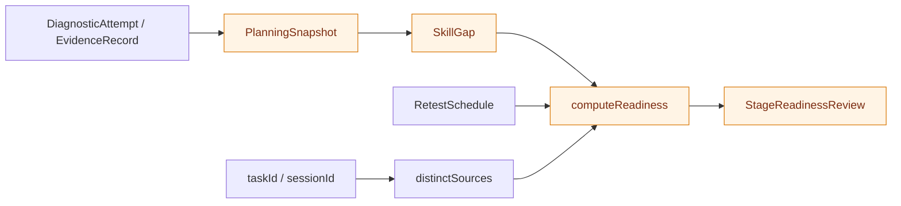
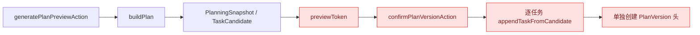
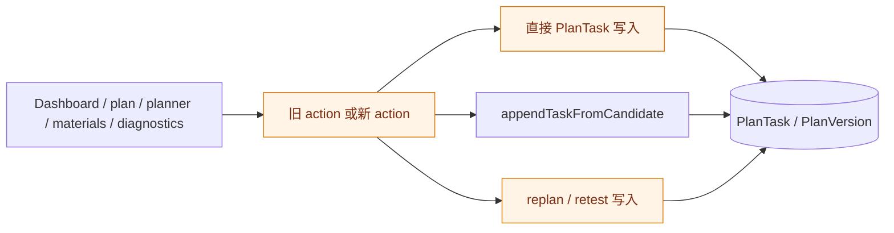
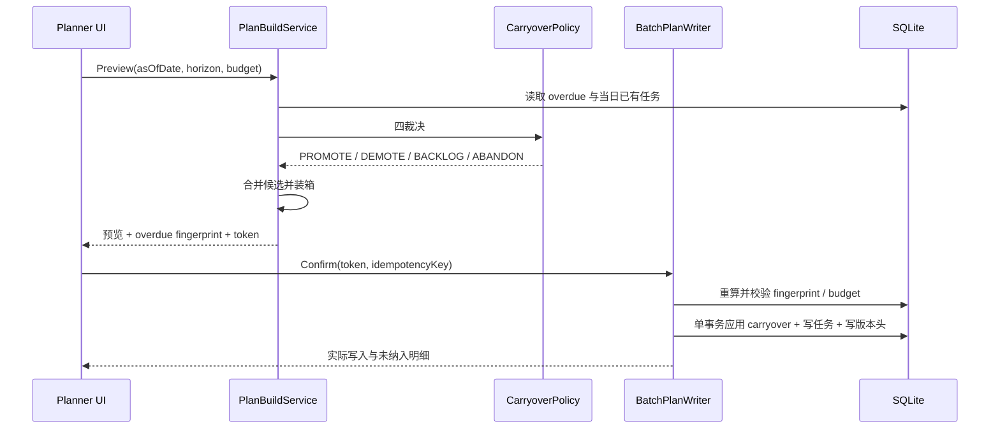
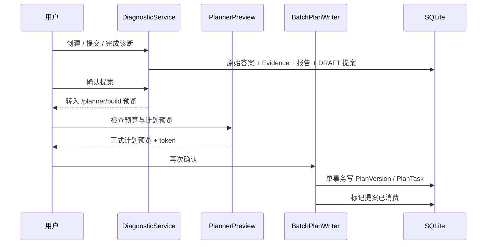

# IELTS Learning OS v2.7.1 Phase 0 审计与实施计划

- 审计日期：2026-11-26
- 审计基线：`main` @ `2a77648ccf935d6cd41e6077498e1e9ae5f159b6`
- 审计范围：v2.7.1 修复需求 P0 / P1 / P2、AC-01–AC-09、§8.2 的 14 个浏览器场景
- 本阶段性质：只读审计；除本文件外不修改业务代码、数据库、测试或发布文档
- 发布判断：**NOT READY FOR FIRST USE**

> 本文件中的 `DONE` 只表示静态代码与本次只读检查能够证明该项已实现，不表示 v2.7.1 的质量门禁已通过。历史测试报告、子任务执行声明和本次未执行的命令均不作为当前通过证据。
>
> 阶段 A 已实施并通过退出条件，真实命令与 NOT_RUN 清单见 `docs/49-v2.7.1-phase-a-test-report.md`；阶段 B 已实施并通过退出条件，真实命令、Chrome 验收与 NOT_RUN 清单见 `docs/50-v2.7.1-phase-b-test-report.md`；阶段 C 的 carryover、GENERATE 批量确认与 replan 退出条件已通过，真实命令、Chrome 验收与剩余项见 `docs/51-v2.7.1-phase-c-test-report.md`。本文件以下内容保留 Phase 0 审计时点，不代表阶段 A–C 后的业务修复状态。

## 1. 执行摘要

v2.7 已具备规划快照、候选评分、自适应装箱、预览/确认、五维 readiness、诊断和备份的基础设施，但 v2.7.1 要求的三条主链仍未闭合：

1. **真实证据 → readiness**：诊断覆盖率存在，却没有进入 `PlanningSnapshot` / `SkillGap`；生产 `coverageRatio` 恒为 `null`，D1 又把未知显示成 0%。
2. **过期任务 → carryover → 当日新计划**：纯函数和落库函数已存在，但 GENERATE 没有调用它们；确认逐任务独立提交，不能整批回滚。
3. **诊断 → PlanProposal → 正式 PlanVersion / PlanTask**：确认按钮只把提案标为 `ACTIVE`，不进入 `/planner/build`，也不创建正式计划。

此外，预算只在读侧统一，写侧仍有旧入口分叉；测试库仍复制真实 `dev.db`；没有浏览器自动化；时区不可配置；语音表没有数据库外键且没有生产删除闭环；备份只覆盖 SQLite，不覆盖上传文件。

当前数据库不是空白库：已有 **1 个 PlanVersion、8 个 PlanTask**。后续任何迁移、测试和恢复演练都必须保护这些历史行。

## 2. 基线、只读检查与真实性声明

### 2.1 Git 与数据库基线

本次实际执行：

```bash
git branch --show-current
git rev-parse HEAD
git status --short

sqlite3 -readonly "file:/Users/bing/ielts-learning-os/prisma/dev.db?mode=ro" \
  "PRAGMA integrity_check; PRAGMA foreign_key_check; ..."
```

结果：

| 检查 | 实际结果 | 结论 |
|---|---|---|
| 分支 / HEAD | `main` / `2a77648ccf935d6cd41e6077498e1e9ae5f159b6` | 与 v2.7 收尾提交一致 |
| 工作区 | 创建本文件前 `git status --short` 无输出 | 干净 |
| SQLite `integrity_check` | `ok` | 当前库页结构完整 |
| SQLite `foreign_key_check` | 无输出 | 当前已声明外键无违反；**不能证明无外键表没有孤儿** |
| 业务表数 | 115 | `CURRENT_STATE_AUDIT.md` 的 68 表是历史快照 |
| `AppMigration` | 8 条，v2.2–v2.7 连续登记 | 当前库迁移链完整 |
| `DiagnosticAttempt` | 0 | 尚无诊断作答 |
| `EvidenceRecord` | 0 | 尚无证据记录 |
| `PlanningSnapshot` | 0 | 尚无 v2.7 规划快照 |
| `StageReadinessReview` | 0 | 尚无 readiness 历史 |
| `PlanVersion` / `PlanTask` | 1 / 8 | 存在必须保护的计划历史 |
| `AudioAsset` 外键数 | 0 | 语音级联不能依赖数据库约束 |
| `UserProfile` | `dailyMinutes=240`、`timezone=Asia/Singapore`、`cefrTarget=B2` | `dailyMinutes` 是 v2.0 旧值，不是当前预算真值 |

迁移登记：

```text
v2.2=ee48308a202e845e
v2.3=69f80a2e69359092
v2.4=cd33fa7a275acad3
v2.4.1=1b7d89e54ddf565c
v2.4.2=2c5b43e6736cbed7
v2.5=6657ce882593958a
v2.6=7b5b2a5e9ee8e18f
v2.7=8563a351ba6ba475
```

现有计划历史：

- 最新版本：`2026-11-18`，`v2`，`REPLAN`，`budgetMinutes=90`，`snapshotId=NULL`，`layer=NULL`。
- 8 条任务日期为 2026-11-16、2026-11-18，模块为 `BASELINE_LISTEN` / `BASELINE_READ` / `BASELINE_OUTPUT`。
- 状态包含 `MISSED` / `DEFERRED`，一条任务 `actualMinutes=15`。
- 这些是 LEGACY/CORE 历史，不得被重新解释为 v2.7 候选证据，也不得在迁移或测试中清空。

### 2.2 本次未执行的验证

| 验证 | 状态 |
|---|---|
| `npm run typecheck` | `NOT_RUN` |
| `npm run typecheck:test` | `NOT_RUN` |
| `npm test` | `NOT_RUN` |
| `npm run build` | `NOT_RUN` |
| 当前 `npm run test:e2e` | `NOT_RUN`，且当前命令不是浏览器 E2E |
| 真实 AI Provider Smoke | `NOT_RUN` |
| 空库迁移 | `NOT_RUN` |
| 当前库副本迁移 | `NOT_RUN` |
| 数据库 + uploads 恢复演练 | `NOT_RUN` |
| 浏览器诊断到周报全链 | `NOT_RUN` |

`docs/45-v2.7-test-report.md` 记录的 133 文件 / 1,571 用例和生产构建通过属于 v2.7 历史结果，不能作为 v2.7.1 当前门禁。

## 3. 状态口径

- `DONE`：需求要求的实现和证据均存在；仍须在实施后回归。
- `PARTIAL`：已有部分基础设施，但关键行为、接线或验证缺失。
- `NOT_DONE`：核心要求未实现，或只有相反行为/占位实现。
- `NO_LONGER_APPLICABLE`：需求被明确取消或替换；本次没有 P0/P1 项属于此类。
- P2 可延期，但 `NOT_DONE` 不因延期而变成 `DONE`。

## 4. P0 / P1 / P2 状态矩阵

| 编号 | 状态 | 核心证据 | 缺口与影响 |
|---|---|---|---|
| P0-1 readiness 真实化 | PARTIAL | `src/lib/domain/readiness.ts:236-461` 已有 D1–D5；`src/lib/services/readiness.ts:54-172` 已装配并落库 | 生产覆盖率恒 `null`；无权威必测分母；UNKNOWN 显示 0%；D2–D5 样本条件不严格；历史规则版本未显式继承 |
| P0-2 carryover 接入 GENERATE | PARTIAL | `src/lib/domain/carryover.ts:81-260` 四裁决；`src/lib/services/carryoverApply.ts:36-98` 落库函数 | 生产 GENERATE 无调用；preview 无四组展示；token 无 overdue fingerprint；confirm 非单事务；replan 不自动锁滚入任务 |
| P0-3 预算与计划入口统一 | PARTIAL | `src/lib/domain/budget.ts:98-174` 唯一读侧规则；`src/lib/services/planWrite.ts:131-341` 单任务写入者 | `/plan`、Dashboard、诊断、replan、retest 仍有独立写链；GENERATE 整批非原子；材料预检漏已有任务和窗口外日期 |
| P0-4 诊断到正式计划闭环 | PARTIAL | `src/lib/diagnostic/service.ts` 已实现会话、INVALID、评分、报告；`src/lib/diagnostic/plan.ts` 生成 DRAFT | `activatePlanProposal()` 只标 `ACTIVE`，不写正式计划、不跳 planner；DAY/WEEK 无诊断仍可生成；报告审计字段展示不足 |
| P0-5 测试隔离 / 浏览器 E2E / 安装迁移 | NOT_DONE | `src/lib/__tests__/helpers/testDb.ts:64-104` 有统一助手；部分新测试已用 | 助手仍复制 `dev.db`；诊断等旧测试未迁移；无 Playwright/Cypress；`test:e2e` 不是浏览器；空库/副本/恢复未验证 |
| P0-6 时区 / 音频 / 备份 / 隐私 | PARTIAL | `UserProfile.timezone` 存在；诊断有 consent；存储有路径校验；SQLite backup/restore 已有 | 时区固定 UTC+8；语音无生产删除；13 张语音表 DDL 无 FK；备份不含 uploads；核心 AI 无统一 consent/预算原子闸门 |
| P0-7 文档与发布收尾 | NOT_DONE | v2.7 文档齐全 | README 仍写 240–300；CHANGELOG 仍“进行中”；Known Limits 未按 v2.7.1 重分类；v2.7.1 报告/清单未创建 |
| P1-1 估时校准 | PARTIAL | `src/lib/domain/adaptivePlan.ts` 支持拆分/最小块；候选有 `estMinutesSource` / `derivedFrom` | 仍是默认粗估；无历史 actual→estimate 校准；无估时模型版本 |
| P1-2 候选数据质量 | PARTIAL | `src/lib/services/candidateSources.ts:264-278` 已把无归属 MISTAKE 放 META；QUESTION 不猜阶段 | `SpeakingPrompt` 无 `active`，全部入池；QUESTION 无阶段前置；手工错题“未归属”提示不足 |
| P1-3 解释回读与冲突 | PARTIAL | `src/lib/queries/planner.ts:981-1093` 已回读 `decisionJson`；budget override 已进 token | GENERATE action 无 60→90 回归；P2002 未统一转 CONFLICT；解释仍缺 expectedOutput 等完整快照 |
| P1-4 Provider 状态与 Smoke | PARTIAL | `src/lib/ai/orchestrator.ts:338-395` 区分 `MOCK` / `OK` / 失败；日志有模型、Prompt、Token、耗时 | 无默认关闭的真实 Provider opt-in smoke；无完整状态呈现和兼容矩阵 |
| P1-5 Expected Output / AI 周主题 | NOT_DONE | `src/lib/services/planBuild.ts:108-128` 预览有 `expectedOutput`；周页明确未开放 AI | `TaskCandidate` / `PlanTask` 无持久列；解释查询恒 `null`；`suggestWeeklyTheme()` 无业务调用 |
| P2-1 `AIEngineSetting.id` DDL 默认不一致 | NOT_DONE（可延期） | Prisma 有 `@default("default")`；SQLite 实际 DDL 为 `TEXT NOT NULL PRIMARY KEY`，无 DEFAULT | 直接裸 SQL 插入可能依赖应用显式 id；表重建风险高，应延期并在 Known Limits 记录 |
| P2-2 旧集成测试全面迁移 | PARTIAL（可延期） | 新规划测试部分使用 `createTestDb` | 仍有一批 copy + 局部清理；本次 P0 至少须迁移 readiness/carryover/plan build/budget/diagnostics |
| P2-3 Provider 兼容矩阵 | NOT_DONE（可延期） | Provider 抽象已存在 | 无逐 Provider 能力、错误、结构化输出兼容矩阵 |
| P2-4 导入导出完整校验 | PARTIAL（可延期） | 已有 JSON/域导出 | 无完整版本、checksum、外键/孤儿、uploads 引用校验 |

## 5. 关键问题到代码路径

### 5.1 P0-1：readiness 尚未消费真实覆盖证据

当前生产数据流：



关键事实：

1. `src/lib/services/planningSnapshot.ts:295-328` 构造 `SkillGapSignal` 时，`coverageRatio: null`、`accuracyDelta: null` 是唯一生产赋值。约 `:725` 又原样落库到 `SkillGap`。
2. `src/lib/diagnostic/routing.ts:173-247` 和 `src/lib/diagnostic/service.ts:623-674` 已计算诊断覆盖率，但分母来自全库 active `DiagnosticItem` 去重集合，未按会话 blueprint、版本或阶段过滤，且结果只进入 `SkillProfileSnapshot.coverageJson`。
3. `src/lib/domain/readiness.ts:247-255` 使用 `g.coverageRatio ?? 0`，把 UNKNOWN 展示成 0%；`gaps.length === 0` 又直接视为覆盖 1。两者都不是“有效必测子维度 / 阶段必测子维度”。
4. `src/lib/domain/readiness.ts:219-222` 用覆盖率阈值近似缺口方向。D2 的“多来源一致”实际上不是逐来源评分一致性，同一 AI 多次调用也没有独立来源标识。
5. `src/lib/services/readiness.ts:82-120` 的 Evidence 查询有 `archivedAt: null`，但未按阶段、日期、有效完成状态、测试条件过滤；来源只取 `taskId` / `sessionId`，没有材料来源。
6. `src/lib/services/readiness.ts:125-145` 的 retest 查询没有阶段、技能、延迟间隔、平行材料、A0 或评分依据过滤，`materialRef` 恒为 `null`。
7. D4/D5 只要求至少一条 DONE 且分数达标，不要求每个技能都有保持/迁移证据；D3 只数 `assistanceLevel=A0`，未验证 Evidence 是否有效、完成、可追溯。
8. `src/lib/actions/planner.ts:367-405` 的阶段确认只检查 review 存在且未确认，不强制 `READY_FOR_REVIEW`，也不解析 `READ_ERROR`。虽然切换必须用户确认，但严格门禁不足。
9. `StageReadinessReview.ruleVersion` 在 `prisma/schema.prisma:3506-3511` 默认 `v2.7.0`；`persistReadinessReview()` 未显式继承 `PlanningSnapshot.ruleVersion`。当前常量恰好相同，但未来规则升级会漂移。
10. `src/lib/queries/diagnostics.ts:320-329` 对缺失覆盖率使用 `?? 0`，诊断报告也会把未知显示成 0。

已具备的正确防线：

- `computeReadiness()` 遇 `readErrors` 或任一 `INSUFFICIENT` 优先返回 `NEED_MORE_EVIDENCE`。
- `effectiveReadinessOutcome()` 在展示层再次把含 `READ_ERROR` 的明细降级。
- READY 只返回 `READY_FOR_REVIEW`，函数本身不切阶段。

### 5.2 P0-2：carryover 未进入生产 GENERATE

当前 GENERATE：



- `src/lib/services/planBuild.ts:224-229` 的 token 只签 `snapshotId + inputHash + budgetOverrideMinutes`，没有 overdue fingerprint。
- `src/lib/services/planBuild.ts:683-851` 不读取 overdue，不返回 PROMOTE / DEMOTE / BACKLOG / ABANDON。
- 全仓生产代码没有 `carryoverPolicy()` / `applyCarryover()` 调用；只有测试调用。
- `src/lib/actions/planner.ts:148-187` 逐任务调用各自开事务的 `appendTaskFromCandidate()`；任一失败时，之前任务已提交。约 `:201-217` 再单独写版本头。
- `confirmPlanVersionAction()` 无 override 时在 `src/lib/actions/planner.ts:207` 写 `budgetMinutes: 0`，而子任务版本写的是实际有效预算，版本头口径不一致。
- `src/lib/services/carryoverApply.ts:44-95` 无事务、状态守卫、幂等或版本快照；缺失任务静默跳过。
- `src/lib/services/replanPreview.ts:305-318` 只保护显式 locked IDs 与运行/计时状态；普通 TODO 滚入任务不会因 `movedCount` / `originalScheduledDate` 自动锁定。
- `DraftActions.tsx` / `ReplanPreviewBody.tsx` 没有四组 carryover 区块，版本详情没有 carryover 摘要。

说明：当前 buildPlan 预览不写 `PlanTask` / `PlanVersion`，但会写 `PlanningSnapshot` / 候选元数据。实施时须把“预览零写”明确为“不写计划与 carryover 状态”；若产品要求连快照也不写，需要另行改变草稿持久化设计，不能口头忽略。

### 5.3 P0-3：预算读侧统一，写侧仍分叉

`src/lib/queries/budget.ts:61-95` 的逐日与批量查询都调用 `resolveEffectiveBudget()`，这一部分已统一。优先级为：显式 `DailyBudget` → 未确认设置建议 → 已确认 weekday/rest day → 无配置建议 60；不会回落到 `UserProfile.dailyMinutes=240`。

仍分叉的入口：

| 入口 | 当前写入路径 | 审计结论 |
|---|---|---|
| `/planner/build` | `appendTaskFromCandidate()` 逐条 + 单独版本头 | 单条有预算闸门，整批无原子性；override 版本头错误 |
| `/materials` | `validateBatchBudget()` + `appendTaskFromCandidate({budgetPrevalidated:true})` | 预检不计当天已有任务；窗口外日期被跳过；逐条提交可能部分成功 |
| 手工新增 | `appendTaskFromCandidate()` | 已走统一单任务写入者 |
| `/plan` 旧生成 | `src/lib/actions/plan.ts:44-105` 直接 `createMany` | 保留 240–300 旧链，绕过唯一写入者 |
| Dashboard 快速生成 | 客户端分钟 + action upsert/createMany | 绕过唯一写入者 |
| 自适应旧生成 | `src/lib/actions/plan.ts:237-372` | 另一套生成/写入口 |
| replan | `src/lib/services/replanPreview.ts:431-521` / `src/lib/actions/replan.ts` | 自身事务，但预算来源和写入服务未统一 |
| retest | `src/lib/actions/retest.ts:143` | 直接创建 PlanTask |
| 诊断提案 | `src/lib/diagnostic/plan.ts:63-85` | 独立周预算聚合，fallback 为 `defaultDailyMinutes * 6`，不是逐日统一预算 |

材料确认的具体风险：

- `src/lib/actions/materialPack.ts:207-215` 只加载基准日起 7 天预算。
- `src/lib/domain/taskProposal.ts:313-338` 对 `days` 中不存在的日期直接 `continue`，不校验。
- `src/lib/schema/materialPack.ts:54-60` 允许任意合法 `finalDate`，没有限制在这 7 天。
- `src/lib/actions/materialPack.ts:507-514` 的批量预检没有加入当日已有 PlanTask。
- 随后 `src/lib/actions/materialPack.ts:539-553` 传 `budgetPrevalidated:true`，单条写入者跳过“已有任务 + 新任务”的闸门。
- 每条写入独立事务，失败后继续；只要至少一条成功，整份提案仍标 `confirmed`，形成部分提交。

### 5.4 P0-4：诊断报告与正式计划断开

当前诊断链本身已实现：

- 自述背景不直接变成等级；技术失败写 `INVALID`，不产生 Evidence、不计分。
- 原始答案 append-only；客观题确定性评分；开放题无 consent 或外部失败时保持 `NEEDS_REVIEW`。
- 低置信度建议补测；报告和提案追加保存。
- AI 结果保存维度、区间、置信度、rubric、evidence refs、limitations 和 `assessorType=AI`。

断点：

1. `src/lib/diagnostic/service.ts` 的 `activatePlanProposal()` 只更新 `PlanProposal.status='ACTIVE'` 和 `activatedAt`，不创建 `PlanVersion` / `PlanTask`。
2. `src/lib/actions/diagnostics.ts` 激活后只 revalidate `/diagnostics` 和 `/plan`，不进入 `/planner/build`。
3. `src/components/diagnostics/DiagnosticReport.tsx` 明确提示“不会自动创建今日任务，请在计划页手动排入”。
4. `src/lib/actions/__tests__/diagnostics.integration.test.ts` 明确断言激活后 PlanTask 数量不变，现有测试证明的是断点，而不是目标闭环。
5. `src/components/planner/build/PlanBuilderBody.tsx:55-65,121-133` 对无诊断只警告；DAY/WEEK 仍允许按通用模板生成，只有 MONTH/CYCLE 被阻断。
6. `src/app/page.tsx:74-95` 的空基线卡仍保留“开始今日计划”，可能把未诊断用户导向旧入口。
7. 报告 DTO 未完整暴露 Prompt 版本、脱敏模型标识、题目 ID / evidence ID、技术无效原因；`coverageRatio ?? 0` 把未知显示成 0。
8. `finalizeDiagnosticSession()` 的画像快照、报告、提案、会话完成状态不在同一事务，存在部分写入风险；新诊断是否自动把旧报告标 `SUPERSEDED` 也不明确。

### 5.5 P0-5：测试与发布门禁

- `src/lib/__tests__/helpers/testDb.ts:64-104` 仍 `copyFileSync(prisma/dev.db)`，只清调用方声明的表；未声明表继承本机状态。它不是从空 schema 构建的测试库。
- `src/lib/actions/__tests__/diagnostics.integration.test.ts:13-18` 自己复制 `dev.db` 且不清理表，直接依赖当前库。
- carryover / planningChain 等测试还存在漏清 `Stage` 等表的情况。
- `package.json:13` 的 `test:e2e` 是三个 `tsx` 领域脚本加两个 Vitest 集成文件；`scripts/e2e-v21.mts` 自己声明不是 HTTP 层。
- 仓库没有 Playwright / Cypress / Puppeteer 依赖或浏览器测试目录。
- 没有 CI workflow；`package.json` 版本仍为 `1.0.0`。
- `scripts/verify.sh:6,23-44` 没有 `set -e`，并会执行 `npm i`、`prisma db push`、seed、test、build；它不是安全的空库迁移/发布门禁，不能对真实库运行。
- `prisma/seed.ts` 不写假学习记录、错题、词汇或成绩，但空库 `db push + seed` 不登记 `AppMigration`，与迁移安装路径是两套机制。

### 5.6 P0-6：时区、语音、备份与隐私

**时区**

- `prisma/schema.prisma:39-55` 有 `UserProfile.timezone`，默认 `Asia/Singapore`。
- `src/lib/schema/settings.ts:1-34` 明确不接受时区；设置 action / UI 未开放。
- `src/lib/date.ts:1-72` 与 `src/lib/constants.ts:81-83` 固定 UTC+8。
- `src/lib/storage.ts:34`、`planningSnapshot.ts:320`、`vocabIntegration.ts` 等仍用 UTC `toISOString().slice(0,10)`；`ai/meter.ts` 用服务器日/月界。
- 没有跨午夜、跨周、IANA 时区和 DST 测试。

**语音与上传**

- 需求列 9 张听说表；实际 v2.5 为 13 张：`AudioAsset`、`Transcript`、`TranscriptSegment`、`ListeningExercise`、`ListeningAttempt`、`ListeningError`、`SpeakingPrompt`、`SpeakingSession`、`SpeakingTurn`、`RecordingAsset`、`ASRResult`、`SpeechEvaluation`、`AudioTechnicalCheck`。
- `scripts/migrations/v2.5.mjs:33-191` 建表/索引，但没有 `FOREIGN KEY`；当前 `AudioAsset` 外键数实测为 0。
- 没有生产语音删除 action/service；`src/lib/storage.ts:99-107` 的 `deleteUploadedFile()` 无业务调用且吞掉删除错误。
- 路径校验只挡词法 `../`，未解析 symlink；MIME、扩展名、时长主要信任客户端，无魔数/容器校验。
- 已有大小限制和 SHA-256 元数据，但不能替代真实媒体校验。

**备份恢复**

- `scripts/backup.sh:121-149` 使用 SQLite `.backup` / `VACUUM INTO`，检查 integrity 和四表行数；不覆盖 `storage/uploads`。
- 没有 bundle manifest、文件清单、SHA-256 checksum、应用/迁移版本、全量 FK/孤儿校验。
- `scripts/restore.sh:159-175,218-245,285-348` 有 integrity、两步确认和覆盖前安全网，但只恢复 SQLite。
- 完整 DB + uploads 备份恢复到临时目录的演练尚未执行。

**AI 隐私**

- 诊断开放题有 `externalAiConsent`；核心 orchestrator / tutor / material 没有统一 consent 闸门。
- 已有 AES-256-GCM、密钥权限、Key 脱敏、日志 metadata 脱敏和 MOCK/EXTERNAL 展示基础。
- `src/lib/ai/orchestrator.ts:234-293` 先聚合日志再调用 Provider，预算检查和调用不是原子的；0 预算与并发存在穿透窗口。
- 输入没有统一的总 token / 文本 / 音频时长硬上限；没有默认关闭的真实 Provider opt-in smoke。

## 6. 当前调用链与目标调用链

### 6.1 当前计划入口



目标：保留 `/plan` 作为 Legacy 兼容页可以，但所有新的正式计划写入必须经过同一个批量提交服务；页面只负责预览和用户确认，不维护第二套预算或版本真值。

### 6.2 目标 GENERATE + carryover



### 6.3 目标诊断到正式计划



诊断报告确认不是正式计划激活；必须保留第二次确认。提案激活失败或计划确认失败不得覆盖旧报告。

## 7. 数据模型与迁移影响

| 领域 | 建议方案 | 迁移风险 | 历史保护 |
|---|---|---|---|
| readiness 必测分母 | 增加显式、版本化的阶段技能子维度要求配置；优先复用 `DiagnosticBlueprint` / `DiagnosticItem` 元数据，不建第二套题库 | 中：需要确定 stage↔blueprint 映射；错误分母会系统性假 PASS/FAIL | 新配置只对新评审生效；历史 `criteriaJson` 原样保留 |
| readiness 结果明细 | 扩展 `StageReadinessReview.criteriaJson`，存分子/分母、必测清单、缺失/无效样本、computedAt、blueprint/rule version | 低：JSON 追加，不改旧行 | 显式继承快照 `ruleVersion`；禁止重算历史结论 |
| carryover | 优先复用 `PlanTask` 现有 `originalScheduledDate` / `movedCount` / 优先级/原因字段；版本 `beforeSnapshot` / `afterSnapshot` 存完整裁决和 fingerprint | 中：需要整批事务和状态守卫；`planVersion` 只是整数，不是版本头 ID | 不物理删除；ABANDON 保留审计；旧 8 条任务不自动滚存 |
| 正式计划批量写入 | 在 `planWrite` 增加接收 tx 的批量原语，外层负责一个事务；单任务 action 复用同一原语 | 中：SQLite 单写者；并发 P2002 要转 CONFLICT | 版本 append-only；idempotency key 唯一 |
| 诊断提案 | `PlanProposal` 增加“已消费 / 关联正式版本”审计信息，或写入 `rationaleJson` + 新版本引用 | 低到中：不得把 ACTIVE 直接等同于正式计划 | 旧 DRAFT/ACTIVE 保持原义，迁移时标记 legacy 状态 |
| 估时版本 / Expected Output |  additive 可空列或持久快照 JSON；历史行保持 null / 原值 | 低：纯加法；不得回填猜测值 | 历史解释不得重算 |
| 时区 | 复用 `UserProfile.timezone`，增加设置校验和统一日期解析服务；原始 timestamp 不改写 | 中：影响所有业务日界；错误会造成跨日统计漂移 | 保留原始 UTC timestamp 与原业务日期，变更为显式操作 |
| 语音删除 | v2.7.1 优先应用层逻辑删除 + tombstone + 子记录一致处理 + 物理文件清理；不首选 SQLite 表重建 | 低到中：需覆盖 13 表引用和文件失败重试 | 保留最小证据索引；删除前展示影响并二次确认 |
| 语音外键 | 若要数据库 FK，必须表重建，先在副本演练；不与其他大迁移并行 | 高：SQLite 重建、索引、关系、孤儿、回滚 | 不在 v2.7.1 默认范围内强行实施 |
| 备份 bundle | SQLite + `storage/uploads` + manifest + checksums + app/migration version | 中：原子发布、路径越界、恢复目标隔离 | 恢复只在临时目录演练，不覆盖当前库 |
| `AIEngineSetting.id` | P2 延期；若修复则单独版本、副本演练 | 高：表重建或默认值变更 | 不通过裸 SQL 绕过约束 |

约束：

- 新迁移必须登记 `AppMigration(version, checksum)`，幂等、先备份、后 integrity/FK/关键表行数核对。
- 空库安装也必须走同一版本链，不能以 `db push + seed` 替代迁移验证。
- 严禁 `db push` / reset / 清表作用于真实 `prisma/dev.db`。
- 语音、预算、计划批量写入三组相互依赖的数据库/计划改动不得一次性并行实施。

## 8. 测试缺口与必须新增的矩阵

### 8.1 测试隔离

1. 新建测试库助手必须从明确 schema 创建空库，再按 fixture 插入定义数据；不得复制真实 `dev.db`。
2. 提供 `empty` 与 `seeded` 两种确定性 fixture；测试只读/写临时库。
3. 本次至少迁移 diagnostics、readiness、carryover、planBuild、budget 相关集成测试。
4. 并发测试使用独立临时库和真实 SQLite 约束，验证 P2002、事务回滚、幂等，不以 mock 代替。
5. 增加“测试运行前后真实 dev.db checksum 不变”的守护检查。

### 8.2 readiness 用例

- 每个 D1–D5：PASS、FAIL、INSUFFICIENT、READ_ERROR 正向/负向/缺失矩阵。
- UNKNOWN / NOT_OBSERVED 不显示 0%；已知分母且有效完成 0 才显示 0%。
- 必测分母固定，不随已出现记录消失；按 skill/subdimension 独立计算。
- 技术失败、中止、无效录音、AI 超时、无评分依据不进入分子/分母，单独列原因。
- 同一 AI 多次调用不算多来源；材料/任务/会话来源可追溯。
- D4 验证延迟间隔、新题/平行题；D5 验证新材料/主题/情境。
- READY 不自动切阶段；READ_ERROR 阻断确认切换；历史 review 不随后续证据变化。

### 8.3 carryover / budget / plan 用例

- Preview 不写 PlanTask / PlanVersion / carryover 状态。
- Confirm 单事务；任一步失败全部回滚。
- 重复 Confirm 不重复增加 movedCount、不重复建任务。
- 修改 overdue 任务 ID、原日期、优先级、movedCount、splittable、planned/actual/minChunk 或预算后 Confirm 返回 CONFLICT。
- 四裁决上限：条数、分钟、最大移动次数；ABANDON 不物理删除。
- 滚入任务在 replan 中 locked，不能普通 DEFER。
- 无 PlannerSettings 时逐日/批量预算逐字段一致。
- 30 / 60 / 90 / 120 / 240、周末、休息日、自定义合法边界。
- Preview 60、Confirm 90 必须在 action 级返回 CONFLICT。
- 材料确认计已有任务；窗口外日期拒绝；部分失败不得把提案标 confirmed。
- GENERATE 版本头记录真实有效预算，不再无 override 写 0。

### 8.4 §8.2 十四个浏览器场景

| # | 场景 | 当前状态 |
|---|---|---|
| 1 | 全新数据库启动和首次打开 | NOT_RUN；安装路径未验证 |
| 2 | Dashboard 显示尚未建立基线 | 代码部分具备，NOT_RUN |
| 3 | 创建并完成至少一个完整诊断路径 | 旧集成部分覆盖，浏览器 NOT_RUN |
| 4 | 报告打开原始证据和评估依据 | UI 部分具备，字段不足，NOT_RUN |
| 5 | 低置信度安排补测 | 代码部分具备，NOT_RUN |
| 6 | PlanProposal 预览不写正式 PlanTask | DRAFT 不写，浏览器 NOT_RUN |
| 7 | 用户确认后正式生成计划 | **当前断链** |
| 8 | 60 分钟预算生成且不超时 | 代码部分具备，NOT_RUN |
| 9 | 预览后改预算，Confirm CONFLICT | token 已签名，action 回归缺失 |
| 10 | carryover Preview 零写、Confirm 单写、重复幂等 | **未接线** |
| 11 | carryover 任务 replan 受保护 | **未实现自动锁定** |
| 12 | 复习/复测优先排入 | 规则存在，NOT_RUN |
| 13 | 学习记录、Evidence、周报一致 | NOT_RUN |
| 14 | 导出、备份、恢复可用 | uploads 备份缺失，NOT_RUN |

### 8.5 AC 状态

| AC | 状态 | 说明 |
|---|---|---|
| AC-01 首次安装 | PARTIAL | seed 静态审计无假成绩；首页有基线提示；空库迁移未执行 |
| AC-02 诊断路径 | PARTIAL | 主行为存在；报告审计字段、事务和旧报告状态不完整 |
| AC-03 readiness | NOT_DONE | UNKNOWN、真实分母、来源和 D1–D5 矩阵缺失 |
| AC-04 carryover | NOT_DONE | 生产 GENERATE 未接线 |
| AC-05 预算一致性 | PARTIAL | 读侧统一，写侧分叉，材料与版本头有缺陷 |
| AC-06 数据与时区 | NOT_DONE | 时区不可配；语音删除与完整恢复未实现 |
| AC-07 浏览器 E2E | NOT_DONE | 无浏览器自动化 |
| AC-08 质量门禁 | NOT_RUN | 当前 checkout 未执行完整门禁 |
| AC-09 文档 | NOT_DONE | v2.7.1 文档未收尾 |

## 9. 分阶段实施计划

原则：先测试基建和只读口径，再单领域接线；每阶段独立可回滚；数据库与计划模块不并行混改。

### 阶段 A：测试底座与只读基线

1. 实现从空 schema 构建的测试库助手和 empty/seeded fixtures。
2. 迁移 diagnostics / budget / readiness / carryover / planBuild 测试。
3. 增加 dev.db checksum 守护和真实 SQLite 并发测试。
4. 重新运行 typecheck、typecheck:test、全量 test/build，记录命令、环境、退出码、时间。
5. 产出 v2.7.1 测试报告骨架；未执行项写 NOT_RUN。

退出条件：测试不再读取真实库；当前门禁有真实结果。

### 阶段 B：readiness 真实证据口径

1. 审计并固化 stage→blueprint→skill/subskill 必测分母，版本化。
2. 从有效 DiagnosticAttempt / EvidenceRecord / RetestSchedule 装配覆盖明细。
3. 修正 UNKNOWN、0%、无缺口和 D2 来源语义；D3–D5 加有效条件。
4. `StageReadinessReview` 显式继承 ruleVersion，criteriaJson 存完整证据快照。
5. 阶段确认强制 READY 且无 READ_ERROR；READY 仍只建议，用户确认才切换。
6. UI 展示分子/分母、清单、缺失、无效原因、Evidence IDs、computedAt、snapshotId、补测建议。

退出条件：AC-03 全矩阵通过；历史 review 不变。

### 阶段 C：统一批量计划写入与预算

1. 把 `appendTaskFromCandidate()` 核心抽取为可接收 tx 的批量原语。
2. GENERATE 在一个事务内写所有任务和一个版本头，预算 override 进 token 和版本头。
3. 修复材料确认：计入已有任务、拒绝窗口外日期、整批原子、部分失败不确认。
4. `/plan` 明确 Legacy；Dashboard 与诊断计划不再直接写另一套真值。
5. replan / retest 接入统一预算与写入边界；P2002 统一转 CONFLICT。

退出条件：AC-05 通过；旧入口不再产生第二套预算/版本语义。

### 阶段 D：carryover 接入

1. GENERATE preview 读取 overdue，调用纯函数生成四裁决，零写计划状态。
2. token 纳入完整 overdue fingerprint；Confirm 重算校验。
3. Confirm 在阶段 C 的批量事务内先应用 carryover，再写新任务和版本摘要。
4. 状态守卫、幂等、P2002、回滚；滚入任务在 replan 自动 locked。
5. 预览四组 UI 与版本详情摘要。

退出条件：AC-04 与浏览器场景 10/11 通过。

### 阶段 E：诊断到正式计划

1. 诊断报告补齐 Prompt/模型/Rubric/题目/Evidence/无效原因，未知覆盖率不落 0。
2. 报告、画像、提案、会话状态原子提交；新报告不覆盖旧报告。
3. 提案确认后转 `/planner/build` 预览，不直接写正式计划。
4. 正式确认通过阶段 C/D 的统一写入者，并记录提案与版本关联。
5. 无有效诊断时 Planner 所有层显示“先建立初始基线”；Dashboard 不引导悄悄生成完整课程。
6. 诊断预算复用逐日有效预算，不再独立推算。

退出条件：AC-02 与浏览器场景 3–7 通过。

### 阶段 F：时区、语音、备份与隐私

1. 时区设置与 IANA 校验；统一业务日界服务；跨午夜/跨周/DST 测试。
2. 语音采用应用层逻辑删除 + tombstone；影响预览、二次确认、子记录处理、文件清理重试。
3. 上传魔数/容器/时长/MIME/扩展名校验；symlink 防护；权限与删除错误可见。
4. 统一 AI consent、OFF 模式、必要片段、总 token/音频上限、原子预算闸门。
5. DB + uploads bundle、manifest、checksum、版本；临时目录完整恢复演练。

退出条件：AC-06 与浏览器场景 14 通过。

### 阶段 G：浏览器 E2E 与发布收尾

1. 引入浏览器自动化，仅使用临时数据库和临时 uploads 目录。
2. 完成 §8.2 十四场景与 AC-07 全链。
3. 增加默认关闭的真实 Provider opt-in smoke，结果标 MOCK / REAL_PROVIDER / NOT_RUN。
4. 更新 README、CHANGELOG、Known Limits、用户指南、迁移/回滚步骤。
5. 新增 `v2.7.1-fix-report.md`、`v2.7.1-test-report.md`、`v2.7.1-release-checklist.md`。
6. 全部 P0 + AC-01–AC-09 通过后才标记 Ready for First Use；P1 延期须逐项写降级。

## 10. 迁移与回滚风险清单

1. **当前库有历史计划**：8 PlanTask / 1 PlanVersion，任何清空式 fixture 或迁移演练都可能损坏用户历史。
2. **readiness 分母错误比 null 更危险**：错误配置会制造假 PASS；必须先固定版本化分母和负向用例。
3. **GENERATE 非原子**：当前失败可能已写部分任务；新事务实现前不得直接接 carryover。
4. **carryover 会移动历史任务**：必须有 fingerprint、状态守卫、幂等和完整 before/after 快照。
5. **语音表重建高风险**：13 表、无 FK、文件在 DB 外；不在 v2.7.1 默认实施。
6. **空库安装与迁移链分叉**：`db push + seed` 不登记 AppMigration，必须改为可重复迁移验证。
7. **时区影响面广**：涉及计划、复习、周报、AI 计量和文件日期；不能只改设置页。
8. **备份不完整**：只恢复 DB 会得到指向不存在音频的引用；必须 bundle 恢复。
9. **回滚无 down 脚本**：v2.7 依赖迁移前备份恢复；v2.7.1 每个迁移也须先备份并验证副本。
10. **测试助手继承本机状态**：可能把当前 8 条任务等历史当成 fixture，必须先建空库助手。

## 11. 文档修正清单

| 文档 | 当前问题 | v2.7.1 处理 |
|---|---|---|
| `README.md` | 开头与 §7 仍写 240–300；声称“27 与 NAV_ITEMS 对齐”，实际 `src/lib/constants.ts:1086-1120` 的 `NAV_ITEMS` 有 31 项；测试隔离陈述过时 | 改为动态预算、Legacy/新入口边界、真实测试方式 |
| `CHANGELOG.md:5` | v2.7 仍“进行中” | 标记完成，新增 v2.7.1 真实完成项 |
| `docs/47-v2.7-known-limits.md` | 未按 RESOLVED / STILL_OPEN / DEFERRED 重分类；“解释回读未实现”已落后 | 保留历史，新增 v2.7.1 状态列 |
| `docs/45-v2.7-test-report.md` | 历史报告不能覆盖 | 原样保留，新增 v2.7.1 测试报告 |
| `docs/48-v2.7-migration-guide.md` | “10 个索引”口径需明确 | 按迁移脚本显式 `CREATE INDEX` 统计；v2.7 实际有 14 条显式建索引语句，含 4 条 UNIQUE；若含 Prisma 自动唯一索引则总数不同，不能混用 |
| `CURRENT_STATE_AUDIT.md` | v2.4.1 历史快照，68 表已过时 | 明确历史文档，新增当前审计引用，不改写历史事实 |
| 用户指南 / 设置说明 | 时区、AI 外发、语音删除、备份恢复说明不足 | 补充实际操作、影响和回滚步骤 |

## 12. Phase 0 结论

- P0 全部尚未完成：P0-1 / P0-2 / P0-3 / P0-4 / P0-6 为 `PARTIAL`，P0-5 / P0-7 为 `NOT_DONE`。
- 当前不能标记 Ready for First Use，也不能建议用户开始正式连续学习。
- 下一阶段应先做阶段 A 测试底座，再按 B → C → D → E → F → G 串行推进；不得并行改动预算、批量计划、carryover 和语音迁移。
- 本文件是审计与实施计划，不是修复完成报告；所有实施后的代码、迁移、测试和文档仍须真实执行并单独交付。
